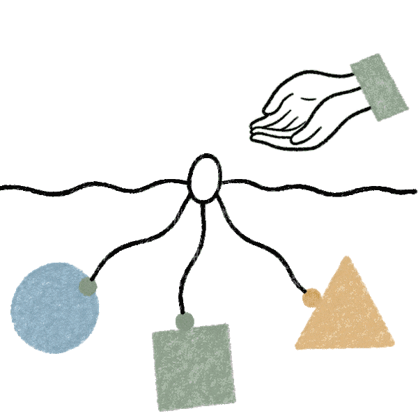
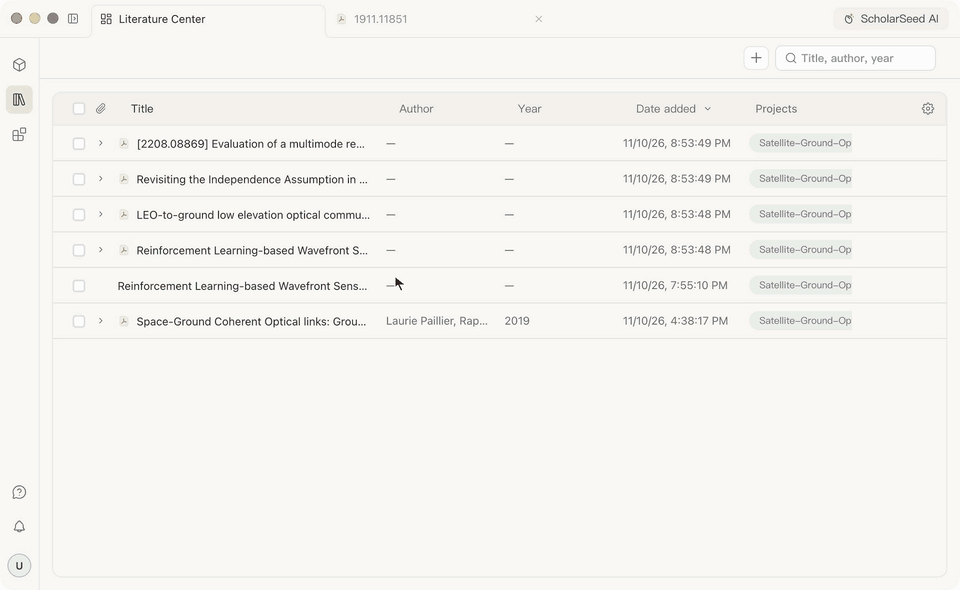
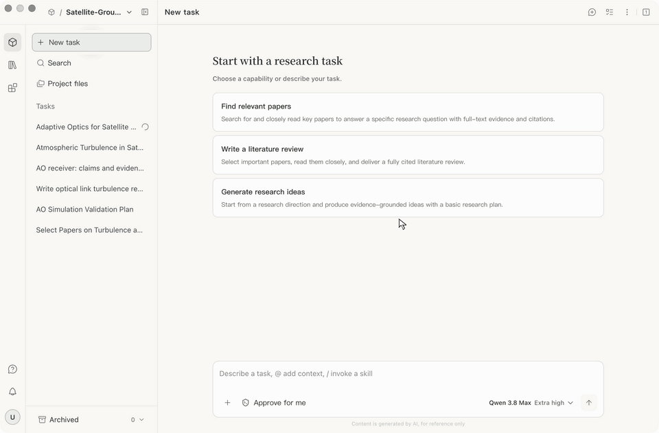
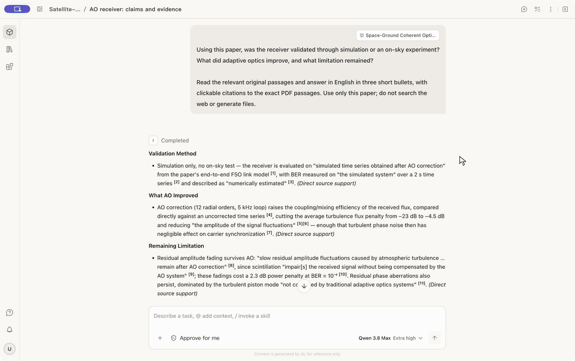
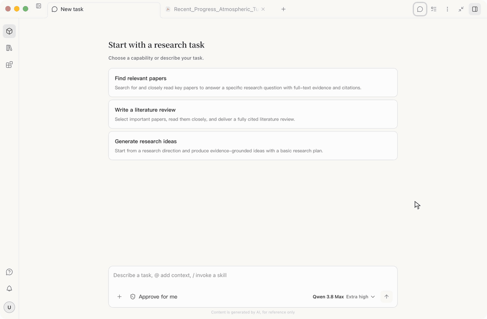
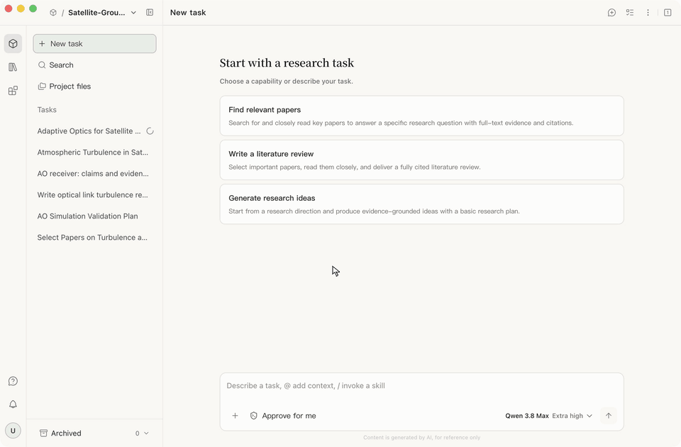
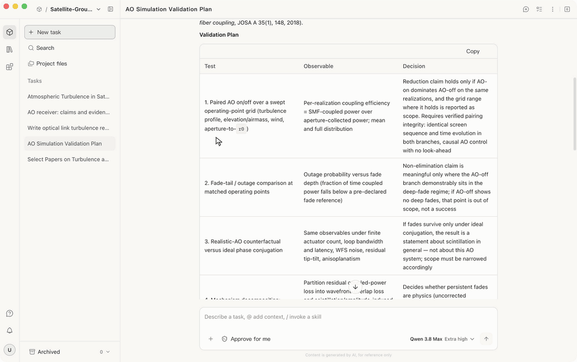

<p align="center">
  <a href="https://scholarseed.damo.alibaba.com/">
    
  </a>
</p>
<p align="center">
  <a href="https://scholarseed.damo.alibaba.com/">
    
  </a>
</p>

<h2 align="center">Where your ideas, documents, and AI stay connected.</h3>
<p align="center">Read, ask, verify, and build on yesterday's work, with your own models, on your own machine.</p>

<p align="center">
  <b>PDF reader</b> · <b>Literature library</b> · <b>Evidence-linked answers</b> · <b>Research skills</b> · <b>Your models</b> · <b>Local-first</b>
</p>

<p align="center">
  <a href="https://scholarseed.damo.alibaba.com/"></a>
  <a href="https://scholarseed.damo.alibaba.com/download.html"></a>
  <a href="LICENSE"></a>
  <a href="https://github.com/alibaba-damo-academy/ScholarSeed/releases"></a>
  <!-- TODO: add CI badge once a public workflow runs on main -->
  <!-- TODO: Linux badge when a Linux build ships -->
  <!-- TODO: community badge (Discord / WeChat / Slack) once one channel is chosen -->
</p>

<p align="center">
  <a href="#quick-start">Quick start</a> ·
  <a href="#why-scholarseed">Why</a> ·
  <a href="#what-it-does">Features</a> ·
  <a href="#recipes">Recipes</a> ·
  <a href="#integrations">Integrations</a> ·
  <a href="#for-developers">For developers</a> ·
  <a href="README_zh.md">中文</a>
</p>

<!-- Hero animation. Until a screen recording exists, the two product GIFs from
     the homepage work as a hero pair. Swap for assets/readme/hero.gif
     (select a sentence → ask → citation opens the passage) when recorded. -->
<p align="center">
  
</p>

---

## Why ScholarSeed?

Most "AI for research" tools are a chat box next to your real work. You paste in a PDF, get an answer, and lose track of where it came from. Next week you start over.

| The pain | What ScholarSeed does instead |
|---|---|
| "I copy passages into a chatbot and lose where the claim came from." | Highlight a passage in the reader and ask. Answers carry `scholarseed-cite:` links that open the exact source passage. |
| "Every session starts from zero." | Papers, notes, conversations and results live in a **project**. Yesterday's comparison is tomorrow's context. |
| "The agent runs off and writes a report I can't steer." | Skills stop at **checkpoints** (candidate lists, selections, confirmations). You pick the papers; the agent does the reading. |
| "I don't want my library and notes on someone else's server." | Local SQLite storage, your own model keys, your Zotero. Everything stays on your machine except model calls you select. |
| "My lab reviews literature our own way." | Write a **Skill** that encodes your method. Share it on the Skill Hub (soon). |
| "I don't trust an agent with my files." | Each agent runs in an isolated, sandboxed process with pinned binaries, projected MCP config, and per-directory authorization you can inspect. |
| "I cannot get the features I want." | Tell us about them in Discord or WeChat group, or clone the source and use AI to create them. |

---

## Quick start

**1. Install** — grab the installer from **[scholarseed.damo.alibaba.com/download.html](https://scholarseed.damo.alibaba.com/download.html)** (macOS Apple silicon, macOS Intel, Windows x64)

**2. Add a model** — Register to use Qwen or add a model from Settings → Models. <!-- TODO: screenshot of the Models settings page -->

**3. Import one PDF or your Bib/Ris/Zotero library**.

**4. Open the PDF and select a sentence and ask** — right-click → *Explain* (or *Translate*).

**5. Check the answer** — click the citation. It should open the passage you selected. If it does, everything is wired up.

<!-- TODO: `scholarseed doctor` / "Copy diagnostics" command for bug reports.
     The CLI already has inspection modules (service/cli/inspection.py,
     desktop_inspection.py); expose one command and document it here. -->

---

## What it does

<!-- Grouped by what a researcher is trying to do, not by code module.
     Only list things that work today. Future items go in Roadmap. -->

### Read
- PDF reader with outline navigation, annotations, and look-back to earlier highlights.
- Select-to-explain and select-to-translate, in the reader, no copy-paste.
- Page-by-page translation and AI reading notes.
- Figure and caption extraction; PDFs rendered in an isolated process.
- Library previews for DOCX, XLSX, PPTX and Markdown alongside PDFs.

<p align="center">
  
</p>

### Find
- Multi-round literature discovery (`agentic-search`) that infers the entities behind a vague question and returns a precision-first candidate set.
- OpenAlex and arXiv metadata, DOI / arXiv / PubMed identity matching, duplicate detection against your library.
- Full-text acquisition with fallbacks for non-open sources, and a receipt of what was fetched and how.
- Import from Zotero; export BibTeX.

<p align="center">
  
</p>

### Verify
- Every AI claim can carry a citation that opens the source passage.
- Citation-coverage checks: answers that cite nothing are visible as such.
- A trace viewer (`damoatrace`) that shows every turn, model call, token count and tool result — searchable, with secrets redacted.

<p align="center">
  
</p>

### Write
- `literature-review` produces a structured review from the papers you confirmed.
- Bundled, hash-verified TeX Live toolchain: LaTeX output works without installing TeX.
<!-- TODO (future): LaTeX editing in the workbench — live preview, BibTeX
     from the library, cite-as-you-write. Today LaTeX is produced by the
     review skill, not edited in-app. Move this line to the Roadmap table
     or expand it here once the editor ships. -->
- Report and PPTX export.

<p align="center">
  
</p>

### Extend
- **Skills**: 13 bundled (`agentic-search`, `precise-literature-search`, `literature-review`, `research-idea-partner`, `design-research-validation`, `pdf-evidence`, `web-search`, `fast-search`, `project-literature`, `find-skill`, `plugin-create`, …). <!-- regenerate this list from skills/community/ -->
- **Skill Hub** — a browsable, installable catalogue of community skills with scan verdicts shown before install. **Soon.**
  <!-- The audit pipeline (capabilities/service/audit.py, SAFE verdicts) and the
       ClawHub client already exist; what's missing is the public catalogue + UI.
       When it ships: add "Browse the Skill Hub →" here and a "Publish your
       skill" section under For developers. -->
- **Plugins**: React UI cards rendered in the conversation, via the `window.scholarseedUI` SDK.
- **Connectors**: Zotero, GitHub, GitLab, Hugging Face, Notion, Elicit, Firecrawl — API key or OAuth.
- **Custom MCP servers**: bring your own.

<p align="center">
  
</p>

### Trust & local-first
- Local SQLite; projects are folders you own. Data lives in `~/.scholarseed` (override with `SCHOLARSEED_HOME`).
- Agents run in isolated homes with plugins, hooks and marketplaces disabled, MCP config projected explicitly, secrets passed by environment, binaries pinned by SHA-256.
- Native per-directory authorization (Windows job-object broker, macOS leases), notarized and Authenticode-signed builds.
- Every skill result that touches full text requires your explicit grant.

<p align="center">
  
</p>

---

## Bring your own model

<!-- Counts from apps/serve/service/settings/capabilities.*.json on
     2026-11-07. Regenerate per release. Do not list individual model names
     that cannot be verified publicly. -->

| Provider | Models in catalog |
|---|---|
| Alibaba (Qwen) | 34 |
| OpenAI | 9 |
| Anthropic (Claude) | 6 |
| DeepSeek | 6 |
| Zhipu (GLM) | 6 |
| Moonshot (Kimi) | 5 |
| **Any OpenAI-compatible endpoint** | your `base_url` + API key (or a custom auth header) |

Switch models per conversation. Keys stay on your machine.

**Coming:** first-class presets for **Google Gemini** and for local models via **Ollama, vLLM and LM Studio**; and **Claude Code** as a second agent runtime next to Codex. See [Roadmap](#roadmap).

---

## Recipes

<!-- Named playbooks: a goal, the skill chain, the outcome, rough time.
     These make abstract skills concrete. Each should be a real tested run;
     link a short screen recording per recipe when you have one. -->

| Recipe | Chain | You get | Time |
|---|---|---|---|
| **Literature review in an afternoon** | `agentic-search` → you confirm candidates → `literature-review` | A structured review with citations into the PDFs you approved, optional LaTeX | ~2–3 h |
| **Is this idea new?** | `research-idea-partner` → `agentic-search` → `check-research-novelty` <!-- verify this skill ships; it's in the host skill list but not skills/community --> | Closest prior work, claim-by-claim differences | ~30 min |
| **Before I run the experiment** | `design-research-validation` → `review-research-ideas` <!-- same check --> | A validation plan, alternative explanations, what evidence would change the conclusion | ~20 min |
| **Read one hard paper** | Import → outline → select-to-explain → `pdf-evidence` | Annotated PDF plus an evidence-linked summary in the project | ~1 h |
| **Keep a running search** | `incre-literature-search` <!-- verify this ships --> across sittings | Only what's new since last time, de-duplicated against your library | ongoing |

<!-- TODO: screen recordings; one per recipe, ≤60 s. -->

---

## Integrations

**Literature**

<p align="center">
  <a href="https://www.zotero.org" title="Zotero"></a>&nbsp;&nbsp;&nbsp;
  <a href="https://arxiv.org" title="arXiv"></a>&nbsp;&nbsp;&nbsp;
  <a href="https://openalex.org" title="OpenAlex"><b>OpenAlex</b></a>&nbsp;&nbsp;&nbsp;
  <a href="https://elicit.com" title="Elicit"><b>Elicit</b></a>
</p>

**Code & docs**

<p align="center">
  <a href="https://github.com" title="GitHub"></a>&nbsp;&nbsp;&nbsp;
  <a href="https://gitlab.com" title="GitLab"></a>&nbsp;&nbsp;&nbsp;
  <a href="https://huggingface.co" title="Hugging Face"></a>&nbsp;&nbsp;&nbsp;
  <a href="https://www.notion.so" title="Notion"></a>
</p>

**Web**

<p align="center">
  <a href="https://www.firecrawl.dev" title="Firecrawl"><b>Firecrawl</b></a>&nbsp;&nbsp;&nbsp;
  <a href="https://brave.com/search/api/" title="Brave Search"></a>
</p>

**Models — today**

<p align="center">
  <a href="https://www.alibabacloud.com/en/product/modelstudio" title="Alibaba Cloud Model Studio (Qwen)"></a>&nbsp;&nbsp;&nbsp;
  <a href="https://platform.openai.com" title="OpenAI"><b>OpenAI</b></a>&nbsp;&nbsp;&nbsp;
  <a href="https://www.anthropic.com" title="Anthropic"></a>&nbsp;&nbsp;&nbsp;
  <a href="https://www.deepseek.com" title="DeepSeek"></a>&nbsp;&nbsp;&nbsp;
  <a href="https://www.zhipuai.cn" title="Zhipu"><b>Zhipu</b></a>&nbsp;&nbsp;&nbsp;
  <a href="https://www.moonshot.cn" title="Moonshot (Kimi)"></a>
</p>

**Models & agents — coming**

<p align="center">
  <a href="https://claude.com/claude-code" title="Claude Code (agent runtime)"></a>&nbsp;&nbsp;&nbsp;
  <a href="https://ai.google.dev" title="Google Gemini"></a>&nbsp;&nbsp;&nbsp;
  <a href="https://ollama.com" title="Ollama"></a>&nbsp;&nbsp;&nbsp;
  <a href="https://docs.vllm.ai" title="vLLM"></a>&nbsp;&nbsp;&nbsp;
  <a href="https://lmstudio.ai" title="LM Studio"></a>
</p>

<!-- TODO: setup guides — Zotero (most requested), a custom MCP server, a
     custom / local model endpoint. Each ≤1 screen, with one "Pro tip". -->

---

## For developers

<!-- Developer proposition: "a foundation for AI research apps".  -->

ScholarSeed is a working research application you can extend rather than a framework you must assemble. PDF handling, the library, projects, model routing, sandboxing, citations, and the UI are already there.

### Build from source

Requires Git, **Node.js 24.16.0**, **pnpm 12.14.0**, **uv ≥ 0.12.11**, and your platform's native build tools. On macOS:

```bash
xcode-select --install
```

On Windows x64, follow the [Windows setup](CONTRIBUTING.md#windows); the build scripts fetch the pinned native compiler themselves.

```bash
git clone https://github.com/alibaba-damo-academy/ScholarSeed.git
cd ScholarSeed
pnpm ops pre   # pinned JS + Python deps, Office assets, bundled Skill pack
pnpm ops dev   # starts Electron
```

Run both on a fresh clone; afterwards `pnpm ops dev` alone, and rerun `pnpm ops pre` after dependency or Skill changes. The first run needs internet. No separate Python install or Git LFS is needed.

- Package a macOS DMG or Windows EXE: [Packaging](CONTRIBUTING.md#packaging).
- Rebuild the Skill pack: `pnpm ops cd build local --target skills`; check it against source: `pnpm ops ci check skills product --mode source`.
- Windows gotchas: [Electron download stalls](CONTRIBUTING.md#windows-download-diagnostics), [stale ACL policy outputs](CONTRIBUTING.md#windows-checkout-line-endings), [private build directory rejection](CONTRIBUTING.md#windows-private-build-directory).
- Optional env vars: [`.env.example`](.env.example). Never commit keys, tokens, session data or certificates.

### Architecture

```text
Electron / React
      │ HTTP + SSE
      ▼
ScholarSeed Serve (FastAPI)
      │ commands + events
      ▼
Runtime Gateway ──► Codex Adapter ──► Codex App Server (sandboxed)
      │
      └────────────► DamoATrace evidence recording
```

<!-- TODO: replace the ASCII diagram with assets/readme/architecture.svg; mark
     Skills, Plugins and MCP as the three extension points. -->
     
| Path | Responsibility |
| --- | --- |
| `apps/desktop/` | Electron + React desktop application |
| `apps/serve/` | FastAPI product backend and the `scholarseed` distribution |
| `packages/runtime/` | Runtime-neutral contracts, provider discovery, event-driven gateway |
| `packages/adapters/codex/` | Codex App Server process integration and protocol translation |
| `packages/damoatrace/` | Independent trace contracts, recording, storage, query, CLI |
| `packages/ui/` | React SDK for conversation cards (plugins) |
| `skills/community/` | Research skills compiled into the product |
| `tests/` | Cross-package contracts, integration, acceptance, release gates |


### Extension points

**Write a Skill** — a folder with `SKILL.md`. Encode your lab's method; the agent follows it inside the sandbox.

**Write a UI plugin** — a React card that renders in the conversation. The `window.plugin` bridge gives you `submit`, `save`, `request`, `onState`. Pack and validate offline with `python -m service.cli.plugins`.
<!-- TODO: link packages/ui/example and doc/plugins.md (currently Chinese; needs an
     English version); state SDK version + compatibility policy
     (packages/ui/contract.ts exposes `version` and `compatibility`). Say
     plainly: "SDK is pre-1.0; breaking changes are listed in CHANGELOG." -->

**Add a runtime** — the agent engine sits behind a typed contract (`packages/runtime`): sessions, events, permissions, sandbox, MCP, secrets, incidents. Providers are discovered through the `scholarseed_runtime.providers` entry point and enabled in `product.json`. The Codex adapter (`packages/adapters/codex`) is the reference implementation; a **Claude Code** adapter is planned.

**Observe everything** — `damoatrace` is a standalone trace CLI + web UI (SQLite FTS5 search, per-session digests, token/cost rollups, secret redaction) with no dependency on the agent.
<!-- TODO: finish the rename; the package still references damoagent and
     ~/.veda paths. Consider publishing it on PyPI on its own. -->

**What's under the hood**
- Electron 44 + React + Vite desktop; FastAPI backend on an embedded relocatable CPython 3.12; native C modules for leases, authorization and signing checks.
- ~3,000 test and contract files; bilingual eval scenarios with independent LLM judges and explicit `not_evaluated` / `inconclusive` verdicts.
<!-- TODO: make `pnpm test` / `uv run pytest` instructions public and
     accurate; link CONTRIBUTING.md; add 5–10 `good first issue` labels
     (new skill, new connector preset, UI card) -->

---

## Roadmap

<!-- Only promise what is scheduled. Mark each with a target quarter or
     "exploring". Move items up into "What it does" as they ship, with a
     🆕 tag and date for one release. -->

| Area | Status |
|---|---|
| **Skill Hub** — browse, audit, install community skills, scan verdict shown before install | **soon** |
| **Claude Code** as a second agent runtime | planned |
| **Google Gemini** provider preset | planned |
| **Local models** — Ollama, vLLM, LM Studio presets with model discovery (reachable today via an OpenAI-compatible `base_url`) | planned |
| LaTeX editor in the workbench with cite-from-library | planned |
| Linux build | exploring |

---

## Community & contributing

<!-- Pick ONE primary channel and repeat it here, in Quick start, and in the
     issue template. The homepage already shows a WeChat QR
     (assets/scholarseed-community-qr.png on the site); reuse it. -->

- <!-- TODO --> Chat: Discord / WeChat group link
- Issues: use *Copy diagnostics* <!-- TODO: once the command exists --> and paste the output.
- Contributing: see [CONTRIBUTING.md](CONTRIBUTING.md). Good first issues: <!-- TODO: label link -->.
- Built by Alibaba DAMO Academy, Decision Intelligence Lab.

### Built on

ScholarSeed stands on a lot of other people's work. Thank you to:

| Area | Projects |
|---|---|
| Agent runtime | [OpenAI Codex](https://github.com/openai/codex) App Server 0.165.0 · [MCP Python SDK](https://github.com/modelcontextprotocol/python-sdk) |
| Literature | [Zotero](https://www.zotero.org) · [zotero-mcp](https://github.com/54yyyu/zotero-mcp) · [OpenAlex](https://openalex.org) · [arXiv](https://arxiv.org) · [Brave Search](https://brave.com/search/api/) |
| PDF & documents | [PDFium](https://pdfium.googlesource.com/pdfium/) via [pypdfium2](https://github.com/pypdfium2-team/pypdfium2) · [pypdf](https://github.com/py-pdf/pypdf) · [pdfplumber](https://github.com/jsvine/pdfplumber) · [python-docx](https://github.com/python-openxml/python-docx) · [python-pptx](https://github.com/scanny/python-pptx) · [openpyxl](https://foss.heptapod.net/openpyxl/openpyxl) |
| Office preview | [docx-preview](https://github.com/VolodymyrBaydalka/docxjs) · [ExcelJS](https://github.com/exceljs/exceljs) · [pptx-renderer](https://github.com/aiden0z/pptx-renderer) · [emf-converter](https://github.com/ChristopherVR/emf-converter) · Zeta Office engine (wasm) with [Fontconfig](https://www.freedesktop.org/wiki/Software/fontconfig/) and [FreeType](https://freetype.org) <!-- confirm the Zeta engine's upstream name and license before publishing --> |
| Writing | [TeX Live](https://tug.org/texlive/) 2026 · [Milkdown](https://milkdown.dev) · [CodeMirror](https://codemirror.net) |
| Desktop | [Electron](https://www.electronjs.org) 44 · [React](https://react.dev) · [Vite](https://vite.dev) / [electron-vite](https://electron-vite.org) · [electron-builder](https://www.electron.build) · [Velopack](https://velopack.io) (Windows updates) · [Tailwind CSS](https://tailwindcss.com) · [i18next](https://www.i18next.com) · [Playwright](https://playwright.dev) |
| Backend | [FastAPI](https://fastapi.tiangolo.com) · [python-build-standalone](https://github.com/astral-sh/python-build-standalone) CPython 3.12 · [uv](https://github.com/astral-sh/uv) · [DuckDB](https://duckdb.org) · [httpx](https://www.python-httpx.org) · [Pydantic](https://pydantic.dev) · [truststore](https://github.com/sethmlarson/truststore) |
| Tools shipped in the package | [ripgrep](https://github.com/BurntSushi/ripgrep) · [PowerShell](https://github.com/PowerShell/PowerShell) 7.6 (Windows) |
| Fonts | [IBM Plex Mono](https://github.com/IBM/plex) · [Newsreader](https://github.com/productiontype/Newsreader) · [Noto Serif SC](https://fonts.google.com/noto) |
| README logos | [Simple Icons](https://simpleicons.org) (CC0; marks remain their owners' trademarks) |

<details>
<summary><b>Troubleshooting</b></summary>

<!-- TODO: collapsed. Start with the three most common: Windows sandbox
     setup / VC++ redistributable (see PR #6), model key rejected, PDF
     fails to open. -->

</details>

<details>
<summary><b>Screenshots</b></summary>

<!-- TODO: 6–9 images, one per surface: Reader, Library, Project, Evidence
     panel, Skill center, Model settings, Trace viewer, Review output. -->

</details>

## License

Apache-2.0. See [LICENSE](LICENSE).
