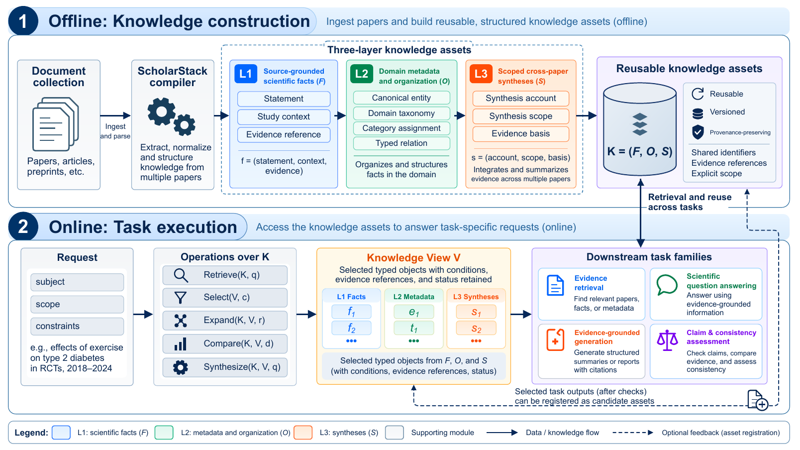
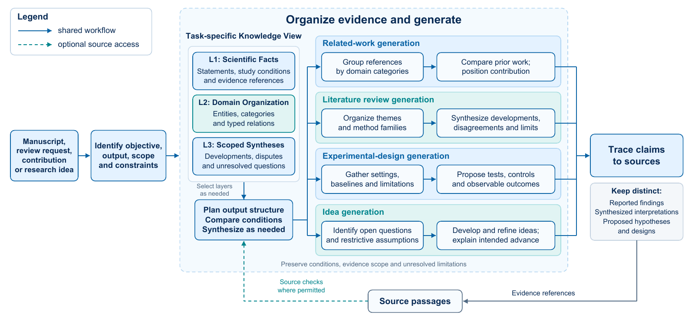
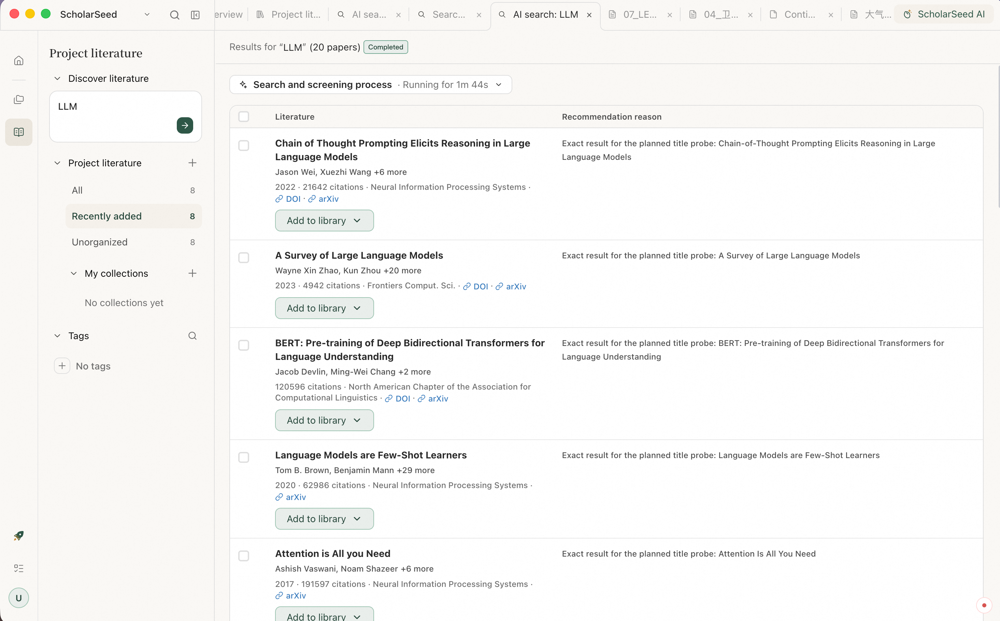
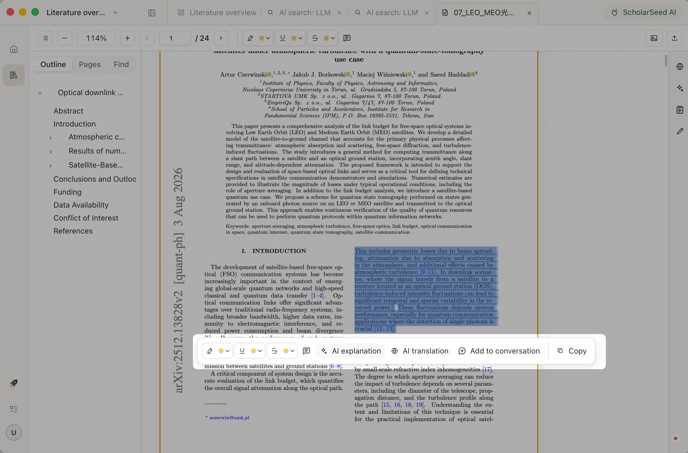
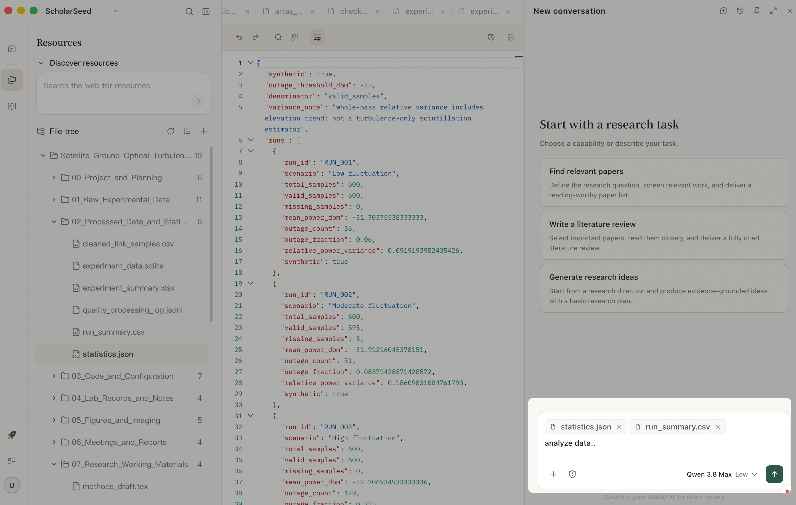
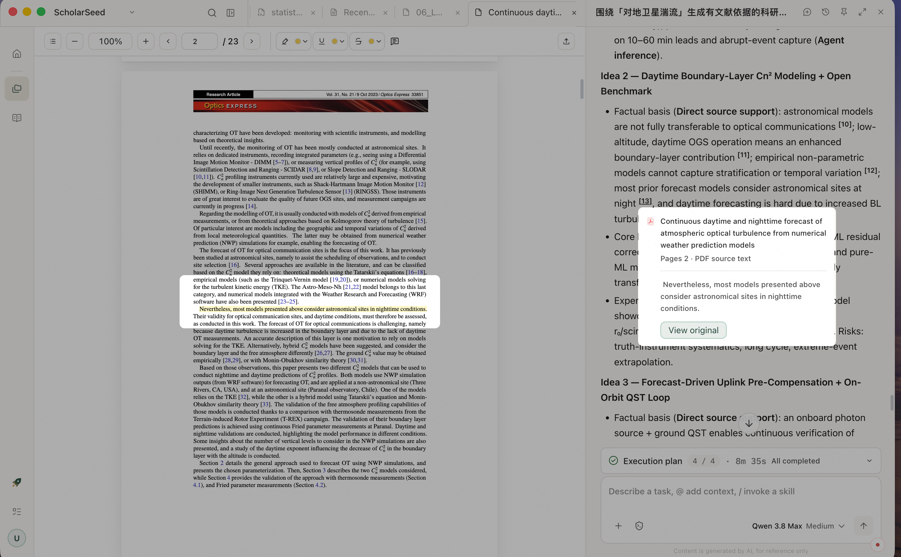
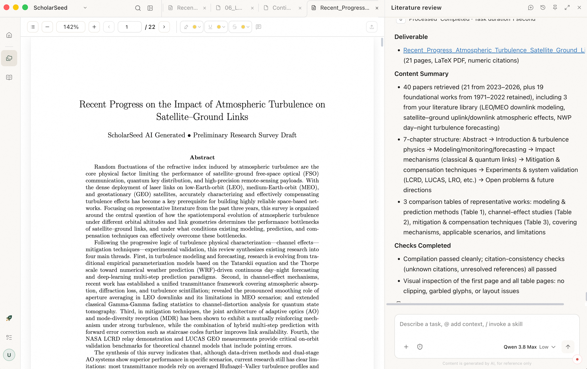

<div align="center">

# ScholarSeed

**Turn every reading session and insight into your next research step.**

**English** · [简体中文](README_zh.md)

[](LICENSE)


[Why ScholarSeed](#why-scholarseed) · [Research Paper](#research-paper) · [From Papers to Progress](#from-papers-to-progress) · [Get Started](#get-started) · [Installation](#run-from-source) · [Development](#development) · [Community](#community-and-support)

</div>

ScholarSeed is a local-first AI research workbench built around your projects. It brings literature search, reading and annotation, AI discussions, and research writing into one place. Start with a paper or a question, then turn your materials and ideas into research outputs you can check, refine, and build on.

## Why ScholarSeed

- **One workbench for a continuous research process.** Find papers, read, take notes, discuss ideas with AI, and revise drafts in the same workspace. Organize materials around your project to spend less time switching tools and rebuilding context.
- **Traceable citations, evidence you can inspect.** View the sources and supporting passages behind AI responses, and return to the original text where a location is available. Keep reading, analysis, and writing connected to evidence you can check.
- **An AI partner that builds on your research context.** Bring papers, notes, project files, and past conversations into each discussion. Every reading session, follow-up question, and revision can become a starting point for the next step.
- **Local-first, with your research in your hands.** Store and manage research materials and outputs locally, and connect your own model service. When you use cloud models or online search, the configured services process the relevant requests.
- **Research Skills for reusable workflows.** Use Skills for literature discovery, review writing, and research idea exploration, or extend the workbench with workflows that fit how you work.

---

## Research Paper

**ScholarStack: Layered Research Asset Orchestration and Cross-Task Reuse for Scientific Agents**

ScholarSeed AI Team

### Let understanding from one task support the next

Research accumulates across tasks. Methods and terminology identified during search help organize a review; disagreements and limitations found in that review motivate new ideas; comparisons made during novelty assessment inform experimental baselines. When this understanding remains inside a single conversation or report, later tasks must reread the same papers and reconstruct earlier judgments.

**ScholarStack organizes source facts, domain structure, and cross-paper understanding into reusable research assets.** It preserves both what individual papers report and how studies relate, together with their sources, study conditions, scope, and versions. Scientific agents can draw on this shared foundation across retrieval, question answering, writing, and claim assessment.



*Figure 1 from the paper: compile a document collection into research assets, then assemble task-specific Knowledge Views. Tasks use the layers they need. Selected task outputs may be registered as candidate assets after checks; registration does not itself establish semantic verification.*

### Three layers connecting source evidence and research understanding

| Layer | What it preserves | How it supports subsequent research |
| --- | --- | --- |
| **L1 · Source-grounded facts** | Reported findings, methods, hypotheses, and limitations, with study conditions, source locations, and checking states | Answer specific questions and verify values and claims while retaining the conditions under which findings apply |
| **L2 · Domain organization** | Canonical entities, domain categories, assignments, and relations linked to their evidence | Align terminology across papers, organize research directions, and establish dimensions for method comparison |
| **L3 · Scoped cross-paper syntheses** | Interpretations across studies, with explicit coverage, supporting, opposing, and limiting evidence | Trace methodological developments, disagreements, and open questions to inform reviews and research planning |

Agents retrieve, select, expand, compare, and synthesize assets into a task-specific **Knowledge View**. Single-paper questions may primarily use L1; cross-paper comparisons can combine L2 with original study conditions; reviews may additionally use L3. When a source or asset changes, dependent judgments require rechecking, while earlier versions retain the basis of previous outputs.

### From literature understanding to research outputs

The same assets support multiple tasks: organizing references and positioning contributions in related work; synthesizing themes, developments, and disagreements in reviews; recovering settings, baselines, and limitations for experimental design; and identifying open questions for new research ideas.



*Figure 4 from the paper: tasks combine the required layers to organize, compare, and synthesize evidence, with claims linked back to sources. Reported findings, synthesized interpretations, and proposed hypotheses remain distinct.*

### Selected experimental results

The paper evaluates **ten settings across four task families: literature retrieval, scientific question answering, evidence-grounded generation, and claim and consistency assessment**. Selected results from the current manuscript are shown below.

| Task and evaluation scope | Comparator | ScholarStack |
| --- | --- | --- |
| **Multi-paper QA** · MDAQA, 797 questions (Table 9) | Full-text: total score **8.46 / 20**; mean **20.8k tokens / question** | Total score **18.41 / 20**; mean **5.5k tokens / question**, approximately **73% fewer** |
| **Literature review generation** · ReportBench-ML, 25 tasks (Table 13) | Claude Code DeepResearch: RACE overall score **7.54 / 10** | RACE overall score **9.18 / 10**; comprehensiveness **9.23** and insight **9.30** |
| **Experimental design** · 12 fields, 38 targets (Table 14) | Full-text: coverage F1 **0.398**; mean **20.7k tokens / task** | Comparable coverage F1 of **0.404**; mean **12.4k tokens / task**, approximately **40% fewer** |

The multi-paper QA total sums five dimensions (out of 20). Both QA and review quality use model-based judging; the review results compare complete workflows. Token figures cover query or generation time and exclude initial asset construction. The small experimental-design F1 difference is not interpreted as a quality improvement. See the paper for task-specific settings, metrics, and evaluation scope.

## From Papers to Progress

### Explore the Literature

Import local PDFs or papers from Zotero, or describe a research question and let AI help find and screen relevant work. Gather the papers worth reading into your research project.



### Capture Your Thinking

Highlight passages, annotate papers, and take notes as you read. Use AI to help understand methods, equations, and figures. Keep your questions and observations alongside the literature for later comparison and discussion.



### Continue the Discussion

Bring papers, notes, and project files into the conversation. Compare methods, examine disagreements, and explore research ideas that are worth testing with the resources you have.



### Check the Evidence

Follow citations in an answer to inspect its sources and supporting passages. Return to the original text to compare the AI's analysis with what the paper actually concludes, and form your own judgment.



### Turn Insights into Progress

Develop your research materials into a cited literature review, related-work section, or research report. Add evidence, refine the structure, and revise the wording. Save the result as a project file you can build on in your next round of research.



## Get Started

After installing and launching ScholarSeed, configure your own model service or sign in to use services enabled for your ScholarSeed account.

1. Create a project and import a paper or a collection of research materials.
2. Choose a model and add the relevant materials to an AI conversation.
3. Describe your research question, check the citations in the response, and save your notes or generated draft.

## Architecture

ScholarSeed is a monorepo. The root `pyproject.toml` coordinates an uv workspace; each application and package owns its source, dependencies, and distribution boundary.

```text
Electron / React
      │ HTTP + SSE
      ▼
ScholarSeed Serve
      │ commands + events
      ▼
Runtime Gateway ──► Codex Adapter ──► Codex App Server
      │
      └────────────► DamoATrace evidence recording
```

| Path | Responsibility |
| --- | --- |
| `apps/desktop/` | Electron + React desktop application |
| `apps/serve/` | FastAPI product backend and the `scholarseed` distribution |
| `packages/runtime/` | Runtime-neutral contracts, provider discovery, and the event-driven gateway |
| `packages/adapters/codex/` | Codex App Server process integration and native protocol translation |
| `packages/damoatrace/` | Independent trace contracts, recording, storage, query, and CLI |
| `skills/community/` | Research skills compiled into the product |
| `tests/` | Cross-package contracts, integration tests, acceptance tests, and release gates |

The executable Agent provider currently included by ScholarSeed is Codex. Runtime discovers providers through the `scholarseed_runtime.providers` entry point; product enablement is controlled by `product.json`. The removed proprietary Harness and the historical `damoagent` namespace are not part of this repository.

## Requirements

- Git and Git LFS
- Node.js `24.16.0`
- npm `11.13.0`
- Python `3.12+`
- uv `0.12.11+`
- Native build tools for the target platform

Installers are built natively for macOS arm64, macOS x86_64, or Windows x86_64. Cross-platform packaging is not supported.

## Run From Source

Clone the repository with Git rather than downloading a source archive so that Git LFS resources are available:

```bash
git clone <repository-url>
cd Scholarseed
git lfs install
git lfs pull
npm ci
npm run dev
```

`npm run dev` prepares the repository-pinned Python runtime and development environment before starting Electron. You normally do not need to install the workspace packages manually.

`npm run dev` enables DevTools and the copy-session-ID button by default on macOS and Windows. Set `SCHOLARSEED_DEVTOOLS=0` to disable them.

## Model and Service Configuration

ScholarSeed requires a model connection that you are authorized to use. Configure the provider endpoint, model name, and credential in the application settings. Local HTTP authentication and model authorization are separate concerns: a healthy local service does not imply that a model account is authorized.

Optional development and service variables are documented in [`.env.example`](.env.example). Do not commit API keys, access tokens, user configuration, session data, certificates, or private keys.

`UPLOAD_BASE_URL` enables the optional paper-card upload service. When it is not configured, ScholarSeed reports the missing configuration instead of connecting to an internal or historical endpoint.

## Local Data and Privacy

The default user data directory is `~/.scholarseed`. Set `SCHOLARSEED_HOME` to use a different location.

- User-level configuration, credentials, project registry, session catalog, and literature data are managed under `SCHOLARSEED_HOME`.
- Project-owned data is stored under `<project>/.scholarseed/` and travels with the project directory.
- Codex state is isolated under the ScholarSeed home unless an explicit source home is configured.
- DamoATrace records product-visible diagnostic events for debugging; it does not imply access to undisclosed executor internals.

Keep user data and credentials outside the repository. Review diagnostic bundles before sharing them.

## Development

Common repository commands are exposed from the root `package.json`:

```bash
# Build the desktop application
npm run build

# Run deterministic desktop tests
npm run desktop:test

# Check Python types
npm run python:typecheck

# Check formatting and import rules
npm run fmt-check

# Inspect the local toolchain and runtime
npm run doctor
```

`npm run check` runs static checks; it is not a substitute for real Electron, backend, model, and tool-flow acceptance.

## Packaging

Build installers on the matching native operating system:

```bash
# Build and verify an unpacked application without signing or an installer
npm run package:check

# Build a local development installer
npm run package

# Build a release installer; signing and notarization credentials come from CI
npm run package:dist
```

| Target | Native build host | Installer |
| --- | --- | --- |
| macOS arm64 | Apple Silicon macOS | DMG |
| macOS x86_64 | Intel macOS | DMG |
| Windows x86_64 | Windows x64 | NSIS EXE |

Release credentials must be supplied through protected CI variables or the local secure credential store. Certificates, private keys, notarization secrets, and internal upload addresses must never be committed.

## Community and Support

Scan the QR code below to join the ScholarSeed community and discuss your experience and research questions.


Share bugs and feature requests through Issues, or contribute code, research Skills, documentation, and examples through pull requests.

When reporting a problem, include your operating system, application version, steps to reproduce, and expected behavior. For contributions, describe the problem you are solving and how you verified the change; include screenshots for interface changes.

If ScholarSeed helps your research, give it a star and share the research problems you would like it to help solve.

## License

ScholarSeed's original source code is licensed under the [Apache License 2.0](LICENSE).

Third-party software, assets, and bundled runtimes remain under their respective licenses. Their licenses are not replaced by Apache-2.0. Available notices include:

- [Desktop dependencies and corresponding source notices](apps/desktop/resources/notices/README.md)
- [Office viewer third-party notices](apps/desktop/src/renderer/public/office/THIRD_PARTY_NOTICES.md)
- [`paper-fulltext-dl` third-party notices](skills/community/precise-literature-search/vendor/THIRD_PARTY_NOTICES.md)
