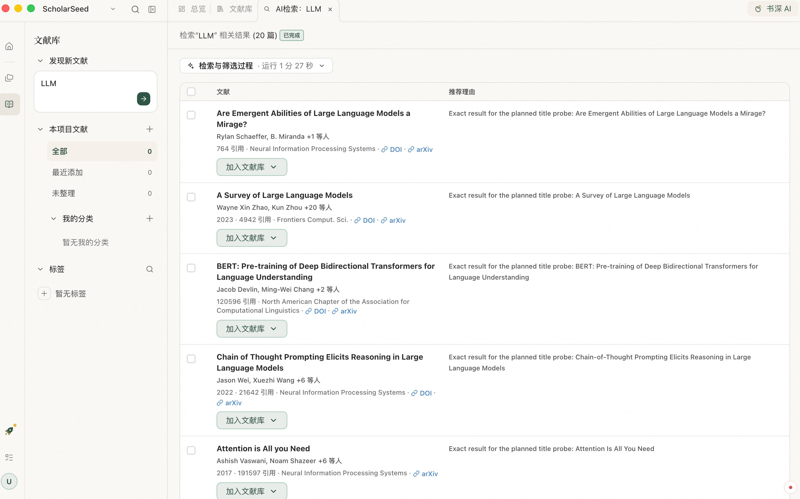
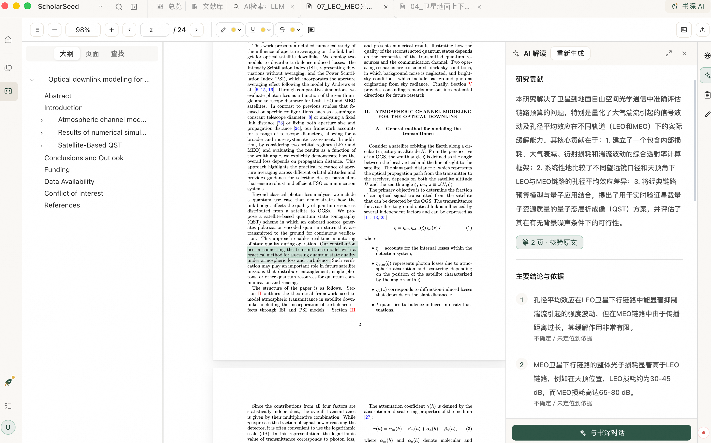
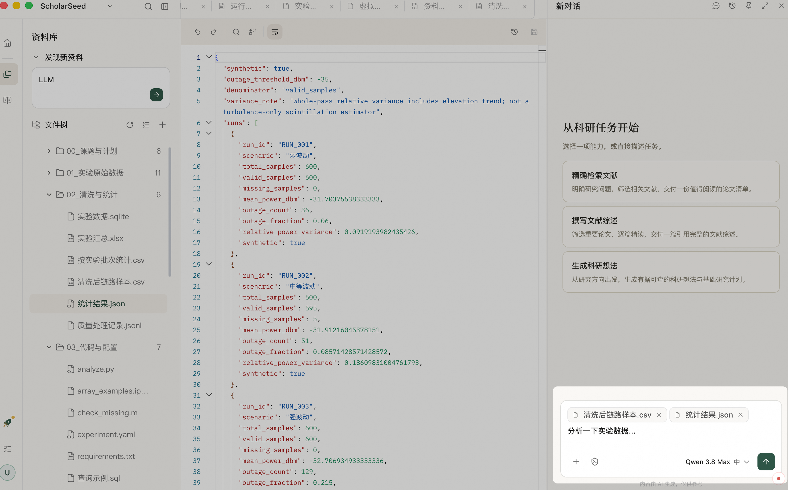
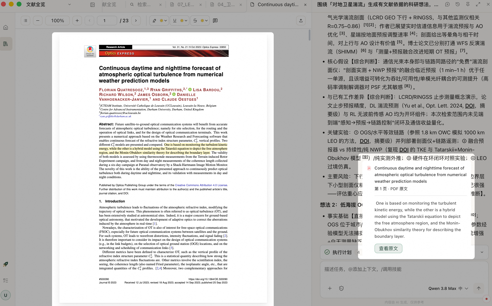
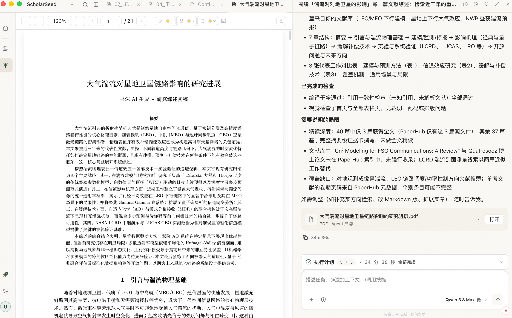

<div align="center">

# ScholarSeed · 书深

[English](README.md) · **中文**

**让每一次阅读与思考，生长为下一步研究。**

[为什么选择书深](#为什么选择书深) · [从文献到成果](#从文献到成果) · [快速开始](#快速开始) · [安装](#安装) · [本地开发](#本地开发) · [社区与支持](#社区与支持)

</div>

书深是一款以研究项目为中心的 AI 科研工作台，将文献检索、阅读批注、AI 讨论与成果写作连接在一起。从一篇论文、一个问题开始，让分散的资料与思考逐步积累为有依据、可继续推进的研究成果。


## 为什么选择书深

- **一体化工作台，让研究连贯发生。** 在同一工作空间里查文献、读论文、记笔记、与 AI 讨论和修改文稿。围绕课题组织材料，减少工具切换与反复搬运上下文。
- **引用可溯源，让判断有据可查。** 查看 AI 回答的文献来源与证据片段，回到可定位的原文核对。将阅读、分析与写作连接到具体依据，方便检查和修正。
- **带着上下文，陪研究一起生长。** 将已有文献、笔记、项目资料和历史对话带入讨论，让 AI 接着你的研究往下想。每一次阅读、追问与修改，都可以成为下一步工作的基础。
- **本地优先，让研究积累留在自己手中。** 在本地保存和管理研究资料与产出，支持连接自己的模型服务。使用云端模型或联网检索时，相关请求由所配置的服务处理。
- **科研 Skills，让常用研究流程可复用。** 通过文献检索、综述写作、研究想法探索等技能推进任务，也支持扩展适合自己研究方式的工作流。

## 从文献到成果

### 精读文献

导入本地 PDF 或 Zotero 中已有的文献，也可以描述研究问题，让 AI 查找、筛选相关论文。把值得继续阅读的材料汇集到研究项目中。


### 留下思考

边读边高亮、批注和记录笔记，借助 AI 理解方法、公式与图表。把一时的疑问与理解留在文献旁，为后续比较和讨论积累线索。


### 展开讨论

带着文献、笔记和项目资料继续追问：比较不同方法，梳理研究分歧，结合自己的条件探索值得验证的想法。


### 回看依据

从回答中的引用查看来源和证据，回到原文核对关键表述。将 AI 的分析与论文实际结论对照，形成自己的判断。


### 写成进展

将研究积累整理为带引用的综述、相关工作章节或研究报告。继续补充材料、调整结构与修改表达，让成果作为项目文件保留下来，衔接下一轮研究。


## 快速开始

安装并启动书深后，配置自己的模型服务，或登录书深账号使用已开通的服务能力。

1. 创建项目，导入一篇论文或一组研究资料。
2. 选择模型，将相关材料加入 AI 对话。
3. 描述研究问题，检查回答中的引用，保存笔记或生成的文稿。

## 工作原理

ScholarSeed 采用桌面客户端、本地服务与 Agent 运行时分层架构，科研 Skills 在此基础上组织任务流程。

- **桌面客户端**：基于 Electron、React 和 TypeScript，提供项目工作台、文献阅读、文件浏览与 AI 对话。
- **本地服务**：基于 FastAPI，连接桌面交互、项目数据和任务执行。
- **Agent 运行时**：通过统一 Runtime 接口与 Gateway 调度任务，当前使用 Codex 适配器连接执行引擎。
- **科研 Skills**：封装文献检索、综述和想法探索等工作流，调用模型、文献服务及相关工具。
- **执行追踪**：通过 ATrace 记录运行过程，为任务排查和开发调试提供支持。

## 安装

### 从源码运行

环境要求：Git、Git LFS、Node.js **24.16.0**、npm **11.13.0**、uv **≥ 0.12.11**，以及 `make` 和目标平台的构建工具。

克隆本仓库后，在仓库根目录执行：

```bash
git lfs install
git lfs pull
make install
make build
make config-template
make desktop
```

大文件通过 Git LFS 管理，请完整拉取运行资源。Python 与 Codex 运行时由仓库工具链统一准备。

启动后，在设置中配置模型连接，或登录书深账号。文献检索与全文获取需要对应服务和访问权限。

`make config` 提供交互式配置。`make config-template` 及依赖它的启动命令会更新配置，已有配置时请先备份。

## 本地开发

```bash
# 检查开发环境
make doctor

# 启动桌面开发环境
make desktop-dev

# 构建桌面端
make build

# 运行桌面测试与类型检查
npm --prefix apps/desktop test
npm --prefix apps/desktop run typecheck

# 检查 Python 代码
make check
```

科研技能源码位于 `skills/community/`。修改后可通过 `make skills-install` 构建技能包，通过 `make skills-verify` 检查与源码的一致性。

## 打包

```bash
# 构建开发版安装包
npm --prefix apps/desktop run package:installer

# 查看平台、架构和发布选项
node apps/desktop/scripts/build.cjs --help
```

默认生成 `dev` 开发包。`preview` 和 `release` 发布构建需配置更新服务和平台签名；macOS 签名发布还需配置公证凭据。

## 项目地图

| 路径 | 用途 |
| --- | --- |
| `apps/desktop/` | Electron 桌面客户端与研究工作台 |
| `apps/serve/` | FastAPI 本地服务 |
| `packages/runtime/` | Runtime 接口与 Gateway |
| `packages/adapters/` | Agent 运行时适配层 |
| `packages/damoatrace/` | 执行追踪与调试工具 |
| `skills/community/` | 科研技能与工作流 |
| `scripts/` | 工具链、配置和构建脚本 |
| `tests/` | 跨包集成与验收测试 |
| `product.json` | 产品与运行时配置 |

## 安全与数据

- 用户数据默认保存在 `~/.scholarseed`，可通过 `SCHOLARSEED_HOME` 指定目录。
- 模型调用、文献检索及联网工具会与所配置的外部服务通信。
- 根据任务选择权限模式，并在需要时确认工具执行与文件操作。
- 提交代码或反馈日志时，请移除 API Key、个人配置和私有研究材料。

## 社区与支持

欢迎通过 GitHub Issues 反馈问题、提出功能建议，通过 Pull Requests 贡献代码、科研 Skills、文档和使用案例。

报告问题时，请附上系统与应用版本、复现步骤和预期结果。提交改动时，请说明解决的问题与验证方式，界面改动可附截图。

如果 ScholarSeed 对你的研究有帮助，欢迎点亮 Star，也欢迎分享你希望它解决的科研问题。

<!-- 发布素材：确认公开 GitHub 仓库后，在此接入 Star History 图表。 -->
<!-- 许可证：确认仓库许可范围并补齐 LICENSE 后，在此添加许可证章节与链接。 -->

---

由 ScholarSeed 团队开发维护。
