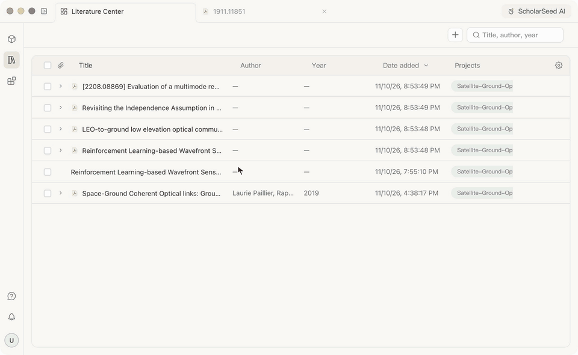
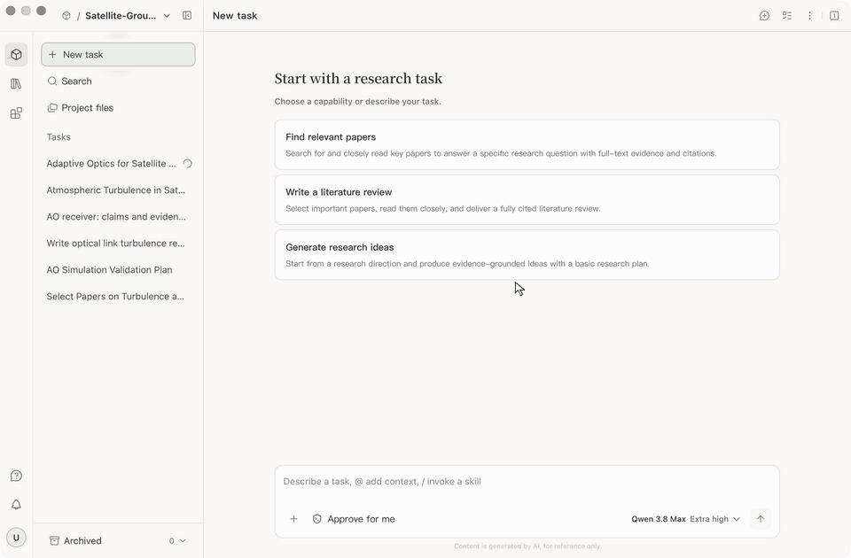
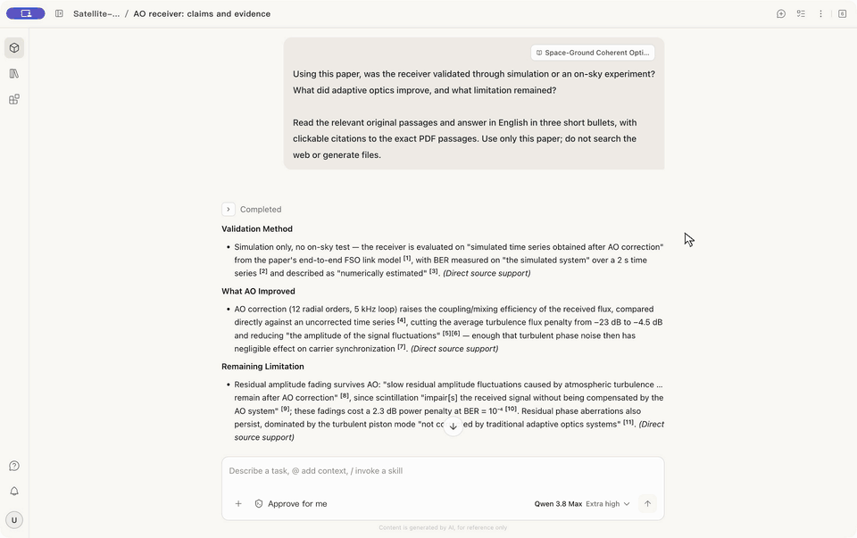
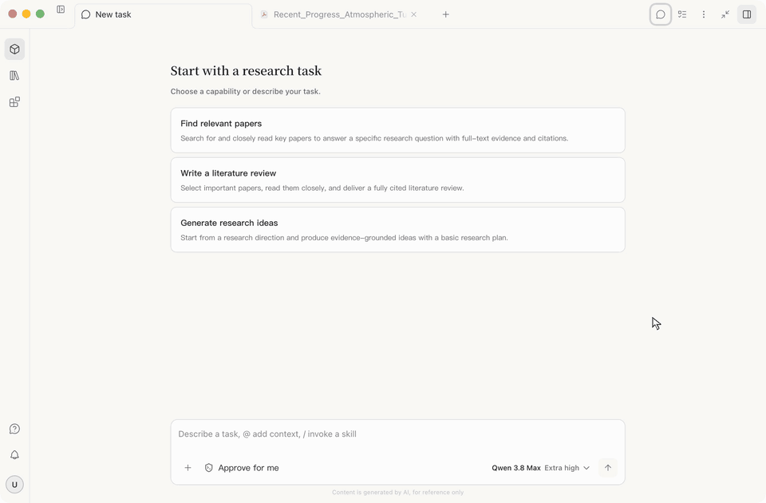
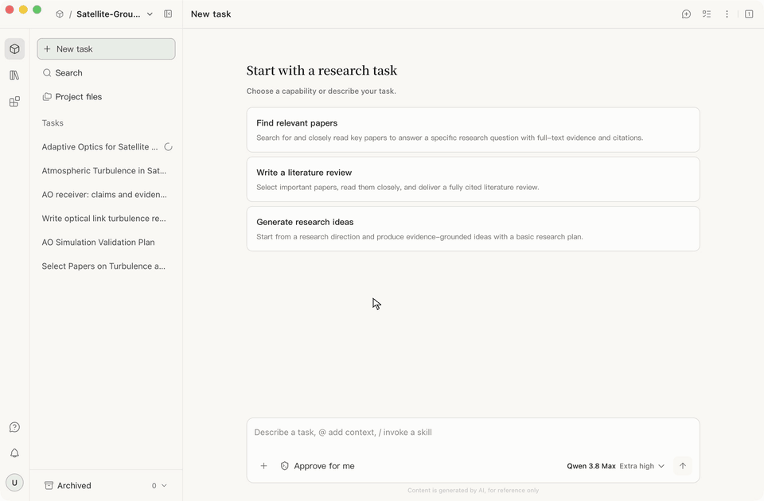
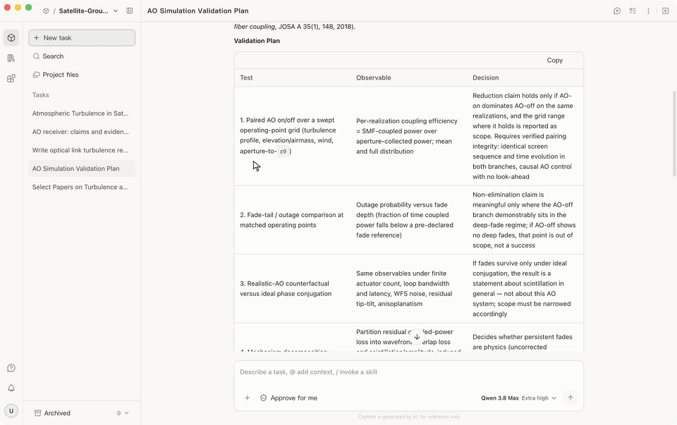

<p align="center">
  <a href="https://scholarseed.damo.alibaba.com/">
    
  </a>
</p>
<p align="center">
  <a href="https://scholarseed.damo.alibaba.com/">
    
  </a>
</p>

<h2 align="center">让想法、文档与 AI 始终相连。</h2>
<p align="center">在自己的电脑上，用自己的模型、技能与插件，完成检索、阅读、提问、核查与构建。</p>
<p align="center">让论文、笔记与对话随研究推进持续积累。</p>

<p align="center">
  <b>PDF 阅读器</b> · <b>文献库</b> · <b>关联证据的回答</b> · <b>科研技能</b> · <b>自选模型</b> · <b>本地优先</b>
</p>

<p align="center">
  <a href="https://scholarseed.damo.alibaba.com/"></a>
  <a href="https://scholarseed.damo.alibaba.com/download.html"></a>
  <a href="LICENSE"></a>
  <a href="https://github.com/alibaba-damo-academy/ScholarSeed/releases"></a>
</p>

<p align="center">
  <a href="#quick-start">快速开始</a> ·
  <a href="#why-scholarseed">为什么选择书深</a> ·
  <a href="#what-it-does">功能</a> ·
  <a href="#recipes">使用场景</a> ·
  <a href="#integrations">集成</a> ·
  <a href="#for-developers">开发者指南</a> ·
  <a href="README.md">English</a>
</p>

<p align="center">
  
</p>

---

<a id="why-scholarseed"></a>
## 为什么选择书深？

多数“科研 AI”工具，只是在实际工作旁放了一个聊天框。你粘贴一篇 PDF，得到一个回答，却逐渐忘了回答依据什么。下一周，又要从头开始。

| 遇到的问题 | 书深的做法 |
|---|---|
| “研究工作分散在不同应用中。” | 围绕同一个研究项目完成检索、阅读、讨论和写作。 |
| “每个新任务都要重新建立上下文。” | 将论文、笔记、对话和产出组织起来，便于在后续任务中带入相关材料。 |
| “AI 的回答并不总是可信。” | 沿着关联来源的引用，检查支持回答的证据。 |
| “AI 智能体难以控制。” | 通过带有评审检查点、决策卡片和权限控制的科研流程，引导下一步行动。 |
| “我不想把文献库和笔记放到别人的服务器上。” | 在本地保存研究材料和项目数据；外部模型、检索与连接器处理你发送给它们的请求。 |
| “每位研究者、每个课题组的方法都不同。” | 将研究方法写入 Skills，通过插件和连接的工具定制交互。 |

---

<a id="quick-start"></a>
## 快速开始

**1. 安装** — 从 **[scholarseed.damo.alibaba.com/download.html](https://scholarseed.damo.alibaba.com/download.html)** 下载安装包（macOS Apple 芯片、macOS Intel、Windows x64）。

**2. 连接模型** — 在“设置 → 模型”中配置模型服务，或登录书深账号，使用该账号可用的服务。

**3. 添加论文** — 导入本地 PDF、BibTeX 或 RIS 文件，或连接 Zotero。

**4. 阅读与提问** — 打开 PDF，选中段落，使用**解释**或**翻译**。需要讨论更广泛的问题时，可将相关论文、笔记或项目文件加入对话。

**5. 检查与保存** — 沿引用核查支持回答的来源，以及可定位的原文段落。将笔记或草稿保存在项目中，供后续工作使用。

---

<a id="what-it-does"></a>
## 功能

### 阅读 — 让思考留在论文旁

在科研工作空间中阅读 PDF、高亮段落、记录疑问与观察，无需来回切换。

- 浏览论文大纲，回看批注。
- 选中段落，让 AI 解释或翻译。
- 借助 AI 理解方法、公式与图表，再与原论文对照。
- 保留笔记和项目材料，供后续讨论使用。

<p align="center">
  
</p>

### 查找 — 将研究问题变成阅读清单

描述想要研究的问题，发现相关文献，并决定哪些论文值得加入项目。

- 使用 `agentic-search` 发现文献，使用 `precise-literature-search` 进行定向检索和全文相关工作。
- 处理包括 OpenAlex、arXiv 在内的来源提供的文献元数据。
- 导入本地论文或连接 Zotero，围绕研究问题组织材料。
- 在深入分析前，审阅候选论文和已有证据。

<p align="center">
  
</p>

### 核查 — 了解 AI 回答的依据

沿引用回到来源和支持段落；存在可用位置时，返回原文核对。

- 将 AI 的解释与来源实际报告的内容进行比较。
- 在笔记和草稿中区分原文报告的发现、自己的解释与尚未解决的问题。
- 排查任务问题时，通过 DamoATrace 诊断查看已记录、产品可见的事件。

引用便于检查回答，但不能证明其中的论断正确或得到了充分支持。科研结论仍需结合原始证据判断。

<p align="center">
  
</p>

### 写作 — 将材料发展为科研产出

将选定文献和项目上下文组织成可供检查与修改的草稿。

- 使用 `literature-review`，通过证据处理和评审检查点形成结构化综述。
- 逐步完善范围、大纲、支持证据和措辞。
- 通过综述流程生成 Markdown 或 LaTeX/PDF；LaTeX 编译使用内置工具链。
- 将产出保存为项目文件，并带入后续讨论。

<p align="center">
  
</p>

### 扩展 — 将研究方法变成可复用的 AI 工作流

将自己的方法整理为可复用流程，并为所属领域添加工具或交互。

- **Skills** 描述研究步骤、所需材料、决策点和预期产出。
- **插件** 将 Skills 与对话卡片结合，用于审阅结果和收集决策。插件目前处于**开发者预览**阶段。
- **MCP 服务器** 通过 Model Context Protocol 连接外部工具与服务。
- **运行时接口** 为接入其他智能体引擎提供开发路径。Codex 是当前随应用提供的可执行智能体提供方。

内置技能源码包括 `agentic-search`、`precise-literature-search`、`literature-review`、`research-idea-partner`、`design-research-validation`、`pdf-evidence`、`project-literature`、`web-search`、`fast-search`、`find-skill` 和 `plugin-create`。各技能的契约与配套工具见[技能源码](https://github.com/alibaba-damo-academy/ScholarSeed/tree/main/skills/community)。

<p align="center">
  
</p>

<a id="recipes"></a>
## 使用场景

从具体问题开始，随任务推进检查证据。以下示例使用仓库中已有的 Skills；实际产出取决于材料、模型和可用服务。

| 目标 | 流程 | 需要检查的内容 |
| --- | --- | --- |
| 撰写文献综述 | `agentic-search` → 审阅候选论文 → `literature-review` | 论文选择、证据覆盖、大纲、引用和最终草稿 |
| 理解难读的论文 | 导入 PDF → 批注 → 选中解释 → `pdf-evidence` | 原文段落、假设、方法和局限 |
| 探索研究想法 | `research-idea-partner` → 定向发现相关文献 | 相关工作、未解决的问题和值得检验的假设 |
| 规划研究验证 | 结合想法和项目上下文使用 `design-research-validation` | 验证标准、其他可能的解释及所需证据 |

## 信任与本地优先

- 使用本地 SQLite；项目是由你掌控的文件夹。数据保存在 `~/.scholarseed`，可通过 `SCHOLARSEED_HOME` 指定其他位置。
- 智能体在隔离的 Home 中运行，禁用插件、hooks 和 marketplaces，显式投影 MCP 配置，通过环境变量传入秘密信息，并以 SHA-256 固定二进制版本。
- 提供原生的逐目录授权（Windows job-object broker、macOS leases），以及经公证和 Authenticode 签名的构建。
- 凡技能结果涉及全文内容，均需要你的明确授权。

<p align="center">
  
</p>

---

## 使用自己的模型

| 提供方 | 模型目录中的数量 |
|---|---|
| 阿里巴巴（Qwen） | 34 |
| OpenAI | 9 |
| Anthropic（Claude） | 6 |
| DeepSeek | 6 |
| 智谱（GLM） | 6 |
| 月之暗面（Kimi） | 5 |
| **任何兼容 OpenAI 的端点** | 你的 `base_url` + API Key（或自定义认证请求头） |

可为每次对话切换模型。密钥保存在本机。

**即将推出：** **Google Gemini** 的专用预设，通过 **Ollama、vLLM 和 LM Studio** 使用本地模型的预设，以及作为 Codex 之外第二种智能体运行时的 **Claude Code**。见[路线图](#roadmap)。

---

<a id="integrations"></a>
## 集成

**文献**

<p align="center">
  <a href="https://www.zotero.org" title="Zotero"></a>&nbsp;&nbsp;&nbsp;
  <a href="https://arxiv.org" title="arXiv"></a>&nbsp;&nbsp;&nbsp;
  <a href="https://openalex.org" title="OpenAlex"><b>OpenAlex</b></a>&nbsp;&nbsp;&nbsp;
  <a href="https://elicit.com" title="Elicit"><b>Elicit</b></a>
</p>

**代码与文档**

<p align="center">
  <a href="https://github.com" title="GitHub"></a>&nbsp;&nbsp;&nbsp;
  <a href="https://gitlab.com" title="GitLab"></a>&nbsp;&nbsp;&nbsp;
  <a href="https://huggingface.co" title="Hugging Face"></a>&nbsp;&nbsp;&nbsp;
  <a href="https://www.notion.so" title="Notion"></a>
</p>

**网页**

<p align="center">
  <a href="https://www.firecrawl.dev" title="Firecrawl"><b>Firecrawl</b></a>&nbsp;&nbsp;&nbsp;
  <a href="https://brave.com/search/api/" title="Brave Search"></a>
</p>

**当前可用的模型**

<p align="center">
  <a href="https://www.alibabacloud.com/en/product/modelstudio" title="阿里云百炼（Qwen）"></a>&nbsp;&nbsp;&nbsp;
  <a href="https://platform.openai.com" title="OpenAI"><b>OpenAI</b></a>&nbsp;&nbsp;&nbsp;
  <a href="https://www.anthropic.com" title="Anthropic"></a>&nbsp;&nbsp;&nbsp;
  <a href="https://www.deepseek.com" title="DeepSeek"></a>&nbsp;&nbsp;&nbsp;
  <a href="https://www.zhipuai.cn" title="智谱"><b>智谱</b></a>&nbsp;&nbsp;&nbsp;
  <a href="https://www.moonshot.cn" title="月之暗面（Kimi）"></a>
</p>

**后续计划中的模型与智能体**

<p align="center">
  <a href="https://claude.com/claude-code" title="Claude Code（智能体运行时）"></a>&nbsp;&nbsp;&nbsp;
  <a href="https://ai.google.dev" title="Google Gemini"></a>&nbsp;&nbsp;&nbsp;
  <a href="https://ollama.com" title="Ollama"></a>&nbsp;&nbsp;&nbsp;
  <a href="https://docs.vllm.ai" title="vLLM"></a>&nbsp;&nbsp;&nbsp;
  <a href="https://lmstudio.ai" title="LM Studio"></a>
</p>

---

<a id="for-developers"></a>
## 开发者指南

书深是一款可以扩展的科研应用，无需先自行组装框架。PDF 处理、文献库、项目、模型路由、沙箱、引用和界面均已具备。

| 扩展方式 | 可以开发的示例 |
| --- | --- |
| 科研 Skill | 根据课题组纳入标准比较论文的流程 |
| UI 插件 | 用于比较方法、筛选论文的对话卡片 |
| MCP 连接器 | 访问专门的科学数据库 |
| 智能体运行时 | 接入另一种科研或编程智能体的适配器 |

这些是扩展思路，不代表已经发布了对应扩展。希望借助 AI 创建插件时，可以让书深使用 `plugin-create`，并描述所需流程。

### 从一个 Skill 开始

创建包含 `SKILL.md` 的文件夹。以下最小示例定义了一种阅读方法，无需定制界面：

```markdown
---
name: lab-paper-comparison
description: 根据课题组的阅读标准比较选定的项目论文。
---

# 课题组论文比较

1. 确认研究问题和需要比较的论文。
2. 阅读获准的材料。逐篇记录研究问题、方法、研究条件、发现和局限。
3. 在可用时引用支持结论的原文段落。注明证据缺口，
   区分原文报告的发现与自己的解释。
4. 展示比较表，并询问哪些论文需要进一步研究。
5. 起草摘要供审阅；修改文献库记录前先征得同意。
```

这份文件提供流程指令。安装插件或添加专用卡片，还需要完成[插件创建指南](https://github.com/alibaba-damo-academy/ScholarSeed/blob/main/developer-docs/plugins/create.zh.md)中的描述符、打包、校验和安装步骤。单独一份 `SKILL.md` 不会生成定制界面。

### 添加卡片与应用操作

两个前端接口的职责不同：

- **`window.scholarseedUI`** 挂载 React 组件，并提供书深的 UI 与对话组件。
- **`window.plugin`** 通过 `onState`、`save`、`submit`、`request` 等方法处理卡片状态和交互。

Skills 通过 **`scholarseed-bridge`** 读取获准材料、管理文献、展示卡片，并在当前项目和权限范围内组织结果。卡片按钮不会自动获得所有后端操作权限。

例如，课题组的流程可以先比较 30 篇论文，展示筛选卡片，再生成报告、保存阅读笔记，或在授权范围内整理文献。阅读方法、卡片实现与应用操作都需要分别接入并测试。

参见[插件概览](https://github.com/alibaba-damo-academy/ScholarSeed/blob/main/developer-docs/plugins.zh.md)、[API 指南](https://github.com/alibaba-damo-academy/ScholarSeed/blob/main/developer-docs/plugins/api.zh.md)、[公共卡片](https://github.com/alibaba-damo-academy/ScholarSeed/blob/main/developer-docs/plugins/cards.zh.md)与[测试指南](https://github.com/alibaba-damo-academy/ScholarSeed/blob/main/developer-docs/plugins/testing.zh.md)。接口处于开发者预览阶段，可能引入不兼容变更。可通过以下命令查看与后端版本匹配的契约：

```bash
python -m service.cli.plugins describe
```

### 从源码构建

需要 Git、**Node.js 24.16.0**、**pnpm 12.14.0**、**uv ≥ 0.12.11**，以及对应平台的原生构建工具。在 macOS 上：

```bash
xcode-select --install
```

Windows x64 请遵循 [Windows 环境准备](CONTRIBUTING_zh.md#windows)；构建脚本会自行获取固定版本的原生编译器。

```bash
git clone https://github.com/alibaba-damo-academy/ScholarSeed.git
cd ScholarSeed
pnpm ops pre   # 固定版本的 JS 与 Python 依赖、Office 资源、内置技能包
pnpm ops dev   # 启动 Electron
```

首次克隆后运行以上两条命令；后续只需运行 `pnpm ops dev`，依赖或 Skill 发生变化时重新运行 `pnpm ops pre`。首次运行需要联网，无需另外安装 Python 或 Git LFS。

- 生成 macOS DMG 或 Windows EXE：[打包说明](CONTRIBUTING_zh.md#打包)。
- 重建技能包：`pnpm ops cd build local --target skills`；检查与源码的一致性：`pnpm ops ci check skills product --mode source`。
- Windows 常见问题：[Electron 下载停滞](CONTRIBUTING_zh.md#windows-下载排查)、[stale ACL policy outputs](CONTRIBUTING_zh.md#windows-检出换行)、[私有构建目录被拒绝](CONTRIBUTING_zh.md#windows-私有构建目录)。
- 可选环境变量：[示例配置](.env.example)。不要提交密钥、令牌、会话数据或证书。

### 架构

```text
Electron / React
      │ HTTP + SSE
      ▼
ScholarSeed Serve (FastAPI)
      │ commands + events
      ▼
Runtime Gateway ──► Codex Adapter ──► Codex App Server (sandboxed)
      │
      └────────────► DamoATrace 证据记录
```

智能体引擎位于运行时契约之后，契约涵盖会话、事件、权限、MCP 及相关执行能力。提供方通过 `scholarseed_runtime.providers` 发现，并在 `product.json` 中启用；`packages/adapters/codex/` 是参考实现。DamoATrace 独立提供 Trace 记录、存储、查询、CLI 和诊断接口。

实现细节见[项目地图](https://github.com/alibaba-damo-academy/ScholarSeed/blob/main/CONTRIBUTING_zh.md#项目地图)、[运行时包](https://github.com/alibaba-damo-academy/ScholarSeed/tree/main/packages/runtime)、[UI SDK](https://github.com/alibaba-damo-academy/ScholarSeed/tree/main/packages/ui)及[开发与测试指南](https://github.com/alibaba-damo-academy/ScholarSeed/blob/main/CONTRIBUTING_zh.md#开发与测试)。

## 模型与服务配置

书深需要连接你有权使用的模型。在应用设置中配置模型服务地址、模型名称和凭据，或登录书深账号，使用该账号可用的模型。本地 HTTP 服务认证与模型授权是两回事：本地服务正常运行，不代表模型账号已获授权。

可选的开发与服务环境变量见 [`.env.example`](.env.example)。不要将 API Key、访问令牌、用户配置、会话数据、证书或私钥提交到仓库。

## 本地数据与隐私

用户数据默认保存在 `~/.scholarseed`。可通过 `SCHOLARSEED_HOME` 指定其他位置；这会选择另一套用户状态，不会迁移已有数据。

- 用户级配置、凭据、项目注册信息、会话目录及文献数据由 `SCHOLARSEED_HOME` 管理。
- 项目专属数据保存在 `<project>/.scholarseed/` 下，随项目目录一起保留。
- Codex 状态默认隔离保存在 `<SCHOLARSEED_HOME>/codex/`，仅在需要独立目录时设置 `SCHOLARSEED_CODEX_HOME`。书深不会自动复制个人 Codex 凭据或模型配置。
- DamoATrace 记录产品可见的诊断事件，用于排障；这不代表可以访问执行器未公开的内部信息。
- 模型调用、文献检索及联网工具会与所配置的外部服务通信；数据保存在本地不等于所有处理都在离线环境完成。
- 根据任务选择合适的权限模式，并在需要时确认工具执行与文件操作。

请将用户数据和凭据保存在仓库之外。分享诊断包前先检查其中的内容。

<a id="roadmap"></a>
## 路线图

以下规划与上文介绍的当前能力分开列出。范围和可用时间可能调整。

| 方向 | 状态 |
| --- | --- |
| 基于 ScholarStack 的可复用研究资产 | 即将推出；尚未完全集成到书深 |
| 用于发现和安装社区 Skills 的技能中心 | 即将推出 |
| 作为补充智能体运行时的 Claude Code | 已规划 |
| Google Gemini 专用提供方预设 | 已规划 |
| Ollama、vLLM、LM Studio 本地模型预设 | 已规划 |
| 工作台内支持文献引用的 LaTeX 编辑器 | 已规划 |
| Linux 构建 | 探索中 |

插件目前处于开发者预览阶段。开发与安装方式见[插件指南](developer-docs/plugins.zh.md)。

### ScholarStack — 可复用的研究知识 · 即将推出

研究工作往往需要反复阅读同一批论文、重新梳理此前的比较。ScholarStack 探索如何将有来源依据的事实、领域概念与跨论文综合认识组织成可复用的研究资产，并保留来源与适用范围。

[ScholarStack 论文](https://arxiv.org/abs/2609.23735v3) *Layered Research Asset Orchestration and Cross-Task Reuse for Scientific Agents* 介绍了其架构与实验评估。

**ScholarStack 尚未完全集成到本仓库。** 当前工作台会保留项目材料与对话，供后续使用；通过 ScholarStack 结构化资产实现系统性复用，仍属于即将推出的工作。

---

AI 按 Skill 调用这些操作，书深检查当前项目范围和权限。卡片不会自动获得应用的全部权限，也不能自动批准敏感操作。可用操作见[插件 API 指南](developer-docs/plugins/api.zh.md)。

## 社区与贡献

扫描下方二维码加入书深社区，交流使用体验与科研问题。


- 通过 [Issues](https://github.com/alibaba-damo-academy/ScholarSeed/issues) 反馈问题或提出功能建议。请附上操作系统、应用版本、复现步骤和预期行为。
- 开发和贡献说明见 [CONTRIBUTING_zh.md](CONTRIBUTING_zh.md)。
- 由阿里巴巴达摩院决策智能实验室开发。

### 基于以下项目构建

书深受益于众多项目的工作，在此致谢：

| 领域 | 项目 |
|---|---|
| 智能体运行时 | [OpenAI Codex](https://github.com/openai/codex) App Server 0.165.0 · [MCP Python SDK](https://github.com/modelcontextprotocol/python-sdk) |
| 文献 | [Zotero](https://www.zotero.org) · [zotero-mcp](https://github.com/54yyyu/zotero-mcp) · [OpenAlex](https://openalex.org) · [arXiv](https://arxiv.org) · [Brave Search](https://brave.com/search/api/) |
| PDF 与文档 | [PDFium](https://pdfium.googlesource.com/pdfium/)（通过 [pypdfium2](https://github.com/pypdfium2-team/pypdfium2)）· [pypdf](https://github.com/py-pdf/pypdf) · [pdfplumber](https://github.com/jsvine/pdfplumber) · [python-docx](https://github.com/python-openxml/python-docx) · [python-pptx](https://github.com/scanny/python-pptx) · [openpyxl](https://foss.heptapod.net/openpyxl/openpyxl) |
| Office 预览 | [docx-preview](https://github.com/VolodymyrBaydalka/docxjs) · [ExcelJS](https://github.com/exceljs/exceljs) · [pptx-renderer](https://github.com/aiden0z/pptx-renderer) · [emf-converter](https://github.com/ChristopherVR/emf-converter) |
| 写作 | [TeX Live](https://tug.org/texlive/) 2026 · [Milkdown](https://milkdown.dev) · [CodeMirror](https://codemirror.net) |
| 桌面端 | [Electron](https://www.electronjs.org) 44 · [React](https://react.dev) · [Vite](https://vite.dev) / [electron-vite](https://electron-vite.org) · [electron-builder](https://www.electron.build) · [Velopack](https://velopack.io)（Windows 更新）· [Tailwind CSS](https://tailwindcss.com) · [i18next](https://www.i18next.com) · [Playwright](https://playwright.dev) |
| 后端 | [FastAPI](https://fastapi.tiangolo.com) · [python-build-standalone](https://github.com/astral-sh/python-build-standalone) CPython 3.14 · [uv](https://github.com/astral-sh/uv) · [DuckDB](https://duckdb.org) · [httpx](https://www.python-httpx.org) · [Pydantic](https://pydantic.dev) · [truststore](https://github.com/sethmlarson/truststore) |
| 安装包内提供的工具 | [ripgrep](https://github.com/BurntSushi/ripgrep) · [PowerShell](https://github.com/PowerShell/PowerShell) 7.6（Windows） |
| 字体 | [IBM Plex Mono](https://github.com/IBM/plex) · [Newsreader](https://github.com/productiontype/Newsreader) · [Noto Serif SC](https://fonts.google.com/noto) |
| README 标志 | [Simple Icons](https://simpleicons.org)（CC0；标志仍为其所有者的商标） |

## 许可证

书深的原创源代码采用 [Apache License 2.0](LICENSE) 许可证。

第三方软件、资源和捆绑的运行环境仍适用各自的许可证，不因本项目采用 Apache-2.0 而改变。相关声明包括：

- [桌面端依赖及对应源码声明](apps/desktop/resources/notices/README.md)
- [`paper-fulltext-dl` 第三方声明](skills/community/precise-literature-search/vendor/THIRD_PARTY_NOTICES.md)
