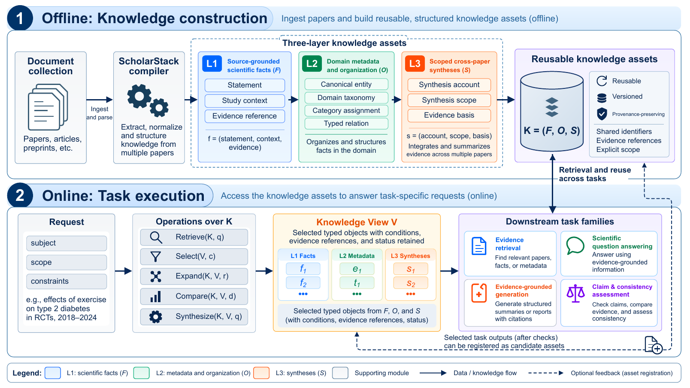
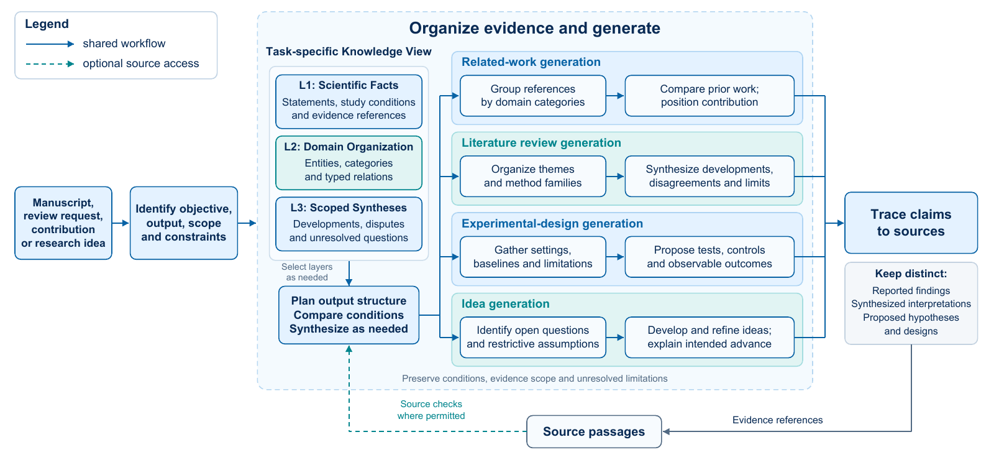
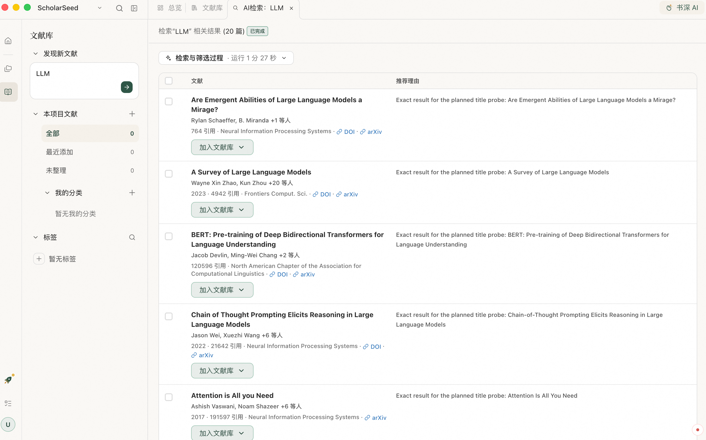
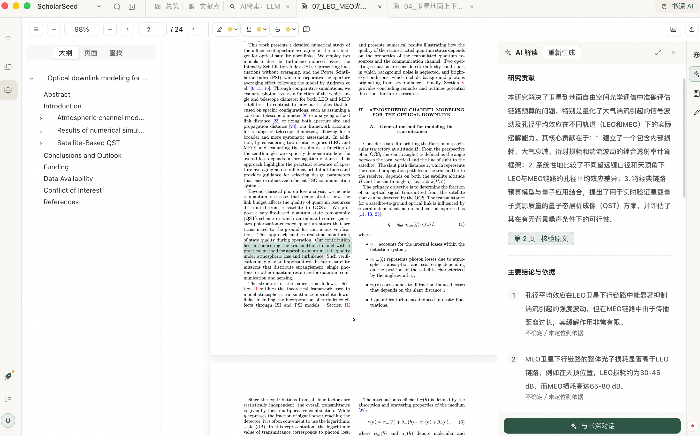
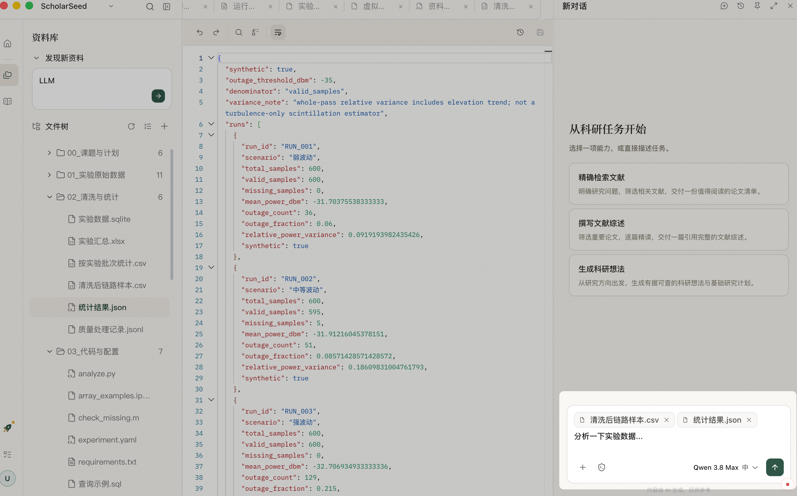
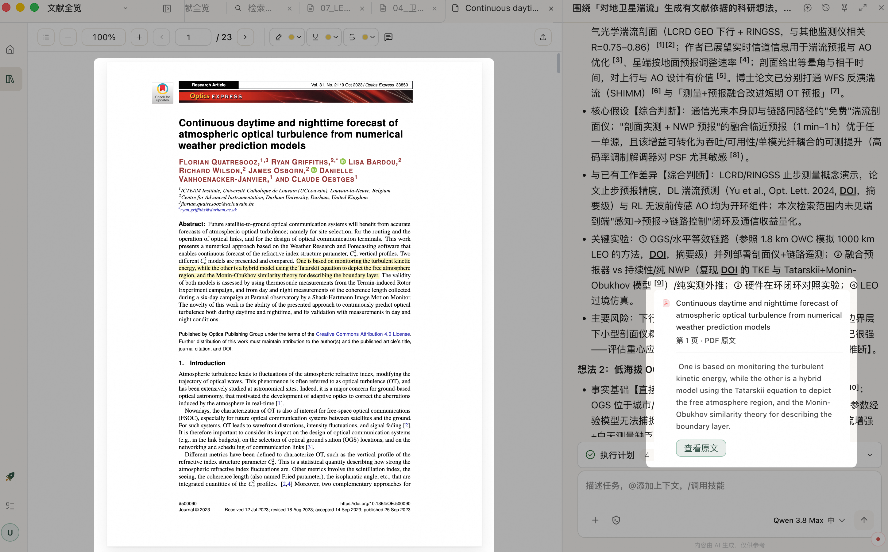
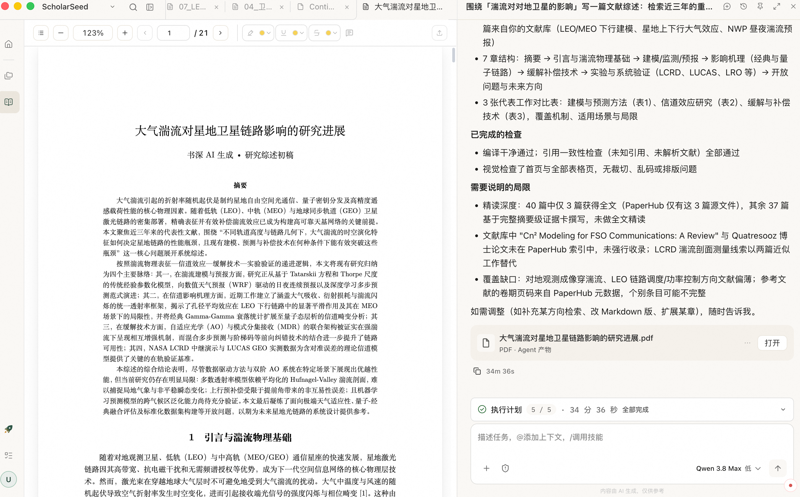

<div align="center">

# ScholarSeed · 书深

[English](README.md) · **中文**

**让每一次阅读与思考，生长为下一步研究。**

[为什么选择书深](#为什么选择书深) · [研究论文](#研究论文) · [从文献到成果](#从文献到成果) · [快速开始](#快速开始) · [安装](#安装) · [插件](#插件) · [社区与支持](#社区与支持)

</div>

书深是一款以研究项目为中心的 AI 科研工作台，将文献检索、阅读批注、AI 讨论与成果写作连接在一起。从一篇论文、一个问题开始，让分散的资料与思考逐步积累为有依据、可继续推进的研究成果。


## 为什么选择书深

- **一体化工作台，让研究连贯发生。** 在同一工作空间里查文献、读论文、记笔记、与 AI 讨论和修改文稿。围绕课题组织材料，减少工具切换与反复搬运上下文。
- **引用可溯源，让判断有据可查。** 查看 AI 回答的文献来源与证据片段，回到可定位的原文核对。将阅读、分析与写作连接到具体依据，方便检查和修正。
- **带着上下文，陪研究一起生长。** 将已有文献、笔记、项目资料和历史对话带入讨论，让 AI 接着你的研究往下想。每一次阅读、追问与修改，都可以成为下一步工作的基础。
- **本地优先，让研究积累留在自己手中。** 在本地保存和管理研究资料与产出，支持连接自己的模型服务。使用云端模型或联网检索时，相关请求由所配置的服务处理。
- **科研 Skills，让常用研究流程可复用。** 通过文献检索、综述写作、研究想法探索等技能推进任务，也支持扩展适合自己研究方式的工作流。

---

## 研究论文

### ScholarSeed：面向人机协同科研的一体化智能体工作台

*ScholarSeed: An Integrated Agentic Workbench for Human–AI Collaborative Research*

**即将发布**

<details>
<summary>展开摘要</summary>

近年来，AI 在文献检索、资料分析、论文写作与专业问题求解等方面展现出强大能力。然而，科研人员若想充分利用这些能力，往往需掌握编程技能，或在割裂的应用间频繁切换，这不仅抬高了使用门槛，也极易打断研究思路。更为关键的是，这种孤立的工具模式背离了科研“探索问题—积累知识—检验证据—迭代方向”的连续本质，导致研究资料与阶段性成果难以在不同任务间顺畅衔接。

为此，我们推出开源、AI 原生的科研工作台 **ScholarSeed（书深）**，旨在帮助科研人员在熟悉的工作环境中无缝调用前沿 AI 能力。书深摒弃了将研究资料迁移至外部 AI 工具的繁琐模式，转而将 AI 深度融于文献研读与批注、知识管理与论文撰写等日常科研活动，实现资料、证据、知识与学术成果的持续积累及跨阶段复用。研究者不仅可在工作流中随时调用 AI，还可精准溯源生成依据、灵活修正研究内容与方法，并始终掌控研究演进的主动权。此外，平台采用开放、可扩展的架构，支持新模型、智能体及专业科研工具的按需接入。

我们将通过文献分析、学术检索、灵感生成、综述撰写及数学与运筹优化等学科专业场景，评估书深在降低使用门槛、减少工具切换损耗、保障研究连续性及提升知识复用率方面的效能。书深旨在让前沿 AI 告别“单点外部工具”的局限，真正融入科研日常，成为伴随研究持续推进的原生能力。

</details>

### [ScholarStack: Layered Research Asset Orchestration and Cross-Task Reuse for Scientific Agents](https://arxiv.org/abs/2609.23735v3)

ScholarSeed AI Team

[arXiv:2609.23735v3](https://arxiv.org/abs/2609.23735v3)

#### 让一次研究中的理解，成为下一次研究的起点

科研是一个持续积累的过程：检索时识别的方法与术语，可以用于组织综述；综述中发现的分歧与局限，可以启发研究想法；新颖性分析中建立的比较，又可以帮助选择实验基线。但当这些理解只留在一次对话或一份报告中，后续任务往往需要重新阅读同一批论文、重新梳理已有判断。

**ScholarStack 将文献中的事实、领域结构与跨论文理解组织为可复用的研究资产。** 它同时保留“论文说了什么”和“多篇论文如何关联”，并记录来源、研究条件、适用范围与版本，让科研 Agent 在检索、问答、写作和论断核查之间共享已有积累。



*论文图 1：从文献集合构建研究资产，再按任务组织知识视图。不同任务按需使用相关层级；经检查的部分任务产出可登记为候选资产，登记本身不等于完成语义验证。*

#### 三层资产，连接原文证据与研究理解

| 层级 | 保留什么 | 如何支持后续研究 |
| --- | --- | --- |
| **L1 · 原文事实** | 论文中的发现、方法、假设与局限，以及对应的研究条件、原文位置和核查状态 | 回答具体问题、核对数值与论断，在复用结论时保留成立条件 |
| **L2 · 领域组织** | 统一的实体名称、领域分类、类别归属与关系，并链接其依据 | 对齐不同论文的术语，组织研究方向，建立方法比较的维度 |
| **L3 · 跨论文综合** | 对多篇研究的综合认识，以及明确的覆盖范围、支持、反对与限制性证据 | 梳理方法演进、研究分歧和未解决问题，为综述与研究规划提供依据 |

执行任务时，Agent 通过检索、筛选、扩展、比较与综合，从这些资产中组织所需的 **Knowledge View（知识视图）**。单篇问答可以主要使用 L1，跨论文比较可结合 L2 与原始研究条件，综述则可进一步使用 L3。来源与资产发生变化时，依赖它们的判断需要重新检查，历史版本保留先前产出的依据。

#### 从文献理解到研究产出

同一组研究资产可以支持多种任务：为相关工作组织参考文献和定位贡献，为综述梳理主题、演进与分歧，为实验设计提供已有设置、基线和局限，也为研究想法识别开放问题与可进一步验证的方向。



*论文图 4：任务按需组合三层资产，完成组织、比较与综合，并将产出中的论断关联到来源；原文报告的发现、综合解释与新提出的假设保持区分。*

#### 代表性实验结果

论文在**文献检索、科学问答、基于证据的生成、论断与一致性评估四类任务、十种设置**中进行评估。以下为当前稿件报告的部分结果：

| 任务与评估范围 | 对照结果 | ScholarStack 结果 |
| --- | --- | --- |
| **多论文问答** · MDAQA，797 个问题（表 9） | Full-text 综合评分 **8.46 / 20**；平均 **20.8k tokens / 问题** | 综合评分 **18.41 / 20**；平均 **5.5k tokens / 问题**，约减少 **73%** |
| **综述生成** · ReportBench-ML，25 个任务（表 13） | Claude Code DeepResearch 的 RACE 总体评分 **7.54 / 10** | RACE 总体评分 **9.18 / 10**；全面性与洞察力得分分别为 **9.23**、**9.30** |
| **实验设计** · 12 个领域，38 个目标（表 14） | Full-text 覆盖 F1 **0.398**；平均 **20.7k tokens / 任务** | 覆盖 F1 **0.404**，与对照相近；平均 **12.4k tokens / 任务**，约减少 **40%** |

多论文问答的综合评分为五个维度之和（满分 20），与综述质量评分均采用模型评审；综述结果比较的是完整工作流。上述 token 数据仅反映查询或生成阶段，不含研究资产的前期构建成本。实验设计的微小 F1 差异不视为质量提升。各任务的设置、指标与评估范围详见论文。

## 从文献到成果

### 精读文献

导入本地 PDF 或 Zotero 中已有的文献，也可以描述研究问题，让 AI 查找、筛选相关论文。把值得继续阅读的材料汇集到研究项目中。


### 留下思考

边读边高亮、批注和记录笔记，借助 AI 理解方法、公式与图表。把一时的疑问与理解留在文献旁，为后续比较和讨论积累线索。


### 展开讨论

带着文献、笔记和项目资料继续追问：比较不同方法，梳理研究分歧，结合自己的条件探索值得验证的想法。


### 回看依据

从回答中的引用查看来源和证据，回到原文核对关键表述。将 AI 的分析与论文实际结论对照，形成自己的判断。


### 写成进展

将研究积累整理为带引用的综述、相关工作章节或研究报告。继续补充材料、调整结构与修改表达，让成果作为项目文件保留下来，衔接下一轮研究。


## 快速开始

安装并启动书深后，配置自己的模型服务，或登录书深账号使用已开通的服务能力。

1. 创建项目，导入一篇论文或一组研究资料。
2. 选择模型，将相关材料加入 AI 对话。
3. 描述研究问题，检查回答中的引用，保存笔记或生成的文稿。

## 工作原理

ScholarSeed 采用桌面客户端、本地服务与 Agent 运行时分层架构，科研 Skills 在此基础上组织任务流程。

- **桌面客户端**：基于 Electron、React 和 TypeScript，提供项目工作台、文献阅读、文件浏览与 AI 对话。
- **本地服务**：基于 FastAPI，连接桌面交互、项目数据和任务执行。
- **Agent 运行时**：通过统一 Runtime 接口与 Gateway 调度任务，当前使用 Codex 适配器连接执行引擎。
- **科研 Skills**：封装文献检索、综述和想法探索等工作流，调用模型、文献服务及相关工具。
- **执行追踪**：通过 ATrace 记录运行过程，为任务排查和开发调试提供支持。

## 安装

### 从源码运行

环境要求：Git、**Node.js 24.16.0**、**pnpm 12.14.0**、**uv ≥ 0.12.11**，以及本机平台的原生构建工具（macOS 为 Xcode Command Line Tools）。环境安装方法见[开发指南](CONTRIBUTING_zh.md#环境准备)。

macOS 首次从源码运行前执行以下命令，并按系统提示完成安装；已安装可用的 Xcode 工具链时无需重复安装：

```bash
xcode-select --install
```

Windows x64 请按[Windows 环境准备命令](CONTRIBUTING_zh.md#windows)操作，原生编译器由构建脚本自动下载。这些工具仅用于源码开发和打包，使用已构建的安装包不需要安装。

```bash
git clone https://github.com/alibaba-damo-academy/ScholarSeed.git
cd ScholarSeed
pnpm ops pre
pnpm ops dev
```

`pnpm ops pre` 安装固定版本的 JavaScript／Python 依赖、准备 Office 资源并构建内置 Skill 包；`pnpm ops dev` 启动 Electron。全新克隆依次执行这两条命令；后续启动只需 `pnpm ops dev`，更新依赖或技能源码后请先停止应用并重跑 `pnpm ops pre`。首次运行需要联网，无需另外安装 Python 或 Git LFS。使用时保持终端运行，按 Ctrl+C 停止。启动后，在设置中配置模型连接，或登录书深账号。日常开发和常见问题见[开发指南](CONTRIBUTING_zh.md)。

Windows 遇到 [Electron 下载停滞](CONTRIBUTING_zh.md#windows-下载排查)、[`stale ACL policy outputs`](CONTRIBUTING_zh.md#windows-检出换行)或[构建目录权限拒绝](CONTRIBUTING_zh.md#windows-私有构建目录)时，请按对应步骤恢复。

## 插件

**书深插件可以把科研步骤、对话卡片和资料整理串成一个可重复使用的流程。让 AI 按你的研究方法分析材料，在关键步骤请研究者作出选择，再生成报告、保存笔记和整理文献。**

在书深中，开发者可以先编写 Skill（科研流程规则），在 `SKILL.md` 文件中说明研究步骤、需要的材料和结果要求；再按需要加入对话卡片，让研究者在关键步骤作出选择，继续分析并整理文献。

插件目前为开发者预览，开发与安装方式见[插件文档](doc/plugins.md)。

科研技能源码位于 `skills/community/`。通过 `pnpm ops cd build local --target skills` 构建技能包，通过 `pnpm ops ci check skills product --mode source` 检查与源码的一致性。

### 不只生成内容，也能操作书深

Skill 可通过 `scholarseed-bridge`（书深提供的应用操作接口）调用已有功能，把分析结果落实到应用中：

- **使用资料：** 检索项目文件、读取获准 PDF 与标注，将生成的文件导入项目。
- **整理文献：** 导入论文、保存或修改笔记、批量添加标签，调整分类与项目归属。
- **推进任务：** 查看获准的历史对话、更新任务计划，展示卡片并根据研究者的选择继续。

这些操作由 AI 按 Skill 调用，再由书深检查当前项目范围和权限；卡片本身不拥有全部操作权限，也不能自动批准敏感操作。可用操作见[插件 API 文档](doc/plugins/api.md)。

### 与 Codex 桌面端、Zotero AI 插件的区别

| 对比项 | 书深 | Codex 桌面端 | Zotero＋AI 插件 |
| --- | --- | --- | --- |
| 自定义流程 | Skill＋可选脚本 | Skill＋可选脚本 | 部分插件支持 Skill |
| 研究交互 | 科研卡片＋自定义卡片 | 工具与插件提供 | 依插件提供的方式 |
| 研究资料 | 项目资料＋文献库 | 文件＋外接服务 | 插件读取文献库 |
| 整理结果 | 直接调用书深功能 | 文献管理需另接 | 调用插件文库工具 |

Codex 桌面端同样支持 Skills、插件和 MCP（连接外部工具的协议），也能调用应用工具。**书深的特别之处，是直接提供科研卡片、项目资料与文献操作，让“分析—选择—整理”在同一应用中完成，无需先接入独立的文献管理服务。**

### 一个场景：按课题组的方法读完 30 篇论文

研究者希望按“研究问题、方法、证据、局限”比较 30 篇论文，选出值得深入研究的论文，形成报告并保存阅读笔记。

在书深中，开发者可以把这些步骤做成一个流程：

1. **写清阅读方法。** 在 `SKILL.md` 中规定比较哪些内容、如何标注来源，以及证据不足时怎样说明。
2. **结合项目资料分析。** 使用书深已有的资料与文献功能，将项目研究问题、课题组阅读要求和论文内容一起分析。
3. **通过卡片选择论文。** 用自定义对话卡片展示论文与比较结果。研究者勾选要保留的论文、补充意见后，AI 根据选择继续分析。
4. **生成报告、整理文献。** 输出比较报告，在授权范围内保存笔记、添加标签、将文献归入项目，供后续研究使用。

同一任务在 Zotero 中，可以安装并配置 LLM-for-Zotero，开启 Agent 模式，用自定义 Skill 规定阅读方法，再让 AI 分析论文、保存笔记。如果需要专门的论文筛选界面，则要根据插件提供的开发接口进一步实现。

在 Codex 桌面端，也可以用 Skill 组织论文分析；若要同步文献标签、笔记与分类，则需要接入相应的文献管理工具或服务。

**阅读规则决定分析方法，卡片承接研究者的判断，结果再回到资料与文献管理中。开发者可以专注于设计科研步骤，复用书深已有功能，无需为每个流程重新开发 AI 接入和文献管理功能。**

一份 `SKILL.md` 不会自动生成定制界面。专用卡片仍需编写界面代码、制作安装包并测试；读取或修改资料需要相应授权，科研结论仍需核对原文与证据。

参考资料：[Codex Skills](https://developers.openai.com/codex/skills)、[OpenAI 插件文档](https://developers.openai.com/plugins/build/plugins)、[Zotero 插件开发文档](https://www.zotero.org/support/dev/client_coding/plugin_development)、[LLM-for-Zotero 文档](https://yilewang.github.io/llm-for-zotero/zh/)、[zotero-gpt 项目](https://github.com/MuiseDestiny/zotero-gpt)。具体功能以所用版本和设置为准。

## 打包

在本机平台生成 macOS DMG 或 Windows EXE，见开发指南中的[打包说明](CONTRIBUTING_zh.md#打包)。

## 模型与服务配置

书深需要连接你有权使用的模型。在应用设置中配置模型服务地址、模型名称和凭据，或登录书深账号，使用该账号可用的模型。本地 HTTP 服务认证与模型授权是两回事：本地服务正常运行，不代表模型账号已获授权。

可选的开发与服务环境变量见 [`.env.example`](.env.example)。不要将 API Key、访问令牌、个人配置、会话数据、证书或私钥提交到仓库。

## 安全与数据

- 用户数据默认保存在 `~/.scholarseed`，可通过 `SCHOLARSEED_HOME` 指定目录；更换该目录是选择另一套用户状态，不会自动迁移原数据。
- 用户级配置、凭据、项目注册信息、会话目录及文献数据由 `SCHOLARSEED_HOME` 管理。
- 项目专属数据保存在 `<项目>/.scholarseed/` 下，随项目目录一起保留；分享或备份项目时也要检查其中的内容。
- Codex 状态默认隔离保存在 `<SCHOLARSEED_HOME>/codex/`，仅在需要独立目录时设置 `SCHOLARSEED_CODEX_HOME`。书深不会自动复制个人 Codex 凭据或模型配置。
- DamoATrace 记录产品可见的诊断事件，用于排障；这不代表可以访问执行器未公开的内部信息。
- 模型调用、文献检索及联网工具会与所配置的外部服务通信；数据保存在本地不等于所有处理都在离线环境完成。
- 根据任务选择权限模式，并在需要时确认工具执行与文件操作。

请将用户数据和凭据保存在仓库之外。提交代码或分享日志、诊断包及项目目录前，请检查并移除 API Key、个人配置和私有研究材料。

## 社区与支持

扫描下方二维码加入书深社区，交流使用体验与科研问题。


欢迎通过 GitHub Issues 反馈问题、提出功能建议，通过 Pull Requests 贡献代码、科研 Skills、文档和使用案例。

报告问题时，请附上系统与应用版本、复现步骤和预期结果。提交改动时，请说明解决的问题与验证方式，界面改动可附截图。

如果 ScholarSeed 对你的研究有帮助，欢迎点亮 Star，也欢迎分享你希望它解决的科研问题。

<!-- 发布素材：确认公开 GitHub 仓库后，在此接入 Star History 图表。 -->

## 许可证

书深的原创源代码采用 [Apache License 2.0](LICENSE) 许可证。

第三方软件、资源和捆绑的运行环境仍适用各自的许可证，不因本项目采用 Apache-2.0 而改变。相关声明包括：

- [桌面端依赖及对应源码声明](apps/desktop/resources/notices/README.md)
- [Office 查看器第三方声明](apps/desktop/src/renderer/public/office/THIRD_PARTY_NOTICES.md)
- [`paper-fulltext-dl` 第三方声明](skills/community/precise-literature-search/vendor/THIRD_PARTY_NOTICES.md)

---

由 ScholarSeed 团队开发维护。
