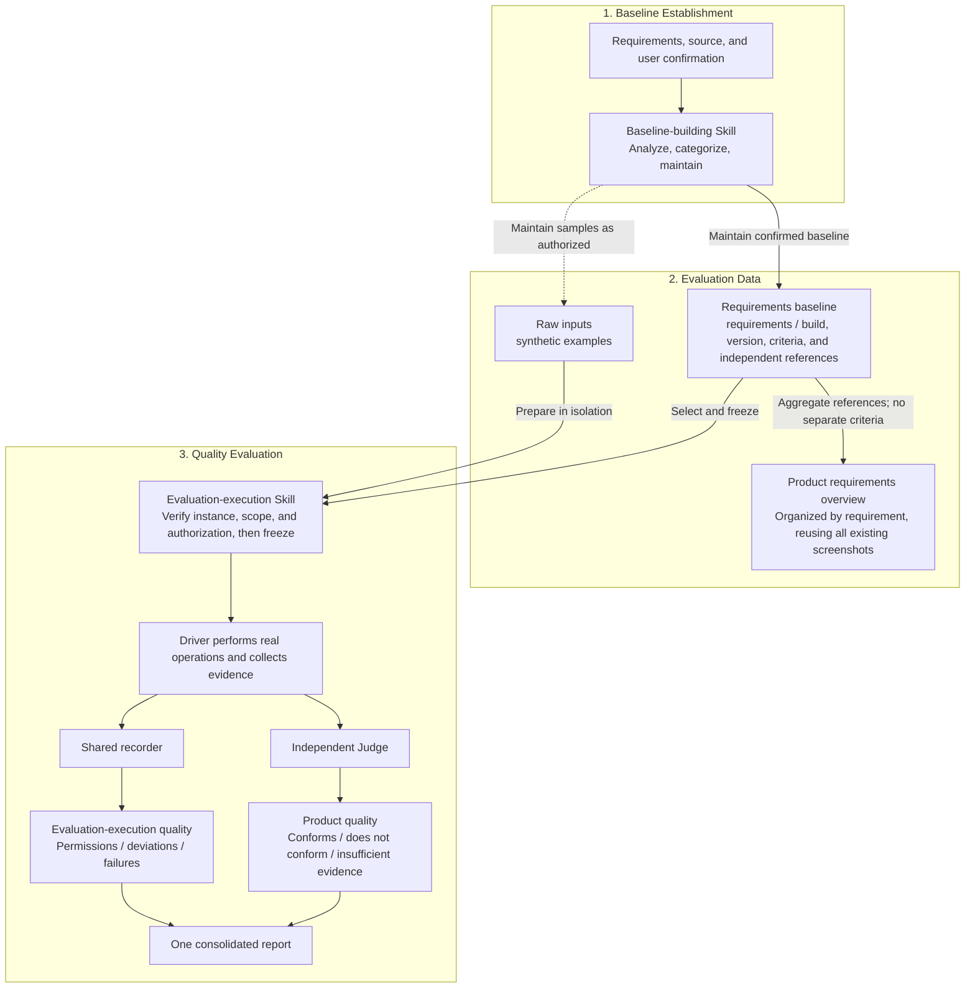
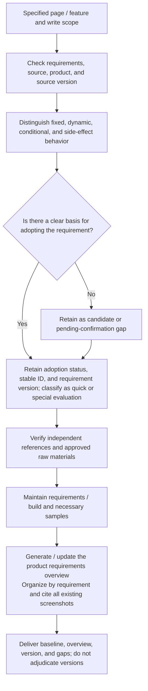
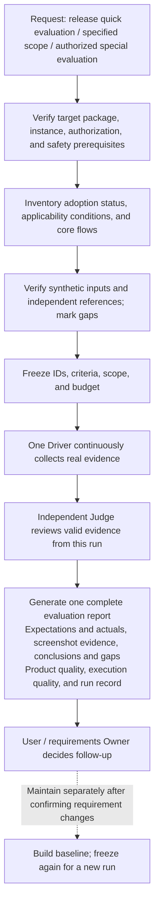

<a id="desktop-llm-评测概要设计开发-skill-承载"></a>
# Desktop LLM Evaluation Overview Design (Carried by Development Skills)

<a id="范围与非目标"></a>
## Scope and Non-goals

Use product pages as the entry point, combining concise quick-check criteria, evidence from real pages through Playwright, and a centralized independent LLM review. By default, quickly detect missing content, incorrect information, contradictory states, and obvious regressions in the target version; this does not provide full interaction acceptance. Verify the actual result of necessary lightweight actions. Run the normal successful path once for core user flows without traversing branches. Verify exceptions, background processing, updates, and the full persistence matrix only within explicitly scoped special evaluations.

Establish the baseline once, then maintain it incrementally as confirmed requirements change. Each run verifies changed functionality and checks whether other functions may be affected. The baseline serves valid requirements for currently supported versions; do not maintain tasks or evidence adaptations for retired product forms. Retire items from the current baseline only when confirmed current requirements and consumer evidence show that they are retired with no continuing use; retain the original criteria and evidence for past runs. Update the real path when a valid feature entry point is replaced; conditional visibility does not mean retirement. Component examples or diagnostic surfaces must not stand in for real user flows. Do not build a separate evaluation platform, modify the product to accommodate testing, or use LLM judgments in place of deterministic tests or release approval. This page defines the business design; Skill orchestration is described in [Skill ownership](../../../../docs/architecture/skills.md).

<a id="与确定性测试的分工"></a>
### Division of Responsibilities with Deterministic Tests

As described in the [testing architecture](testing-strategy.md), unit tests cover logic, real API/data integration covers APIs, and automated tests driven by the PDFE Mock API cover shared UI state combinations. This work package covers user flows through the real client, backend, and any models/tools required by the task; an LLM drives the flow and reviews it independently. Continue using programmatic checks for task files/summaries, business terminal states, permission boundaries, and real side effects. Do not declare completion based only on model self-report or screenshots, and do not treat PDFE simulated events or preset results as evidence of a real flow.

Maintain the required scope, expected source of truth, minimal associations, and defect feedback rules for real tasks only in the [testing architecture](testing-strategy.md#测试分层与共享契约). Based on the task delivery owner's change-impact description, B maintains the criteria and results for affected real tasks. Do not omit model, tool, authorization, or artifact tasks deemed necessary by risk merely because lower-level tests pass or a page quick evaluation can run.

B reuses the existing requirements/build to record the raw inputs required by the task, user goals, observable terminal states, artifact/side-effect facts, and independent references. Cite existing content instead of requiring additional template fields or a separate task library. Keep permissions, budget, target package, and run identity in the run record for each run. If the baseline is not ready or permissions are insufficient, explicitly mark the task as not accepted; do not expand default Skill permissions or use mocks to fill in results. The original Owner provides deterministic fact checks. The Judge synthesizes only evidence already obtained; humans review disputed and high-risk conclusions.

For fixes that do not change requirements, retain the original expectations. For confirmed behavior changes, maintain only affected assets; for data-only changes, refresh this run's references without rebuilding the entire library. Do not automatically remove existing programmatic E2E tests because of this division of responsibilities. Specific migration arrangements belong in the implementation plan (non-public execution/provenance record omitted).

B consumes lower-level evidence that remains applicable to the same target version, without repeating all state combinations. Still obtain the real task's actual terminal state, artifacts, and independent review. Attribute product-model and Driver/Judge costs, as well as the full wall-clock time for preparation, evidence collection, and review, to this run. Do not use page quick-evaluation time or mock results to claim that the real flow is faster.

**current / gap**: The existing default entry point remains page release quick evaluation and the adopted core success flow; it does not cover all research tasks or model-capability evaluations. Its default safety scope excludes product-model requests. Real model, tool, save/recovery, and similar flows must be established as special evaluations under confirmed requirements and run with the corresponding authorization. This architecture division does not expand existing Skill permissions or count uncreated special evaluations as covered. Defined architecture responsibilities do not mean that the executor or all special evaluations have been implemented.

<a id="评测类型与划分"></a>
## Evaluation Types and Categories

The following categories support development delivery by helping developers and testers find issues early, focus on risk, and speed up feedback. The execution Skill includes entry rules for all four categories; actual host and product verification must be confirmed separately from run evidence. The previous "release quick evaluation" remains compatible with all adopted and applicable page quick-evaluation layers and the core success flow. Do not claim acceptance merely because the rules have been documented, or use them to rejudge past runs.

| Type | Selection Criteria and Scope | Delivery and Boundaries |
| --- | --- | --- |
| Smoke evaluation | Select a relatively stable core product flow and check required pages, the normal path, and the real terminal state. | Quickly find issues that block primary usage; does not claim to cover every page or complete interactions. |
| Change quick evaluation | Based on recently delivered changes and impact analysis, select changed functionality, possibly affected related functionality, and necessary regression flows. | Quickly report issues introduced by this change. If the impact scope cannot be determined reliably, state the gap; do not assume there is no impact. |
| Detailed evaluation | For a release or a broad change, check each page in the target version's applicable-page list for entry points, primary content, key states, and necessary representative actions, and cover applicable core flows. | First freeze the complete page list and applicability conditions. List pages without a baseline, unreachable pages, and pages lacking evidence separately; do not silently remove them from the denominator. Covering every page does not mean exhaustively testing every exception and combination. |
| Special evaluation | Deeply verify a specified feature or risk, such as import and save, exception recovery, cross-platform behavior, permissions, models, or performance. | Specify its criteria, inputs, terminal state, and required authorization. It may be combined with other types, but report its result separately; page appearance cannot replace a real action. |

Smoke and change quick evaluations may be combined according to delivery risk. For overlapping items, reuse the same valid evidence when the target version, inputs, and criteria match; do not repeat the operation. Regression is an evaluation objective and may be covered by a change quick evaluation, detailed evaluation, or special evaluation. For every type, specify the target version, data, criteria, scope, and evidence; separately report product issues, evaluation blockers, and uncovered scope. Do not repeat checks just to improve coverage numbers. Before changing the default scope or adding execution capabilities, update and verify both Skills separately; this overview alone does not change current execution behavior.

<a id="唯一依据"></a>
## Authoritative Sources

- The shared contract for raw samples, project definitions, and external dependencies is in the [shared examples design](../../../../docs/architecture/examples.md). Evaluation criteria and hidden references remain in the scenario library and control plane; do not place them in the product project. Text-project preparation and procedures are wired up, but real host calls and product terminal states still require independent evidence; the existence of an interface does not prove they passed.
- The responsible requirements/evaluation Owner confirms product requirements and criteria. The current implementation may be used only to recover candidate requirements; it does not automatically become the standard. If the user explicitly adopts the current state of a specified version as the baseline, include it on the basis of that adoption decision; this does not mean the feature has passed real testing.
- Page requirements and necessary reference assets belong in the [scenario library](../../eval-scenarios/README.md). Associate evidence using each page's stable identifier; do not create a separate point directory or fixed tier list.
- Responsibilities of the two target entry points are described in [Skill ownership](../../../../docs/architecture/skills.md); each flow belongs in its own SKILL.md.
- Reuse the single [shared recorder](../../../../scripts/shared/record.cjs) for run records. Page evaluations and fixed-Skill evidence collection share it; do not create another writer or ledger.
- [Skill ownership](../../../../docs/architecture/skills.md) collects observable facts only. It does not make semantic judgments, replace the independent Judge, or expand page quick-evaluation scope or model authorization. Classification remains based on the driver and judgment method.
- Reuse the [Desktop operation entry point](../../../../docs/runbooks/development.md); real acceptance follows the [testing standards](../quality/testing.md).

<a id="系统架构图"></a>
## System Architecture Diagram

The diagram below shows responsibilities and information boundaries. It does not indicate that a standalone evaluation service or persistent scheduler exists, or that all model special evaluations have been implemented.



The evaluation-data layer contains both the requirements baseline and raw `examples` inputs. The former includes confirmed requirements, versions, and independent references; the latter contains synthetic materials approved for reuse. They have different responsibilities, and neither is a run result. Baseline construction maintains data within its authorization; evaluation execution selects and freezes applicable data. Finding an issue does not automatically change this run's criteria. Report product quality and evaluation-execution quality separately: the former describes product conformance and missing evidence; the latter describes permissions, deviations, and failures. The recorder provides process evidence only and does not automatically score quality.

The product requirements overview is a consolidated document for user confirmation, organized from each page's `requirements.md` and all existing reference screenshots. It cites the original requirements and images; it does not establish a separate source of truth for criteria. A screenshot represents only its source version and the state actually shown. Explicitly mark missing screenshots or those that cannot be associated with a requirement; do not use one page image to imply that every interaction has a screenshot. The overview is a planned artifact and does not mean its generation capability has been implemented.

`examples` provides raw materials, not preset answers. The Driver does not read hidden criteria, and the Judge does not replace real operations or deterministic verification. Keep reports and raw run evidence in approved ignored directories; the baseline is reusable input. Do not rejudge historical runs against a new baseline. Evidence collection for fixed Skills may share the recorder, but it does not share the page quick-evaluation permissions or judgments.

<a id="基线构建-skill-流程图"></a>
## Baseline-building Skill Flowchart



When construction rationale is insufficient, do not convert a candidate into an adopted requirement; without write permission, provide recommendations only. Maintain necessary samples as authorized; do not preset results as inputs. Link each item in the overview to its corresponding original requirement and all existing screenshots, preserving sources and dynamic boundaries. If requirements or screenshots are not ready, report the gaps accurately; do not copy, rewrite, or fabricate acceptance criteria.

<a id="评测执行-skill-流程图"></a>
## Evaluation-execution Skill Flowchart



The diagram shows only the normal main flow; failure handling and safety, authorization, and budget boundaries are defined by the execution Skill. `Review` evaluates only items with evidence. If evidence is absent, report the gap directly and do not issue a passing conclusion. Missing permissions, references, or real terminal states cannot be made up by shrinking the frozen denominator, changing expectations, or presetting results. Report default quick evaluations separately from human/model special evaluations requiring additional authorization.

The complete report covers all pages and core flows planned and frozen for this run. It links requirement IDs, expectations, actual results, evidence, and conclusions, and separately describes product quality, evaluation-execution quality, and gaps that were not run or could not be judged. The run record provides traceability to the target version, process, and evidence index. A complete report does not mean that every requirement passed or that unselected special evaluations were accepted.

<a id="当前能力要求与缺口"></a>
## Current Capabilities, Requirements, and Gaps

By default, "release quick evaluation" automatically plans all currently adopted baseline quick-evaluation layers and core success flows applicable to the target package, rather than sampling only the main pages. Give every asset a reason for inclusion or exclusion, and list candidates, special evaluations, unready scope, and uncreated scope explicitly. Prior completion does not replace execution in this run; narrow the scope only when a feature is specified. All features do not have to pass, and repeated evidence collection must not be used to force a 100% pass rate. Bind the baseline to the target identity and applicability conditions, and list insufficient evidence, failures, and special evaluations separately. For writes across states, separately verify isolation side effects and actual results; an entry-point display cannot substitute for them.

- **current**: Scenario assets and Desktop operation/evidence-collection capabilities exist; this does not mean that complete automated evaluation is available.
- **required**: Requirements can be judged, operations are real, evidence matches the target version, and review does not change this run's criteria.
- **required**: Before freezing, verify all necessary data and independent-reference fields in one pass. Prepare synthetic inputs under existing permissions; state gaps without removing items. Define ordinary project return and cross-project isolation separately; do not add undeclared prerequisites. Collect evidence continuously over short page flows and check readiness step by step. Once evidence is complete, perform one independent review and deliver one report. For reruns, list condition differences before comparing elapsed time; do not add a scheduling framework or reduce testing to chase a pass.
- **required**: Separate the quick-evaluation layer and special-evaluation layer before execution. For each page, check its normal entry point, primary content/controls, and dynamic relationships; perform one representative lightweight action if needed and capture clear screenshots. Limits, all keyboard shortcuts, loading transients, combinations, complex formatting, exception recovery, and the persistence matrix are not included by default. Retain original requirements and historical judgments; do not remove items after seeing results.
- Recover and judge requirements using user-visible business semantics. A source-code route name does not directly become a page name, and reviewers must not infer undeclared layout or interaction conditions. Handle ambiguity revisions separately from evidence-deficient retests, retaining the original inputs and judgment.
- **gap**: Quick results cover only frozen criteria and actual natural states. Historical results do not retroactively prove a new mode passed and do not prove release or cross-platform acceptance. Each run report owns the actual coverage and gaps.
- **required**: Isolate an ordinary evidence-collection failure and its dependent flow, preserving the first error. When new evidence is available and safety, permissions, and budget allow, record a correction or continue with independent items. An ordinary product page, obscured label, or incidental ordinary directory metadata does not automatically constitute sensitive exposure. First isolate an affected path for instance-identity drift, exposure of real credentials or unauthorized private content, unknown side effects, and similar issues; do not continue that path until the risk is resolved. Do not reset historical failures, scope, or budget; the execution Skill owns the specific classification and recovery mechanism.
- **advisory**: Approximately 3–5 minutes per page in an already-running client is an efficiency target to validate; do not make a new engine, full-repository source scan, or machine-format rewrite a prerequisite.
- **required**: Prioritize speed. Quick evaluations should state key fields/references directly and must not expand into exhaustive specifications through referenced IDs. Locate items reliably on the current page; within a batch, first capture the real terminal states of core flows. For long pages, capture continuous overlapping regions; the Driver checks the regions and the Judge checks key report images, avoiding full duplicate review. Verify known reference/entry-point gaps once and close them while retaining the denominator; do not add a scheduling layer or chase a pass. Disclose scope differences when comparing reruns.
- **advisory**: Advance baseline construction and release quick evaluation separately; do not wait for the whole project baseline to be complete. For pages without concise criteria, the construction entry point first adds necessary points and sources, then freezes them. The execution entry point does not define the correct answer ad hoc.

<a id="页面需求与评测结果"></a>
## Page Requirements and Evaluation Results

Map confirmed entry-point migrations from old stable IDs to their current host pages, and merge counts for duplicate pages while preserving the original complete fields, historical denominators, and unmapped boundaries. Do not infer missing business capability because an old layout disappeared, or treat a mapping as a real-test pass. The build process owns the mapping rationale; a run consumes only its newly frozen scope.

Organize each page as "page purpose and semantic entry point → user task → concise quick-check criteria." Put the feature name first and retain stable IDs and versions; do not write complete interaction test cases. Entry points are verified navigation cues, not fixed coordinates or layout constraints.
After the entry point, an approved reusable page reference image may be included, with its source version/platform/date and dynamic boundaries, to help identify the feature. Keep a reference copy with the scenario and do not overwrite original run evidence. Reference images are not pixel standards, criteria for dynamic values, or result screenshots for this run. Maintain default evaluation scope and action prohibitions only in the Skill; do not repeat shared rules on every page or item in requirement text.
During construction, analyze the relevant page and necessary Owner flows in detail. Distinguish fixed structure/semantics, dynamic-field sources and fallbacks, conditional visibility/disabled states, and action side effects. Record item-level locations and unknowns in the build record; keep only information needed for judgment in the requirements. Fixed does not mean pixel-fixed or identical text in every language, and dynamic content is not compared character-by-character with old screenshots. Reuse analyses unaffected by changes.
Page-level library construction inventories visible and scrollable content and known conditional branches, retaining unknown and pending-confirmation items. A single-feature pilot limits execution scope; it does not mean the page has only that requirement. New items recovered from screenshots or source remain candidates; they are not automatically approved or added to the evaluation scope.
Save reusable requirements in the existing scenario directory's `requirements.md`. Candidates may be added to the library but must retain their pending-confirmation status; a temporary directory is not a substitute for a reusable deliverable.
Describe in one or two sentences what each item checks on the current page, whether it is fixed or dynamic, and what relationship determines correctness. For necessary copy actions, still verify the real clipboard and feedback. An ordinary quick review does not traverse every state, change preferences, or open every external link.
The baseline explicitly assigns items to automated quick evaluation or human special evaluation. Requirements needing a special real environment or high-risk operation retain their IDs and criteria, are listed separately for human confirmation, and are excluded from the automated denominator. Dynamic displays with safe independent references may still be reviewed automatically. Freeze this assignment before the run; do not remove items with missing evidence or failures based on results. The Skill owns classification rules and raw-field handoff procedures.
List naturally inapplicable points separately; they do not count as passing. Describe uncovered full business requirements and special behaviors together. Their absence does not invalidate quick-check criteria already met, and quick conformance does not mean full feature acceptance. If the user separately requests a special evaluation, verify the real conditions and all required branches.
Support natural states and applicability conditions with evidence. Check only fields expected in the current state; do not force a click when a control is reasonably disabled. If download/install/restart is outside the quick scope, list it only as uncovered full behavior. Lack of a click does not make an entry-point display unexecuted or indeterminate; classify selected special-evaluation actions according to what actually happened.

| Requirement Field | Content |
| --- | --- |
| Feature identifier | Put the feature name first and retain its stable ID and per-item inclusion/change version. |
| Quick-check criteria | Specify observable fixed content or dynamic relationships; avoid vague descriptions such as "normal" or "good user experience." |
| Test prerequisites | Required account state, project, or materials; do not add preparation when there are no special prerequisites. |
| Judgment and evidence boundaries | State requirement-specific conformance/non-conformance conditions, insufficient-evidence cases, and page regions, artifacts, or terminal states to observe; do not bind to fixed coordinates. |

Maintain shared execution, authorization, budget, stopping, and screenshot rules only in the Skill; do not copy them into every requirement.
Keep only one requirements body per page; do not create duplicate page-template copies. The construction Skill owns formatting requirements. Host reads, tool calls, and actual execution details belong in the run record, not in requirements or fixed process rules.
Reusable requirements bodies record business content, stable IDs, and per-item versions only. Keep sources, source hashes, adoption rationale, and asset revisions together in the scenario construction record, not in the requirements body.
Mark each item with the requirements version (for example, v`0.3`) in which it was first included or last materially changed. When first creating the library, include items under the confirmed version. Later, update the marker only for new or materially changed items; retain the old version and ID for unchanged, still-valid items used in regression against new versions. This marker is not the tested package version or an end-of-applicability version. Formatting and retesting do not update it; leave it pending confirmation when there is no version basis.
Record the specific target package version, path, initial settings, and this run's metadata values in the run manifest and bind them at execution time; do not modify long-lived requirements for each release.
Manage small synthetic/de-identified materials with their scenarios, and reference historical data by applicable version and semantics. Keep run screenshots, logs, results, and temporary analysis in ignored directories. Cite existing requirement/criteria text rather than maintaining duplicate standards.

Present the evaluation report in this order: an overall results list, discovered issues and gaps, normal-function results, and a run-record link. Briefly state the mode, scope, and actual elapsed time at the beginning. Do not treat coverage gaps as product defects or a partial pass as proof that the entire version is releasable. Each item detail includes expectations, actual results, rationale, and screenshots. A small number of screenshots may be shared if the report identifies the region each proves. Store technical identity and the evidence index in the run record; do not list only failures.
One request produces one consolidated report covering all selected pages, features, and batches; do not overwrite retest history. Distinguish run wall-clock time from development-optimization time. The execution Skill owns detailed report organization and evidence-collection rules; do not create a separate reporting process.
Show page coverage, core-flow coverage, and this run's pass rate separately, with traceable numerators and planned denominators. List baseline-construction completeness separately; it is neither this run's coverage nor a prerequisite for execution. Distinguish pages with evidence that could not be judged from pages that were not run at all. Maintain detailed calculation conventions only in the execution Skill.
Separate product conformance from evaluation-execution quality, and record scope violations, evidence-collection failures, and supplemental collection. A page passing does not prove execution rules were accepted. Mark a final rule "verified" only when supported by evidence of a real invocation. Generate timing and evidence indexes automatically during execution; a completely blocked run does not consume an additional product Judge.
Natural-language requests may select release quick evaluation, a specified feature, or an explicit special evaluation. By default, a "complete report" consolidates all currently adopted, applicable quick-evaluation scope across pages/batches; it does not mean that every historical detail has been accepted. The execution Skill is the sole owner of the user-adopted default safety scope, so do not reconfirm it before a run. Stop and record a gap for out-of-scope actions, ambiguous identity, or flows that cannot be isolated; continue other independent items. Do not ask for ad hoc permission expansion or treat automatic execution as authorization for every side effect. Distinguish not run, special evaluation, unselected, and baseline-not-created items; deliver a gap report even when startup is blocked.
List natural states and shared conditions affecting judgment once, then add only condition differences for each item. Irrelevant prerequisites, actions, and non-image evidence fields may be omitted or combined; do not leave empty placeholders. Required expectations, actual results, rationale, evidence, and gaps must remain complete.
Place each screenshot in the detail for the first feature that uses it. For later features, link to the earlier image and identify the relevant region; do not repeat images or collect them at the end. Retain separate evidence for different states.
Use plain Markdown headings for report navigation so raw HTML anchors do not impair human readability.

The overall list covers every feature planned for this run, clearly listing passed items and items that do not conform, cannot be judged, or were not run, with links to their details:

| Requirement | Actual Result | Conclusion | Issue and Evidence |
| --- | --- | --- | --- |
| ID and quick-check criteria | Real observations from this run | Quick-review: conforms / does not conform / cannot judge / not run | Difference between expected and actual, brief reproduction, screenshot, or necessary result evidence |

For every feature run, including those that passed, provide an explanation of the test result and corresponding real screenshots from this run:
- Feature ID and name, test prerequisites, and key operations.
- Expected result, actual result, conclusion, and rationale; for non-conformance, explain the difference and how to reproduce it.
- Directly viewable result screenshots, absolute local paths, and what each screenshot proves. Provide multiple screenshots when necessary to show multiple key results.

Open and inspect each screenshot; do not substitute irrelevant images, screenshots from older versions, or screenshots from other cases. For shared screenshots, explicitly associate each feature and state the boundary of what it proves.
For behavior that screenshots cannot prove, add the corresponding artifacts or other evidence. If a screenshot cannot be captured, state the reason and evidence gap; do not represent it as a passing item with complete screenshots.
Retain the reason for every feature not run; do not fabricate screenshots. Use only approved de-identified evidence for sensitive content. By default, save reports and screenshots in approved ignored directories.

The report records the target build, platform, baseline version, and tested scope, highlighting non-conformance, blockers, and remaining risks.
Retain failures when a clear violation was observed; insufficient evidence cannot be judged as conformant. Report the quick-evaluation scope as conformant only when every selected, applicable quick-check criterion has passed with sufficient evidence. List inapplicable counts, conditional evidence, and uncovered full behavior separately; do not claim that the entire page's business behavior has passed acceptance.

<a id="基线构建与版本评审闭环"></a>
## Baseline Construction and Version Review Loop

```text
Requirements / source / product observations → candidate requirements → confirmed requirements and test data
    → freeze this run's baseline → real operations and result evidence → independent review → requirements comparison and issues
```

- **Baseline maintenance**: Retain the original expectations when requirements have not changed. Update only affected items when requirements are added or confirmed to have changed; add regression scenarios when fixing defects.
  Retain stable IDs, revision rationale, and historical results. Do not automatically change standards or delete checks because of a single failure or a disappeared entry point.
- **Development wrap-up**: Automatically analyze the complete diff for this task and existing sources; identify related direct pages and pages affected by shared capabilities; define the regression scope and classify each item as "no expectation change," "minimal revision," or "pending confirmation." Generate revisions and review them automatically only when requirements are confirmed, version rationale exists, and asset-write authority is available. Preserve the original standard for anomalies, conflicts, and ambiguity. Automatic analysis means the coding host performs it at development wrap-up; it does not imply existing background monitoring or CI writes to the library. The construction Skill owns the method; do not add a platform.
- **Version identification**: Record requirement markers, source revisions, asset revisions, and the identity of the actually tested package separately. A requirement version comes from a confirmed target or release mapping; do not infer it from a branch name, build date, or installed version. A version declared by source is only a clue. Retain old markers for unchanged requirements, and do not automatically adopt new requirements without version rationale. Reuse old requirements according to applicability conditions. For new changes or claims tied to the same build, verify a trustworthy artifact binding; do not use an old installed package to prove new changes passed.
- **Incremental boundary**: Reuse the most recent valid analysis. Recheck related flows only when dependencies change, a source becomes invalid, or coverage is insufficient; do not reread all history just because a source is old. Changes in run data do not change expectations. Changes to business rules for dynamic fields, such as their source, format, default, or conditions, still require a revision decision based on confirmed rationale and must not be skipped as a routine value refresh.
- **Test data**: Reuse synthetic or approved de-identified materials, which may include specific historical projects, conversations, and old-format data.
  Preserve originals and use an isolated copy for each run without overwriting user state; migration tests begin with pre-migration data.
  Preparation must not perform the step under test in advance—for example, importing before testing import, pre-filling results before testing parsing, or leaking answers to a task.
- **Evaluation scope**: Cover this change, related functionality potentially affected by shared-capability changes, and fixed critical regression flows.
  Temporarily broaden regression to compensate for a missed impact in analysis. If time is insufficient, retain unrun items; do not silently reduce required scope.
- **Execution boundary**: Freeze requirements, materials, and target version before operations. Do not change criteria or add assets during a run to turn it green.
  Confirm and revise baseline issues separately before retesting; preserve the original standards and evidence for past runs.

Distinguish facts, inferences, and confirmed requirements in source analysis and product observations. Without confirmation rationale, report only exploration or behavioral differences; do not claim that formal requirements are met. For features not run or supported only by historical evidence, do not claim that this version is unaffected.

<a id="真实取证与判断边界"></a>
## Real Evidence Collection and Judgment Boundaries

Judge primarily against frozen requirements and real product information: state expectations first, then compare the page, feedback, clipboard, and actual results. Use source only to clarify by applicable version when judgment is impossible, evidence conflicts, or the cause is unknown. It is not mandatory reading for every item or a substitute for real testing; do not infer the correct answer from the current implementation.
Source may explain configuration and conditions already referenced by an original requirement. If a key expectation or its reference is unclear, return it for baseline confirmation; do not treat an implementation value as a new standard ad hoc. Distinguish product issues, missing evidence collection, insufficient environment/data, and safety/permission limits in the report, explaining what auxiliary evidence resolved and what remains missing.
For an authorized offline re-review, retain the original report and review, and separately record the changed conclusion and rationale. Do not modify frozen criteria or represent the re-review as a new real test or independent review.

Playwright drives the real client through the existing operation entry point and captures page structure, text, control states, screenshots, and post-operation results.
A UI-only evaluation does not require product-model authorization or a real model turn. Separately verify any required product-account permissions and host-driver/reviewer costs; check model prerequisites only when the product model is involved.
Judge current display requirements from the real page. A successful click, an entry point, or a product self-report does not prove that an action completed. Verify results for necessary lightweight actions. Import, save, background, AI, and similar tasks require their corresponding real terminal states and artifacts only when included in a special evaluation; do not silently add them to default quick scope.
Use existing capabilities to collect evidence for native windows or unobservable states. If evidence cannot be obtained, state the blocker; do not fabricate data.

The LLM interprets evidence against confirmed requirements. The driver and reviewer use separate contexts or an independent human review; hidden references must not enter the product or Driver context.
Reuse existing assertions/verification for deterministic facts and use the LLM to assist with semantic-quality review. Humans review disputed and high-risk conclusions.
Add logs and Trace only when page evidence is insufficient or needed to locate an issue; do not require full diagnostics for every page.

<a id="职责与依赖"></a>
## Responsibilities and Dependencies

The requirements Owner confirms requirements; the evaluation Owner maintains the baseline and results; product defects go to the original development Owner for fixes.
Assets belong in the app scenario library; execution evidence is kept in an approved ignored directory. Do not place hidden answers in product Skill packages or discoverable directories.
Orchestration, authorization, budget, and recovery rules belong in [Skill ownership](../../../../docs/architecture/skills.md); implementation details are not duplicated here.
Private documents and test materials follow existing public-projection and privacy boundaries. Do not expand the publication scope through evaluation consolidation.

<a id="正反例"></a>
## Examples and anti-patterns

- Example: Following the requirement "the imported item can be opened and read," import the original file and inspect the actual reading result.
- Anti-pattern: Preload a parsed result and declare import conformant merely because one record appears in a list.

<a id="落实方式"></a>
## Implementation

Implement this design through item-by-item links from page requirements to evidence, independent review, and real host/product verification; document checks do not prove product conformance.
Distinguish conformance, non-conformance, and insufficient evidence in conclusions. Do not promise fully automated judgments or fixed completion times.

<a id="更新时机"></a>
## Update Triggers

Incrementally update affected items when confirmed requirements, feature scope, critical data compatibility, or evidence capabilities change. An implementation change does not automatically change expectations.

<a id="停止条件"></a>
## Stop Condition

Stop when this run reaches its scope, budget, or permission boundary, and report completed and incomplete items; do not retry indefinitely to obtain a pass.
An established overview design does not mean the target Skill has been implemented, and does not automatically grant permission to operate the product, call models, or publish.
