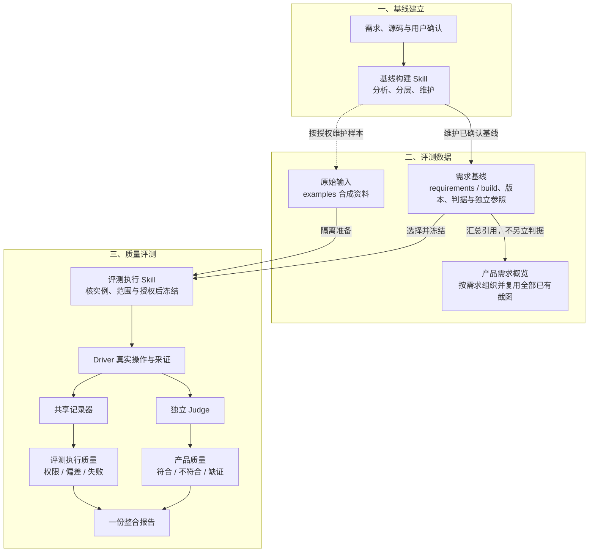
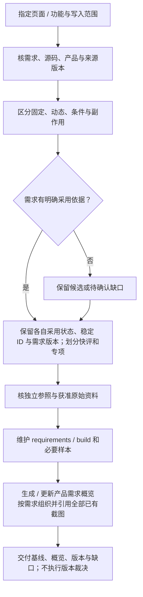
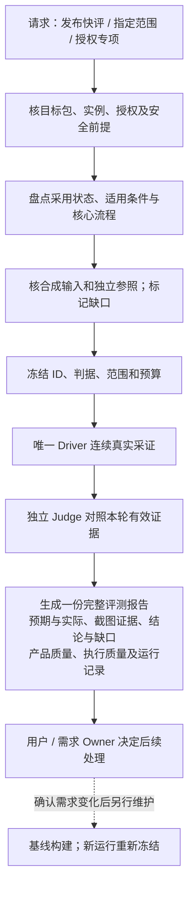

# Desktop LLM 评测概要设计（开发 Skill 承载）

## 范围与非目标

以产品页面为入口，用“简明快速检查要点＋Playwright 真实页面取证＋LLM 集中独立评审”，
默认快速发现目标版本的内容缺失、信息错误、状态矛盾和明显回归，不承担完整交互验收。
必要轻量动作须验证实际结果；核心用户流程选正常成功路径完成一次，不遍历分支。异常、后台、更新及完整持久化矩阵仅在明确的专项范围中验证。

首次建立基线，后续按已确认的需求变化增量维护；每轮验证变更功能，并检查其他功能是否受影响。
基线服务当前支持版本的有效需求，不为退役产品形态维持任务或采证适配。按已确认的
当前需求及消费者证据判定退役且无持续用途者退出当前基线，旧运行保留原标准与证据。
有效功能入口替换则更新真实路径，条件显示不等于退役；组件示例或诊断面不能冒充真实用户链路。
不建设独立评测平台，不修改产品来配合测试，也不以 LLM 判断替代确定性测试或发布审批。
本页固定业务设计；Skill 编排见[Skill ownership](../../../../docs/architecture/skills.md)。

### 与确定性测试的分工

按[测试架构](testing-strategy.md)，逻辑由单元测试、API 由真实接口/数据集成、
UI 状态组合由 PDFE Mock API 驱动共享 UI 的自动化测试承担；本工作包承接真实
客户端、后端及任务所需模型/工具的用户链路，由 LLM 驱动并独立评审。
任务的文件/摘要、业务终态、权限边界和真实副作用仍复用程序核验，不能只凭模型
自述或截图认定完成，也不以 PDFE 模拟事件和预置结果作为真实链路证据。

真实任务的必需范围、预期真源、最小关联及缺陷回流规则只在
[测试架构](testing-strategy.md#测试分层与共享契约)维护。B 根据任务交付负责人的
变更影响说明，维护受影响真实任务的判据与结果；不能只因低层测试通过或页面快评
可执行，就省略按风险判为必需的模型、工具、授权或产物任务。

B 复用现有 requirements/build，记录任务所需的原始输入、用户目标、可观察终态、
产物/副作用事实及独立参照；已存在的内容只引用，不强制增加模板字段或单独任务库。
每轮权限、预算、目标包和运行身份仍留运行记录；基线未就绪或权限不足则明确该任务
未验收，不扩大默认 Skill 权限，不用 Mock 补结果。确定性事实核验由原 Owner 提供，
Judge 只综合已取得证据，争议及高风险结论交人工复核。

需求未变的修复保留原预期；已确认行为变化只维护受影响资产，纯数据变化刷新本轮
参照而不重建全库。现有程序化 E2E 不因本分工自动删除；具体迁移安排归
实施计划 (non-public execution/provenance record omitted)。

B 消费同目标版本仍适用的低层证据，不重复遍历其全部状态组合；真实任务的实际
终态、产物和独立评审仍须取得。产品模型与 Driver/Judge 的费用、准备/采证/评审
完整墙钟分别归本次运行，不拿页面快评耗时或 Mock 成绩证明真实链路提速。

**current / gap**：现有默认入口仍是页面发布快评及已采用核心成功流程，并非全部
科研任务或模型能力评测；其默认安全范围不包含产品模型请求。真实模型、工具、
保存/恢复等链路须按已确认需求建立专项及相应授权后执行，不能因本架构分工扩大
现有 Skill 权限或将未建专项算作已覆盖。架构职责不等于执行器与全部专项已经落地。

## 评测类型与划分

以下为面向开发交付的划分，用于帮助开发与测试人员尽早发现问题、聚焦风险并加快反馈。执行 Skill 已写入四类入口规则，实际宿主及产品验证按运行证据分别确认；旧“发布快评”仍兼容覆盖全部已采用且适用的页面快评层及核心成功流程。不得因规则写入即宣称验收通过，或据此重判历史运行。

| 类型 | 选择标准与范围 | 交付与边界 |
| --- | --- | --- |
| 冒烟评测 | 选择相对稳定的产品核心主流程，检查必经页面、正常路径及真实终态。 | 快速发现阻断主要使用的问题；不声称覆盖所有页面或完整交互。 |
| 变更快评 | 根据最近交付的修改及影响分析，选择变更功能、可能受影响的关联功能和必要的回归链路。 | 快速反馈本次变更引入的问题；影响范围无法可靠判断时明确缺口，不默认为无影响。 |
| 详评 | 在版本交付或较大范围变更时，按目标版本的适用页面清单逐页检查入口、主要内容、关键状态和必要代表动作，并覆盖适用核心流程。 | 先冻结完整页面清单及适用条件；未建基线、不可达和缺证页面分别列出，不从分母静默删除。覆盖所有页面不等于穷举全部异常和组合。 |
| 专项评测 | 对指定功能或风险开展深入验证，例如导入与保存、异常恢复、跨平台、权限、模型或性能。 | 明确专项判据、输入、终态及所需授权；可与其他类型组合，结果单独说明，不用页面展示代替真实动作。 |

冒烟和变更快评可按交付风险组合执行；重叠项在目标版本、输入和判据一致时复用同一份有效证据，不重复操作。回归是评测目的，可由变更快评、详评或专项承载。各类型均需明确目标版本、数据、判据、范围及证据，分别说明产品问题、评测阻塞与未覆盖范围；不要为追求覆盖数字重复检查。调整默认范围或新增执行能力前，须另行更新并验证两个 Skill，不由本概要设计单方面改变现行执行行为。

## 唯一依据

- 原始样本、项目定义及外部依赖的共同契约见[共享示例设计](../../../../docs/architecture/examples.md)；
  评测判据与隐藏参照仍归场景库和控制侧，不能装入产品项目。文本项目准备与规程已接线，
  真实宿主调用和产品终态仍须独立取证，不能由接口存在推定通过。
- 产品要求与判据由所属需求/评测 Owner 确认；实现现状只可恢复候选要求，不能自动成为标准。
  用户明确采用指定版本现状为基线时，以该采用决定为依据纳入，不能将此视为功能已实测通过。
- 页面需求及必要参考资产归[场景库](../../eval-scenarios/README.md)，以各页面的稳定编号关联证据，不另建点位目录或固定档位清单。
- 两个目标入口的职责见[Skill ownership](../../../../docs/architecture/skills.md)；流程归各自 SKILL.md。
- 运行记录复用单一[共享记录器](../../../../scripts/shared/record.cjs)，页面评测与固定 Skill 采证共用，不另建写入器或账本。
- [Skill ownership](../../../../docs/architecture/skills.md)只收集可观察事实，不承担语义裁决或替代独立 Judge，也不扩大页面快评范围与模型授权；分类仍按驱动及判定方法。
- 操作能力复用[Desktop 操作入口](../../../../docs/runbooks/development.md)；真实验收遵守[测试规范](../quality/testing.md)。

## 系统架构图

下图展示职责和信息边界，不表示存在独立评测服务、持久化调度器，或所有模型专项已实现。



评测数据层同时包含需求基线及 `examples` 原始输入：前者包括已确认要求、版本与独立参照，后者是获准复用的合成资料；二者职责不同，均不是运行结果。基线构建在授权范围内维护数据，评测执行选择并冻结适用数据，发现问题不自动修改本轮判据。产品质量与评测执行质量分别报告：前者描述产品符合性及缺证，后者描述权限、偏差和失败；记录器只提供过程证据，不自动给质量评分。

产品需求概览是面向用户确认的汇总文档，由各页 `requirements.md` 及其全部已有参考截图组织而成；引用原需求与原图，不另建判据真源。截图只代表其来源版本及实际展示状态，缺失或不能对应某需求时明确标注，不用一张页面图冒充所有交互均有截图。概览属于计划产物，不表示生成能力已经实现。

`examples` 提供原始资料，不提供预置答案；Driver 不读取隐藏判据，Judge 不代替真实操作或确定性核验。报告和原始运行证据留获准忽略目录，基线是可复用输入；历史运行不被新基线重判。固定 Skill 的采证可共享记录器，但不共享页面快评的权限或裁决。

## 基线构建 Skill 流程图



构建依据不足时不把候选变成已采用要求；无写入权限时只交建议。必要样本按授权维护，不将结果预置为输入。概览逐项链接对应的原需求和全部已有截图，保留来源及动态边界；需求或截图未就绪时如实列缺口，不复制、改写或补造验收判据。

## 评测执行 Skill 流程图



图中仅展示正常主流程；失败处理及安全、授权和预算边界以执行 Skill 为准。`Review` 仅评审有证据的项目，无证据时直接报告缺口，不生成通过结论。缺权限、参照或真实终态不能靠减少冻结分母、修改预期或预置结果补齐；默认快评与需额外授权的人工/模型专项分列。

完整报告覆盖本轮冻结的全部计划页面与核心流程，关联需求编号、预期、实际、证据及结论，并分别说明产品质量、评测执行质量和未执行或无法判断的缺口；运行记录提供目标版本、过程及证据索引的追溯入口。完整报告不等于全部要求通过，也不代表未选专项已经验收。

## 当前能力、要求与缺口

默认“发布快评”自动规划全部现行已采用且适用于目标包的基线快评层及核心成功流程，不只抽选主要页面；每份资产均有纳入/排除理由，候选、专项、未就绪与未建范围明确列出。历史完成不替代本轮执行，指定功能时才缩小范围。不要求全部功能全绿，也不以反复补证获得100%通过。基线与目标身份及适用条件绑定，缺证、失败及专项分别列明；跨状态写入须另核隔离副作用及实际结果，不能由入口展示替代。

- **current**：已有场景资产、Desktop 操作与取证能力；不等于已具备完整自动评测。
- **required**：需求可判断，操作真实，证据对应目标版本，评审不改变本轮标准。
- **required**：冻结前一次核齐必要数据和独立参照字段；按既有权限准备合成输入，缺口明示不删项。普通项目返回和跨项目隔离分别界定，不能增加未声明前提。按页面短链连续采证、逐步核就绪，证据齐后一次独立评审直接交单报告；复测列条件差异再比耗时，不新增调度框架或以少测追绿。
- **required**：执行前区分快评层与专项层。每页检查正常入口、主要内容/控件及动态关系，必要时一个代表性轻操作，并留清晰截图；限幅、全快捷键、加载瞬态、组合、复杂格式、异常恢复及持久化矩阵不默认纳入。原要求及历史判定保留，不在看到结果后删项。
- 需求恢复与裁决均使用用户可见的业务语义；源码路由名不直接成为页面名称，评审不额外推导未声明的布局或交互条件。歧义修订与缺证补测分别处理，保留原输入及原裁决。
- **gap**：快速结果只覆盖冻结要点与实际自然状态；历史结果不追认新模式通过，也不证明发布或全平台验收。实际覆盖与缺口由各运行报告持有。
- **required**：普通采证失败隔离本项及依赖流程，保留首错；有新证据且安全、权限和预算满足时可记录纠正或继续独立项。普通产品页面、遮掩标识或偶然显示的普通目录元数据不自动构成敏感暴露；实例身份漂移、真实凭据或未授权私密正文暴露、未知副作用等先隔离受影响路径，风险未解除前不继续该路径。历史失败、范围和预算不重置；具体分类与恢复机制由执行 Skill 持有。
- **advisory**：已运行客户端每页约 3–5 分钟作为待验证效率目标；不以新引擎、全仓源码扫描或机器格式重做作为起步前提。
- **required**：速度优先，快评直接说明关键字段/参照，不由引用ID扩张为完整细则；按当前页面可靠定位，批内先采核心链真实终态，长页连续重叠，Driver核区域、Judge检查报告关键图，避免双方重复全看。已知参照/入口缺口一次核验收口并保留分母，不增加调度层或追绿；范围差异须在复测对比披露。
- **advisory**：基线建设与发布快评分开推进，不必等全项目基线齐备。缺简明判据的页面先由构建入口补必要要点/来源再冻结；执行入口不临时定义正确答案。

## 页面需求与评测结果

已确认的入口迁移按当前承载页映射旧稳定ID，合并重复页面计数，保留原完整字段/历史分母及未映射边界；不因旧布局消失认定业务能力缺失，也不把映射当作实测通过。映射依据由build持有，run只消费新冻结范围。

每个页面按“页面用途与语义入口 → 用户工作 → 简明快速检查要点”组织，功能名称前置，保留稳定编号及版本，不写完整交互用例。入口是已核对的导航线索，不是固定坐标或布局约束。
入口后可放获准复用的页面参考图，标明来源版本/平台/日期及动态边界，帮助人对应功能；参考副本随场景保存，原运行证据不覆盖。参考图不是像素标准、动态值判据或本轮结果截图。默认评测范围和动作禁令只在 Skill 维护，需求正文不逐页或逐项重复公共规则。
构建时必须详细分析相关页面及必要 Owner 链路，区分固定结构/语义、动态字段来源与回退、条件显示/禁用及动作副作用；逐项定位和未知项放构建记录，正文只保留判断所需信息。固定不等于像素或所有语言文字固定，动态内容不与旧截图逐字比较；未受变化影响的分析可复用。
页面级建库应盘点可见内容、滚动内容及已知条件分支，保留未知和待确认项；单功能试点只限制执行范围，不代表整页需求只有该功能。截图及源码恢复的新项保持候选，不自动批准或扩大评测。
准备复用的需求保存于已有场景目录的 `requirements.md`；候选可入库但保留待确认身份，不能以临时目录代替可复用交付。
每条用一两句话表达当前页检查什么、固定还是动态、以什么关系判断正确；必要复制动作仍核真实剪贴板和反馈。普通快速评审不遍历所有状态、切换偏好或逐个打开外链。
基线明确自动快评和人工专项的归属：需要特殊真实环境或高风险操作的要求保留编号及判据，单列待人工确认，不计自动分母；有安全独立参照的动态展示仍可自动评审。归属在运行前冻结，不能按结果移除缺证或失败项；划分规则及原始字段交接规程由 Skill 持有。
自然条件不适用的点据实单列，不算通过；完整业务要求及专项行为未覆盖范围集中说明，不因未遍历它们否定已满足的快速要点，也不把快速符合当完整功能通过。用户另行要求专项时再核真实条件和全部必需分支。
自然状态与适用条件须有证据；只核当前状态应展示的字段，合理禁用不强行点击。快速范围未选入的下载安装/重启只列完整行为未覆盖，不因未点击而将入口展示判为未执行或无法判断；已选专项动作另按实际情况分类。

| 需求字段 | 内容 |
| --- | --- |
| 功能标识 | 功能名称前置，保留稳定编号及逐项纳入/变更版本 |
| 快速检查要点 | 明确可观察的固定内容或动态关系，避免“正常”“体验良好”等模糊描述 |
| 测试前提 | 必要账号状态、项目或资料；无特殊前提时不增加额外准备 |
| 判定与证据边界 | 需求特有的符合/不符合条件、缺证情形及应观察的页面区域、产物或终态，不绑定固定坐标 |

公共执行、授权、预算、停止及截图规则只在 Skill 维护，不复制进每份需求。
同一页面只有一份需求正文，不另建页面模板副本；格式要求归构建 Skill。宿主读取、工具调用和实际执行情况属于运行记录，不属于需求或固定流程规则。
可复用需求正文只记录业务内容、稳定编号及逐项版本；来源、源码哈希、采用依据及资产修订集中留在场景构建记录，不混入需求正文。
每项以需求版本（例如 v`0.3`）标记首次纳入或最近实质变更的需求版本。首次建库按已确认版本纳入；后续仅新增/实质变更项升级标记，仍有效的未变项保留旧版本和编号，用于新版本回归。该标记不是被测包版本或截止适用版本，排版与复测不升级标记；缺少版本依据时保留待确认。
具体目标包版本、路径、初始设置及本轮元数据取值在运行清单记录，执行时绑定，不为每次发布修改长期要求。
小型合成/脱敏资料随场景管理，历史数据按适用版本与语义引用；运行截图、日志、结果和临时分析仍放忽略目录。已有需求/判据正文只引用，不重复维护标准。

评测报告依次呈现总体结果列表、发现的问题与缺口、正常功能结果及运行记录链接；开头简述模式、范围和实际耗时，不将覆盖缺口当产品缺陷或将局部通过当整个版本可发布。逐项详情含预期、实际、判断依据与截图，少量截图可共享但须说明所证区域；技术身份和证据索引另存运行记录，不只列失败项。
一次请求对应一份整合报告，覆盖全部所选页面、功能与批次，复测历史不覆盖；运行墙钟与开发优化耗时区分，具体组织与采证规则归执行 Skill，不新增独立报告流程。
总体分别展示页面覆盖、核心流程覆盖及本轮通过率，分子/计划分母可回查；基线建设完成度另列，不混作本轮覆盖或执行前提。已取得页面证据但无法判定与完全未执行区别呈现；具体口径只在执行 Skill 维护。
产品符合性与评测执行质量分开，记录越界、采证故障与临时补采；页面通过不证明执行规则已验收。最终规则有真实调用证据才标已验证，计时与证据索引在执行时自动产生，完整受阻不额外消耗产品Judge。
自然语言可选择发布快评、指定功能或明确专项；“完整报告”默认是全现行已采用适用快评范围的跨页面/批次整合交付，不是全部历史细则验收。用户已采用的默认安全范围由执行Skill唯一维护，运行前不再确认；越界、身份歧义或无法隔离的分支停止并记缺口，其他独立项继续，不询问临时扩权或把自动执行视为所有副作用授权。区分未执行、专项、未选与未建基线；启动受阻也交付缺口报告。
影响判断的自然状态及公共条件集中列一次，逐项只补条件差异。无关前提、动作和非图证据字段可省略或合并，不留空占位；必要预期、实际、判断依据、证据及缺口仍须完整。
截图放在首次使用它的逐功能详情内，后续功能链接前图并说明对应区域，不重复展示或集中放到末尾；不同状态保留各自证据。
报告使用纯Markdown标题导航，避免原始HTML锚点影响人工阅读。

总体列表覆盖本轮全部计划功能，明确通过列表及不符合、无法判断、未执行项，并可定位到对应详情：

| 需求 | 实际结果 | 结论 | 问题及证据 |
| --- | --- | --- | --- |
| 编号及快速要点 | 本次真实观察 | 快速评审符合／不符合／无法判断／未执行 | 预期与实际差异、简短复现、截图或必要结果证据 |

每项已执行功能均提供测试结果说明及对应的本轮真实截图，包括通过项：
- 功能编号与名称、测试前提及关键操作。
- 预期结果、实际结果、结论及判断理由；不符合时说明差异与复现方式。
- 可直接查看的结果截图、绝对本地路径及截图所证明的内容；涉及多个关键结果时提供必要的多张截图。

截图逐张打开检查，不以无关画面、旧版本截图或其他用例截图替代；共享截图须明确关联功能及各自所证边界。
截图无法证明的行为补充对应产物或其他证据。无法采集截图时注明原因与证据缺口，不冒充截图完整的通过项；
未执行功能保留原因，不伪造截图。敏感内容仅使用获准脱敏证据，报告和截图默认保存在获准忽略目录。

报告记录目标构建、平台、基线版本和已测范围，突出不符合项、阻塞及剩余风险。
已观察到明确违规应保留失败；证据不足不能判符合。只有所选全部适用快速要点有充分证据通过，才能报告该快速范围符合；不适用数、条件证据和未覆盖完整行为另列，不声称整页业务全部验收通过。

## 基线构建与版本评审闭环

```text
需求资料／源码／产品观察 → 候选要求 → 确认要求与测试数据
    → 冻结本轮基线 → 真实操作与结果取证 → 独立评审 → 需求对比表与问题
```

- **基线维护**：需求不变则保留原预期；新增或确认变化时只更新受影响项；修复缺陷补回归场景。
  保留稳定编号、修订依据和历史结果，不因单次失败或入口消失自动改标准、删除检查。
- **开发收尾**：自动分析本任务完整差异与已有来源，识别直接页面及共享能力的关联页面，形成“无需改预期／最小修订／待确认”与回归范围。有已确认需求、版本依据和资产写权时自动生成修订并Review；异常、冲突及歧义保留原标准。自动分析指编码宿主在开发收尾执行，不代表已有后台监控或CI自动写库；具体方法由构建Skill持有，不新增平台。
- **版本识别**：需求标记、源码修订、资产修订和实际被测包身份分别记录。需求版本来自已确认目标或发布映射，不从分支名、构建日期或安装版猜测；源码声明版本仅为线索。未变要求保留旧标记，新要求缺版本依据时不自动采用。评测沿适用条件复用旧要求，涉及新变更或同构建声明时核可信制品绑定，不用旧安装包证明新改动通过。
- **增量边界**：复用最近有效分析，仅依赖变化、来源失效或覆盖不足时补核相关链路，不因来源较早重读全部历史。运行数据变化不改预期；动态字段的来源、格式、默认值或条件等业务规则变化，仍按确认依据判断是否修订，不能作为普通取值刷新略过。
- **测试数据**：复用合成或获准脱敏资料，可包含特定历史项目、会话及旧格式数据。
  保留原件，每轮使用隔离副本，不覆盖用户状态；迁移测试从迁移前数据开始。
  前置准备不得提前完成被测步骤，如导入前预先导入、解析前预填结果或向任务泄漏答案。
- **评测范围**：覆盖本次变更、共享能力变化可能影响的关联功能，以及固定关键回归链路。
  阶段性扩大回归弥补影响分析漏判；时间不足保留未执行项，不静默删减必测范围。
- **执行边界**：操作前固定需求、资料和目标版本；运行中不改判据或补资产追绿。
  基线问题另行确认、修订后再测；旧运行保留原标准和证据。

源码和产品观察必须区分事实、推断与已确认要求。缺确认依据时，只报告探索或行为差异，
不能声称满足正式需求。未执行、只引用历史证据的功能，不能声称本版本未受影响。

## 真实取证与判断边界

判断以冻结需求和真实产品信息为主：先明确预期，再比较页面、反馈、剪贴板及实际结果。源码仅在无法判断、证据矛盾或原因不明时按适用版本辅助澄清，不作为每项必读或实测替代，不从当前实现反推正确答案。
源码可解释原需求已引用的配置与条件；关键预期或引用本身不明确时应交基线确认，不能临时把实现值当新标准。报告区分产品问题、采证遗漏、环境/数据不足和安全/权限限制，说明辅助证据解决了什么、仍缺什么。
获准离线复核时保留原报告及原评审，另记结论变化及依据，不修改冻结判据、不冒充重新实测或新的独立评审。

Playwright 经既有操作入口驱动真实客户端，采集页面结构、文字、控件状态、截图及操作后的结果。
UI-only 评测不以产品模型授权或真实模型回合为前提；需要的产品账号权限与宿主驱动/评审费用仍分别核清，只有涉及产品模型调用时才检查其模型前提。
当前展示要求可以据真实页面判断；点击成功、入口或产品自述不证明动作完成。必要轻量动作核结果；导入、保存、后台和 AI 等专项任务才要求对应真实终态与产物，不能静默加入默认快速范围。
原生窗口或不可观察状态按既有能力补证；无法取得时明确受阻，不伪造数据。

LLM 按已确认要求解释证据；驱动与评审使用独立上下文或独立人工评审，隐藏参考不能进入产品或 Driver。
确定性事实复用现有断言/验证能力，语义质量由 LLM 辅助评审；争议及高风险结论由人工复核。
日志与 Trace 仅在页面证据不足或定位问题时按需补充，不要求每个页面都执行完整诊断。

## 职责与依赖

需求 Owner 确认要求，评测 Owner 维护基线与结果，产品缺陷交原开发 Owner 修复。
资产归 app 场景库，执行证据保存在获准忽略目录；不把隐藏答案放入产品技能包或可发现目录。
编排、授权、预算和恢复规则归[Skill ownership](../../../../docs/architecture/skills.md)，不在此复制实现细节。
私有文档和测试资料遵守现有公开投影及隐私边界，不因评测整合扩大发布范围。

## 正反例

- 正例：按“导入后可打开阅读”的要求，从原始文件导入并检查实际阅读结果。
- 反例：预先放入解析结果，仅凭列表出现一条记录就宣布导入功能符合需求。

## 落实方式

通过页面需求到证据的逐项关联、独立评审及真实宿主/产品验证落实；文档检查不证明产品符合需求。
结论区分符合、不符合和证据不足，不承诺所有判断自动完成或固定耗时。

## 更新时机

确认需求、功能范围、关键数据兼容性或证据能力变化时，增量更新受影响项；实现变化不自动修改预期。

## 停止条件

达到本次范围、预算或权限边界时停止，报告已完成与未完成项；不能为取得通过无限重试。
概要设计成立不等于目标 Skill 已实施，也不自动授予产品操作、模型调用或发布权限。
