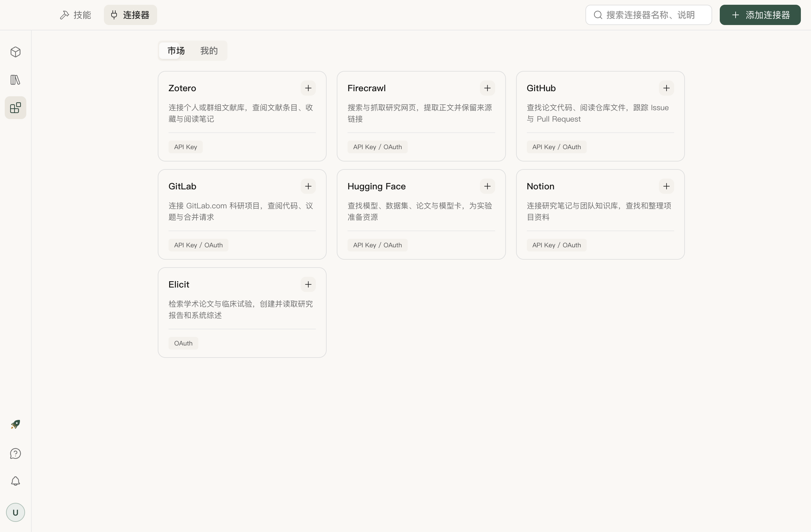

# 连接器列表与详情

目标版本连接器市场参考

参考：macOS arm64，0.3.2 / 202611121823 / preview，2026-11-12；仅展示市场自然状态，不证明连接器配置、授权或工具调用。

目标版本连接器未提交表单

参考：同一目标版本，2026-11-12；完整窗口中的 HTTP 空表单，未填写或提交，不证明预览、保存或连接。

目标版本 STDIO 空表单参考

参考：同一目标版本，2026-11-12；完整窗口中的 STDIO 未提交空表单，仅展示命令和参数入口，不证明切换动作、预览、保存、命令执行或连接。

当前连接器市场参考

当前连接器未提交表单参考

参考：macOS arm64，0.3.2 / 202611121104，2026-11-12；表单未填写或提交，不证明连接、授权或工具调用。

查找连接器并查看连接说明、当前状态和可见工具信息。入口：主界面“扩展” → “连接器”；默认“市场”，可切换“我的”。

参考：macOS arm64，0.3.0 / 202610281438，2026-10-29。目录、安装及授权状态随环境变化；图中取值不作为长期预期。

## 查找连接器

### 入口与市场目录（CONNECTOR-OBS-001 · v`0.3`）
固定：连接器导航、市场/我的标签、搜索及添加入口清楚，当前标签与内容一致。动态：市场展示当前公开目录中的非自定义连接器，名称、当前语言说明及适用认证方式/授权状态徽标与目录和产品文案一致；已安装项仍保留。加载、读取失败和真正空态须有可区分的反馈。

### 我的目录与卡片状态（CONNECTOR-OBS-002 · v`0.3`）
动态：我的仅展示当前已安装连接器，包含预置及自定义项；无安装项且未搜索时显示空态和添加入口。市场安装标记对应当前安装状态；已授权项的任务开关选中状态为已授权且已启用，未授权项显示适用授权或自定义编辑入口，不可直接切换启用；不能由入口展示推断动作成功。

### 搜索与范围组合（CONNECTOR-OBS-003 · v`0.3`）
动态：当前来源内可按名称、当前语言简介或来源地址检索，忽略大小写和首尾空格；无匹配有提示，清空恢复。市场/我的切换保留当前搜索词，并按新范围过滤，不套用技能页的分类或分标签关键词规则。

## 查看连接器

### 详情说明与元数据（CONNECTOR-OBS-004 · v`0.3`）
动态：未安装也可查看详情，标题、说明、来源域名或来源标识与所选目录项一致；传输协议、支持的认证方式及服务地址清楚，无远程地址时显示本地进程说明。固定：当前详情展示版本标识1.0.0，不将其作为远程服务握手版本正确性的证明。说明区域可按内容滚动，关闭回原列表。

### 详情安装与授权状态（CONNECTOR-OBS-005 · v`0.3`）
条件：未安装时不显示已安装专属任务开关；已安装时，任务启用及授权信息对应当前状态。已授权且为预置或OAuth连接时，非空账户、范围及到期信息与公开授权元数据一致，到期秒值按客户端本地时区显示；已有错误或撤销影响说明不能被正常状态掩盖。安装、授权及任务入口不证明其动作链路通过。

### 工具区域与分页（CONNECTOR-OBS-006 · v`0.3`）
条件：未授权不展示工具清单；已授权时区分待获取、停用后需启用、0个工具及已有工具，不将未知数据当0。已有工具的数量、名称和说明对应当前公开工具元数据，缺描述显示“暂无说明”；超过5个时每页5个，首末页前后按钮禁用状态正确，切换详情回第一页。获取失败有说明，不伪造清单；当前未出现的授权/分页状态不算已遍历。

## 发布快评层

采用v`0.3`的正常子要点：CONNECTOR-OBS-001、002；仅代表下述范围，不代表这些ID全部细则通过。

连接器页面的市场/我的来源标签、当前目录卡片及自然安装/授权状态应与对应公开目录一致；无安装时保留真实空态，不凭市场卡片推定已连接。

MCP承载关系由用户于2026-10-31确认，复用MCP-OBS-001–003的v`0.3`功能身份，与本页合并核验：
- **状态（MCP-OBS-001子范围）**：当前卡片及所选详情的安装/启用/授权状态对应公开目录；未授权不冒充已就绪或已有工具，未知工具数量不当0。
- **列表（MCP-OBS-002子范围）**：“我的”包含已安装预置/自定义连接器，或显示与目录一致的真实空态；与CONNECTOR-OBS-002共用证据，不重复计页面。
- **添加表单（MCP-OBS-003子范围）**：“添加连接器”可打开未提交表单，名称及HTTP/SSE/stdio协议入口可辨；自然HTTP显示URL，若自然为stdio则显示命令/参数。当前新建表单不要求旧版独立标识输入框。空表单不允许直接预览/提交，取消回列表；不填地址/凭据，不执行预览、保存、导入或连接。

旧独立页的六类总数、全部传输切换、刷新/写入与异常矩阵仍见[MCP历史要求](../mcp/requirements.md)，不宣称本层全部覆盖；当前功能判据不要求复原旧设置页布局。

必要参照：目标实例同来源公开目录及安装/启用/授权最小字段；[目标版本沿用边界](build.md#202611121823-正常展示沿用)要求先核目标包实际读取契约，[旧制品复核](build.md#当前制品复核)仅作线索，不读取凭据或配置正文。

## 专项层

本层未选：搜索组合、详情全部元数据、已授权工具与分页、安装/授权/调用。原完整判据、稳定ID、版本和历史结果保留；未确认分支不因分层获批。

## 连接器配置与工具使用候选专项

以下是历史探索要求及用户确认的连接器入口语义，目标版本适用性、产品需求版本和正式采用状态仍待确认，不属于上述已采用发布快评分母。历史 `@` 后数字为业务点资产修订，不是产品需求版本；见[构建依据](./build.md)。现有未提交空表单截图不证明预览、保存、授权、连接或工具调用。

### 无效配置与纠正（历史 `CONNECTOR-VALIDATE-01@2`）

在获准隔离实例的未保存合成草稿中填写无效 URL，预览时应有可辨的校验反馈并允许纠正；合法格式的草稿可继续预览或明确说明不可用，取消后不应形成新配置。校验反馈不证明远端服务连通；不得为验证执行 STDIO 命令或使用真实凭据。测试前须准备可区分的合成输入与独立目录前后参照，预览可能读取配置，须先核目标包实际副作用及授权。

### 批量预览与取消（历史 `CONNECTOR-PREVIEW-01@1`）

对两项可区分的 HTTP/SSE 合成配置，预览内容的名称、地址和传输方式与独立输入对应；取消后重新读取获准隔离目录，确认未新增连接器。示例地址只作为格式输入，不视为可用服务；仅靠关闭弹窗或保存按钮回执不能证明配置未写入。表单/JSON 双向转换、重复项和失败恢复另列专项。

### 配置、认证与真实工具消费（历史 `CONNECTOR-AUTH-01@1`）

历史用户要求授权页同时支持两种方式时 API Key 在左、OAuth 在右；服务只支持一种时不伪造另一方式。以同一可控服务的独立能力参照核展示，不以空表单或源码推断认证已完成；目标包适用及具体服务状态待核。

在另行获准的隔离环境中，使用专用测试服务及本人授权的测试认证，从连接器入口配置或安装，分别观察认证、连接、可见工具和获准任务中的真实工具消费；工具身份与独立服务目录对应，消费结果与同一回合及服务证据相符。保存成功、授权入口或工具列表单独出现均不等于真实调用成功。API Key、OAuth 和 STDIO 是不同条件，外部登录、进程执行、配置写入、联网及模型调用须分别核定授权，不读取或复制真实凭据；撤销/删除及异常恢复另列专项。

### 数据与截图缺口

可使用[合成连接器配置](../../../../../examples/projects/connector-preview/files/connector-preview.json)作为获准人工预览的输入，身份与摘要见[构建依据](./build.md)；它只供人工复制至 JSON 草稿，使用保留的 `.invalid` 域名，不提供真实服务、认证或可连接性。预览前须核隔离实例与读配置副作用，不自动保存或连接；可控 MCP 测试服务仍缺。当前仅有市场及未提交空表单的真实窗口参考图，缺预览、连接、授权和真实工具消费状态的可复用完整窗口图。执行前须确认需求与目标版本、独立参照、成本和副作用；缺任一必要条件时保留缺口，不以历史局部观察或源码模拟事件替代真实路径。
