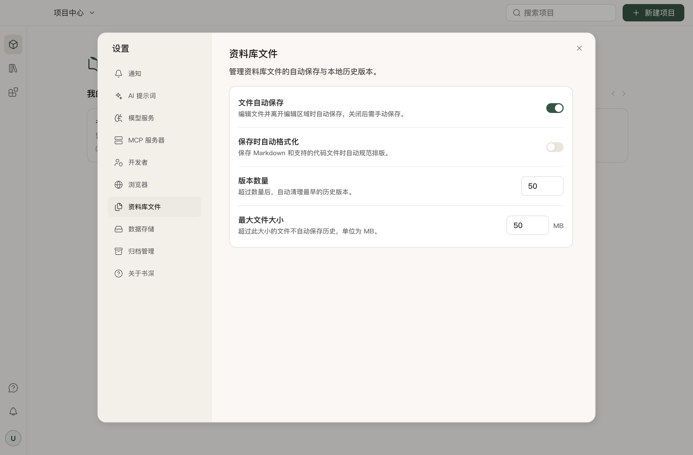

# 资料库文件

目标版本资料库文件参考

参考：macOS arm64，0.3.2 / 202611121823 / preview，2026-11-12；显示自然偏好和版本限制，图中数值为动态值，不证明策略保存或生效。来源与摘要见[构建依据](./build.md#202611121823-目标版本参考图)。

查看文件保存偏好及版本保留限制。入口：主界面头像菜单 → 设置 → 资料库文件。

参考图来源：macOS arm64，0.3.0 / 202610281438，2026-10-28。开关和限制数值为当时设置，不作为后续固定预期。

## 查看保存与版本策略

### 保存偏好（FILE-OBS-001 · v`0.3`）
固定：标题、说明、自动保存及保存时格式化两行清楚。动态：两个开关分别对应客户端当前保存偏好，未保存时采用该版本默认值。

### 保留限制（FILE-OBS-002 · v`0.3`）
动态：每文件版本保留数、最大文件大小及单位清楚；数值对应本实例当前文件版本设置，文件大小以MB展示并由设置中的KB换算。读取完成前的临时默认值不能作最终依据。

### 说明与可用性（FILE-OBS-003 · v`0.3`）
固定/条件：保留数和大小字段附用途说明；设置读取成功后数值可用，读取失败时有失败反馈，当前设置标记需迁移时展示迁移提示。高级配置仅在目标版本开放该能力时要求显示，未开放不要求额外配置区。

## 发布快评层

采用v`0.3`的正常子要点：FILE-OBS-001–003；仅代表下述范围，不代表这些ID全部细则通过。

文件策略应显示当前自动保存/保存时格式化状态、版本保留数量与大小及说明；值与已成功读取设置/声明默认值对应，大小单位转换正确。

必要参照：按目标实例实际契约核保存偏好与文件版本设置最小字段；[旧包读取记录](build.md#当前制品复核)仅作线索。大小按KB/1024并保留两位后去无用0比较。

## 专项层

本层未选：偏好修改、迁移确认、保留/清理与真实保存生命周期。原完整判据、稳定ID、版本和历史结果保留；未确认分支不因分层获批。
