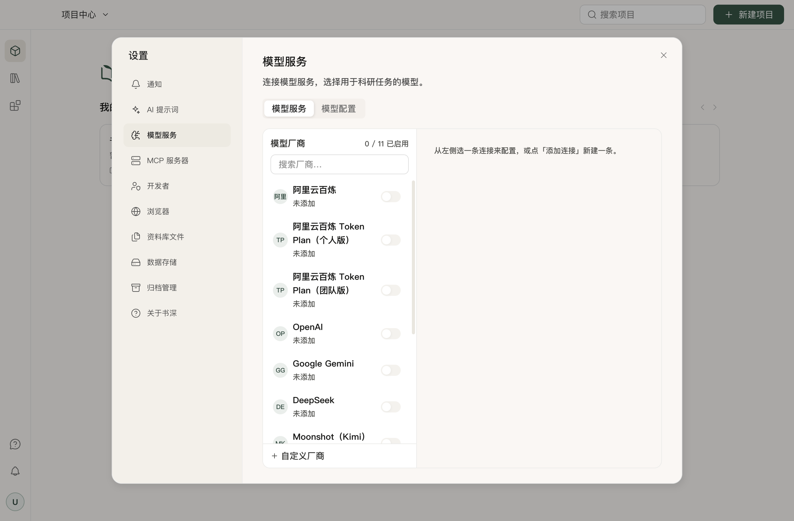
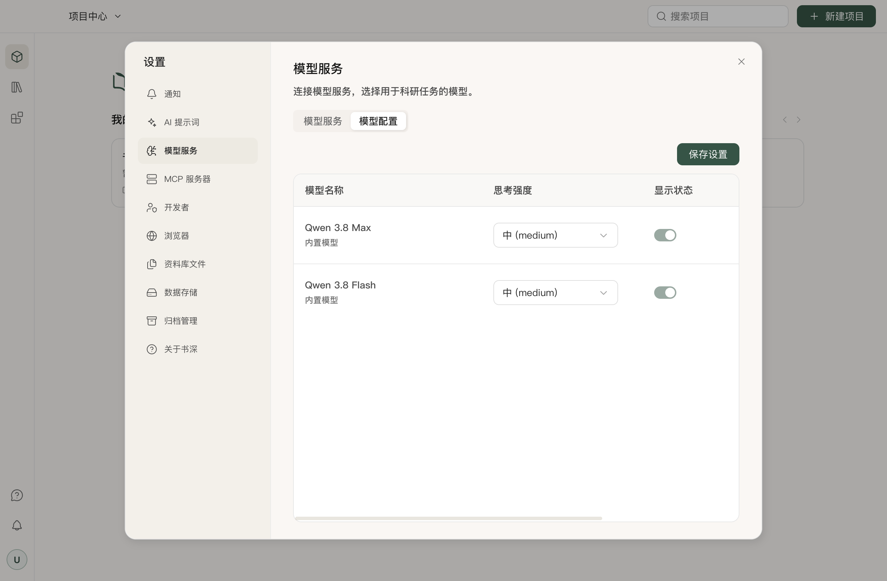

# 模型服务

目标版本模型服务参考

参考：macOS arm64，0.3.2 / 202611121823 / preview，2026-11-12；仅展示未配置厂商的自然状态，不证明连接、配置或调用。来源与摘要见[构建依据](./build.md#202611121823-目标版本参考图)。

目标版本模型配置参考

参考：同一目标版本，2026-11-12；展示内置模型的自然配置，不证明参数保存、生效或调用。

查看模型连接及模型配置。入口：主界面头像菜单 → 设置 → 模型服务；页面内有“服务”“配置”标签。

补充参考：[厂商列表底部](./providers.png)、[横向滚动后的参数区域](./parameters.png)。来源：macOS arm64，0.3.0 / 202610281438，2026-10-28；连接、模型、档位和数量为当时数据，不固定后续取值。

## 查看连接

### 服务目录（MODEL-OBS-001 · v`0.3`）
固定：页面标题、说明、服务/配置标签、连接搜索和添加入口清楚。动态：服务列表的厂商/连接名称、启用连接数和列表总数与当前公开厂商目录及已有连接一致，不固化数量；未配置厂商可显示未添加状态。

### 当前详情（MODEL-OBS-002 · v`0.3`）
条件：没有选择连接时，右侧显示选择或添加连接的引导；自然状态已选连接时，API详情展示对应名称、地址、密钥遮蔽及模型区域，OAuth详情展示对应订阅连接信息。读取中与加载失败须有对应提示，不能把它们当作稳定空态。

## 查看配置

### 模型与参数布局（MODEL-OBS-003 · v`0.3`）
固定：“配置”标签内展示保存入口及模型名称、思考深度、可见性、上下文窗口列。动态：模型行对应当前可用及隐藏模型目录，名称、来源不与历史参考图逐字绑定；无模型时不要求虚构行。

### 能力与当前偏好（MODEL-OBS-004 · v`0.3`）
动态/条件：支持可选思考档位的模型，当前显示值采用有效的已保存档位，未保存或无效时采用模型目录默认档位；无可选档位时展示固定或尚未确认的能力说明。内置模型显示为可见且不可切换，其他模型可见性对应当前目录；上下文窗口仅核参数入口与刻度展示，不把它作为实际模型容量或已生效值。

## 发布快评层

采用v`0.3`的正常子要点：MODEL-OBS-001–004；仅代表下述范围，不代表这些ID全部细则通过。

模型服务与配置的主要区域、服务目录/连接数量及当前自然详情应与公开目录和获准配置最小字段一致；模型行的名称、推理强度、可见性及上下文说明可辨，不把上下文显示当实际容量证明。

必要参照：按目标实例实际契约核公开厂商、连接、可用/隐藏模型与推理偏好最小投影；[旧包读取记录](build.md#当前制品复核)仅作线索，无选中项按原002自然引导核对。

## 专项层

本层未选：新增连接、OAuth/API凭据、连接测试、参数修改保存及模型调用。原完整判据、稳定ID、版本和历史结果保留；未确认分支不因分层获批。

## 模型配置与生效候选专项

以下为历史需求线索，均未自动纳入当前目标版本的已采用范围；`@` 后数字为历史资产修订，不是产品需求版本。目标包适用性、需求版本与采用状态待确认；既有展示快评不证明配置、保存或模型调用成功。

- **服务配置与目录（历史 `MODEL-CONFIG-01@5`）**：在获准隔离配置中通过真实表单保存指定测试服务；独立核对重新打开的配置及目标模型进入可选目录，密钥不以明文回显。只看空表单或内置模型不能证明保存与连接；真实凭据、外部端点和连接探测须另获授权，不记录完整密钥。
- **思考强度（历史 `MODEL-REASONING-01@2`）**：在支持选项的模型上更改并保存获准档位，重新打开设置和新任务时核对同一模型显示与独立保存参照一致，其他模型不被串改；界面一致不证明供应商接受该参数。模型调用另需授权。
- **上下文窗口（历史 `MODEL-CONTEXT-01@2`）**：在可丢弃隔离配置中选择、保存并重新打开，比较所选值与产品接收状态；不把控件显示或保存提示直接当作真实生效。当前是否支持持久化及目标版本适用性待确认，不能以实现现状或截图更改历史候选。
- **会话模型切换（历史 `CHAT-MODEL-SWITCH-01@3`）**：在已有两个获准可用模型的隔离任务中选择目标模型，观察下一真实回合的模型身份与界面选择对应；只有选择器变化不构成成功。需要模型调用、费用和任务写入授权，不预设模型输出。

测试使用专用测试账户、隔离模型配置、受控端点和非秘密独立参照；不复制真实用户密钥或配置。可选用 `examples` 中的合成原始资料作为任务输入，但其存在不证明模型已连接或回合已执行。当前完整配置/重新打开及模型切换真实窗口截图、测试端点和权限均缺；不得用既有展示图、模拟响应或预填结果代替。
