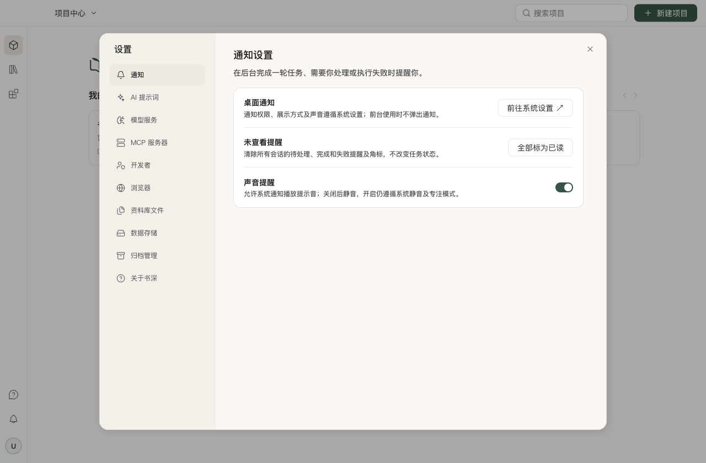

# 通知

目标版本通知设置参考

参考：macOS arm64，0.3.2 / 202611121823 / preview，2026-11-12；展示通知设置及当时声音偏好，不证明通知投递或实际发声。来源与摘要见[构建依据](./build.md#202611121823-目标版本参考图)。

查看系统通知入口、未读处理入口和声音偏好。入口：主界面头像菜单 → 设置 → 通知。

参考图来源：macOS arm64，0.3.0 / 202610281438，2026-10-28。声音开关为当时偏好，不作为后续固定预期；参考图仅帮助对应页面。

## 查看通知选项

### 通知与未读入口（NOTIFY-OBS-001 · v`0.3`）
固定：页面标题、说明及“桌面通知”“未读消息”“声音提醒”三个分组清楚；前两组分别展示系统通知设置、全部已读入口及其用途说明。

### 声音偏好（NOTIFY-OBS-002 · v`0.3`）
动态：声音提醒开关与客户端当前保存的声音偏好一致；未保存过时采用该版本默认值。只核展示状态，不以是否实际发声判断。

## 发布快评层

采用v`0.3`的正常子要点：NOTIFY-OBS-001、002；仅代表下述范围，不代表这些ID全部细则通过。

通知设置应显示桌面通知、未读和声音相关分区与主要入口说明；声音开关与已成功读取的偏好或声明默认值相符。

必要参照：本实例 `soundAlerts` 启动偏好白名单；[历史制品读取线索](build.md#当前制品复核)仅绑定旧包，执行前须核目标包的读取契约和默认值。仅已知偏好缺失且已确认目标包默认值时使用默认值，启动后有修改则需当前独立参照。

## 专项层

本层未选：系统设置跳转、全部已读、开关修改及实际声音/通知投递。原完整判据、稳定ID、版本和历史结果保留；未确认分支不因分层获批。
