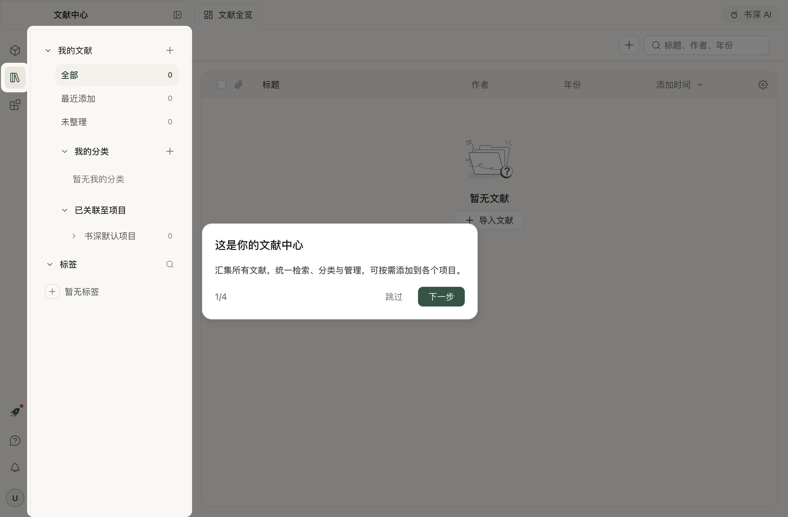

# Onboarding

Help users understand projects, the Literature Center, and the reader. Entry: avatar menu → 新手引导 (Onboarding). On first entry into an applicable work scope, onboarding is also shown automatically.

Full-window reference: onboarding center in the target version

Reference: macOS arm64, 0.3.2 / 202611121823 / preview, 2026-11-12; shows the onboarding-center dialog and the seen state at that time. It does not prove first-time triggering or onboarding progress.

Reference: macOS arm64, 0.3.0 / 202610281438, 2026-10-29. Example first-step card and spotlight area for the Literature Center; progress, content, and seen state vary by onboarding group and data, so this is not evidence from the current run.

## Entry and Orientation

### Onboarding center (GUIDE-OBS-001 · v`0.3`)
Fixed: Show descriptions for the three items “开始使用”, “文献中心”, and “文献阅读”, along with the View and Reset All entries. Project onboarding is part of the Getting Started flow; a fourth standalone entry is not required. Dynamic: assess each seen marker under 010. Closing the center returns to the work area.

### First-time triggering and waiting (GUIDE-OBS-002 · v`0.3`)
Conditional: When a group has not been seen and its page is ready, the project overview triggers the welcome flow, the project work scope triggers project onboarding, global literature triggers Literature Center onboarding, and a real PDF reader triggers reading onboarding. Only one group appears at a time. Onboarding must not take priority while settings, a menu, or a project form is open, and must not falsely mark a group as seen when its prerequisites are unmet.

## Learn by Work Scenario

### Welcome and project creation (GUIDE-OBS-003 · v`0.3`)
Fixed: The welcome page explains projects, tasks, and artifacts, and offers Create First Project and Skip. Project creation reuses the project form. Clicking “取消” in the form returns to Welcome; closing the form or explicitly skipping is covered by 009. After successful creation, enter the new project and continue project onboarding. Verify the actual project creation result against the [project baseline](../project-center/requirements.md).

### Project-work onboarding (GUIDE-OBS-004 · v`0.3`)
Fixed: In the full applicable scenario, introduce project switching, research capabilities, task input, project files, and the workbench in five steps; each card corresponds to the actual area. The descriptions of resources, literature, and task artifacts in Project Files match the switcher area. The final step, “开始第一个任务”, ends onboarding and focuses task input; it does not mean a task has been submitted.

### Literature Center onboarding (GUIDE-OBS-005 · v`0.3`)
Fixed: In the full applicable scenario, introduce global literature, import, categories, and the AI entry in four steps; each card points to the actual current area. Expand the relevant area when needed for the category step. After the final step, onboarding disappears and the AI panel opens; no literature is imported and no task is sent automatically.

### Onboarding in the real PDF reader (GUIDE-OBS-006 · v`0.3`)
Conditional: When a readable real literature PDF is available, introduce chart interpretation, the reading assistant, tools for selecting real text, and the literature AI entry in four steps. The selection comes from the current PDF; do not insert sample text. The final step opens the AI panel. These displays do not prove that translation, explanation, or generation has completed.

### Built-in sample and no readable PDF (GUIDE-OBS-007 · v`0.3`)
Conditional: When viewing reading onboarding from the onboarding center with an empty literature library, a built-in sample may be opened to demonstrate only the one step for the real text-selection tool. State clearly that it cannot replace AI context or annotation capabilities for real literature; it must not create an imported item. If the library contains literature but no readable PDF, prompt the user to import a PDF; do not present this as though reading onboarding has opened.

## Progress and Reuse

### Cards, progress, and positioning (GUIDE-OBS-008 · v`0.3`)
Dynamic: The title, description, and spotlight target match the current step; the card remains within the window and its key content is readable. Check progress against the expected step list for the applicable scenario; the current interface alone cannot establish the expected total. Next/Finish button semantics must be correct, and users cannot continue before the page is ready. Only the project group provides a Previous button from step two onward; a Back button is not required in every group.

### Skipping and destination (GUIDE-OBS-009 · v`0.3`)
Fixed: In v0.3, skipping exits onboarding and returns to the project overview, while marking Welcome and Project as seen. The currently ready group is also marked seen. Skipping does not create a project or send a task.

### Seen state, replay, and reset (GUIDE-OBS-010 · v`0.3`)
Dynamic: A group is marked seen once the first card for Project, Literature Center, or Reading is successfully displayed; this does not mean the entire group is complete. Welcome is marked seen only after successful project creation or an explicit skip. The center shows Getting Started as seen only when both Welcome and Project have been seen. Seen groups do not replay automatically; View allows the user to replay one. Reset All clears the seen markers for all four groups, retains the recent-project reference, does not immediately start onboarding, and does not delete projects or literature.

### Invalidated or unavailable content (GUIDE-OBS-011 · v`0.3`)
Conditional: If the page, project, or PDF changes, do not keep showing onboarding that points to the old object. Show a notice if preparation fails or an entire group cannot be displayed. Do not add a seen marker for a group that was not successfully displayed, and do not discard a previously recorded seen state because of a later failure.

## Release Quick-Review Layer

This layer extracts only the adopted center display and close behavior from GUIDE-OBS-001 · v`0.3`: open onboarding from the avatar menu; show the descriptions and View and Reset All entries for Getting Started, Literature Center, and Literature Reading; closing returns to the original work area. Do not click View or Reset, and do not advance onboarding by default.

Required reference: the work scope before entry. Compare seen badges only when an authorized, valid minimal onboarding projection is already available. Getting Started requires both `home` and `project` to have been seen. If this reference is missing, record the badge as unverified; do not infer correct state from the badge itself.

## Specialized Layer

The full badge-state branches for 001 and the complete flows for first-time triggering, creation/progression, skipping, replay/reset, and invalidation in 002–011 remain conditional specialized scenarios; their original automated-verification eligibility is unchanged. The built-in sample in an empty library cannot replace a real PDF. Missing data/state or permission to change preferences does not count as coverage. Passing this layer does not mean all of 001 or the full onboarding group passes.
