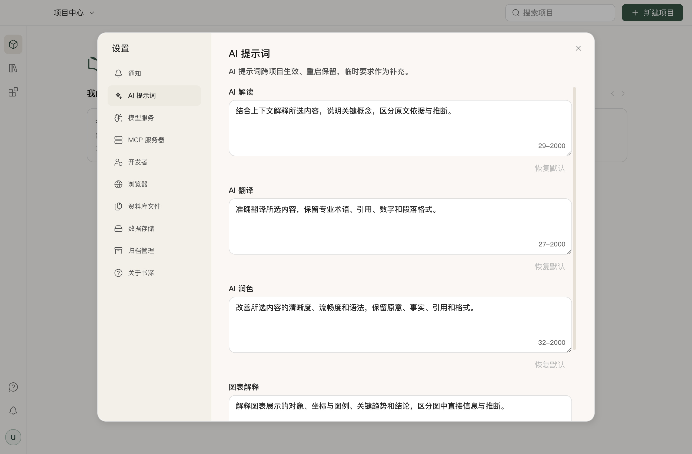
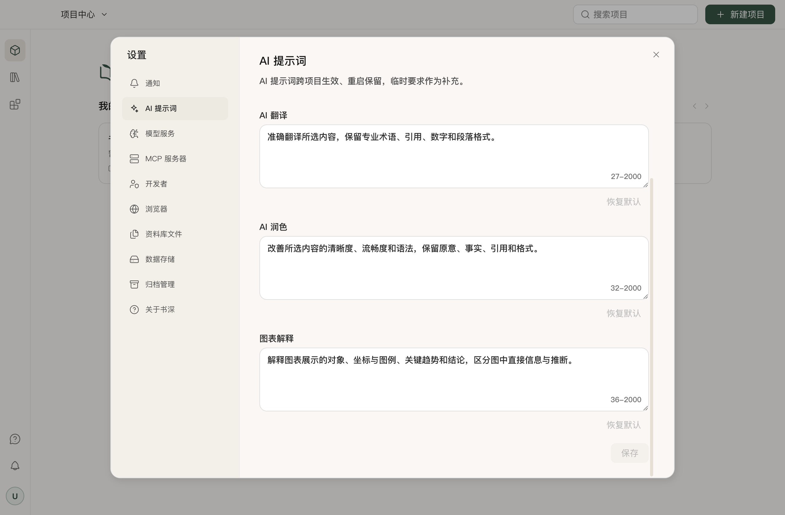

# AI 提示词

目标版本AI 提示词参考

参考：macOS arm64，0.3.2 / 202611121823 / preview，2026-11-12；展示 AI 提示词，不证明恢复、保存或模型调用。来源与摘要见[构建依据](./build.md#202611121823-目标版本参考图)。

查看选区AI操作采用的提示词。入口：主界面头像菜单 → 设置 → AI 提示词。

当前已确认承载映射（2026-11-04）：解释、润色、图表解释仍在“AI 提示词”；翻译在同一设置导航的“翻译配置”提示词区域。四类原要求、稳定ID及v`0.3`保留，当前只读快评按下述两个页面单元分别取证，不要求重现旧同页布局。旧参考图、全文及冻结运行仍按其原范围解释。

参考图来源：macOS arm64，0.3.0 / 202610281438，2026-10-28。文本、字数和按钮状态为当时偏好，不作为后续固定预期。

翻译配置提示词参考

翻译服务列表折叠状态

参考：同一目标版本及日期的翻译配置滚动视口；展示当时折叠的服务及状态，不证明服务配置、验证或翻译请求。

参考图来自 macOS arm64 安装版 `0.3.2 / 202611121823 / preview` 的隔离实例，展示翻译提示词区域、长度和恢复入口；文本与状态为当时动态值，不证明恢复、保存或翻译请求。来源见[构建依据](./build.md#202611121823-翻译提示词参考图)。

## 查看提示词与编辑状态

### 操作分类（PROMPT-OBS-001 · v`0.3`）
固定：标题和用途说明清楚，解释、翻译、润色、图表解释各有独立的提示词文本区域，可滚动查看全部内容。

### 内容与字数（PROMPT-OBS-002 · v`0.3`）
动态：各文本区域内容与当前保存的对应提示词一致，未配置时采用该版本默认提示词；旁边的当前字数等于文本长度，上限为2000。

### 初始按钮状态（PROMPT-OBS-003 · v`0.3`）
条件：刚进入且未编辑时，“保存”不可用；每项展示恢复默认入口，内容已等于该版本默认值时该恢复入口不可用。

## 发布快评层

采用v`0.3`的正常子要点：PROMPT-OBS-001–003；仅代表下述范围，不代表这些ID全部细则通过。

历史同页快评表述保留：提示词设置应具备解释、翻译、润色、图表解释四类输入区域；当前内容与其字数、未修改时保存按钮状态相符，恢复默认状态按已读值判断。必要时滚动，不输入正文。新运行按以下已确认映射消费同一组原判据，不追改旧运行。

| 当前页面单元 | 原ID映射及仅选子要点 |
| --- | --- |
| prompts（AI 提示词） | PROMPT-OBS-001的解释/润色/图表解释三个独立区域；002的三字段当前值、目标默认回退、JS字符串长度与2000上限展示；003的初始保存禁用及各恢复默认状态。 |
| translation-prompts（翻译配置的提示词区域） | PROMPT-OBS-001的翻译独立区域；002的translate当前值、目标默认回退、JS字符串长度与2000上限展示；003的恢复默认入口及其按当前值判断的状态。旧显式保存按钮条件不映射为本页必须存在按钮，也不把自动保存提示当保存成功证据；保存行为仍归专项。 |

一份prompts资产对应两个物理页面单元，四字段不删除、不复制成另一套标准；每单元分别记录目标观察与结论，未取得翻译页证据时不得用AI页补齐。只读必要滚动或读取textarea.value，不输入、清空、粘贴、恢复默认或点击保存。翻译配置的服务、开关、语言、凭据和翻译请求均不属于此映射快评。

必要参照：按目标实例实际契约核 selectionPrompts 四项白名单、目标包默认原文及独立JS字符串长度计数；[已确认承载映射](build.md#已确认当前承载映射2026-11-04)保留，历史读取方式仅作线索。启动快照陈旧时保留内容参照缺口。两个页面仍分别对照对应字段，不从画面反推已保存值。

## 专项层

### 翻译服务与划词偏好（`TRANSLATION-CONFIG-CAND-001`；需求版本待确认）

历史用户需求及 Mock 设计涉及默认翻译服务选择、PDF 划词即翻译开关，以及工具条关闭时开关不可用但保留选择。后续已有真实 macOS 开发实例观察；目标包需求适用、版本和真实服务语义仍待确认，不将 Mock 的服务验证策略或历史默认值直接作为目标判据。核查时以同隔离实例的公开配置、可用服务与工具条状态作独立参照；偏好写入、凭据、联网和翻译请求分别核授权，不以展示或单次快照证明保存生效。此候选不同于翻译提示词快评。

本层未选：编辑、长度边界、恢复默认与保存。原完整判据、稳定ID、版本和历史结果保留；未确认分支不因分层获批。

当前翻译文本onChange即提交保存仅是实现事实，不由只读映射授权或证明自动保存；翻译的旧保存条件与真实保存生命周期尚未由本快评验收，也不以观察“已保存”文案替代。翻译请求和产品模型费用同样不在本次授权内。
