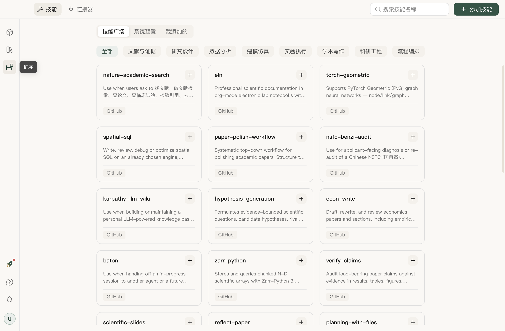

# 技能发现与详情

查找技能、区分来源并查看说明。入口：主界面“扩展” → “技能”；默认进入“技能广场”，还可查看“系统预置”和“我添加的”。

目标版本技能搜索结果参考

参考：macOS arm64，0.3.2 / 202611121823 / preview，2026-11-13；展示技能广场搜索结果，名称、来源和数量随目录变化，单图不证明详情、安装或调用。来源见[构建依据](./build.md)。

目标版本技能详情参考

参考：macOS arm64，0.3.2 / 202611121823 / preview，2026-11-12；仅展示市场搜索结果及对应详情弹窗，名称、版本、来源和状态随实际目录变化，不证明安装或调用。

目标版本系统预置技能列表参考

目标版本用户上传技能空态参考

参考：同一目标版本，2026-11-12；分别展示当时系统预置列表及用户上传空态。旧来源分组与目标版本的承载映射仍待确认，列表、开关及空态随环境变化；两图不证明安装、启停或整页通过。

补充参考：[系统列表](./system.png)、[本机详情](./detail.png)。来源：macOS arm64，0.3.0 / 202610281438，2026-10-29；卡片、分类、名称、数量、版本及状态随当前目录变化，不固定图中取值。

## 发现技能

### 页面与来源分区（SKILL-OBS-001 · v`0.3`）
固定：技能/连接器导航、技能来源标签、搜索及添加入口清楚，当前标签与内容一致。条件：加载、读取失败与真正空列表有可区分的提示，不能把失败显示成无技能。

### 列表与卡片（SKILL-OBS-002 · v`0.3`）
动态：系统预置、我添加的列表分别对应当前设置页目录响应中的系统及用户技能；卡片名称、当前语言简介和来源标记与目录元数据一致，不固定数量。广场卡片对应当前市场查询结果，不将全部随包技能当作设置页列表。

### 搜索与清空（SKILL-OBS-003 · v`0.3`）
动态：本机技能可按可见名称或简介关键词检索；市场搜索结果对照相同关键词的查询服务响应。无匹配时提示无结果，清空恢复该来源列表。条件：各来源分别保留自己的搜索词，不将另一标签的筛选误套到当前列表。

### 市场分类与列表状态（SKILL-OBS-004 · v`0.3`）
动态：技能广场分类含“全部”及当前分类服务提供的推荐分类，所选分类与结果查询一致，分类溢出时可展开/收起。条件：分类加载/失败有反馈；当前已加载卡片不重复，继续加载提示与服务分页状态一致，不把部分结果标成全部已加载。

## 查看技能

### 本机技能详情（SKILL-OBS-005 · v`0.3`）
动态：打开系统或用户卡片后，详情标题、简介、来源、存在时的作者及版本与所选技能元数据一致，无版本时明确说明；正文对应该技能说明文件，去除元信息后正常排版，长文可滚动，关闭回到原列表。文档读取失败有反馈，不展示伪造或其他技能正文。

### 市场技能详情（SKILL-OBS-006 · v`0.3`）
动态：详情与所选市场技能及版本一致，名称、简介、来源、可选作者/版本及正文对照相同技能标识和版本的详情资料。条件：正文加载、失败及无正文分别有反馈；自然出现风险阻止状态时有说明，不显示为可正常安装。

### 安装与可用状态展示（SKILL-OBS-007 · v`0.3`）
动态/条件：市场“已安装”标记对应本机同一市场来源、标识及命名空间的技能，而非仅同名；本机开关对应启用偏好，不把运行未就绪当未启用，可操作性与目录许可一致。未登录且技能要求登录时显示登录提示；已启用且有非登录不可用原因时显示原因；更新标记对应可更新状态。详情中的安装、使用等入口与已安装状态一致，不以入口展示证明动作成功。

## 发布快评层

采用v`0.3`的正常子要点：SKILL-OBS-001–003、005/006、007；仅代表下述范围，不代表这些ID全部细则通过。

技能目录的来源、卡片可见名称/说明与自然可用状态应相符；固定一条真实可见名称作一次搜索并查看其详情，详情应属于同一技能、正文与对应目录/文档只读参照一致。与F2共用，不改用内部标识或换来源绕过搜索失败。

必要参照：本次实际可见名称，以及相同来源、语言、查询、标识与版本的目录和文档最小字段；不安装或授权。[历史制品读取记录](build.md#当前制品复核)仅供定位线索，执行前须核本次目标制品的读取契约，不能沿用旧包接口假定当前有效。
自然安装入口/标记另对照同来源、标识及命名空间的本机目录最小投影；该参照失败则保留007缺证，搜索详情成功不等于整页状态通过，不重试或换来源追绿。

## 专项层

本层未选：全分类分页、全部来源组合、安装/启停/授权/更新；历史可见名称搜索疑点保留。原完整判据、稳定ID、版本和历史结果保留；未确认分支不因分层获批。

## 技能使用主链候选专项

技能添加菜单自然状态

参考：macOS arm64 `0.3.2 / 202611121823 / preview`，2026-11-13；隔离实例的技能页面及添加菜单完整视口，菜单项未执行，不证明创建或上传成功。

**通过书深创建技能（`SKILL-CREATE-CAND-001`；需求版本待确认）**：历史设计记录添加菜单可进入创建任务，另有暂时隐藏未支持入口的记录，目标包实际可用性和适用范围待核。若入口适用，应区分创建入口、项目与描述、真实任务及技能产物，不以普通技能使用或本地上传代替；模型调用、生成及写入分别核授权，不预置产品结果。

**对话生成技能的审阅安装（`SKILL-GENERATED-INSTALL-CAND-001`；需求版本待确认）**：历史用户截图记录从对话安装卡发起、宿主重检同一生成包并展示只读安装预览与显式确认。需真实生成包及独立身份、摘要和获准环境；预览、确认及真实安装终态分别判断，不能以本地上传预览或模拟卡代替。本轮不评测导入，生成包安装尚未选入；目标包适用与真实截图待核。

**来源展示待确认**：既有 `SKILL-OBS-002` 保留原文；后续设计对来源分组标识和 owner/repo 链接的区分与目标包映射须核，不能以源码或此次整理直接删除既有要求。

**市场技能来源展示（`SKILL-MARKET-SOURCE-CAND-001`；需求版本待确认）**：历史用户要求市场技能及已安装的市场来源技能详情使用 GitHub 展示，并要求“我添加的”中市场来源卡片底部标签与之保持一致；官方、用户上传及本地来源不由此外推。以同来源、同技能的独立安装来源及列表/详情身份为参照，分别核显示；展示文案不改变后端安装来源。目标包适用、需求版本及完整窗口图待核，不以菜单、单张卡片或旧版本运行证明通过。

以下历史需求线索的产品需求版本、当前目标包适用性及采用状态待确认；历史 `@` 后数字是业务点资产修订，不是产品需求版本。历史编号、来源和映射见[构建依据](./build.md#技能使用主链候选skills9)；不因本段建立而纳入已采用冒烟或执行分母。

### 本地技能预览与安装（历史 `SKILL-INSTALL-LOCAL-01@1`）

从技能页的本地上传入口选择获准的合成技能，查看对应名称、版本及说明并显式确认安装；终态为本机目录中能独立读回同一对象的来源和版本，且与所选原始资料对应。本地标记或卡片出现不能单独证明安装成功；文件/目录选择和安装由人工确认并须明确授权，冲突、扫描失败和卸载另列专项。

### 市场技能安装（`SKILL-MARKET-CAND-001`）

对可核来源、标识和版本的市场技能，从列表或详情发起获准安装后，以同一市场来源、标识、命名空间和版本的本机目录确认结果。用户历史确认的市场链路见构建依据；目标版本适用性及安装后默认启用语义仍待核。网络、第三方内容、安装及可能的依赖处理须有相应授权；不以名称相同、显示对勾或按钮反馈代替独立目录结果。

### 停用与恢复（历史 `SKILL-ENABLE-01@2`）

在获准的隔离状态中，对可操作的同一技能分别观察停用和恢复：停用后新任务技能选择器不误报可选，恢复后同一技能重新可选；分别与本机目录的该技能启用状态核对。系统技能和本轮自建用户技能是不同来源，不能互相替代；详情按钮可见不证明真实可调用。失败回滚、并发和跨重启持久化另列专项。

### 选择技能并完成任务（历史 `SKILL-INVOKE-01@2`）

从技能中心选择可调用技能及目标项目、填写合成任务描述，观察新任务中同一技能身份与原描述；如范围包含真实发送，则核同一真实回合的技能身份、执行关联及对应最终结果。版本存在时应绑定并核对，不将当前源码中的可选版本字段视为必填需求；版本缺失或无法绑定是否影响判断须按选定技能和需求确认。输入器引用、发送请求、实际技能执行与回答终态是不同观察点，不以填入草稿、入口存在或模型自述代替任务完成。该路径可能自动提交；对停用技能选择使用还可能触发启用确认，须在操作前确认隔离项目、状态变更、模型/费用与发送权限，未授权时不得确认启用或点击可能发送的入口。

**跨入口显示名与注册身份候选子点**：对于同一市场来源技能，分别以同语言、同来源及身份的独立目录参照核对技能广场、“我添加的”和对话 `/`、加号技能选择器中的中英文显示名；系统预置技能也核对管理页与选择器的中英文名称。若选入发送，核发送给 Codex 的真实注册名而非本地化显示名，并分别判断后续执行关联与最终结果。名称相同不能单独证明身份，草稿或界面显示不能证明真实发送；此子点补充上述调用候选，不另计一条流程。目标包适用、需求版本及采用状态待确认；语言偏好变更、市场访问、真实发送和模型费用分别核授权，使用隔离状态与最小必要身份参照，不读取或保存用户真实技能目录及凭据。目标包跨语言选择器和真实发送的完整窗口证据缺失，不能以历史截图或源码替代。

上述专项需要真实目标页面的完整窗口截图及必要中间状态，当前已收录的列表/详情参考图只展示发现阶段，不能证明安装、启停、选择器或真实回合。[合成技能输入](../../../../../examples/projects/skill-import/files/SKILL.md)及其清单供人工导入前核验，不自动安装；不能使用用户技能目录或预置安装结果冒充。真实运行缺截图、权限或独立参照时保留缺口。
