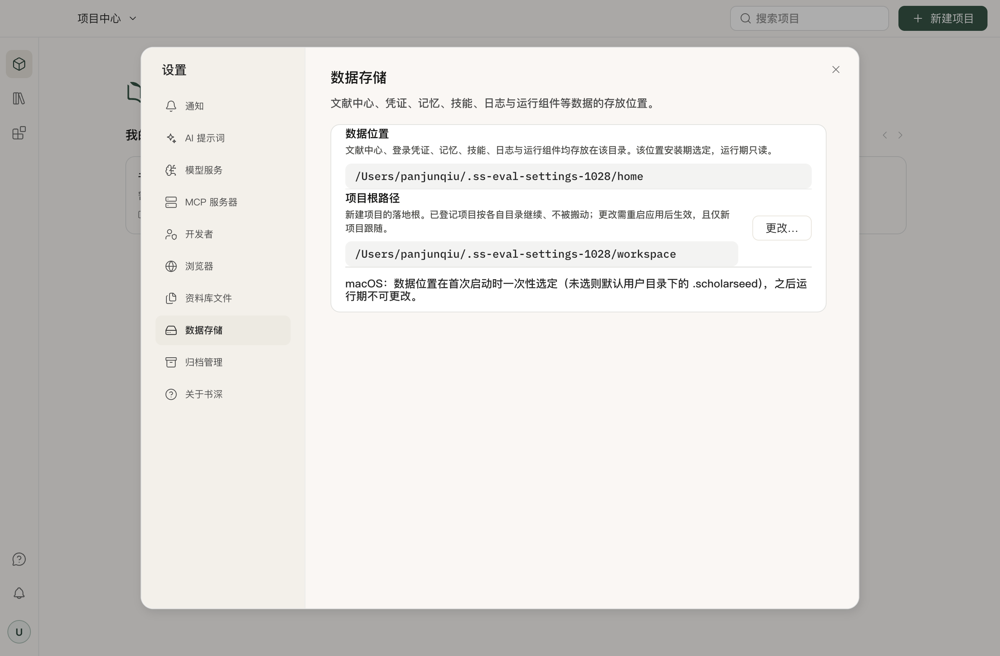

# 数据存储

目标版本数据存储参考

参考：macOS arm64，0.3.2 / 202611121823 / preview，2026-11-12；展示隔离实例的数据根与项目根，含本机用户名及隔离路径；路径为动态值，不证明迁移或修改。来源与摘要见[构建依据](./build.md#202611121823-目标版本参考图)。

查看当前数据目录及默认项目位置。入口：主界面头像菜单 → 设置 → 数据存储。

参考图来源：macOS arm64，0.3.0 / 202610281438，2026-10-28。路径为合成测试环境，平台说明和路径需按后续目标实例核对，不固定为图中值。

## 查看路径与生效边界

### 当前数据目录（STORAGE-OBS-001 · v`0.3`）
动态：数据目录区域完整显示客户端本次启动实际使用的数据根，与独立启动记录一致；不以项目目录或程序安装目录代替。加载中、读取失败分别有对应反馈，失败时不虚构路径。

### 默认项目位置（STORAGE-OBS-002 · v`0.3`）
动态：默认项目位置展示本实例已配置的项目根；没有配置时展示当前项目根，与独立项目根设置核对，不将已配置路径当作已生效证明。展示更改入口，项目根尚未就绪或操作中时入口不可用。

### 存储边界说明（STORAGE-OBS-003 · v`0.3`）
固定/条件：说明更改默认项目位置只影响后续新建项目，不迁移既有项目；数据根选择与安装/首启的说明符合目标平台。本轮未修改位置，不要求出现仅由本页修改触发的重启提示。

## 发布快评层

采用v`0.3`的正常子要点：STORAGE-OBS-001–003；仅代表下述范围，不代表这些ID全部细则通过。

存储设置应显示当前运行数据目录、默认项目位置及仅作用于后续项目的说明；两类路径分别与启动Owner和已读项目根配置/回退参照一致，不混作当前项目资源目录。

必要参照：按目标实例实际契约核独立启动数据根、storageConfig与workspace-root最小字段；[旧包读取记录](build.md#当前制品复核)仅作线索。分别核当前root及configured，不读目录内容。

## 专项层

本层未选：目录选择/打开/复制、迁移、更改与重启。原完整判据、稳定ID、版本和历史结果保留；未确认分支不因分层获批。
