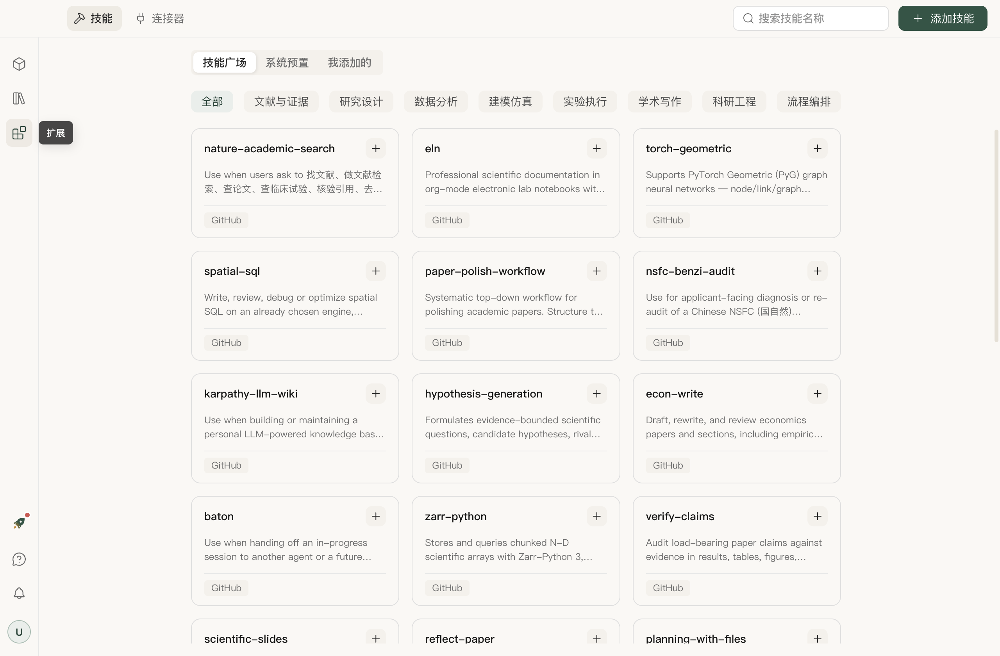
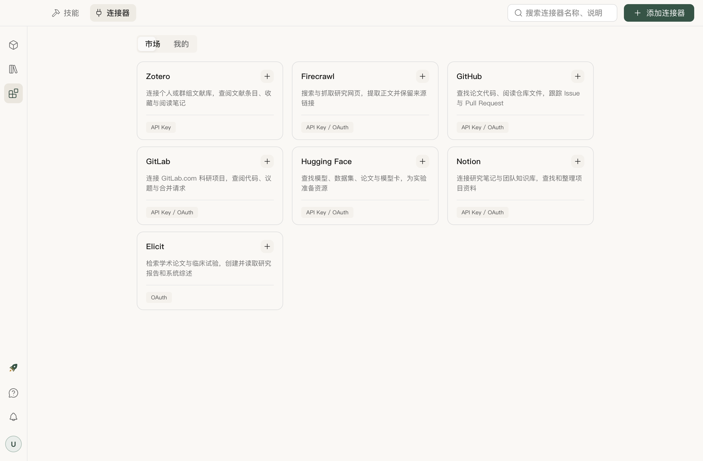
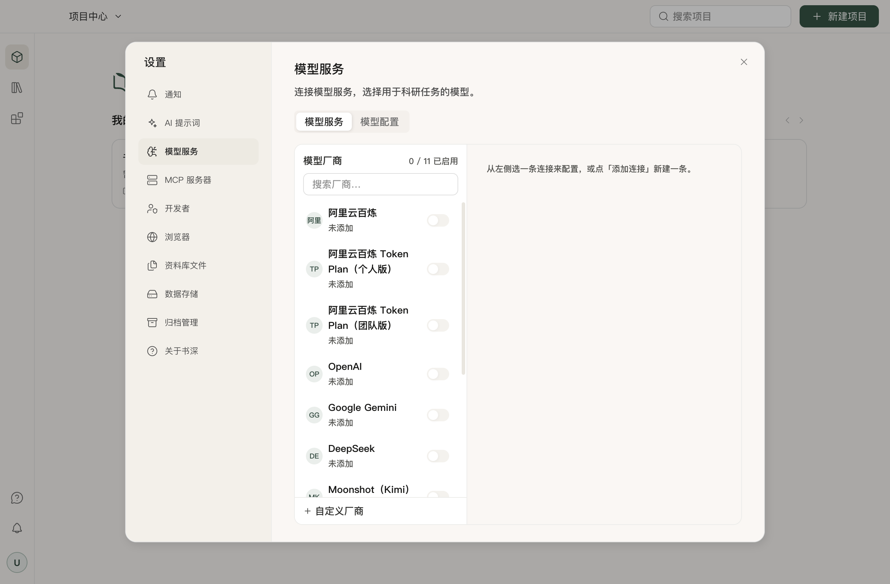
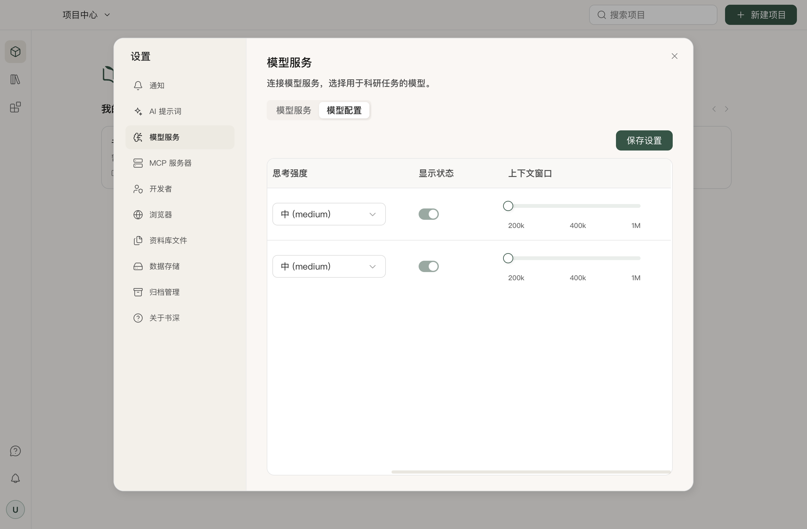
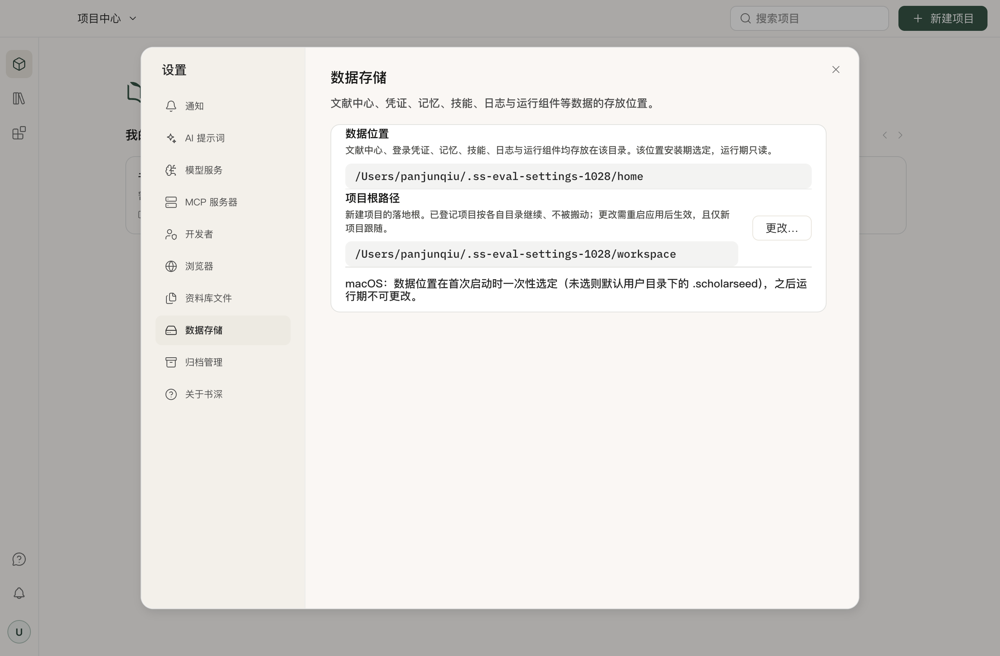

# 产品需求概览

> 本文是现有页面需求与截图的导航性摘要，不是新的需求真源或评测结果。完整判据、适用条件、版本及历史沿革以各页需求正文和构建依据为准。

## 使用说明

- 本文收录 22 份既有页面需求资产及任务列表、新任务输入器、真实对话与任务结果、内置浏览器使用、账号与开发者、反馈和系统入口 7 份候选草案；直接复用与需求或构建依据对应的完整窗口或完整页面视口参考图，不复制、不改写；历史局部图留原记录，不在此嵌入。
- 截图来自不同版本，来源和展示边界见各节；历史图片不代表当前安装版实际状态或本轮评测通过。
- 2026-11-13 有界核查时，部分旧截图在本工作区未找到字节一致的原始运行图；对应需求及构建记录仍保留截图摘要和历史版本，不将其视为已重新采证。
- 既有 22 份资产均提供页面级参考图；任务列表、输入器、对话及浏览器候选已有部分状态图，其余候选及其他状态仍有截图缺口。需求正文未建立完整的逐条需求与各状态截图映射，**逐项截图覆盖未核实**，不能将页面图视为所有条目的验证证据。
- 2026-11-13 已逐张视觉核查本文现有 107 张不同截图，未发现明确的局部裁图或明文凭据。部分完整窗口中分屏很窄，PDF 放大图的正文在视口内被裁切；设置长页的单张视口也不代表整页均可见。这些是所示状态，不代表正常布局、完整内容或操作均已验证。账号、反馈和系统入口候选目前无截图。
- 本轮不评测导入；导入候选及历史记录保留，所需原始文件从 `examples` 准备。文件存在不代表产品内已入库、接入或安装，也不自动授权写入。
- MCP 历史需求并入连接器承载；提示词资产映射 AI 提示词与翻译配置两个页面；保存仍属专项。页面数量、采用状态和运行范围以各自真源为准。
- 每页仅概述功能与入口，完整需求、限制及补充要求须回到需求正文核对；截图中的动态数据不是固定预期。
- 部分 2026-10-28 设置页旧版参考图的历史运行目录记于提交 `bdd1146705` 的 `work-records/20261028-settings-evaluation.md`：`tmp/test_snapshot/desktop/settings-readonly-20261028/`；该目录当前本机不存在。仓库保留的参考副本与摘要可回查，但不能据此声称原始截图已恢复或独立核对。

## 已采用核心流程

现有基线记录的核心流程包括：F1 从项目资料打开 PDF 并阅读、F2 搜索技能并查看详情、F3 在当前项目搜索并打开目标文件；各流程的具体判据和适用条件见对应需求正文及[基线记录](./README.md)。冒烟评测从已采用流程中按目标版本和适用条件选择；此处不表示核心流程清单完整，也不表示三条在每次运行中自动适用。

下文仅标明与上述流程相关的页面；未标注不等于不做页面快评。现行发布快评仍包含所有已采用且适用的页面快评层；保存等专项不因此纳入，实际范围以执行时冻结结果为准。

## 1. 主导航与工作范围

[需求正文](./exploratory/navigation/requirements.md) ｜ [构建依据](./exploratory/navigation/build.md)

**功能与入口：** 通过主窗口侧边主导航切换项目、文献和扩展，并可从头像菜单进入设置。

**页面参考截图**

参考：macOS arm64，0.3.2 / 202611121823 / preview，2026-11-12；完整窗口中的隔离项目工作台及主导航，项目和最近访问状态会变化。

项目工作台及主导航完整窗口参考

参考：同目标版本，2026-11-13；文献中心空态和扩展技能页的完整窗口，数量与目录随环境变化，不单凭静图证明切换动作。

文献中心导航状态参考

扩展导航状态参考

**截图缺口：** 现有图片仅覆盖所展示页面或状态；逐条需求和其他状态的对应截图尚未完整建立，待按需求正文核对补充。

## 2. 项目中心：创建、查找与重命名

[需求正文](./exploratory/project-center/requirements.md) ｜ [构建依据](./exploratory/project-center/build.md)

**功能与入口：** 通过项目中心新建入口创建项目、搜索框查找项目，或从项目卡片编辑菜单修改项目信息。

**候选专项：** 跨项目切换、已有目录接入、归档恢复及[置顶排序](./exploratory/project-center/requirements.md#项目置顶与排序候选project-pin-cand-001)已整理历史依据；置顶排序历史要求与当前源码冲突，目标适用性、操作权限与真实状态图仍待核。

**最近任务：** [首页最近任务](./exploratory/project-center/requirements.md#首页最近任务候选home-task-cand-001)展示和进入会话已列候选；历史追加、搜索规则与当前源码不同，目标适用及翻页状态待核。

参考：macOS arm64 `0.3.2 / 202611121823 / preview`，2026-11-13；隔离项目的三条合成任务自然显示，未验证翻页或打开；图中可见本机用户名和隔离工作区路径，外部分发前须核适用范围。

首页最近任务自然状态

**页面参考截图**

参考图来源：macOS arm64 `0.3.0 / 202610271421`，2026-10-28；仅含隔离合成项目。名称、描述、目录和列表数量是动态示例，图中截断路径不作完整值判据；不是像素标准或本轮通过证据。

参考：macOS arm64 `0.3.2 / 202611121823 / preview`，2026-11-12；完整窗口展示隔离项目列表，路径为当时本机元数据，不证明创建、归档或切换。

目标包项目中心完整窗口参考

参考：同目标版本，2026-11-13；合成名称和描述的新建表单，路径在图中截断，未提交创建。

目标包新建项目表单

**截图缺口：** 现有图片仅覆盖所展示页面或状态；逐条需求和其他状态的对应截图尚未完整建立，待按需求正文核对补充。

## 3. 全局搜索

[需求正文](./exploratory/search/requirements.md) ｜ [构建依据](./exploratory/search/build.md)

**功能与入口：** 通过工作区搜索按钮或项目导航中的搜索入口查找资料、文献和对话；入口可达性待核实。

**核心流程：** 属于 F3：当前项目搜索并打开目标文件。

**页面参考截图**

参考：macOS arm64，0.3.2 / 202611121104，2026-11-12；仅展示合成资料查询结果，不代表全部分类、空态或异常状态。

搜索结果参考

参考：macOS arm64，0.3.2 / 202611121823 / preview，2026-11-13；当前项目的合成文件搜索命中，背景窗口较窄，不单凭截图证明打开动作。

目标版本合成资料搜索结果

参考：macOS arm64，0.3.2 / 202611121823 / preview，2026-11-12；合成目标文件打开后的状态，不单凭截图证明打开动作。

搜索目标打开状态

**截图缺口：** 现有图片仅覆盖所展示页面或状态；逐条需求和其他状态的对应截图尚未完整建立，待按需求正文核对补充。

## 4. 全局与项目文献列表

参考：macOS arm64 `0.3.2 / 202611121823 / preview`，2026-11-12；隔离项目文献显示空态，右侧合成文档分屏较窄，不证明非空、导入或列设置通过。

项目文献显示空态

[需求正文](./exploratory/literature-list/requirements.md) ｜ [构建依据](./exploratory/literature-list/build.md)

**功能与入口：** 通过主导航的文献中心或项目工作区的项目文件区域→文献查看对应范围内的文献；具体入口层级待核实。

**候选专项：** PDF/Bib 导入、文献附件阅读及项目关联的历史需求线索已纳入需求正文；目标版本适用性、人工导入和完整窗口截图仍待核实，不由列表空态代替。旧文件夹交付卡已下线，文献入库不等于保存到项目资料；现行资料交付入口及需求待确认。

**标签筛选：** 多标签交集及与关键词、分类叠加的确认依据已整理为候选；目标版本及非空截图待核。

**分类和标签：** 分类、标签管理及删除后的文献保留已列候选；目标适用、写入授权及真实状态截图待核。

**批量同步：** 文献元数据批量同步入口已整理为候选；真实外部参照、目标版本及完成态截图待核。

**阅读笔记：** 空态入口、直接写、重开与单篇导出已整理为候选；目标版本适用、非空状态截图和真实终态仍待核。

**详情页签：** 历史两页签记录与后续 AI 解读及附件入口确认存在冲突，目标版本需求待 Owner 核实，原判据和历史记录保留。

**页面参考截图**

参考：macOS arm64，0.3.2 / 202611121104，2026-11-12；仅展示项目文献空态，不代表非空行、列偏好或详情状态。

项目文献空列表参考

参考：macOS arm64，0.3.2 / 202611121823 / preview，2026-11-12；展示全局文献空态，不证明项目关联、导入或非空列表。

目标版本全局文献空态

参考：同目标版本，2026-11-12；项目文献空态与列设置，右侧分屏较窄；不证明非空列表、列修改或导入，默认列冲突仍待确认。

目标版本项目文献列设置

**截图缺口：** 现有图片仅覆盖所展示页面或状态；逐条需求和其他状态的对应截图尚未完整建立，待按需求正文核对补充。

## 5. 资料树与列表

[需求正文](./exploratory/resources/requirements.md) ｜ [构建依据](./exploratory/resources/build.md)

**功能与入口：** 通过项目工作区的资料树或项目文件区域→资料浏览和筛选当前项目资料；具体入口层级待核实。

**核心流程：** 关联 F1：从项目资料打开 PDF；资料页也有独立快评层。

**候选专项：** 目录导入、关联、冲突及文件管理的历史要求线索已整理；人工导入、目标版本适用性和对应真实完整截图仍待核。

**项目资源管理器：** 工作台资源管理器文件名搜索及打开方式已单列候选，不等同资料库侧栏本地搜索；目标版本行为及需求适用性待核。

参考：同目标版本，2026-11-13；隔离合成文件预览的打开方式菜单完整视口，面包屑因窄分屏部分截断，未选择菜单项。

项目资源管理器打开方式菜单

**全网检索：** [既有资料需求](./exploratory/resources/requirements.md#项目与资料入口res-list-001--v03)仅要求发现入口展示；旧入口曾确认退役，当前源码线索与旧要求的关系及目标版本适用性待核，检索和网页导入终态尚未建基线。

**项目文件分类：** 资料、文献和任务产物切换时保持工作台布局的要求已整理为候选；目标版本及三类状态截图待核。

**页面参考截图**

参考：macOS arm64，0.3.2 / 202611121104，2026-11-12；仅展示合成资料树及展开状态，不代表文件操作或异常分支。

项目资料树参考

参考：macOS arm64，0.3.2 / 202611121823，2026-11-12；展示隔离项目的合成资料树展开状态，不证明导入或写入。

目标版本项目资料树参考

参考：同目标版本，2026-11-13；项目文件资料列表中两层合成目录的展开和收起状态，不单凭截图证明操作过程或侧栏树行为。

项目文件资料列表深层目录展开状态

项目文件资料列表深层目录收起状态

参考：同目标版本，2026-11-13；工作台项目资源管理器自然状态，右侧分屏较窄，不证明搜索或打开操作。

目标版本项目资源管理器

参考：同目标版本，2026-11-13；一次合成文件搜索及打开观察，未覆盖清空、其他匹配或分页，不代表候选已采用。

项目资源管理器搜索状态

项目资源管理器打开文件状态

参考：同目标版本，2026-11-13；清空搜索后的项目目录树，目录处于折叠状态，不证明其完整内容。

项目资源管理器清空搜索后

**截图缺口：** 现有图片仅覆盖所展示页面或状态；逐条需求和其他状态的对应截图尚未完整建立，待按需求正文核对补充。

## 6. 多标签与分屏

[需求正文](./exploratory/tabs/requirements.md) ｜ [构建依据](./exploratory/tabs/build.md)

**功能与入口：** 通过打开资料文件、工作台新标签按钮或文档标签菜单管理多标签和分屏；具体入口可达性待核实。

**溢出列表：** 页签压缩仍放不下时的全部页签入口已记录为候选；已观察目标包列表，选择目标和需求适用性待核。

参考：macOS arm64 `0.3.2 / 202611121823 / preview`，2026-11-13；隔离项目缩窄分屏后展示全部标签列表，未选择菜单项。

页签溢出列表自然状态

**页面参考截图**

参考：macOS arm64，0.3.2 / 202611121104，2026-11-12；只展示合成文档分屏，不代表排序、编辑传播或关闭保护。

分屏页面参考

参考：macOS arm64，0.3.2 / 202611121823 / preview，2026-11-12；展示合成文档双分屏，不单凭截图证明切换动作。

目标版本分屏参考

参考：macOS arm64，0.3.2 / 202611121823 / preview，2026-11-13；隔离项目合成文档分屏调整前后状态，不单凭截图证明拖动过程或标签排序。

分屏调整前完整窗口参考

分屏调整后完整窗口参考

**截图缺口：** 现有图片仅覆盖所展示页面或状态；逐条需求和其他状态的对应截图尚未完整建立，待按需求正文核对补充。

## 7. Markdown与代码阅读、编辑

[需求正文](./exploratory/editor/requirements.md) ｜ [构建依据](./exploratory/editor/build.md)

**功能与入口：** 通过项目资料正常打开文档，在文档查看器中阅读、查找或编辑 Markdown 与代码；真实入口可达性待核实。

**选区引用：** Markdown 预览选区添加到对话已列候选；目标适用及输入器引用终态待核，添加不等于发送。

参考：macOS arm64 `0.3.2 / 202611121823 / preview`，2026-11-13；合成 Markdown 的只读模式选区及工具栏，未点击工具栏，不证明添加或发送。

Markdown 预览选区及工具栏

**页面参考截图**

参考：macOS arm64，0.3.2 / 202611121104，2026-11-12；合成资料只显示阅读状态，不代表编辑、保存或全部格式已经验证。

Markdown 阅读页面参考

参考：macOS arm64，0.3.2 / 202611121823 / preview，2026-11-12；合成 TypeScript 展示及 Markdown 可视查找两个命中状态分别对应 `EDITOR-OBS-003` 和 `EDITOR-OBS-004` 的部分内容，不单凭截图证明动作。

TypeScript 文档显示参考

Markdown 可视查找首项参考

Markdown 可视查找第二项参考

**截图缺口：** 其他需求和状态的对应截图尚未完整建立；跳行、编辑、保存及全部查找分支不由以上截图证明。

## 8. PDF基础阅读

[需求正文](./exploratory/pdf/requirements.md) ｜ [构建依据](./exploratory/pdf/build.md)

参考：macOS arm64 `0.3.2 / 202611121823 / preview`，2026-11-13；合成 PDF 查找无匹配的完整视口，正文因分屏较窄仅部分可见。

PDF 查找无匹配显示状态

除下列条目外，PDF 的补充条件及诊断边界以需求正文为准。

**功能与入口：** 通过正常打开资料中的 PDF 进入阅读器，阅读、定位及使用相关工具；具体入口可达性待核实。

**核心流程：** 属于 F1：打开 PDF 并阅读。

**页面参考截图**

参考：macOS arm64，0.3.2 / 202611121104，2026-11-12；合成 PDF 的第一页，不代表批注、选区或异常状态。

PDF 阅读页面参考

参考：macOS arm64，0.3.2 / 202611121823 / preview，2026-11-12；同一合成 PDF 的两页状态，不单凭截图证明翻页动作。

PDF 第一页

PDF 第二页

参考：同目标版本，2026-11-13；两页样本的目录与查找状态，静图不单独证明跳转或命中切换。

PDF 目录第二页状态

PDF 目录第一页状态

PDF 第三处命中状态

PDF 第二处命中状态

参考：同目标版本，2026-11-13；两页样本分别选中的缩略图和正文状态，静图不单独证明切换。

PDF 第一页缩略图状态

PDF 第二页缩略图状态

参考：同目标版本，2026-11-13；普通放大图中正文局部被视口裁切，适应页面与适应宽度在此布局下原图相同，静图不能单独证明切换或模式。

PDF 普通放大状态

PDF 普通缩小状态

PDF 适应页面状态

**截图缺口：** 现有图片仅覆盖所展示页面或状态；逐条需求和其他状态的对应截图尚未完整建立，待按需求正文核对补充。

## 9. 图片查看

[需求正文](./exploratory/images/requirements.md) ｜ [构建依据](./exploratory/images/build.md)

**功能与入口：** 通过正常打开项目资料中的图片进入图片查看器，查看图片并调整缩放和位置；具体入口可达性待核实。

**页面参考截图**

参考：macOS arm64，0.3.2 / 202611121104，2026-11-12；展示合成图片的一个缩放状态，不代表限幅、拖动或失败状态。

图片查看页面参考

参考：macOS arm64，0.3.2 / 202611121823 / preview，2026-11-12；展示图片适应窗口状态，不证明缩放动作或限幅。

目标版本图片查看参考

**截图缺口：** 现有图片仅覆盖所展示页面或状态；逐条需求和其他状态的对应截图尚未完整建立，待按需求正文核对补充。

## 10. CSV与表格阅读

[需求正文](./exploratory/tables/requirements.md) ｜ [构建依据](./exploratory/tables/build.md)

**功能与入口：** 通过正常打开项目资料中的表格文件查看 CSV、分隔文本或工作簿；具体入口和引擎可用性待核实。

**页面参考截图**

参考：macOS arm64，0.3.2 / 202611121104，2026-11-12；仅展示合成工作簿一个工作表，不代表 CSV 编辑、导出或失败状态。

工作簿网格参考

参考：macOS arm64，0.3.2 / 202611121823 / preview，2026-11-12；合成工作簿的 Main 和 Secondary 状态对应 `TABLE-OBS-003` 的部分内容，静图不单独证明切换动作。

Main 工作表参考

Secondary 工作表参考

**截图缺口：** 现有图片仅覆盖所展示页面或状态；逐条需求和其他状态的对应截图尚未完整建立，待按需求正文核对补充。

## 11. 技能发现与详情

[需求正文](./exploratory/skills/requirements.md) ｜ [构建依据](./exploratory/skills/build.md)

**功能与入口：** 通过主界面→扩展→技能查找技能并查看不同来源的详情。

**核心流程：** 属于 F2：搜索技能并查看详情。

**候选专项：** 本地/市场安装、启停、技能带入任务、通过书深创建及生成技能审阅安装的历史线索已整理；目标适用性、相关授权及真实完成态截图待核，本轮不评测导入，生成包安装尚未选入。卡片来源展示的历史要求对应关系待确认。

**技能名称：** 管理页与对话选择器的双语显示名及注册身份已列候选子点；目标适用和真实发送证据待核。

**市场来源：** 市场与已安装市场技能的 GitHub 展示有后续用户确认；目标版本适用及与旧来源标记的映射待核。

参考：macOS arm64 `0.3.2 / 202611121823 / preview`，2026-11-13；技能页添加菜单完整视口，未执行菜单项。

技能添加菜单自然状态

**页面参考截图**

补充参考：系统列表、本机详情。来源：macOS arm64，0.3.0 / 202610281438，2026-10-29；卡片、分类、名称、数量、版本及状态随当前目录变化，不固定图中取值。

参考：macOS arm64，0.3.2 / 202611121823 / preview，2026-11-13；技能广场搜索结果，目录数据动态变化，单图不证明详情、安装或调用。

目标版本技能搜索结果参考

参考：macOS arm64，0.3.2 / 202611121823 / preview，2026-11-12；市场搜索结果与详情弹窗，不证明安装或调用。

目标版本技能详情参考

参考：同目标版本，2026-11-12；系统技能列表与用户上传空态仅展示自然状态，旧来源分组映射仍待确认，不证明安装或启停。

目标版本系统技能列表

目标版本用户上传空态

**截图缺口：** 现有图片仅覆盖所展示页面或状态；逐条需求和其他状态的对应截图尚未完整建立，待按需求正文核对补充。

## 12. 连接器列表与详情

[需求正文](./exploratory/connectors/requirements.md) ｜ [构建依据](./exploratory/connectors/build.md)

**功能与入口：** 通过主界面→扩展→连接器查找连接器并查看状态、说明和工具信息。

**候选专项：** 配置校验、授权及真实工具消费需测试服务与明确授权，现有展示图不证明连接或调用。

**页面参考截图**

参考：macOS arm64，0.3.2 / 202611121104，2026-11-12；表单未填写或提交，不证明连接、授权或工具调用。
当前连接器市场参考

当前连接器未提交表单参考

参考：macOS arm64，0.3.2 / 202611121823 / preview，2026-11-12；HTTP 空表单未提交，不证明保存或连接。

目标版本连接器未提交表单

参考：同目标版本，2026-11-12；STDIO 空表单未提交，不证明命令执行、预览或连接。

目标版本 STDIO 空表单

参考：macOS arm64，0.3.0 / 202610281438，2026-10-29。目录、安装及授权状态随环境变化；图中取值不作为长期预期。

参考：macOS arm64，0.3.2 / 202611121823 / preview，2026-11-12；展示连接器市场自然状态，不证明连接或授权。

目标版本连接器市场参考

**截图缺口：** 现有图片仅覆盖所展示页面或状态；逐条需求和其他状态的对应截图尚未完整建立，待按需求正文核对补充。

## 13. MCP 历史要求与当前入口映射

[需求正文](./exploratory/mcp/requirements.md) ｜ [构建依据](./exploratory/mcp/build.md)

该资产保留历史编号，当前入口映射到连接器，不再表示独立设置页面。

**功能与入口：** 通过主界面→扩展→连接器访问 MCP 相关能力，历史需求不再对应独立设置页。

**页面参考截图**

参考：macOS arm64，0.3.2 / 202611121104，2026-11-12；仅为未填写、未提交表单，不证明连接或授权。

当前连接器未提交表单

**截图缺口：** 现有图片仅覆盖所展示页面或状态；逐条需求和其他状态的对应截图尚未完整建立，待按需求正文核对补充。

## 14. 新手引导

[需求正文](./exploratory/onboarding/requirements.md) ｜ [构建依据](./exploratory/onboarding/build.md)

**功能与入口：** 通过头像菜单→新手引导了解项目、文献中心和阅读器，首次进入适用工作范围时也可自动展示。

**页面参考截图**

参考：macOS arm64，0.3.0 / 202610281438，2026-10-29。示例文献中心首步卡片及聚光区域；进度、内容及已看过状态随引导组和数据变化，不作为本轮运行证据。

参考：macOS arm64，0.3.2 / 202611121823 / preview，2026-11-12；展示已看过状态的引导弹窗，不代表首次引导。

目标版本新手引导参考

**截图缺口：** 现有图片仅覆盖所展示页面或状态；逐条需求和其他状态的对应截图尚未完整建立，待按需求正文核对补充。

## 15. 通知

[需求正文](./exploratory/notifications/requirements.md) ｜ [构建依据](./exploratory/notifications/build.md)

**功能与入口：** 通过头像菜单→设置→通知查看通知入口、未读处理入口和声音偏好。

**页面参考截图**

参考图来源：macOS arm64，0.3.0 / 202610281438，2026-10-28。声音开关为当时偏好，不作为后续固定预期；参考图仅帮助对应页面。

参考：macOS arm64，0.3.2 / 202611121823 / preview，2026-11-12；仅展示通知设置，不证明通知投递。

目标版本通知设置

**截图缺口：** 现有图片仅覆盖所展示页面或状态；逐条需求和其他状态的对应截图尚未完整建立，待按需求正文核对补充。

## 16. 模型服务

[需求正文](./exploratory/models/requirements.md) ｜ [构建依据](./exploratory/models/build.md)

**功能与入口：** 通过头像菜单→设置→模型服务查看服务连接和模型配置。

**候选专项：** 模型配置保存、思考强度、上下文窗口和会话切换的历史要求线索已整理；需求版本、目标适用及正式采用待确认，真实配置或调用另需相应条件和授权。

**页面参考截图**

补充参考：厂商列表底部、横向滚动后的参数区域。来源：macOS arm64，0.3.0 / 202610281438，2026-10-28；连接、模型、档位和数量为当时数据，不固定后续取值。

参考：macOS arm64，0.3.2 / 202611121823 / preview，2026-11-12；展示未配置状态，不证明配置生效。

目标版本模型服务

参考：同目标版本，2026-11-12；模型配置自然展示，不证明写入或调用。

目标版本模型配置

**截图缺口：** 现有图片仅覆盖所展示页面或状态；逐条需求和其他状态的对应截图尚未完整建立，待按需求正文核对补充。

## 17. 资料库文件

[需求正文](./exploratory/file-policy/requirements.md) ｜ [构建依据](./exploratory/file-policy/build.md)

**功能与入口：** 通过头像菜单→设置→资料库文件查看保存偏好和版本保留限制。

**页面参考截图**

参考图来源：macOS arm64，0.3.0 / 202610281438，2026-10-28。开关和限制数值为当时设置，不作为后续固定预期。

参考：macOS arm64，0.3.2 / 202611121823 / preview，2026-11-12；展示当时文件策略，不证明修改或生效。

目标版本资料库文件设置

**截图缺口：** 现有图片仅覆盖所展示页面或状态；逐条需求和其他状态的对应截图尚未完整建立，待按需求正文核对补充。

## 18. 数据存储

[需求正文](./exploratory/storage/requirements.md) ｜ [构建依据](./exploratory/storage/build.md)

**功能与入口：** 通过头像菜单→设置→数据存储查看数据目录和默认项目位置。

**页面参考截图**

参考图来源：macOS arm64，0.3.0 / 202610281438，2026-10-28。路径为合成测试环境，平台说明和路径需按后续目标实例核对，不固定为图中值。

参考：macOS arm64，0.3.2 / 202611121823 / preview，2026-11-12；图含本机用户名和隔离路径，仅展示当时设置，不证明迁移。

目标版本数据存储设置

**截图缺口：** 现有图片仅覆盖所展示页面或状态；逐条需求和其他状态的对应截图尚未完整建立，待按需求正文核对补充。

## 19. AI 提示词

[需求正文](./exploratory/prompts/requirements.md) ｜ [构建依据](./exploratory/prompts/build.md)

该资产对应 AI 提示词与翻译配置两个页面，字段和承载映射见需求正文。

**翻译服务配置：** 默认服务与划词翻译开关是同页独立候选；历史 Mock 与开发实例依据已记录，目标适用性及实际生效待核，不由提示词展示判通过。

**功能与入口：** 通过头像菜单→设置→AI 提示词或翻译配置查看对应功能的提示词。

**页面参考截图**

参考图来源：macOS arm64，0.3.0 / 202610281438，2026-10-28。文本、字数和按钮状态为当时偏好，不作为后续固定预期。

参考：macOS arm64，0.3.2 / 202611121823 / preview，2026-11-12；AI 提示词展示不证明保存。

目标版本 AI 提示词

参考：macOS arm64，0.3.2 / 202611121823 / preview，2026-11-12；翻译配置中的文本和字数是动态值，不证明恢复或保存。

翻译配置参考

参考：同版本及日期；翻译配置的滚动视口展示折叠服务及当时状态，不证明服务配置或翻译。

翻译服务列表折叠状态

**截图缺口：** 现有图片仅覆盖所展示页面或状态；逐条需求和其他状态的对应截图尚未完整建立，待按需求正文核对补充。

## 20. 浏览器设置展示

[需求正文](./exploratory/browser-settings/requirements.md) ｜ [构建依据](./exploratory/browser-settings/build.md)

**功能与入口：** 通过主界面设置→浏览器查看密码库、下载和访问策略，入口仅在浏览器能力开放时显示。

**页面参考截图**

参考：macOS arm64，0.3.2 / 202611121823 / preview，2026-11-13；完整设置窗口滚动至高级设置。目标分支后续确认默认配置下高级入口下线，此历史状态仅适用于显式开启高级能力的配置；新制品配置及可达性需另核。端口、开关、站点规则和密码库状态随环境变化，不将图中取值作为固定预期。

浏览器设置完整窗口参考：高级设置

参考：同目标版本，2026-11-13；中部视口展示 CDP 与站点规则自然状态，端口和规则随环境变化，不证明编辑或连接。

浏览器设置完整窗口参考：中部

参考：同目标版本，2026-11-13；顶部视口含本机用户名、下载目录与本地端口，不含完整连接密钥；状态随环境变化。

浏览器设置完整窗口参考：顶部

参考：同目标版本，2026-11-13；实际清理选项与本次冻结的类型勾选要求不符，需求适用性待 Owner 确认；未执行清理。

浏览器清理选项实际状态

**截图缺口：** 现有图片仅覆盖所展示页面或状态；逐条需求和其他状态的对应截图尚未完整建立，待按需求正文核对补充。

## 21. 关于书深：快速评审基线

[需求正文](./exploratory/about/requirements.md) ｜ [构建依据](./exploratory/about/build.md)

**功能与入口：** 通过头像菜单→设置→关于书深查看版本、更新偏好和官方支持入口。

**页面参考截图**

来源：macOS arm64 安装版 `0.3.0`，构建 `202610271421`，截图日期 `2026-10-28`。仅辅助对应页面与要求；图中版本、更新提示、偏好和年份是当时取值，以文字中的动态关系为准，不作为本轮结果证据或像素标准。

参考：macOS arm64，0.3.2 / 202611121823 / preview，2026-11-12；更新提示为当时动态状态，不证明更新。

目标版本关于页面

**截图缺口：** 现有图片仅覆盖所展示页面或状态；逐条需求和其他状态的对应截图尚未完整建立，待按需求正文核对补充。

## 22. 文档保存与未保存保护

[需求正文](./exploratory/saving/requirements.md) ｜ [构建依据](./exploratory/saving/build.md)

**功能与入口：** 通过正常打开资料后的文档编辑视图及保存入口保存修改并处理未保存状态；真实入口可达性待核实。

**页面参考截图**

参考：macOS arm64，0.3.2 / 202611121104，2026-11-12；仅展示代码编辑器和保存控件，不代表保存、失败或冲突终态。

文档保存入口上下文

**截图缺口：** 现有图片仅覆盖所展示页面或状态；逐条需求和其他状态的对应截图尚未完整建立，待按需求正文核对补充。

## 23. 项目任务列表（候选）

[候选需求](./exploratory/task-list/requirements.md) ｜ [构建依据](./exploratory/task-list/build.md)

**功能与入口：** 项目工作区的任务区域用于查看当前项目任务和置顶分组；目标版本需求适用性待核实。

**归档任务：** 已整理查看、恢复和确认删除的候选；真实归档任务、删除授权及目标版本截图待核。

**状态：** 候选草案，需求版本待确认，尚未纳入评测执行；置顶、归档、恢复及运行中归档/删除停止已整理历史确认依据，目标版本适用性与完整截图待核。

项目任务空态及新任务输入器

参考：同版本隔离项目，2026-11-13；一个真实任务及其重新选中后的状态，不代表置顶或排序。

隔离项目非空任务列表

参考：macOS 安装版 `0.3.2` 隔离实例，2026-11-13；多个合成任务的列表及一条回复，身份与构建关联并非原子，不证明列表完整性或排序规则。

隔离项目多任务列表状态

**截图缺口：** 置顶及其他任务状态仍缺完整截图。

## 24. 新任务输入器（候选）

[候选需求](./exploratory/task-composer/requirements.md) ｜ [构建依据](./exploratory/task-composer/build.md)

**功能与入口：** 通过项目工作区的新任务输入器组织草稿和待发送内容；目标版本入口动作与需求适用性待核实。

**状态：** 候选草案，需求版本待确认，尚未纳入评测执行。

**附件范围：** 已整理普通文件卡片、草稿图片移除、资料目录选择及同项目资料/文献拖入的历史线索；目标版本适用性及其他状态图待核，不代表附件发送或模型消费成功。

**文献引用：** 文献库选择弹窗与资料库选择及项目文献拖入分别记录；已观察显示空态，选择细则及非空截图待核。

项目空态中的新任务输入器

**截图范围：** macOS arm64 `0.3.2 / 202611121823 / preview`，2026-11-12；同一自然空态的空白输入器，草稿切换、待发送队列及发送状态尚缺截图。

参考：同版本隔离项目，2026-11-13；资料引用选择器未选状态，不证明勾选或提交引用。

资料引用选择器未选状态

参考：同版本隔离项目，2026-11-13；文献选择器显示空态，独立库内容未核，不证明库确实为空或选择已通过。

文献引用选择器显示空态

## 25. 真实对话与任务结果（候选）

[候选需求](./exploratory/conversation/requirements.md) ｜ [构建依据](./exploratory/conversation/build.md)

**功能与入口：** 通过项目工作区的新任务或已有任务输入区发起对话，查看回答并打开任务产物；目标版本适用性待确认。

**状态与截图缺口：** 历史需求线索仍为候选；已有获准隔离真实单轮及同进程重选显示图，后续补采两个新任务的公开身份与回合参照但非原子关联；产物及跨重启状态仍缺，不能用空白输入器图代替。

**文件审阅：** 旧任务文件待审阅不阻断新对话已列候选；目标版本适用及真实状态截图待核。

参考：macOS arm64，0.3.2 / 202611121823 / preview，2026-11-13；隔离项目的合成请求与真实回复，输入框文字为占位提示，不代表产物或正式评测通过。

隔离项目真实单轮完成状态

参考：同版本隔离项目，2026-11-13；同进程重新选中任务后的显示状态，不单凭截图证明切换过程或跨重启恢复。

同进程重开任务后的显示状态

参考：同版本隔离项目，2026-11-13；工作台打开时的真实任务标题区操作菜单，不证明菜单动作或关闭工作台时的状态。

真实任务标题区操作菜单

**消息展示：** 长用户消息折叠、复制及已发送混合上下文展示顺序有历史确认依据；已观察合成长消息展开与收起，目标版本适用及复制、混合上下文仍待核。

**已发送图片：** 同组预览和原文件操作已列候选；目标版本适用与真实图片消息截图待核，原文件动作按权限分别验证。

参考：macOS arm64 安装版 `0.3.2`，2026-11-13；隔离合成会话长消息展开和收起的完整视口，展开内容末尾超出视口，构建与身份关联限制见构建依据。

长用户消息展开状态

长用户消息收起状态

参考：同日隔离合成会话的连续完整视口，前后重叠并显示原始文本末尾；不能仅凭图证明逐字符复制或跨重启恢复。

长消息展开顶部视口

长消息展开中部视口

长消息展开末尾视口

**正文网址：** Agent 正文裸网址的省略、完整提示与复制打开另列候选；目标适用及真实回答图待核。

**回答来源：** 文件与网页混合引用列表及同源去重已有候选依据；真实同轮来源和目标版本截图待核。

**引用摘录：** 单文件及分组引用的摘录展开与原文导航已列候选；目标版本截图及折叠行数待核。

**任务历史：** 历史浮层按 Agent 最后回复时间展示和排序的需求已整理为候选；目标版本及非空状态截图待核。

**问答回放：** 普通澄清及内置问答的历史回显、只读和复制已列候选专项；目标版本适用及真实完整窗口图待核。

**悬浮会话：** 移动、五点停靠及最小化还原已整理为候选专项；真实会话入口及动作结果待核。

**悬浮调宽：** 左右边缘调宽与对侧固定另列候选；已补隔离真实会话状态图，目标版本需求适用和完整面板几何待核。

参考：同版本隔离项目，2026-11-13；悬浮输入条初态及两次边缘拖动后的完整窗口，不证明完整面板高度、极限或正式评测通过。

悬浮输入条初态

左边缘拖动后的悬浮状态

右边缘拖动后的悬浮状态

参考：macOS arm64，0.3.2 / 202611121823 / preview，2026-11-13；新任务悬浮输入状态，不代表真实回合或拖动结果。

空任务悬浮输入状态

**任务分支：** 任务菜单创建分支及来源回跳已有候选依据；目标版本、隔离写入及完整截图待核。

**任务产物：** 概览中输出及过程产物分组的预览、展开与收起已整理为候选；目标版本和足量真实产物截图待核。

**产物版本：** 同轮同路径的最新文件卡与历史版本入口已记录为候选；真实版本、目标适用及截图待核。

**过程文献：** 更多操作入口与 PDF 阅读另列候选；真实过程文献、目标适用及截图待核。

**文献综述：** 卡片四区、大纲及引用导航已列候选；真实综述、目标适用和截图待核，不等于综述质量已验证。

**对话画布：** 预览折叠与工作台同一画布往返已整理为候选；真实画布及目标版本截图待核。

**授权确认：** 文献全文、普通工具权限及文件读取/写权限恢复已有候选依据；目标版本、真实请求截图和相关决策分支待核。

**检索结果：** 已整理授权范围、已入库行选择及加入文献库的候选依据；真实结果、入库终态和目标版本截图待核。

## 26. 内置浏览器使用（候选）

[候选需求](./exploratory/browser/requirements.md) ｜ [构建依据](./exploratory/browser/build.md)

**功能与入口：** 在浏览器能力开放时通过工作台入口打开网页并查找内容，具体入口及目标版本适用性待核。

**状态与截图缺口：** 网页导航、查找及历史等为候选；真实网页完整窗口图与可控测试站点尚缺，设置页截图不能代替网页结果。历史按时间检索的具体语义待确认；Agent 授权、下载及清理另列专项。

**网页打印：** 历史确认的打印入口及取消行为已列候选；目标版本、原生对话框与输出终态待核。

**网页工具：** 缩放、网页截图、开发者工具和设备工具栏分别记录为候选；目标版本、实际终态与平台条件待核。

参考：macOS arm64，0.3.2 / 202611121823 / preview，2026-11-13；浏览历史自然空态及清理入口，不代表网页浏览、非空检索或清理结果。

目标版本浏览历史空态

## 27. 账号与开发者（候选）

[候选需求](./exploratory/account/requirements.md) ｜ [构建依据](./exploratory/account/build.md)

**功能与入口：** 通过头像菜单查看账户状态及资料、额度入口，并通过设置中的开发者入口管理 API 密钥；目标版本入口与适用性待核。

**状态与截图缺口：** 登录、退出及密钥写操作需明确授权；账号菜单、登录交接与开发者设置的可复用真实完整图尚缺。页面本身是正常产品功能，实际出现的完整凭据不得作为截图内容传播。

## 28. 问题反馈与操作记录（候选）

[候选需求](./exploratory/feedback/requirements.md) ｜ [构建依据](./exploratory/feedback/build.md)

**功能与入口：** 通过产品反馈入口描述问题，并可按可用条件记录操作步骤与截图后检查或提交；目标入口和适用性待核。

**状态与截图缺口：** 真实反馈表单、记录及回执完整图尚缺；操作记录不预设连续视频，自动截图和外部上传需分别核实授权。

**步骤说明：** 成功提交的说明与提交时步骤关联、可查看的历史要求已列候选；真实记录、目标适用与截图待核。

## 29. 窗口、托盘与系统通知（候选）

[候选需求](./exploratory/system-shell/requirements.md) ｜ [构建依据](./exploratory/system-shell/build.md)

**功能与入口：** 通过原生窗口关闭、后台菜单和系统通知管理应用，并从更新提示进入后续流程；实际平台和目标版本适用性待核。

**状态与截图缺口：** macOS 与 Windows 行为分别验证，原生窗口、托盘和系统通知的可复用完整图尚缺；安装与重启另需授权。
