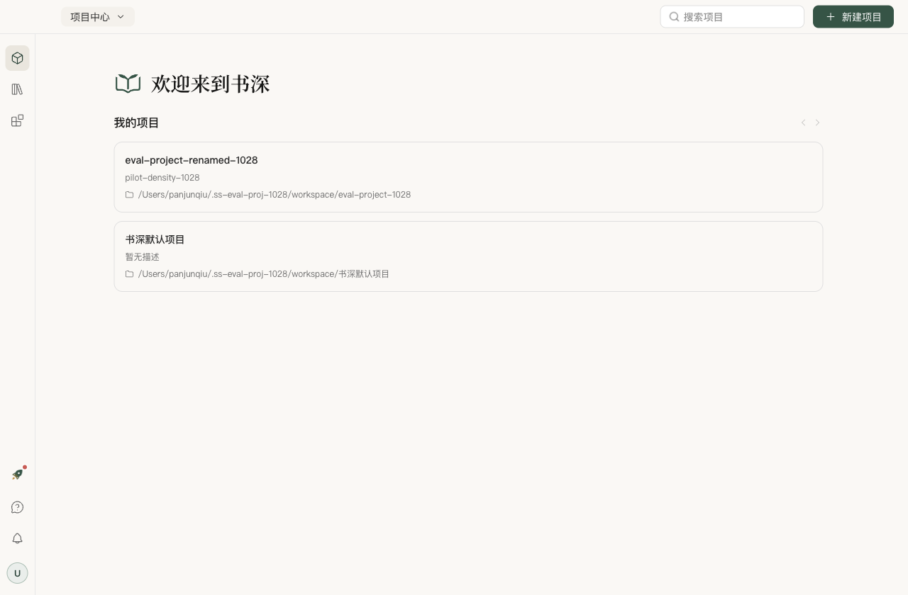
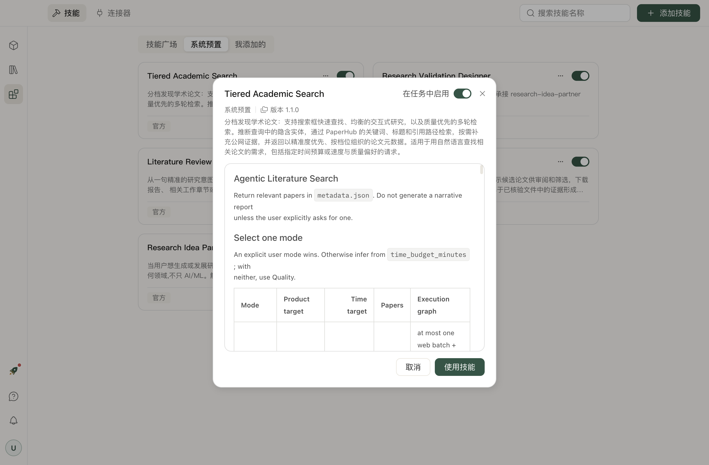
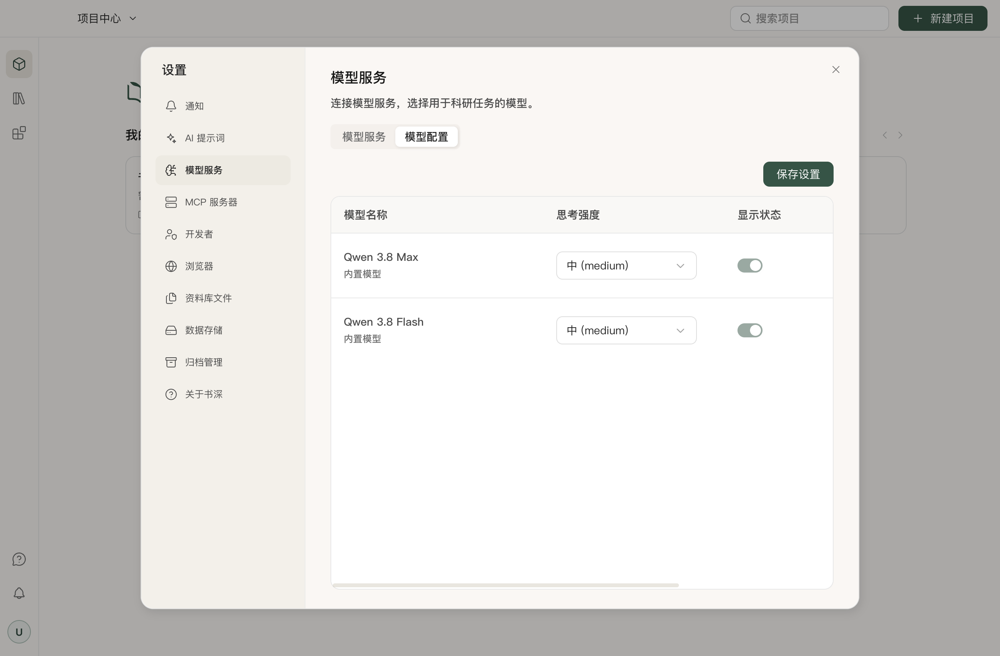
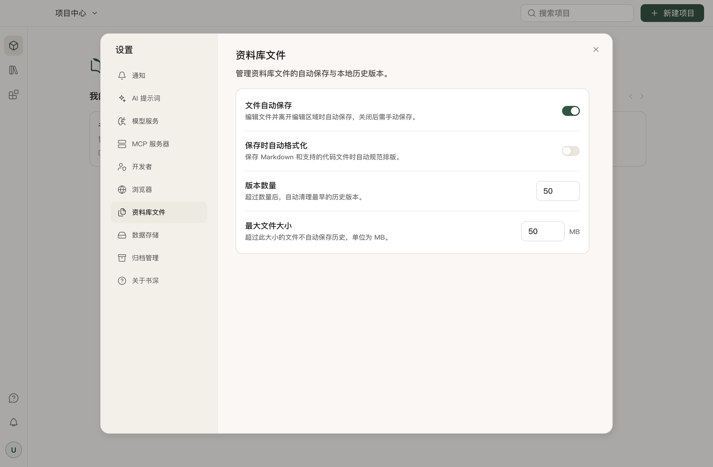

# Product Requirements Overview

> This document is a navigational summary of existing page requirements and screenshots, not a new source of truth for requirements or evaluation results. Refer to each page's requirements and build basis for the complete criteria, applicability conditions, versions, and history.

## Usage Notes

- This document includes 22 existing page-requirement assets and 7 candidate drafts covering the task list, new-task composer, real conversations and task results, built-in browser use, account and developer, feedback, and system entry points. Reuse the complete-window or full-page-viewport reference image corresponding to the requirements or build basis as-is; do not copy or rewrite it. Leave historical partial images in their original records; do not embed them here.
- Screenshots come from different versions; their sources and display boundaries are given in each section. Historical images do not represent the actual state of the currently installed build or a pass in this evaluation round.
- During the bounded review on 2026-11-13, byte-identical original runtime images for some old screenshots could not be found in this workspace. The corresponding requirements and build records still retain screenshot summaries and historical versions; these are not treated as newly collected evidence.
- All 22 existing assets provide page-level reference images. Partial state images exist for the task list, composer, conversation, and browser candidates; other candidates and states still have screenshot gaps. The requirements do not establish a complete mapping from each individual requirement to screenshots of each state. **Per-requirement screenshot coverage has not been verified**; page images cannot be treated as verification evidence for every item.
- On 2026-11-13, all 107 distinct screenshots currently in this document were visually inspected one by one; no clearly partial crops or plaintext credentials were found. Some complete windows have very narrow split panes, and the body text in enlarged PDF images is cropped within the viewport; a single viewport of a long settings page also does not mean the entire page is visible. These images show only the displayed states and do not establish that normal layout, complete content, or operations were verified. The account, feedback, and system-entry candidates currently have no screenshots.
- Import is not evaluated in this round; import candidates and historical records are retained, and required source files should be prepared from `examples`. A file's presence does not mean it has been added to the product, connected, or installed, nor does it automatically authorize writing.
- Historical MCP requirements are now carried under Connectors; prompt assets map to two pages, AI Prompts and Translation Settings; Save remains a dedicated evaluation. Page counts, adoption status, and runtime scope are governed by each source of truth.
- Each page only summarizes its functionality and entry points. Check the requirements page for complete requirements, limitations, and supplementary requirements; dynamic data in screenshots is not a fixed expectation.
- The historical runtime directory for some old settings-page reference images from 2026-10-28 is recorded in the commit `bdd1146705` at `work-records/20261028-settings-evaluation.md`: `tmp/test_snapshot/desktop/settings-readonly-20261028/`; this directory does not currently exist on this machine. The reference copies and summaries retained in the repository can be consulted, but they do not establish that the original screenshots were restored or independently checked.

## Adopted Core Flows

The core flows in the existing baseline record are: F1, open and read a PDF from project files; F2, search for a Skill and view its details; and F3, search the current project and open a target file. See the corresponding requirements and the [baseline record](./README.md) for each flow's criteria and applicability conditions. Smoke evaluations select from adopted flows according to the target version and applicability conditions; this does not mean the core-flow list is complete or that all three flows automatically apply in every run.

The sections below only identify pages related to the flows above; an unmarked page is not thereby excluded from the page quick review. The current release quick review still includes the page-review layer for every adopted and applicable page; dedicated evaluations such as Save are not included on that basis. The frozen scope at execution time is authoritative.

## 1. Main Navigation and Workspace Scope

[Requirements](./exploratory/navigation/requirements.md) ｜ [Build Basis](./exploratory/navigation/build.md)

**Function and entry point:** Use the main navigation in the main window's sidebar to switch among Projects, Literature, and Extensions, and open Settings from the avatar menu.

**Page Reference Screenshots**

Reference: macOS arm64, 0.3.2 / 202611121823 / preview, 2026-11-12; isolated-project workbench and main navigation in a full window. Projects and recently visited states can change.

Full-window reference: project workbench and main navigation

Reference: same target version, 2026-11-13; full windows showing the Literature Center empty state and Extensions Skills page. Counts and catalogs vary by environment; a static image alone does not prove the switching action.

Reference: Literature Center navigation state

Reference: Extensions navigation state

**Screenshot gap:** Existing images cover only the pages or states shown. A complete mapping of screenshots to individual requirements and other states has not yet been established; check the requirements page and supplement as needed.

## 2. Project Center: Create, Find, and Rename

[Requirements](./exploratory/project-center/requirements.md) ｜ [Build Basis](./exploratory/project-center/build.md)

**Function and entry point:** Create a project using the Project Center's New entry point, find a project with the search box, or edit project information from the project card's edit menu.

**Candidate dedicated evaluations:** Historical evidence has been assembled for switching across projects, attaching an existing directory, restoring an archive, and [pin ordering](./exploratory/project-center/requirements.md#项目置顶与排序候选project-pin-cand-001). The historical pin-ordering requirement conflicts with current source code; target applicability, operation permissions, and real state images still need verification.

**Recent tasks:** Displaying and entering a conversation from [Home Recent Tasks](./exploratory/project-center/requirements.md#首页最近任务候选home-task-cand-001) is listed as a candidate. Historical append behavior and search rules differ from current source code; target applicability and pagination states still need verification.

Reference: macOS arm64 `0.3.2 / 202611121823 / preview`, 2026-11-13; three synthetic tasks appear naturally in an isolated project. Pagination and opening were not verified. The image shows the local username and isolated workspace path; verify applicability before external distribution.

Home Recent Tasks: natural state

**Page Reference Screenshots**

Reference image source: macOS arm64 `0.3.0 / 202610271421`, 2026-10-28; contains only an isolated synthetic project. Names, descriptions, directories, and list counts are dynamic examples. Truncated paths in the image are not criteria for complete values; this is neither a pixel standard nor evidence of a pass in this round.

Reference: macOS arm64 `0.3.2 / 202611121823 / preview`, 2026-11-12; a full window showing an isolated project list. Paths are local metadata from that time and do not prove creation, archiving, or switching.

Target build: Project Center full-window reference

Reference: same target version, 2026-11-13; new-project form with a synthetic name and description. The path is truncated in the image; creation was not submitted.

Target build: new-project form

**Screenshot gap:** Existing images cover only the pages or states shown. A complete mapping of screenshots to individual requirements and other states has not yet been established; check the requirements page and supplement as needed.

## 3. Global Search

[Requirements](./exploratory/search/requirements.md) ｜ [Build Basis](./exploratory/search/build.md)

**Function and entry point:** Use the workspace search button or the search entry in project navigation to find resources, literature, and conversations; entry-point reachability still needs verification.

**Core flow:** Part of F3: search the current project and open a target file.

**Page Reference Screenshots**

Reference: macOS arm64, 0.3.2 / 202611121104, 2026-11-12; shows only synthetic resource search results, not all categories, empty states, or error states.

Reference: search results

Reference: macOS arm64, 0.3.2 / 202611121823 / preview, 2026-11-13; a synthetic file search hit in the current project, with a narrow background window. The screenshot alone does not prove the file was opened.

Target version: synthetic resource search results

Reference: macOS arm64, 0.3.2 / 202611121823 / preview, 2026-11-12; state after opening a synthetic target file. The screenshot alone does not prove the opening action.

Search target: opened state

**Screenshot gap:** Existing images cover only the pages or states shown. A complete mapping of screenshots to individual requirements and other states has not yet been established; check the requirements page and supplement as needed.

## 4. Global and Project Literature Lists

Reference: macOS arm64 `0.3.2 / 202611121823 / preview`, 2026-11-12; isolated-project literature shows an empty state, with a narrow split pane for a synthetic document on the right. This does not prove non-empty content, import, or passing column settings.

Project literature: empty state

[Requirements](./exploratory/literature-list/requirements.md) ｜ [Build Basis](./exploratory/literature-list/build.md)

**Function and entry point:** View literature for the relevant scope through Literature Center in the main navigation or Project Files → Literature in the project workspace; the exact entry-point hierarchy still needs verification.

**Candidate dedicated evaluations:** Historical requirement leads for PDF/Bib import, reading literature attachments, and project association have been incorporated into the requirements page. Target-version applicability, manual import, and full-window screenshots still need verification; an empty list cannot substitute for them. The old folder-delivery card has been retired, and adding literature to the library is not the same as saving it to project files; the current resource-delivery entry point and requirements remain to be confirmed.

**Tag filtering:** Confirmation evidence for intersecting multiple tags and combining them with keywords and categories has been assembled as a candidate; the target version and non-empty screenshots still need verification.

**Categories and tags:** Managing categories and tags, and retaining literature after deletion, are listed as candidates; target applicability, write authorization, and real state screenshots still need verification.

**Bulk synchronization:** The entry point for bulk synchronization of literature metadata has been assembled as a candidate; real external references, the target version, and completion-state screenshots still need verification.

**Reading notes:** The empty-state entry point, direct writing, reopening, and single-item export have been assembled as candidates; target-version applicability, non-empty-state screenshots, and real final states still need verification.

**Detail tabs:** Historical records of two tabs conflict with later confirmation of AI Interpretation and Attachment entries. The target-version requirements await Owner verification; original criteria and historical records are retained.

**Page Reference Screenshots**

Reference: macOS arm64, 0.3.2 / 202611121104, 2026-11-12; shows only the project literature empty state, not non-empty rows, column preferences, or detail states.

Reference: empty project literature list

Reference: macOS arm64, 0.3.2 / 202611121823 / preview, 2026-11-12; shows the global literature empty state and does not prove project association, import, or a non-empty list.

Target version: global literature empty state

Reference: same target version, 2026-11-12; project literature empty state and column settings, with a narrow split pane on the right. This does not prove a non-empty list, column changes, or import; the default-column conflict remains to be confirmed.

Target version: project literature column settings

**Screenshot gap:** Existing images cover only the pages or states shown. A complete mapping of screenshots to individual requirements and other states has not yet been established; check the requirements page and supplement as needed.

## 5. Resource Tree and List

[Requirements](./exploratory/resources/requirements.md) ｜ [Build Basis](./exploratory/resources/build.md)

**Function and entry point:** Browse and filter resources in the current project through the resource tree in the project workspace or Project Files → Resources; the exact entry-point hierarchy still needs verification.

**Core flow:** Related to F1: open a PDF from project files. The Resources page also has a separate quick-review layer.

**Candidate dedicated evaluations:** Historical requirement leads have been assembled for directory import, association, conflicts, and file management; manual import, target-version applicability, and corresponding real full-window screenshots still need verification.

**Project resource explorer:** Filename search and opening methods in the workbench explorer are listed as separate candidates; they are not equivalent to local search in the library sidebar. Target-version behavior and requirement applicability still need verification.

Reference: same target version, 2026-11-13; full viewport of the Open With menu for an isolated synthetic file preview. The breadcrumb is partly truncated because of the narrow split pane; no menu item was selected.

Project resource explorer: Open With menu

**Web search:** [Existing resource requirements](./exploratory/resources/requirements.md#项目与资料入口res-list-001--v03) only require displaying the discovery entry point. The old entry point was confirmed retired; the relationship between current source-code leads and the old requirement, as well as target-version applicability, still needs verification. Search and webpage-import final states have no baseline yet.

**Project file categories:** The requirement to preserve the workbench layout while switching among resources, literature, and task artifacts has been assembled as a candidate; the target version and screenshots of all three states still need verification.

**Page Reference Screenshots**

Reference: macOS arm64, 0.3.2 / 202611121104, 2026-11-12; shows only a synthetic resource tree and its expanded state, not file operations or error branches.

Reference: project resource tree

Reference: macOS arm64, 0.3.2 / 202611121823, 2026-11-12; shows the expanded synthetic resource tree of an isolated project; does not prove import or writing.

Target version: project resource tree reference

Reference: same target version, 2026-11-13; expanded and collapsed states of two levels of synthetic directories in the Project Files resource list. The screenshots alone do not prove the operation or sidebar-tree behavior.

Project Files resource list: deep directory expanded

Project Files resource list: deep directory collapsed

Reference: same target version, 2026-11-13; natural state of the project resource explorer in the workbench, with a narrow split pane on the right; does not prove searching or opening.

Target version: project resource explorer

Reference: same target version, 2026-11-13; one observation of searching for and opening a synthetic file. Clearing, other matches, and pagination are not covered; this does not mean the candidate was adopted.

Project resource explorer: search state

Project resource explorer: file-open state

Reference: same target version, 2026-11-13; project directory tree after clearing the search, with directories collapsed; does not prove its complete contents.

Project resource explorer after clearing search

**Screenshot gap:** Existing images cover only the pages or states shown. A complete mapping of screenshots to individual requirements and other states has not yet been established; check the requirements page and supplement as needed.

## 6. Multiple Tabs and Split View

[Requirements](./exploratory/tabs/requirements.md) ｜ [Build Basis](./exploratory/tabs/build.md)

**Function and entry point:** Manage multiple tabs and split view by opening resource files, using the workbench's New Tab button, or using the document-tab menu; reachability of the exact entry points still needs verification.

**Overflow list:** The entry point to all tabs when they still do not fit after tab compression is recorded as a candidate. The target build's list has been observed; selection targets and requirement applicability still need verification.

Reference: macOS arm64 `0.3.2 / 202611121823 / preview`, 2026-11-13; all-tabs list displayed after narrowing the split pane in an isolated project; no menu item was selected.

Tab overflow list: natural state

**Page Reference Screenshots**

Reference: macOS arm64, 0.3.2 / 202611121104, 2026-11-12; shows only a synthetic document in split view, not ordering, edit propagation, or close protection.

Reference: split-view page

Reference: macOS arm64, 0.3.2 / 202611121823 / preview, 2026-11-12; shows a synthetic document in a two-pane split view; the screenshot alone does not prove the switching action.

Target version: split-view reference

Reference: macOS arm64, 0.3.2 / 202611121823 / preview, 2026-11-13; before-and-after states of adjusting split view for a synthetic document in an isolated project. The images alone do not prove the dragging process or tab ordering.

Full-window reference before split-view adjustment

Full-window reference after split-view adjustment

**Screenshot gap:** Existing images cover only the pages or states shown. A complete mapping of screenshots to individual requirements and other states has not yet been established; check the requirements page and supplement as needed.

## 7. Reading and Editing Markdown and Code

[Requirements](./exploratory/editor/requirements.md) ｜ [Build Basis](./exploratory/editor/build.md)

**Function and entry point:** Open a document normally from project files, then read, search, or edit Markdown and code in the document viewer; reachability of the real entry point still needs verification.

**Selection citation:** Adding a selection from the Markdown preview to a conversation is listed as a candidate; target applicability and the final reference state in the composer still need verification. Adding is not the same as sending.

Reference: macOS arm64 `0.3.2 / 202611121823 / preview`, 2026-11-13; a selection and toolbar in read-only mode for synthetic Markdown. The toolbar was not clicked; this does not prove addition or sending.

Markdown preview selection and toolbar

**Page Reference Screenshots**

Reference: macOS arm64, 0.3.2 / 202611121104, 2026-11-12; synthetic resource shown in reading state only; does not mean editing, saving, or all formats have been verified.

Reference: Markdown reading page

Reference: macOS arm64, 0.3.2 / 202611121823 / preview, 2026-11-12; synthetic TypeScript display and two Markdown visual-search match states correspond to portions of `EDITOR-OBS-003` and `EDITOR-OBS-004`, respectively. Screenshots alone do not prove the actions.

Reference: TypeScript document display

Reference: first Markdown visual-search match

Reference: second Markdown visual-search match

**Screenshot gap:** The mapping of other requirements and states to screenshots has not been completed; the images above do not prove line navigation, editing, saving, or all search branches.

## 8. Basic PDF Reading

[Requirements](./exploratory/pdf/requirements.md) ｜ [Build Basis](./exploratory/pdf/build.md)

Reference: macOS arm64 `0.3.2 / 202611121823 / preview`, 2026-11-13; full viewport of a no-match search in a synthetic PDF; only part of the document is visible because the split pane is narrow.

PDF search: no-match state displayed

Except for the items below, refer to the requirements page for supplementary conditions and diagnostic boundaries for PDF.

**Function and entry point:** Open a PDF in resources through the normal flow to enter the reader, read, navigate, and use related tools; reachability of the exact entry point still needs verification.

**Core flow:** Part of F1: open and read a PDF.

**Page Reference Screenshots**

Reference: macOS arm64, 0.3.2 / 202611121104, 2026-11-12; the first page of a synthetic PDF. It does not represent annotations, selections, or error states.

Reference: PDF reading page

Reference: macOS arm64, 0.3.2 / 202611121823 / preview, 2026-11-12; two page states of the same synthetic PDF. The screenshots alone do not prove page-turning actions.

PDF page 1

PDF page 2

Reference: same target version, 2026-11-13; table-of-contents and search states for the two-page sample. Static images alone do not prove navigation or switching between matches.

PDF table of contents: page 2 state

PDF table of contents: page 1 state

PDF third-match state

PDF second-match state

Reference: same target version, 2026-11-13; selected thumbnail and document states for each page of the two-page sample. Static images alone do not prove switching.

PDF page 1 thumbnail state

PDF page 2 thumbnail state

Reference: same target version, 2026-11-13; part of the document is cropped by the viewport in the regular zoom image. Fit Page and Fit Width look identical in this layout; static images alone cannot prove switching or the mode.

PDF regular zoom: enlarged state

PDF regular zoom: reduced state

PDF Fit Page state

**Screenshot gap:** Existing images cover only the pages or states shown. A complete mapping of screenshots to individual requirements and other states has not yet been established; check the requirements page and supplement as needed.

## 9. Image Viewing

[Requirements](./exploratory/images/requirements.md) ｜ [Build Basis](./exploratory/images/build.md)

**Function and entry point:** Open an image in project files through the normal flow to enter the image viewer, view the image, and adjust zoom and position; reachability of the specific entry point still needs verification.

**Page Reference Screenshots**

Reference: macOS arm64, 0.3.2 / 202611121104, 2026-11-12; shows one zoom state of a synthetic image, not clamping, dragging, or failure states.

Reference: image viewing page

Reference: macOS arm64, 0.3.2 / 202611121823 / preview, 2026-11-12; shows an image fitted to the window, but does not prove zoom actions or clamping.

Target version: image viewing reference

**Screenshot gap:** Existing images cover only the pages or states shown. A complete mapping of screenshots to individual requirements and other states has not yet been established; check the requirements page and supplement as needed.

## 10. CSV and Spreadsheet Reading

[Requirements](./exploratory/tables/requirements.md) ｜ [Build Basis](./exploratory/tables/build.md)

**Function and entry point:** Open a spreadsheet file in project files through the normal flow to view CSV, delimited text, or a workbook; the exact entry point and engine availability still need verification.

**Page Reference Screenshots**

Reference: macOS arm64, 0.3.2 / 202611121104, 2026-11-12; shows only one sheet of a synthetic workbook, not CSV editing, export, or failure states.

Reference: workbook grid

Reference: macOS arm64, 0.3.2 / 202611121823 / preview, 2026-11-12; the Main and Secondary states of a synthetic workbook correspond to part of `TABLE-OBS-003`; static images alone do not prove switching actions.

Reference: Main worksheet

Reference: Secondary worksheet

**Screenshot gap:** Existing images cover only the pages or states shown. A complete mapping of screenshots to individual requirements and other states has not yet been established; check the requirements page and supplement as needed.

## 11. Skill Discovery and Details

[Requirements](./exploratory/skills/requirements.md) ｜ [Build Basis](./exploratory/skills/build.md)

**Function and entry point:** Find Skills and view details from different sources through Main Interface → Extensions → Skills.

**Core flow:** Part of F2: search for a Skill and view its details.

**Candidate dedicated evaluations:** Historical leads have been assembled for local/marketplace installation, enabling and disabling, using a Skill in a task, creating through ScholarSeed, and reviewing and installing generated Skills. Target applicability, related authorization, and real completion-state screenshots still need verification. Import is not evaluated in this round, and generated-package installation has not yet been selected. The mapping to historical requirements for source labels on cards remains to be confirmed.

**Skill names:** Bilingual display names and registered identity in the management page and conversation selector are listed as candidate sub-items; target applicability and evidence of real sending still need verification.

**Marketplace source:** Subsequent user confirmation exists for displaying GitHub as the source for marketplace and installed marketplace Skills; applicability to the target version and mapping to old source labels still need verification.

Reference: macOS arm64 `0.3.2 / 202611121823 / preview`, 2026-11-13; full viewport of the add menu on the Skills page; no menu item was executed.

Skills: add menu in its natural state

**Page Reference Screenshots**

Additional references: System list and local details. Source: macOS arm64, 0.3.0 / 202610281438, 2026-10-29; cards, categories, names, counts, versions, and states vary with the current catalog; values shown in the images are not fixed.

Reference: macOS arm64, 0.3.2 / 202611121823 / preview, 2026-11-13; Skills Marketplace search results with dynamic catalog data. A single image does not prove details, installation, or invocation.

Target version: Skill search results reference

Reference: macOS arm64, 0.3.2 / 202611121823 / preview, 2026-11-12; marketplace search results and a details dialog; does not prove installation or invocation.

Target version: Skill details reference

Reference: same target version, 2026-11-12; the system Skill list and user-upload empty state show only their natural states. Mapping to old source groups still needs confirmation; this does not prove installation or enabling/disabling.

Target version: system Skills list

Target version: user-upload empty state

**Screenshot gap:** Existing images cover only the pages or states shown. A complete mapping of screenshots to individual requirements and other states has not yet been established; check the requirements page and supplement as needed.

## 12. Connector List and Details

[Requirements](./exploratory/connectors/requirements.md) ｜ [Build Basis](./exploratory/connectors/build.md)

**Function and entry point:** Find connectors and view their status, description, and tool information through Main Interface → Extensions → Connectors.

**Candidate dedicated evaluations:** Configuration validation, authorization, and real tool consumption require a test service and explicit authorization; existing display images do not prove connection or invocation.

**Page Reference Screenshots**

Reference: macOS arm64, 0.3.2 / 202611121104, 2026-11-12; the form was neither filled nor submitted, so this does not prove connection, authorization, or tool invocation.
Reference: current Connector Marketplace

Reference: current connector form, not submitted

Reference: macOS arm64, 0.3.2 / 202611121823 / preview, 2026-11-12; empty HTTP form not submitted; does not prove saving or connection.

Target version: connector form not submitted

Reference: same target version, 2026-11-12; empty STDIO form not submitted; does not prove command execution, preview, or connection.

Target version: empty STDIO form

Reference: macOS arm64, 0.3.0 / 202610281438, 2026-10-29. Catalog, installation, and authorization states vary by environment; values in the image are not long-term expectations.

Reference: macOS arm64, 0.3.2 / 202611121823 / preview, 2026-11-12; shows the Connector Marketplace in its natural state; does not prove connection or authorization.

Target version: Connector Marketplace reference

**Screenshot gap:** Existing images cover only the pages or states shown. A complete mapping of screenshots to individual requirements and other states has not yet been established; check the requirements page and supplement as needed.

## 13. Historical MCP Requirements and Current Entry-Point Mapping

[Requirements](./exploratory/mcp/requirements.md) ｜ [Build Basis](./exploratory/mcp/build.md)

This asset retains its historical numbering. The current entry point maps to Connectors and no longer represents a separate Settings page.

**Function and entry point:** Access MCP-related capabilities through Main Interface → Extensions → Connectors; historical requirements no longer correspond to a separate Settings page.

**Page Reference Screenshots**

Reference: macOS arm64, 0.3.2 / 202611121104, 2026-11-12; only an unfilled, unsubmitted form; does not prove connection or authorization.

Current connector form, not submitted

**Screenshot gap:** Existing images cover only the pages or states shown. A complete mapping of screenshots to individual requirements and other states has not yet been established; check the requirements page and supplement as needed.

## 14. Onboarding

[Requirements](./exploratory/onboarding/requirements.md) ｜ [Build Basis](./exploratory/onboarding/build.md)

**Function and entry point:** Learn about projects, Literature Center, and the reader through Avatar menu → Onboarding. It may also appear automatically the first time the user enters an applicable workspace.

**Page Reference Screenshots**

Reference: macOS arm64, 0.3.0 / 202610281438, 2026-10-29. Example first-step card and spotlight area for Literature Center; progress, content, and seen status vary with the onboarding set and data and are not evidence of a run in this round.

Reference: macOS arm64, 0.3.2 / 202611121823 / preview, 2026-11-12; shows the onboarding dialog in an already-seen state, not first-time onboarding.

Target version: onboarding reference

**Screenshot gap:** Existing images cover only the pages or states shown. A complete mapping of screenshots to individual requirements and other states has not yet been established; check the requirements page and supplement as needed.

## 15. Notifications

[Requirements](./exploratory/notifications/requirements.md) ｜ [Build Basis](./exploratory/notifications/build.md)

**Function and entry point:** View notification entry points, unread-item handling, and sound preferences through Avatar menu → Settings → Notifications.

**Page Reference Screenshots**

Reference image source: macOS arm64, 0.3.0 / 202610281438, 2026-10-28. The sound toggle reflects the preference at that time and is not a fixed expectation for later versions; the reference image only helps identify the page.

Reference: macOS arm64, 0.3.2 / 202611121823 / preview, 2026-11-12; shows only notification settings and does not prove notification delivery.

Target version: notification settings

**Screenshot gap:** Existing images cover only the pages or states shown. A complete mapping of screenshots to individual requirements and other states has not yet been established; check the requirements page and supplement as needed.

## 16. Model Services

[Requirements](./exploratory/models/requirements.md) ｜ [Build Basis](./exploratory/models/build.md)

**Function and entry point:** View service connections and model configuration through Avatar menu → Settings → Model Services.

**Candidate dedicated evaluations:** Historical requirement leads have been assembled for saving model configuration, reasoning effort, context window, and switching conversations. The requirement version, target applicability, and formal adoption remain to be confirmed; real configuration changes or calls require the corresponding conditions and authorization.

**Page Reference Screenshots**

Additional references: bottom of the provider list and parameter area after horizontal scrolling. Source: macOS arm64, 0.3.0 / 202610281438, 2026-10-28; connection, model, tier, and count are values from that time and are not fixed for later versions.

Reference: macOS arm64, 0.3.2 / 202611121823 / preview, 2026-11-12; shows an unconfigured state and does not prove that configuration took effect.

Target version: Model Services

Reference: same target version, 2026-11-12; shows the model configuration in its natural state and does not prove writing or invocation.

Target version: model configuration

**Screenshot gap:** Existing images cover only the pages or states shown. A complete mapping of screenshots to individual requirements and other states has not yet been established; check the requirements page and supplement as needed.

## 17. Library Files

[Requirements](./exploratory/file-policy/requirements.md) ｜ [Build Basis](./exploratory/file-policy/build.md)

**Function and entry point:** View save preferences and version-retention limits through Avatar menu → Settings → Library Files.

**Page Reference Screenshots**

Reference image source: macOS arm64, 0.3.0 / 202610281438, 2026-10-28. Toggles and limit values reflect the settings at that time and are not fixed expectations for later versions.

Reference: macOS arm64, 0.3.2 / 202611121823 / preview, 2026-11-12; shows the file policy at that time and does not prove changes or effect.

Target version: Library Files settings

**Screenshot gap:** Existing images cover only the pages or states shown. A complete mapping of screenshots to individual requirements and other states has not yet been established; check the requirements page and supplement as needed.

## 18. Data Storage

[Requirements](./exploratory/storage/requirements.md) ｜ [Build Basis](./exploratory/storage/build.md)

**Function and entry point:** View the data directory and default project location through Avatar menu → Settings → Data Storage.

**Page Reference Screenshots**

Reference image source: macOS arm64, 0.3.0 / 202610281438, 2026-10-28. The paths are from a synthetic test environment; verify platform notes and paths against the later target instance rather than treating image values as fixed.

Reference: macOS arm64, 0.3.2 / 202611121823 / preview, 2026-11-12; the image contains the local username and an isolated path, and shows only the settings at that time; it does not prove migration.

Target version: Data Storage settings

**Screenshot gap:** Existing images cover only the pages or states shown. A complete mapping of screenshots to individual requirements and other states has not yet been established; check the requirements page and supplement as needed.

## 19. AI Prompts

[Requirements](./exploratory/prompts/requirements.md) ｜ [Build Basis](./exploratory/prompts/build.md)

This asset corresponds to two pages, AI Prompts and Translation Settings; see the requirements page for field and hosting mappings.

**Translation service configuration:** The default service and selection-translation toggle are separate candidates on the same page. Historical Mock and development-instance evidence has been recorded; target applicability and actual effect still need verification. Displaying prompts does not constitute a pass.

**Function and entry point:** View prompts for the corresponding features through Avatar menu → Settings → AI Prompts or Translation Settings.

**Page Reference Screenshots**

Reference image source: macOS arm64, 0.3.0 / 202610281438, 2026-10-28. Text, word counts, and button states reflect preferences at that time and are not fixed expectations for later versions.

Reference: macOS arm64, 0.3.2 / 202611121823 / preview, 2026-11-12; displaying AI prompts does not prove they were saved.

Target version: AI Prompts

Reference: macOS arm64, 0.3.2 / 202611121823 / preview, 2026-11-12; text and word count in Translation Settings are dynamic values and do not prove restoration or saving.

Translation Settings reference

Reference: same version and date; the scrolled viewport of Translation Settings shows collapsed services and their state at that time; it does not prove service configuration or translation.

Translation service list: collapsed state

**Screenshot gap:** Existing images cover only the pages or states shown. A complete mapping of screenshots to individual requirements and other states has not yet been established; check the requirements page and supplement as needed.

## 20. Browser Settings Display

[Requirements](./exploratory/browser-settings/requirements.md) ｜ [Build Basis](./exploratory/browser-settings/build.md)

**Function and entry point:** View the password store, downloads, and access policies through Main Interface Settings → Browser. The entry point appears only when browser capabilities are enabled.

**Page Reference Screenshots**

Reference: macOS arm64, 0.3.2 / 202611121823 / preview, 2026-11-13; full Settings window scrolled to Advanced Settings. The target branch later confirmed that the Advanced entry is removed under the default configuration. This historical state applies only to configurations that explicitly enable advanced capabilities; verify configuration and reachability on new artifacts separately. Ports, toggles, site rules, and password-store state vary by environment; values shown are not fixed expectations.

Browser Settings full-window reference: Advanced Settings

Reference: same target version, 2026-11-13; middle viewport showing the natural state of CDP and site rules. Ports and rules vary by environment; this does not prove editing or connection.

Browser Settings full-window reference: middle

Reference: same target version, 2026-11-13; top viewport includes the local username, download directory, and local port, but not the complete connection key; state varies by environment.

Browser Settings full-window reference: top

Reference: same target version, 2026-11-13; the actual cleanup options differ from the type-selection requirements frozen for this round. The Owner must confirm requirement applicability; cleanup was not performed.

Actual state of browser cleanup options

**Screenshot gap:** Existing images cover only the pages or states shown. A complete mapping of screenshots to individual requirements and other states has not yet been established; check the requirements page and supplement as needed.

## 21. About ScholarSeed: Quick-Review Baseline

[Requirements](./exploratory/about/requirements.md) ｜ [Build Basis](./exploratory/about/build.md)

**Function and entry point:** View the version, update preferences, and official support entry through Avatar menu → Settings → About ScholarSeed.

**Page Reference Screenshots**

Source: macOS arm64 installed build `0.3.0`, build `202610271421`, screenshot date `2026-10-28`. This only helps identify the page and requirements. Version, update notice, preferences, and year shown in the image were values at that time; follow the dynamic relationships described in text. This is not evidence of this round's result or a pixel standard.

Reference: macOS arm64, 0.3.2 / 202611121823 / preview, 2026-11-12; the update notice is a dynamic state from that time and does not prove an update.

Target version: About page

**Screenshot gap:** Existing images cover only the pages or states shown. A complete mapping of screenshots to individual requirements and other states has not yet been established; check the requirements page and supplement as needed.

## 22. Document Saving and Unsaved-Changes Protection

[Requirements](./exploratory/saving/requirements.md) ｜ [Build Basis](./exploratory/saving/build.md)

**Function and entry point:** Save changes and handle unsaved states through the document editing view and save entry point after opening a resource normally; reachability of the real entry point still needs verification.

**Page Reference Screenshots**

Reference: macOS arm64, 0.3.2 / 202611121104, 2026-11-12; shows only the code editor and save control, not final states for saving, failure, or conflict.

Document save entry-point context

**Screenshot gap:** Existing images cover only the pages or states shown. A complete mapping of screenshots to individual requirements and other states has not yet been established; check the requirements page and supplement as needed.

## 23. Project Task List (Candidate)

[Candidate Requirements](./exploratory/task-list/requirements.md) ｜ [Build Basis](./exploratory/task-list/build.md)

**Function and entry point:** Use the task area in the project workspace to view the current project's tasks and pinned group; applicability of the requirements to the target version still needs verification.

**Archived tasks:** Candidates for viewing, restoring, and confirming deletion have been assembled; real archived tasks, deletion authorization, and target-version screenshots still need verification.

**Status:** Candidate draft; requirement version awaits confirmation and has not been included in evaluation execution. Historical confirmation evidence has been assembled for pinning, archiving, restoring, and stopping a running task when archived/deleted; target-version applicability and complete screenshots still need verification.

Project tasks empty state and new-task composer

Reference: isolated project on the same version, 2026-11-13; one real task and its state after being selected again; does not represent pinning or ordering.

Isolated project: non-empty task list

Reference: isolated instance of macOS installed build `0.3.2`, 2026-11-13; list of multiple synthetic tasks and one reply. Identity and build association are not atomic; this does not prove list completeness or ordering rules.

Isolated project: multiple-task list state

**Screenshot gap:** Complete screenshots are still missing for pinning and other task states.

## 24. New-Task Composer (Candidate)

[Candidate Requirements](./exploratory/task-composer/requirements.md) ｜ [Build Basis](./exploratory/task-composer/build.md)

**Function and entry point:** Organize drafts and pending content in the new-task composer in the project workspace; the target-version entry-point action and requirement applicability still need verification.

**Status:** Candidate draft; requirement version awaits confirmation and has not been included in evaluation execution.

**Attachment scope:** Historical leads have been assembled for ordinary file cards, removing draft images, selecting a resource directory, and dragging resources/literature from the same project into the composer. Target-version applicability and images of other states still need verification; these do not prove attachment sending or model consumption succeeded.

**Literature references:** The literature-library selection dialog is documented separately from resource-library selection and dragging project literature. An empty state has been observed; selection details and non-empty screenshots still need verification.

New-task composer in an empty project state

**Screenshot scope:** macOS arm64 `0.3.2 / 202611121823 / preview`, 2026-11-12; blank composer in the same natural empty state. Screenshots are still missing for switching drafts, the pending-send queue, and sending states.

Reference: isolated project on the same version, 2026-11-13; resource-reference selector with nothing selected; does not prove selection or submission of a reference.

Resource-reference selector: nothing selected

Reference: isolated project on the same version, 2026-11-13; literature selector shows an empty state. The independent library contents were not checked, so this does not prove the library is actually empty or that selection passed.

Literature-reference selector: empty state displayed

## 25. Real Conversations and Task Results (Candidate)

[Candidate Requirements](./exploratory/conversation/requirements.md) ｜ [Build Basis](./exploratory/conversation/build.md)

**Function and entry point:** Start a conversation from the new-task or existing-task input area in the project workspace, view the response, and open task artifacts; applicability to the target version awaits confirmation.

**States and screenshot gaps:** Historical requirement leads remain candidates. An authorized isolated real single-turn run and an image showing reselection in the same process are available. Public identities and turn references for two new tasks were collected later but are not atomically associated. Artifact and cross-restart states are still missing; an image of a blank composer cannot substitute for them.

**File review:** A candidate requirement states that files awaiting review in an old task do not block a new conversation; target-version applicability and real-state screenshots still need verification.

Reference: macOS arm64, 0.3.2 / 202611121823 / preview, 2026-11-13; synthetic request and real response in an isolated project. Text in the input box is a placeholder; this does not represent an artifact or a pass in formal evaluation.

Isolated project: real single-turn completion state

Reference: isolated project on the same version, 2026-11-13; displayed state after selecting the task again in the same process. The screenshot alone does not prove the switching process or recovery across restart.

Displayed state after reopening the task in the same process

Reference: isolated project on the same version, 2026-11-13; operation menu in the real task title area while the workbench is open. This does not prove a menu action or the state when closing the workbench.

Real task title-area operation menu

**Message display:** Historical confirmation evidence exists for collapsing and copying long user messages and for the display order of sent mixed context. Expanded and collapsed states of a synthetic long message have been observed; target-version applicability, copying, and mixed context still need verification.

**Sent images:** Previewing images in the same group and operating on the original file are listed as candidates; target-version applicability and screenshots of real image messages still need verification. Verify original-file actions separately according to permissions.

Reference: macOS arm64 installed build `0.3.2`, 2026-11-13; full viewports of an expanded and collapsed long message in an isolated synthetic conversation. The end of the expanded content extends beyond the viewport. See the build basis for limitations on associating the build and identity.

Long user message: expanded state

Long user message: collapsed state

Reference: consecutive full viewports of an isolated synthetic conversation from the same day, overlapping and showing the end of the original text; images alone cannot prove character-by-character copying or recovery across restart.

Long message expanded: top viewport

Long message expanded: middle viewport

Long message expanded: end viewport

**URLs in message bodies:** Omitting bare URLs in Agent message bodies, displaying the full URL in a tooltip, and copying/opening are separate candidates; target applicability and real response images still need verification.

**Response sources:** Candidate evidence exists for mixed file-and-web citation lists and deduplication of identical sources; real sources in the same turn and target-version screenshots still need verification.

**Citation excerpts:** Expanding excerpts and navigating to source text for single-file and grouped citations are listed as candidates; target-version screenshots and collapsed line counts still need verification.

**Task history:** The requirement for the history popover to display and sort by the time of the Agent's last reply has been assembled as a candidate; target version and non-empty-state screenshots still need verification.

**Q&A replay:** Historical replay, read-only display, and copying for ordinary clarifications and built-in Q&A are listed as candidate dedicated evaluations; target-version applicability and real full-window images still need verification.

**Floating conversation:** Moving, docking at five positions, and minimizing/restoring have been assembled as candidate dedicated evaluations; the real conversation entry point and action results still need verification.

**Floating-panel resizing:** Resizing from the left and right edges while fixing the opposite side is a separate candidate. An isolated real-conversation state image has been added; target-version requirement applicability and complete panel geometry still need verification.

Reference: isolated project on the same version, 2026-11-13; full windows showing the floating input bar's initial state and states after dragging both edges. This does not prove full panel height, limits, or a pass in formal evaluation.

Floating input bar: initial state

Floating state after dragging the left edge

Floating state after dragging the right edge

Reference: macOS arm64, 0.3.2 / 202611121823 / preview, 2026-11-13; floating input state for a new task; does not represent a real turn or a drag result.

Empty-task floating input state

**Task branches:** Candidate evidence exists for creating a branch from the task menu and navigating back to its source; target version, isolated writes, and complete screenshots still need verification.

**Task artifacts:** Previewing, expanding, and collapsing output and process-artifact groups in the overview have been assembled as candidates; target version and sufficient screenshots of real artifacts still need verification.

**Artifact versions:** The latest file card for the same turn and path, and the entry point to historical versions, are recorded as candidates; real versions, target applicability, and screenshots still need verification.

**Process literature:** The More actions entry point and PDF reading are separate candidates; real process literature, target applicability, and screenshots still need verification.

**Literature review:** The four card areas, outline, and citation navigation are listed as candidates; a real review, target applicability, and screenshots still need verification. This does not mean review quality has been verified.

**Conversation canvas:** Collapsing the preview and round-tripping the same canvas in the workbench have been assembled as candidates; the real canvas and target-version screenshots still need verification.

**Authorization confirmation:** Candidate evidence exists for full-text literature, ordinary tool permissions, and restoring file-read/write permissions; the target version, screenshots of real requests, and related decision branches still need verification.

**Search results:** Candidate evidence has been assembled for authorization scope, selecting already-ingested rows, and adding items to the literature library; real results, final ingestion states, and target-version screenshots still need verification.

## 26. Built-In Browser Use (Candidate)

[Candidate Requirements](./exploratory/browser/requirements.md) ｜ [Build Basis](./exploratory/browser/build.md)

**Function and entry point:** When browser capabilities are enabled, open webpages and find content through the workbench entry point; the exact entry point and applicability to the target version still need verification.

**States and screenshot gaps:** Web navigation, search, and history are candidates. Full-window images of real webpages and a controllable test site are still missing; Settings screenshots cannot substitute for webpage results. The precise semantics of time-based history search await confirmation. Agent authorization, downloads, and cleanup are separate dedicated evaluations.

**Webpage printing:** The historically confirmed print entry point and cancellation behavior are listed as candidates; the target version, native dialog, and final output state still need verification.

**Web tools:** Zoom, webpage screenshots, developer tools, and the device toolbar are each recorded as candidates; target version, actual final states, and platform conditions still need verification.

Reference: macOS arm64, 0.3.2 / 202611121823 / preview, 2026-11-13; natural empty state of browsing history and its cleanup entry point; does not represent webpage browsing, non-empty search, or cleanup results.

Target version: browsing-history empty state

## 27. Account and Developer (Candidate)

[Candidate Requirements](./exploratory/account/requirements.md) ｜ [Build Basis](./exploratory/account/build.md)

**Function and entry point:** View account status, profile, and quota entry points through the avatar menu, and manage API keys through the Developer entry in Settings; target-version entry points and applicability still need verification.

**States and screenshot gaps:** Login, logout, and writing API keys require explicit authorization. Reusable real full-page images of the account menu, login handoff, and developer settings are still missing. The page itself is a normal product feature; any complete credentials that actually appear must not be distributed in screenshots.

## 28. Feedback and Operation Records (Candidate)

[Candidate Requirements](./exploratory/feedback/requirements.md) ｜ [Build Basis](./exploratory/feedback/build.md)

**Function and entry point:** Describe an issue through the product feedback entry point and, where available, record operation steps and screenshots for review or submission; target entry point and applicability still need verification.

**States and screenshot gaps:** Complete images of a real feedback form, record, and receipt are still missing. Operation records do not presuppose continuous video; authorization for automatic screenshots and external uploads must be verified separately.

**Step descriptions:** The historical requirement that a successful submission's description be associated with the steps at submission time and viewable is listed as a candidate; real records, target applicability, and screenshots still need verification.

## 29. Window, Tray, and System Notifications (Candidate)

[Candidate Requirements](./exploratory/system-shell/requirements.md) ｜ [Build Basis](./exploratory/system-shell/build.md)

**Function and entry point:** Manage the application through native window closing, background menus, and system notifications, and continue the update flow from an update notice; actual platform and target-version applicability still need verification.

**States and screenshot gaps:** macOS and Windows behavior must be verified separately. Reusable full images of native windows, tray, and system notifications are still missing; installation and restart require separate authorization.
