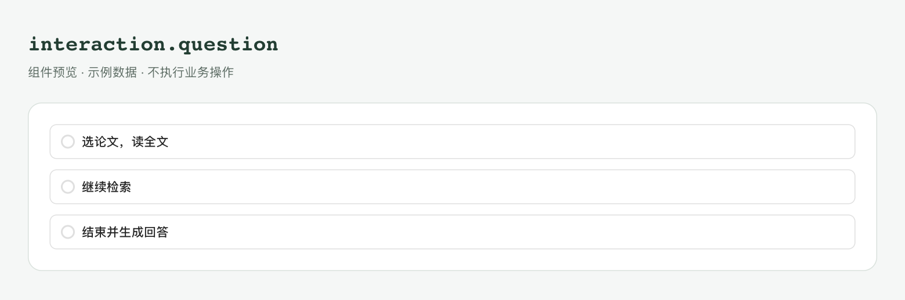
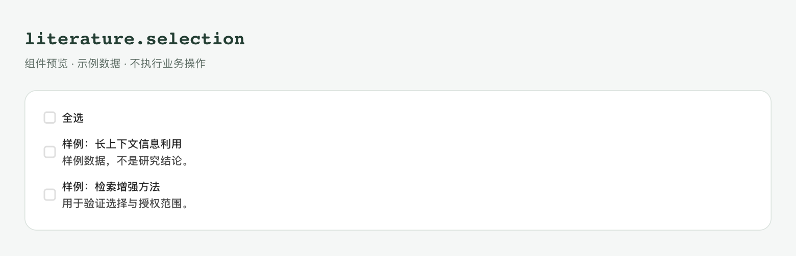
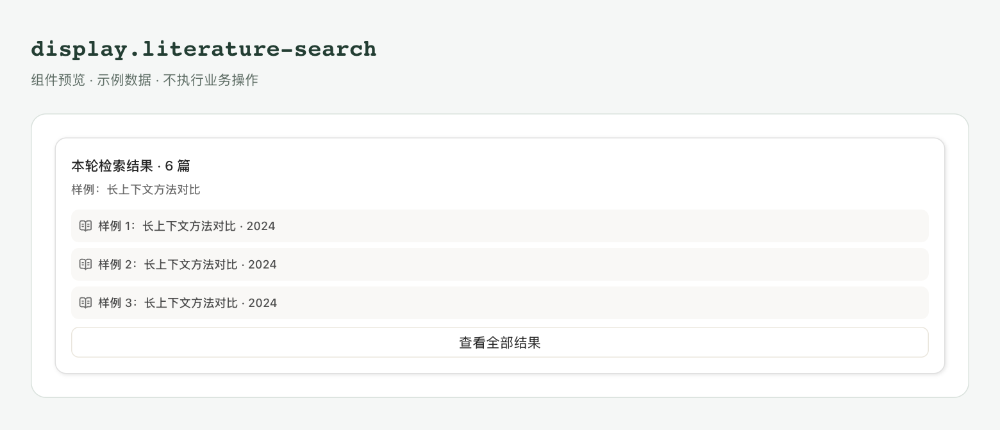
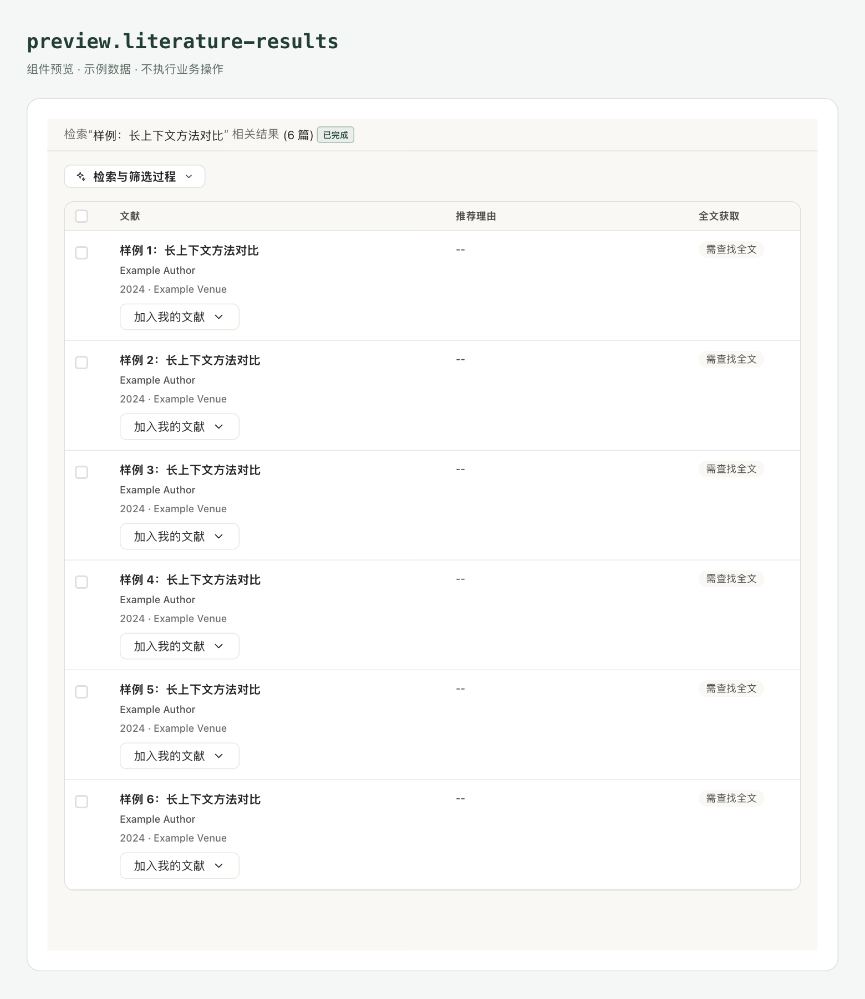
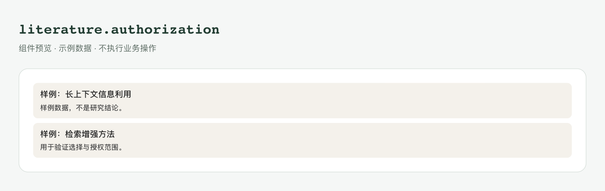
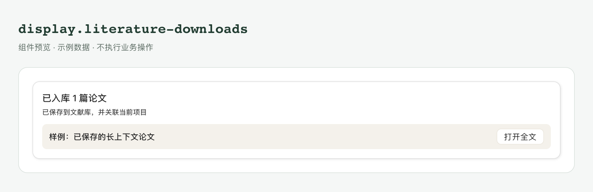
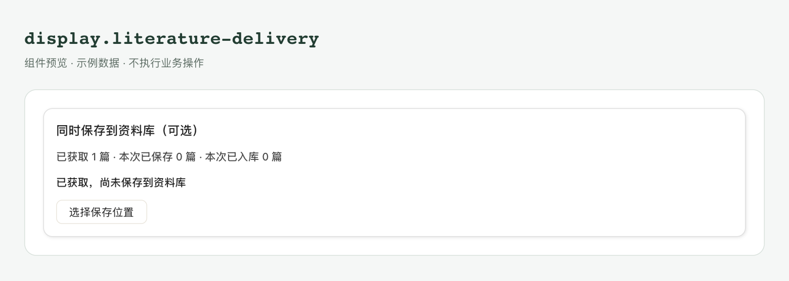
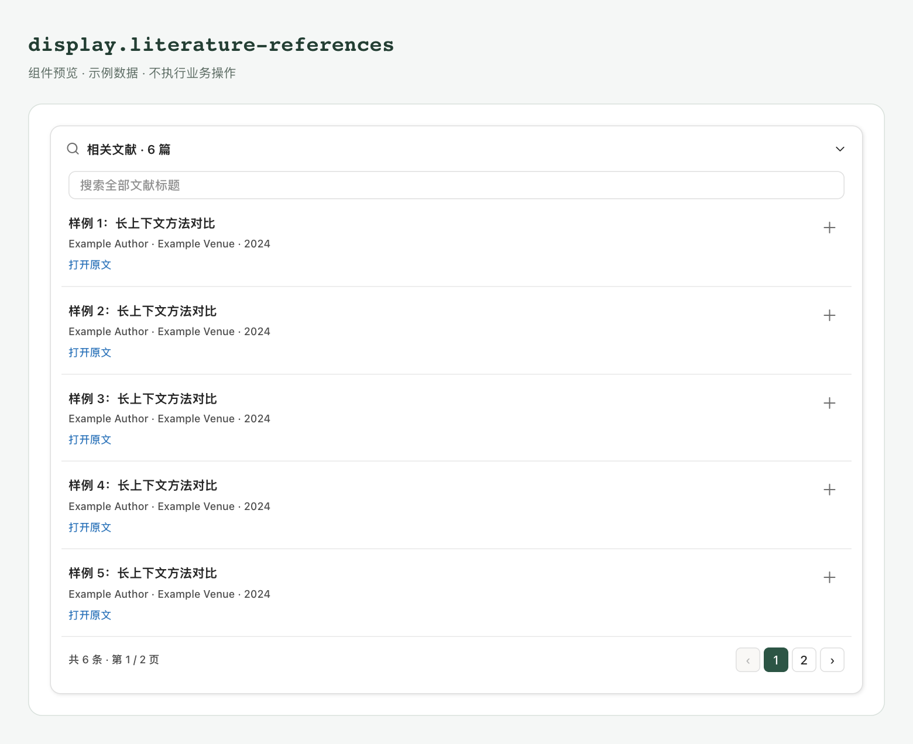

# Plugin 公共对话卡片

[Plugin 概览](../plugins.md)

先选择卡片由谁驱动，再选择界面。**公共 slot 是业务入口；Conversation 是可组合的 UI，两者不是一回事。**

## 选择卡片

| 你要做什么 | 使用什么 |
| --- | --- |
| 复用检索、文献选择、授权或保存流程 | 由所属领域工具驱动公共 slot |
| 自己组织已有对话 UI | Conversation 组件，并接入实际 props 和回调 |
| 收集自己的业务选择 | 自定义 slot、数据/动作 schema 和组件代码 |

## 公共业务 slot

| slot | 显示内容 | 使用方式 | 书深前端实现 |
| --- | --- | --- | --- |
| `interaction.question` | 问题选项与确认 | 由 AI 的原生提问流程展示并收集回答。 | [Choices.tsx:19](../../apps/desktop/src/renderer/src/features/literature/Choices.tsx#L19) |
| `display.literature-search` | 检索摘要、进入完整结果的按钮 | 在文献检索结果流程中展示，使用本轮结果集。 | [Summary.tsx:45](../../apps/desktop/src/renderer/src/features/literature/Summary.tsx#L45) |
| `preview.literature-results` | 完整结果、筛选、分页与来源 | 从检索摘要打开详情，可选择论文、查看来源或加入文献库。 | [Details.tsx:35](../../apps/desktop/src/renderer/src/features/literature/Details.tsx#L35) |
| `literature.selection` | 论文子集选择 | 兼容已有文献流程；用户勾选后返回论文 ID 列表。 | [Choices.tsx:19](../../apps/desktop/src/renderer/src/features/literature/Choices.tsx#L19) |
| `literature.authorization` | 全文授权涉及的论文 | 通过文献授权流程展示，用户确认后才获取全文。 | [Choices.tsx:19](../../apps/desktop/src/renderer/src/features/literature/Choices.tsx#L19) |
| `display.literature-downloads` | 逐篇获取或入库结果 | 在获取或入库结束后展示，可打开全文或进入文献库。 | [Downloads.tsx:16](../../apps/desktop/src/renderer/src/features/literature/Downloads.tsx#L16) |
| `display.literature-delivery` | 保存位置、文件冲突与保存结果 | 通过 `literature delivery` 发起，由用户选择保存目标并确认。 | [Delivery.tsx:74](../../apps/desktop/src/renderer/src/features/literature/Delivery.tsx#L74) |
| `display.literature-references` | 引用列表与来源操作 | 展示正文引用的文献，可打开来源、入库或设置分类。 | [References.tsx:131](../../apps/desktop/src/renderer/src/features/literature/References.tsx#L131) |

描述符引用公共组件时设置 `public: true`，指定 slot 和场景文件，不提供 entry。实际数据和动作以[组件目录](api.md#查询组件与-slot)为准。

公共 slot 不能通过通用 `component/request` 或 `component/display` 伪造调用：

- `interaction.question` 由书深的原生问答流程绑定，没有独立的命令行问答操作。要收集自己的业务选择，按[创建教程](create.md#请求卡片)使用自定义 slot。
- 文献卡片由 `literature/result`、`literature/review` 等领域入口建立真实上下文；先查询对应操作的实际契约，不自行拼造数据。

`literature.outline`、`display.literature-review` 是已有插件的自定义 slot，不是公共 slot。

### slot 怎样找到组件

前端入口在 `apps/desktop/src/renderer/src/features/literature/Component.tsx`。[源码路由](../../apps/desktop/src/renderer/src/features/literature/Component.tsx)节选：

```typescript
const VIEWS = {
  'display.literature-search': LiteratureResults,
  'display.literature-references': LiteratureReferences,
  'display.literature-downloads': LiteratureDownloads,
  'display.literature-delivery': LiteratureDeliveryCard,
  'preview.literature-results': LiteratureDetails,
};
const CHOICES = ['interaction.question', 'literature.authorization'];
const LEGACY_SELECTION = 'literature.selection';
```

结果卡片接收 `content` 与业务操作端口 `ports`；选项卡片接收 `data/status/slot/submit`。`literature.selection` 的前端注册标为 `legacyOnly`，用于已有绑定兼容，不作为新插件的通用问答入口。

公共 slot 的后端清单在 [descriptor.py](../../apps/serve/service/capabilities/service/descriptor.py)，动作约束在 [ui.py](../../apps/serve/service/capabilities/service/ui.py)，前端操作到领域能力的映射在 [ports.ts](../../apps/desktop/src/renderer/src/features/literature/ports.ts)。修改或复用前同时查这三处，不能只看按钮。

在描述符中引用已有公共卡片，例如：

```json
{
  "id": "results",
  "slot": "display.literature-search",
  "public": true,
  "preview": "components/results.json"
}
```

将这项放入 `components`，按实际数据和动作补齐 schema 与能力声明。这里没有 `entry`，因为界面由书深实现；声明只建立引用，真正显示仍走文献领域工具。

## 公共卡片视觉示例

以下为公共卡片的组件预览。示例数据位于 `skills/community/<插件名>/components/`。

### 问答与论文选择

`interaction.question` 显示选项，`literature.selection` 显示可选论文子集。问答的题干和整轮确认由外层交互流程负责，不由下面的选项组件单独完成。





### 检索摘要与完整结果

`display.literature-search` 给出摘要，`preview.literature-results` 承载完整结果、筛选与操作。示例数据见 [agentic-search/components](../../skills/community/agentic-search/components) 中的 `results.json`、`details.json` 和 `question.json`。





### 全文授权与获取结果

`literature.authorization` 展示本次全文授权涉及的论文；按钮和授权结果由书深原生流程处理。`display.literature-downloads` 显示逐篇结果。示例分别来自 [literature-review/components/authorization.json](../../skills/community/literature-review/components/authorization.json) 与 [precise-literature-search/components/downloads.json](../../skills/community/precise-literature-search/components/downloads.json)。论文子集样例在同目录 `scenario.json`。





### 保存交付与引用

`display.literature-delivery` 收集保存目标和相关选择；`display.literature-references` 显示引用列表及来源操作。示例分别来自 [precise-literature-search/components/delivery.json](../../skills/community/precise-literature-search/components/delivery.json) 与 [research-idea-partner/components/references.json](../../skills/community/research-idea-partner/components/references.json)。





## Conversation 组件

从 `window.scholarseedUI.Conversation` 取组件，在 ui.exports 声明 `Conversation`。

| 类别 | 当前导出 | 开发者负责什么 |
| --- | --- | --- |
| 科研卡片 | `Choices`、`Results`、`Details`、`References`、`Downloads`、`Delivery`、`Review` | 真实业务数据、操作端口、授权结果；科研卡通常接收 `content` 与 `ports`，Choices 接收 `data/status/slot/submit` |
| 正文与原文 | `Markdown`、`Message`、`Code`、`Formula`、`Tabulation` | 原始内容、复制/打开回调、引用和数学含义核对；显示代码不会执行代码 |
| 产物 | `Artifact`、`ArtifactGroup`、`ArtifactMenuItems`、`ArtifactDestination` | 不可变文件/版本身份、保存/导入/打开操作及结果；分组只负责布局 |
| 图片 | `ImageView`、`Images`、`ImageThumbnail` | 已授权 URL、资源身份、加载失败、选中状态与操作；组件不会读取任意本地文件 |
| 引用与上下文 | `CitationLink`、`WebCitationLink`、`CitationSources`、`ConversationReference`、`ComposerRefChip` | 引用解析、授权预览、历史快照、分页与跳转；前端标签不是读取权限 |
| 执行过程 | `ExecutionProcess`、`ExecutionBatch`、`ToolExecution`、`ExecutionIO`、`ExecutionStatus`、`WebSearchRecord` | 真实轮次、状态、输入输出和时间；不能把未知/中断显示为成功 |
| 任务辅助 | `Plan`、`Failure`、`Suggestions`、`Attachments`、`FileFormatIcon` | 计划投影、恢复资格、发送、文件身份与打开操作；UI 不自动恢复任务或发送消息 |

输入提示见 `catalog.composition.Conversation`，精确类型见[源码与类型](api.md#源码与类型)。导出组件不表示其所有书深内部回调都向普通插件开放。

## 基础控件

- **输入**：Button、IconButton、Checkbox、Input、Textarea、RadioGroup、Select。
- **布局**：Card 及其 Header、Title、Description、Content、Footer。
- **浮层**：Dialog、DropdownMenu 及其已声明子组件。
- **表格与反馈**：Table、Alert、Badge、Progress。

精确导出先查 `catalog.exports`，在 ui.exports 声明实际使用的顶层名称。使用官方 React，不重复打包 React 或从 Desktop 内部导入代码；自定义样式由自己的构建提供，不能假设书深生成任意 Tailwind 类。

接下来：[用组件完成交互](runtime.md#处理草稿与回答)。
