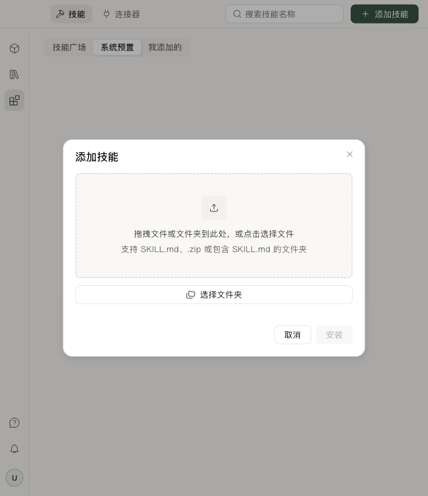

# 创建 Plugin

[English](create.md) · **简体中文** · [离线阅读](../plugins.zh.html#create)

[Plugin 概览](../plugins.zh.md)

本教程创建一个**论文阅读笔记**插件：用户提供论文材料，选择“理解方法”或“核对证据”，AI 按阅读重点生成带来源的笔记。

## 让 AI 创建

在书深对话中发送：

> 请使用 plugin-create 创建 paper-reading-notes 插件。用户提供论文或摘录后，先用卡片询问阅读重点：“理解方法”或“核对证据”。理解方法时整理研究问题、方法步骤和适用条件；核对证据时整理主要结论、对应证据和局限。笔记附上页码或段落位置，材料未提到的内容标为未说明。生成源码、检查并打包 ZIP，再提供安装卡片。

AI 会生成 Skill、描述符、组件和场景。检查交付的源码和报告后，在安装卡片中确认安装。

要修改它，在同一对话继续指名 `plugin-create` 并描述变更；不用重新创建一个相同身份的插件。

## 自己编写

在安装了目标版本书深后端的 Python 环境中，查询 `host` 字段需要填写的值：

```sh
python -c "from importlib.metadata import version; print('==' + version('scholarseed'))"
```

创建以下文件：

```text
paper-reading-notes/                 # 插件源码，也是打包输入目录
├── SKILL.md                         # 论文阅读流程与笔记要求
├── .scholarseed-plugin.json          # 插件身份、兼容设置、卡片与动作
└── components/
    ├── focus.js                     # 阅读重点选择卡片
    └── focus.preview.json           # 卡片的示例输入与提交样例
request.json                        # 校验用请求，放在插件目录外
```

`.scholarseed-package.json` 是打包工具生成的包清单，不需要手写。

### 1 SKILL.md

`SKILL.md` 使用[标准 Skill 格式](https://agentskills.io/specification)（[GitHub](https://github.com/agentskills/agentskills)）。

```markdown
---
name: paper-reading-notes
description: 按用户选择的阅读重点，为论文或摘录整理方法笔记或证据笔记。
version: "0.1.0"
---

# 论文阅读笔记

1. 确认用户提供的论文或摘录；缺少材料时请用户补充。
2. 查询 component/catalog，确认 reading.focus 可用。
3. 使用 component/request 发布“选择阅读重点”卡片，传入 question 和唯一 request_id。
4. 等待回答，从 result.answers 解析 JSON {action, values}。
5. action 为 confirm 时，按 values.focus 生成笔记：
   - method：研究问题、方法步骤、适用条件。
   - evidence：主要结论、对应证据、研究局限。
6. 为每条笔记附上页码或段落位置；材料未说明的内容标为“未说明”。
7. 收到取消或失败结果时停止；仅有摘要或摘录时，注明笔记覆盖的材料范围。
```

### 2 .scholarseed-plugin.json

描述符声明插件身份、卡片入口和输入输出。复制下面的内容，将 `__HOST__` 替换为上方命令的完整输出。

```json
{
  "schema": 2,
  "id": "paper-reading-notes",
  "version": "0.1.0",
  "host": "__HOST__",
  "skill": "SKILL.md",
  "ui": {
    "compatibility": "1.0",
    "exports": ["React", "mount", "Button"]
  },
  "capabilities": ["interaction.answer"],
  "components": [
    {
      "id": "focus",
      "slot": "reading.focus",
      "entry": "components/focus.js",
      "preview": "components/focus.preview.json",
      "input_schema": {
        "type": "object",
        "required": ["question"],
        "properties": {"question": {"type": "string"}},
        "additionalProperties": false
      },
      "output_schema": {
        "type": "object",
        "required": ["focus"],
        "properties": {"focus": {"type": "string", "enum": ["method", "evidence"]}},
        "additionalProperties": false
      },
      "actions": [
        {
          "id": "confirm",
          "capability": "interaction.answer",
          "input_schema": {
            "type": "object",
            "required": ["focus"],
            "properties": {"focus": {"type": "string", "enum": ["method", "evidence"]}},
            "additionalProperties": false
          }
        }
      ]
    }
  ],
  "configuration": []
}
```

#### 顶层字段

| 字段 | 含义 | 本教程怎么填 |
| --- | --- | --- |
| `schema` | 书深使用的描述符格式版本 | 填数字 `2`。 |
| `host` | 插件支持的书深后端版本 | 复制查询命令的完整输出，包含开头的 `==`。 |
| `id` | 插件的唯一名称 | 填 `paper-reading-notes`，与 Skill 的 `name` 一致。更新时保持不变。 |
| `version` | 插件自身的发布版本 | 填 `0.1.0`，与 Skill 和打包命令一致；发布更新时递增。 |
| `skill` | Skill 入口路径 | 填 `SKILL.md`。 |
| `ui.compatibility` | 书深 UI 接口版本 | 填 `"1.0"`。 |
| `ui.exports` | 组件使用的官方 UI 导出 | 填 `React`、`mount`、`Button`；增加控件时同步补充。 |
| `capabilities` | 卡片动作需要的能力 | 此例只提交用户选择，填 `["interaction.answer"]`。 |
| `components` | 卡片列表 | 此例声明一张 `focus` 卡片，字段见下表。 |
| `configuration` | 可选的配置项声明 | 此例没有配置，填 `[]`。 |

#### 每张卡片的字段

| 字段 | 怎么填 |
| --- | --- |
| `id` | 插件内唯一的组件名称，此例填 `focus`。 |
| `slot` | AI 请求卡片时使用的名称，此例填 `reading.focus`。使用两个以点分隔的名称段，各段以小写字母开头，可包含数字和连字符。 |
| `public` | 默认 `false`。自己的组件保持默认；引用[公共卡片](cards.zh.md#公共业务-slot)才设为 `true`，使用已有公共 slot，并且不能提供 `entry`。 |
| `entry` | 界面的 JavaScript 路径，此例填 `components/focus.js`。 |
| `preview` | 检查场景的 JSON 路径，此例填 `components/focus.preview.json`。 |
| `input_schema` | 卡片 `data` 的 JSON Schema；省略时默认为对象。写清必填字段和允许的数据类型。 |
| `output_schema` | 用户回答中 `values` 的 JSON Schema；省略时默认为对象。不要套上 `{action, values}` 外层信封。 |
| `actions` | 动作数组，默认 `[]`。每项的 `id` 是代码传给 `submit` 或 `request` 的名称；`capability` 必须出现在顶层能力数组；`input_schema` 校验该动作的 `values`，默认对象。动作 ID 在卡片内唯一。 |

例如 `submit("confirm", {focus: "method"})`：`confirm` 对应动作 ID，`{focus: "method"}` 同时接受动作和卡片输出 schema 的校验。

#### 配置项与填写约束

需要声明配置时，每项填写 `key`（唯一名称）、`type`（`string`、`integer` 或 `boolean`）、`label`（显示名称），可附 `required` 和同类型的 `default`。配置声明目前不提供设置页面或值的存取接口。

描述符不接受未知字段。资源路径使用 `/`，相对插件根目录，不使用 `..`、绝对路径或 Windows 保留名。Schema 不使用 `$ref` 或 `$dynamicRef`；改动后重新运行检查。

### 3 components/focus.js

按钮把所选方式提交给书深；仅在 pending 状态允许操作。需要可编辑表单时，再接入[草稿与状态](runtime.zh.md#处理草稿与回答)。

```javascript
(() => {
  const { React, mount, Button } = window.scholarseedUI;
  const create = React.createElement;

  function FocusCard({ state }) {
    const disabled = state.status !== "pending";
    const chinese = state.language.startsWith("zh");
    return create("section", { "aria-label": chinese ? "阅读重点" : "Reading focus" },
      create("p", null, state.data.question),
      create(Button, {
        disabled,
        onClick: () => window.plugin.submit("confirm", { focus: "method" })
      }, chinese ? "理解方法" : "Understand the method"),
      create(Button, {
        disabled,
        onClick: () => window.plugin.submit("confirm", { focus: "evidence" })
      }, chinese ? "核对证据" : "Check the evidence")
    );
  }

  mount(state => create(FocusCard, { state }));
})();
```

### 4 components/focus.preview.json

场景文件为 `focus.js` 提供检查数据，通过描述符的 `preview` 字段关联。`data` 是示例输入，`responses` 是模拟动作响应，`submissions` 是待检查的提交值。正式对话使用实际请求数据，不读取这个文件。

```json
{
  "data": {"question": "这篇论文，你想重点了解什么？"},
  "responses": {
    "confirm": {"state": "resolved", "data": {"focus": {"$input": "focus"}}}
  },
  "submissions": {
    "confirm": [{"focus": "method"}, {"focus": "evidence"}]
  }
}
```

## 请求卡片

安装并启用后，AI 使用以下 `scholarseed_bridge` 工具参数请求卡片：

```json
{
  "capability": "component",
  "operation": "request",
  "request": {
    "request_id": "reading-focus-1",
    "slot": "reading.focus",
    "data": {
      "question": "这篇论文，你想重点了解什么？"
    },
    "title": "选择阅读重点",
    "prompt": "选择后生成对应的论文阅读笔记。"
  }
}
```

书深后端返回用户选择后，AI 从 `result.answers` 解析 `{action, values}`，按 `values.focus` 生成方法笔记或证据笔记。

发布前按[API 参考](api.zh.md#查询组件与-slot)检查 `reading.focus` 是否与已启用插件冲突。每次新问题使用不同的 `request_id`。

## 检查和打包

把上面 JSON 的**内层 request** 保存为 `request.json`，从插件父目录运行：

```sh
python -m service.cli.plugins validate ./paper-reading-notes/.scholarseed-plugin.json ./request.json
python -m service.cli.plugins pack ./paper-reading-notes --name paper-reading-notes --version 0.1.0 --output ./paper-reading-notes-0.1.0.zip
```

输出 `valid=true` 后，保留 ZIP 和 SHA-256。ZIP 放在源码目录外；发布更新时递增版本并生成新包。

`capabilities_unchecked` 表示尚未核验书深运行时的实际能力。离线通过不等于已经安装或运行，下一步仍需[导入并完成端到端测试](testing.zh.md#导入书深并完成第一次对话)。

## 安装并试用

- **AI 生成**：在已发布的安装卡片上核对报告并确认安装。`published` 只表示卡片已发布。
- **自己编写**：技能中心 → **添加技能**，选择 ZIP，检查后确认安装。



安装并启用后，发送：

> 请使用 paper-reading-notes 为我刚上传的论文整理阅读笔记，先让我选择阅读重点。

选择“理解方法”后，应得到研究问题、方法步骤和适用条件；选择“核对证据”后，应得到结论、证据和局限。两类笔记都应包含来源位置。完整检查步骤见[Plugin 测试](testing.zh.md#导入书深并完成第一次对话)。

接下来：[公共对话卡片](cards.zh.md) · [运行原理](runtime.zh.md)。
