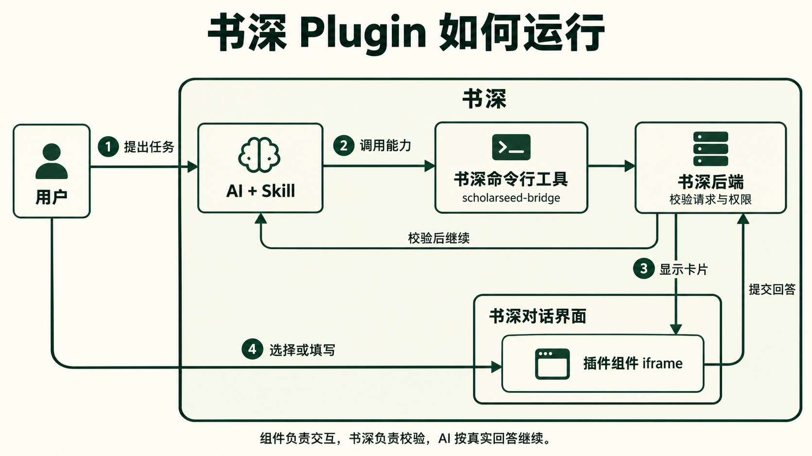

# Plugin 运行原理

[English](runtime.md) · **简体中文** · [离线阅读](../plugins.zh.html#runtime)

[Plugin 概览](../plugins.zh.md)

AI 按 Skill 的指令发起请求，书深后端校验后，在书深对话界面展示卡片。用户提交选择后，AI 根据回答继续完成任务。

以[论文阅读笔记](create.zh.md)为例：AI 请求 `reading.focus` → 书深后端检查数据 → 对话界面加载 `focus.js` → 用户选择“理解方法” → 后端返回 `{focus: "method"}` → AI 生成方法笔记。

## 从加载到绘制

1. 安装检查通过后，用户确认安装并启用。AI 在真实任务中发现并使用 Skill。
2. AI 查询组件目录，向可用 slot 发出请求；公共业务卡片由领域工具驱动。
3. 书深固定本次交互的插件和 UI 资源版本：自定义组件在隔离 iframe 中加载包内 entry；公共卡片使用书深前端实现，不提供包内 entry。
4. 自定义组件通过 `mount(render)` 接收快照、切换语言和主题并绘制到 `#root`。不要同时创建第二个 React root 或重复订阅渲染链。

`component/request` 等待用户回答；`component/display` 只展示。发布记录不表示相关业务已经完成。

## 处理草稿与回答

| 数据 | 用途 | 校验 |
| --- | --- | --- |
| data | 书深传给组件的业务输入 | 组件 input_schema |
| draft | 已保存的界面草稿 | 保存流程；不是批准或执行结果 |
| values | 用户提交的值 | 动作 input_schema；interaction.answer 还校验组件 output_schema |
| {action, values} | 回到 AI 的回答信封 | 书深后端封装；不要把外层信封写进 values 的 schema |

使用 `onState` 接收当前快照及后续 data、draft、status、language、slot、theme。使用 mount 时，渲染订阅已经接好。

- `save(values)` 保存草稿，不让 AI 继续；失败时保留输入。
- `submit(actionId, values)` 回答当前交互，仅在 pending 时提交；完成情况看后续状态。
- 主题、语言或状态更新不能清空未保存输入，旧保存回执不能覆盖更新的编辑。
- 取消、失败、过期或未知结果，不推进依赖这个回答的步骤。

方法签名与返回值见[前端 SDK](api.zh.md#前端-sdk)。

## 更新和旧卡片

修改插件后递增 Skill 与描述符版本，重新生成 ZIP 和摘要，通过新安装卡片或技能中心确认更新。slot 冲突或更新失败时保留旧版，不静默接管其他插件。

旧交互固定原插件、UI 资源、数据、草稿和动作语义；新版不能重新解释旧回答。关闭插件只阻止新绑定，旧卡仍需当前权限和状态校验，不等于授权永久有效。

## 权限边界

组件只能使用书深给出的数据和已声明且已接通的动作。iframe 没有 Node、Electron、preload 或父文档权限，不是任意文件、HTTP 或命令代理。

Skill 调用后端与前端 SDK 是两个调用面；声明 capability 不会自动接通处理器或授予业务权限。本协议没有全局事件拦截、工具重写或自动批准接口。

接下来：[可用 API](api.zh.md) · [测试状态与更新](testing.zh.md)。
