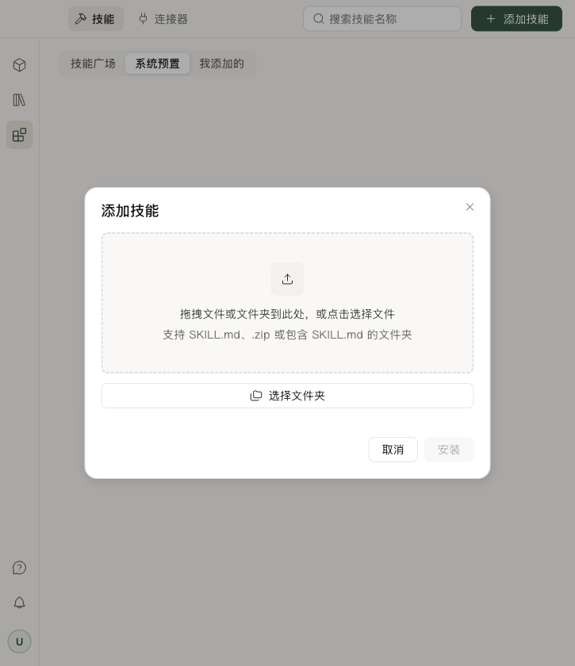

# Plugin 测试

[Plugin 概览](../plugins.md)

用[论文阅读笔记插件](create.md)走完检查、安装和对话使用流程。

## 检查插件包

按[创建教程](create.md#检查和打包)执行 validate 和 pack。validate 使用 `request.json` 中的内层请求。

收到外部 ZIP，或需要核对传输后的字节时执行：

```sh
python -m service.cli.plugins check ./paper-reading-notes-0.1.0.zip
```

- 核对包身份、版本、实际 SHA-256 和每个 issue。
- 检查场景覆盖所有动作，以及每个动作的提交值。
- ZIP 放在源码目录外，路径使用可移植相对路径；不要带绝对路径、盘符、反斜杠、.. 或 Windows 保留名。
- 不打包凭据、.env、登录缓存、虚拟环境或无关文件。

`capabilities_unchecked` 表示还需要在书深中验证实际调用。

## 导入书深并完成第一次对话

准备 `paper-reading-notes-0.1.0.zip` 和一篇你要阅读的论文。

1. 打开书深，进入**技能中心 → 添加技能**，选择 ZIP。
2. 核对插件名称、版本和检查结果，确认安装。
3. 在自己的技能列表中找到 `paper-reading-notes` 并启用。通过 AI 创建的插件，也可以直接在对话安装卡片中确认安装。
4. 打开自己的对话，上传论文或粘贴摘录，发送下方指令。
5. 等到“选择阅读重点”卡片出现，点**理解方法**，检查笔记是否包含研究问题、方法步骤和适用条件，并标注来源位置。
6. 再发起一次任务，选择**核对证据**，检查是否改为整理主要结论、对应证据和局限。材料未说明的内容应标为“未说明”。

可以直接发送：

> 请使用 paper-reading-notes 为我刚上传的论文整理阅读笔记，先让我选择阅读重点。

无需先通过技能选择器绑定插件。若没有出现卡片，检查插件是否启用，以及工具记录中是否发起了 `component/request`。



## 检查任务结果

| 测试 | 预期结果 |
| --- | --- |
| 选择“理解方法” | 回答中的 `focus` 为 `method`，生成方法笔记并附来源。 |
| 选择“核对证据” | 回答中的 `focus` 为 `evidence`，生成证据笔记并附来源。 |
| 取消阅读重点选择 | 不再生成本轮笔记。 |
| 只提供论文摘要 | 笔记注明仅基于摘要，不补写全文中的实验或结论。 |
| 使用下载、保存或入库能力的插件 | 在对应文件目录、资料库或文献库中核对实际结果。 |

记录任务输入、工具返回和输出笔记，保留出错时的截图或录屏。

## 检查界面和更新

对于自定义卡片，调用 `setCopyContent()` 后点击消息下方的复制按钮。将剪贴板粘贴到文本编辑器，核对正文、卡片、后续结论的顺序，以及选择、引用和链接是否完整。切换会话再返回，确认历史卡片内容仍包含在复制结果中；修改草稿后应重新登记，不能继续复制旧选择。未登记文本时，复制结果应明确标出缺失的卡片内容。

- **界面**：明暗主题、窄窗口、键盘、长文本和错误提示。
- **状态**：重绘保留编辑，旧保存回执不覆盖新输入，取消后不继续。
- **更新**：新包、新摘要、新安装确认；slot 冲突不接管其他插件，失败保留旧版。
- **旧卡片**：按固定版本恢复，并重新检查当前权限。
- **平台**：macOS 与 Windows 分别验证受影响的安装和运行。

## 排障

| 现象 | 先检查 |
| --- | --- |
| 找不到创建或预览按钮 | 页面入口隐藏；在对话中指名 plugin-create |
| 对话无法使用 plugin-create | 当前版本是否包含技能、是否启用、书深技能清单是否正常 |
| host 不兼容 | 后端 distribution 版本、描述符范围和实际契约 |
| 已安装但没卡片 | 启用状态、component/catalog、slot 和真实工具请求 |
| component_value_invalid | data、动作 values、output_schema；不要把外层回答信封当 values |
| plugin_capability_unavailable | 当前卡片是否有实际处理器；能力声明不是接通操作 |
| ui_dependency_unavailable | 官方资源、compatibility、实际 exports；不要自带 React 冒充书深提供的资源 |
| 保存后输入丢失 | 本地编辑与快照合并，旧回执是否覆盖了新输入 |
| 技能列表失败或 503 | 书深技能清单与初始化日志；恢复后重试，不模拟成功 |
