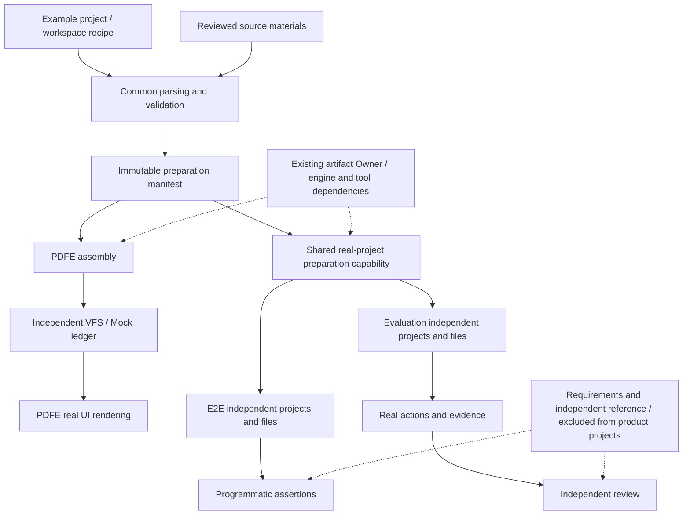
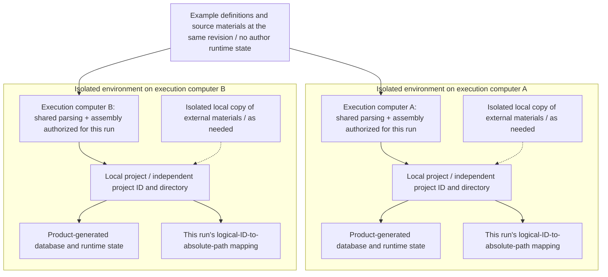

<a id="评测自动化测试与-pdfe-的共享示例设计"></a>
# Shared Examples for Evaluation, Automated Testing, and PDFE

## Scope / Non-goals

Unify the external source materials, synthetic example projects, and lightweight workspace recipes
needed by the three consumer types, so users mainly choose an example and data conditions instead
of independently finding files, checking digests, assembling directories, and combining projects.
What is shared is immutable content, common parsing and validation, and preparation manifests—not
product databases, writable directories, prebuilt successful results, or a universal business
simulator. This document is a data design and maintenance contract; it does not claim that a data
loader has already been implemented.

The initial consumers are the current Desktop, its real Serve integration, and the development
evaluation Skill. Other Owners may adopt the same data contract when they have a real reuse need;
migration of all local unit fixtures is not required. This design adds no evaluation platform,
scheduling framework, production data schema, or Runtime dependency, and changes no product paths
or permission rules.

<a id="-核心设计原则"></a>
## 🎯 Core Design Principles

This design addresses “how one example project can be used reliably by different tools on different
execution computers”; it is not about moving files into a common directory. Directories and fields
are implementations of the following principles, not design goals:

1. **Treat a usable project as the unit.** Callers express the business example and necessary
   conditions; they do not repeatedly find files, assemble directories, check digests, or create
   relationships. Complete files alone do not make a project usable: ownership, references, and
   reachability must also be preserved.
2. **Share reproducible inputs, not runtime state.** Different execution computers use the same
   content definition and create their own project identities, databases, and paths in isolated
   environments. Do not distribute the author's already-run workspace/Home copies.
3. **Unify preparation capabilities, not product implementations.** Maintain one parser and
   validator; leave assembly with its owning Owner. PDFE Mock, the real product, and independent
   judgment do not replace one another. Do not rewrite business state machines for reuse.
4. **Keep defaults simple and differences explicit.** One base project should work directly. Add
   conditions or recipes only when empty, multi-project, or special-material cases are actually
   needed. Do not build a framework in advance for directory symmetry, potential consumers, or
   format completeness.
5. **Prepare conditions; do not manufacture results.** Prerequisite materials, projects, and
   capabilities must be distinct from the actions being verified in this run. Data sources and
   evaluation criteria are independent; prebuilt artifacts cannot prove successful import, saving,
   model execution, or recovery.
6. **Keep content stable while allowing locations to vary.** Example identity and relative
   relationships must not depend on usernames, checkout paths, or workspace locations. Absolute
   paths belong only in local assembly mappings. Disclose platform capability limits; do not
   silently degrade.
7. **Keep data traceable without duplicate maintenance.** Sources, revisions, and runtime mappings
   must be traceable; tools generate mechanical metadata such as digests. Reuse must not require
   maintainers to register the same file in three consumers or edit environment paths for every run.

Trade-off priority: safety and truthful acceptance come before reuse, business semantics before file
deduplication, and simple calls before complete configuration. If a shared abstraction burdens
callers without removing duplicated preparation, narrow the abstraction instead of adding a
configuration layer.

## Source of truth

| Responsibility | Current Owner and source |
| --- | --- |
| Projects, user roots, and real persistence | [Persistence boundaries](persistence.md), plus Serve paths and business APIs; data tools must not derive project database paths independently |
| PDFE scenario policy, generators, and instance ledger | [PDFE overview design](../../apps/desktop/docs/architecture/PDFE.md), [runtime](../../apps/desktop/docs/architecture/preview.md) |
| Automated runs and assertions | [Testing design](../../apps/desktop/docs/architecture/testing-strategy.md), [acceptance specification](../../apps/desktop/docs/quality/testing.md) |
| Evaluation requirements, independent references, and adoption status | [Evaluation design](../../apps/desktop/docs/architecture/evaluation.md), [scenario library](../../apps/desktop/eval-scenarios/README.md); input samples do not determine the correct answer |
| Execution, authorization, and judgment | [Build engineering specification](../../apps/desktop/docs/architecture/evaluation.md), [execution engineering specification](../../apps/desktop/docs/architecture/evaluation.md); this document does not duplicate their workflows |

## Current / Required / Gap / Advisory

**🚧 Status definitions**: `current` describes the current mechanism, `required` a design
constraint, `gap` something not yet available or verified, and `advisory` a recommendation. The
architecture diagrams below describe the target design; they do not claim the corresponding code
has been implemented.

- **current**: The minimal project is at `apps/desktop/e2e/fixtures/data/minimal-project/`;
  the Office-specific corpus is at `apps/desktop/e2e/fixtures/office-corpus/`; evaluation pages
  have additional source materials. PDFE references some existing files through `documents.ts`
  and checks their digests; `PreviewFiles` provides in-memory copies. `homeSeed` generates projects
  and tasks according to policy; the E2E runtime provides an isolated Home/workspace/profile.
- **current**: Declarative `buildProject` can create a real project and write materials, but is not
  yet connected to spec consumers; non-empty sessions/settings are explicitly rejected. Its
  interface declaration does not mean sessions or settings can be seeded.
- **current**: The top-level `examples/` contains a base project and empty/pair recipes; common
  parsing and validation are in `scripts/shared/examples.cjs`. Existing editor synthetic
  Markdown/TypeScript original bytes have moved into that project, and active evaluation references
  have been updated without changing criteria or historical requirement versions.
- **current**: PDFE distinguishes example/reviewed/empty file seeds; empty creation no longer loads
  samples. `scripts/shared/preparation.cjs` prepares text and declared PDF, PNG, and XLSX source
  materials without UI or assertion dependencies, writing or copying them through public project
  and material APIs and reading back their digests. Evaluation examples are consolidated in
  `examples/projects/evaluation/`; data preparation does not replace testing the manual import
  feature. The new `buildExample` and E2E consumer spec and the evaluation preparation procedure
  have been wired up.
- **required**: New shared samples must follow this page's identity, source, isolation, and minimal
  loading contract. Adapters remain with their existing Owners; production code must not depend on
  development data. Unknown, missing, and unsupported cases must fail explicitly, with no success
  placeholders.
- **gap**: Wiring and deterministic passes do not mean real Serve/Electron E2E, the evaluation host,
  or cross-computer/platform acceptance has passed. Specific versions, tested scope, and blockers
  are in the implementation record (non-public execution/provenance record omitted). Current real
  preparation supports only lossless UTF-8 text; binary data, generation parameters, remote
  acquisition, and automatic historical recovery are not supported. Unknown capabilities are
  explicitly rejected. The specialized reviewed corpus is still fully validated on demand; do not
  claim per-format lazy loading.
- **advisory**: First connect all three consumer types to one base project, then migrate as needed;
  do not seek to unify every fixture.

## Ownership / Dependency

<a id="-架构图一一份定义三种消费独立判据"></a>
### 🧩 Architecture Diagram 1: One Definition, Three Consumers, Independent Criteria



The key point is that shared capabilities stop at data parsing and preparation; each assembly path
remains with its own Owner, and E2E and evaluation use different writable copies. Source inputs,
required runtime dependencies, and independent criteria have distinct roles and must not be treated
as project files. PDFE Mock rendering is not part of the real E2E or evaluation pass path.

Shared data describes only content, relationships, and necessary generation parameters; each
consumer Owner owns HTTP/SSE, renderer DTO, and database-field mappings. Do not extract a “universal
seed” that rewrites Serve, PDFE, and test business rules together. Creating through the real product
API is one preparation method; it is not equivalent to testing UI creation. The action under test
must remain for execution time.

<a id="公共准备边界与调用方式"></a>
### Shared Preparation Boundary and Invocation

The goal is “one shared parsing and validation capability, two assembly methods,” not a separate
loader for each of the three consumers:

| Layer | Shared responsibilities and boundaries |
| --- | --- |
| Shared parsing and validation | Parse projects/recipes and defaults, select optional data conditions, resolve file references, validate versions/digests/paths/relationships, and produce an immutable preparation manifest with a common structure; must not create products, modify directories, or access the network automatically |
| PDFE assembly | Construct an independent VFS and supported domain ledgers from the manifest, retaining existing scenario policies and interface adapters |
| Real-project preparation | Let E2E and evaluation reuse the same isolated project creation, file materialization, and result-mapping capabilities; use existing product contracts, not test assertions, Playwright Page, or Judge logic |
| Caller | Select data, verify this run's authorization and action under test, provide a verified isolated target and dependencies, and consume the preparation result; keep assertions, Driver actions, and review independent |

The shared development-data preparation capability belongs to the root development-tools Owner;
reuse applicable mechanisms in `scripts/shared/` during implementation. Domain assembly remains
with its original Owner, and production products must not import this capability. Initial Node
consumers share the actual parsing implementation; if Python needs it later, use the same schema
and consistency fixtures without prematurely creating a second ruleset or cross-language platform.

Callers usually select only a project ID; shared capabilities handle directory and file details.
Choose a recipe or explicit condition only when empty, multi-project, or large-data cases are
needed. The following is the shared selection and return contract. The minimal implemented entry
point and types are in the shared module; extension fields still need implementation, and this does
not mean a new ops CLI has been registered:

- Data selection: Choose either `projectId` or `workspaceId`, optionally with existing optional
  conditions; unknown conditions are rejected. If neither is supplied, read the unique
  `defaultProjectId` in `examples/manifest.json`. This field is the machine-readable source of truth
  for the default identity. The README only explains its purpose: do not parse Markdown, select the
  first file, or duplicate hard-coded defaults in consumers. Missing, invalid, or dangling default
  references are explicitly rejected; explicit IDs are validated by the same rules. A default
  selects data only; it does not automatically authorize creation or writing.
- Execution context: This run's mode (preparation/read-only inspection), verified isolated target,
  and permitted preparation capabilities. The existing runner/Skill provides these; ordinary cases
  need not repeat them. Do not infer them from user directories or silently widen permissions.
- Return value: Data identity, preparation status, projects/files located by symbolic ID,
  dependencies, and unsupported items; after assembly, include real IDs/paths and a preparation
  receipt. Callers use symbolic references and do not assemble paths or hard-code random IDs.

The simplest ordinary case is “use the default project,” not a requirement to supply a profile,
project count, and seed. Run records still freeze the actually resolved revision and content
digests; a change to the default project does not rewrite historical runs or silently upgrade frozen
inputs. Sharing real preparation capabilities does not mean evaluation can copy every E2E seeding
method: perform only preparation actions allowed for this run. If the interface or permissions are
insufficient, report a blocker explicitly; do not bypass it with direct database writes, internal
dispatch, or prebuilt results.

<a id="共同业务不变量"></a>
### Shared Business Invariants

Within the capabilities supported by each consumer, the same project definition must preserve:

- Source materials retain the same content identity and project-relative locations, and file
  references resolve to targets that actually exist.
- Ownership of tasks, sessions, materials, versions, and artifacts is explicit. Every supported
  reference points to this assembly's mapping, not another project, an author-machine path, or an
  old run ID. Matching file digests do not establish correct business relationships.
- Two instances of the same template are independent projects. Their content may match, but they
  must not share writable state or reuse one another's identities.
- Empty, missing, load-failed, and unsupported states are represented distinctly. If a preparation
  capability is missing, reject the dependency instead of fabricating an empty list, deleting a
  relationship, or switching to other data. The three consumer types also retain distinct evidence
  levels for their results.

Physical paths, run IDs, and valid run times may differ. Compare semantic identities and results,
not absolute strings from the author's environment. The shared manifest describes target conditions;
adapters assemble and verify them instead of merely declaring “the files were copied.”

<a id="-目标目录及渐进归属"></a>
### 📁 Target Directories and Incremental Ownership

Shared examples live in the repository-root `examples/`, not `tests/datasets/`, so product examples
are not limited to test-only assets. Use the plural name to represent multiple example projects and
their shared materials. The following is the layout contract. A base project and minimal recipes
have been established; create `assets/` only when there is real cross-project reuse, and do not
pre-create an empty directory.

```text
examples/
├─ README.md                   Usage entry point and index of assets and consumers; links to this document
├─ manifest.json               schemaVersion and the unique defaultProjectId; does not duplicate the full project inventory
├─ assets/<asset-id>/           Source files and manifest.json that are actually reused across projects
├─ projects/<project-id>/
│  ├─ project.json             File inventory, business relationships, and necessary optional conditions
│  └─ files/                   Reviewed source materials specific to this project; create as needed
└─ workspaces/<workspace-id>.json  Recipes for empty, multi-project, or large-data cases only when needed

apps/desktop/preview/           Scenario policies, generators, and VFS/DTO adapters that reference shared definitions
apps/desktop/e2e/fixtures/      Adapters for real-project preparation and isolated lifecycles
apps/desktop/eval-scenarios/    Requirements, criteria, independent references, and selected-data references
```

The top-level `examples/` holds reusable example inputs and project definitions; it does not own
test execution, evaluation criteria, or PDFE business adapters. Each consumer Owner maintains its
own adapters and acceptance. Changes to shared definitions must be checked against all actual
consumers. This directory does not store runtime workspaces, screenshots, logs, credentials, real
user state, or reference answers.

Shared data must not depend on Desktop code or be loaded by default by product startup paths or
installers. Node and Python consume the same data files; do not import UI modules across languages.
If user-importable product examples are offered in the future, define their distribution inventory,
license, and product entry point separately; their location under `examples/` does not automatically
include them in packaging. Fixtures used only locally, such as geometry, malformed formats, and
protocols, remain in their owning test directories. Existing reviewed corpora such as the Office
corpus may temporarily use an explicit legacy path; do not duplicate bytes just to make the
directory layout look tidy.

Initially, share only business source materials that are actually consumed in multiple places.
Keep format stress corpora separate from ordinary business examples; an example need not contain
every format, and each consumer need not load every asset. Store project-specific materials beside
the project in `projects/<project-id>/files/`, with `project.json` recording the same source and
integrity metadata. Do not create a separate asset directory and manifest for every small file.
Extract materials into `assets/` only when there is real cross-project reuse. Store identical bytes
only once; callers need not know the storage details.

<a id="外部依赖分类"></a>
### External Dependency Categories

| Type | Organization and failure semantics |
| --- | --- |
| Small synthetic/de-identified source materials | Add to Git only after review and confirmation of source and rights; maintain identical bytes once and reference them by ID |
| Large or separately acquired corpus | Check in the manifest and keep bytes in a controlled local cache; pin version/digest/size and prepare explicitly, never download silently in ordinary tests |
| Office/WASM, fonts, native modules, toolchains | Continue to be prepared and validated by existing artifact/toolchain Owners; data declares only dependency identity and does not copy them into example projects |
| Network sites, services, models, accounts | Verify endpoint capabilities, cost, permissions, and availability before running; do not store real secrets or use project fixtures to fake service readiness |
| Faulty, oversized, and malicious-format samples | Require explicit opt-in for specialized cases and state risks and resource budgets; keep them out of routine quick evaluation and do not use them to expand production capabilities |

Attribute missing data, missing dependency resources, unreachable services, and product feature
failures separately. If required input is unavailable, block the dependent item and continue other
independent items under their original rules. Do not report “not run” as a pass or delete frozen
scope to turn results green.

<a id="数据契约"></a>
## Data Contract

<a id="资产-manifest"></a>
### Asset Manifest

The manifest uses JSON. The table below defines the full target semantics of its fields; the shared
module is the sole implementation of the current minimal fields and validation. Unsupported fields
such as remote `acquisition`/`requirements` are explicitly rejected. Node and Python must not
maintain separate enums or implicit default rules in the future.

| Field | Constraint |
| --- | --- |
| `schemaVersion`, `id`, `revision` | Keep format version, stable business identity, and content revision separate. Increment the revision when bytes or important metadata change; do not overwrite references from historical runs. |
| `source` | Use an explicit source category such as `synthetic`, `reviewed-local`, or `remote`; record the generator or original source, source version, rights statement, and any required license. |
| `files` | Each entry has a stable ID, controlled relative path, media type, actual byte count, and SHA256; a file extension does not prove format validity. |
| `requirements` | Declare only necessary reader engines/format capabilities and similar requirements; do not include local absolute paths, model keys, or personal configuration. |
| `acquisition` | Required only for remote assets: pin the source version, digest, and size. Do not include URLs containing tokens or locate assets through a mutable `latest`. |

Validate the integrity of both Git files and remote caches. Missing digests, incorrect sizes, unknown
files, duplicate IDs, or paths that escape the allowed root must fail explicitly. Downloadable
source and rights to use/redistribute are separate questions; matching digests do not replace rights
review. Do not invent licenses for historical files whose source is currently unknown; keep them
pending verification and out of newly shared reviewed inventories. Tools generate and validate
mechanical fields such as digests and actual sizes; maintainers need not calculate them manually or
synchronize multiple manifests. IDs, source rights, and important content revisions still require
human/AI review; generated metadata does not automatically approve content or change criteria.

<a id="修订追溯与旧内容重建"></a>
### Revision Traceability and Reconstructing Old Content

Revision numbers and digests can identify and validate content, but cannot recover bytes that have
been replaced. This design does not build a multi-version asset service or require each project to
maintain a historical directory. Restore old inputs from their actual sources:

- Bind definitions and source materials in Git to the repository source, exact commit, repository-
  relative path, project/recipe revision, and file digest. Resolve a given run from one source
  snapshot; do not mix definitions and files from different commits.
- Bind external materials to an immutable source version and digest; restore them from a verified,
  controlled content cache when available. A mutable URL, identical filename, or prior download to
  the local machine does not prove that the old bytes remain obtainable.
- When uncommitted data is used for development, record its identity and changes relative to the
  commit. If reproducibility must be claimed, preserve the selected definition, source inputs, and
  digests in an authorized isolated record. A commit ID, diff, or digest without retrievable source
  files is not enough to claim complete reconstruction. This does not authorize automatically
  committing, publishing, or packaging sensitive runtime state.
- Freeze the resolved default project identity and source, not merely “use the default project.”
  Historical runs must use their original binding rather than resolve the current default again;
  explicitly reject mismatched content revisions and sources.
- If the old commit or source materials cannot be obtained, report “not reproducible.” Existing
  evidence may still be reviewed, but do not substitute a new revision, regenerate approximate
  inputs, or claim a rerun under the same conditions. Prepare restoration sources under separate
  authorization; do not automatically switch the current checkout, overwrite the workspace, or
  access an unauthorized network.

When updating bytes, maintainers modify only the current definition and increment the necessary
revision. The bindings above and actual source establish historical availability; copying every old
file is not required. Later acceptance must verify both restoration of old inputs and explicit
rejection when restoration is impossible.

<a id="默认项目与按需条件"></a>
### Default Project and On-Demand Conditions

Keep project definitions small and explicit: `schemaVersion`, `id`, `revision`, project name/
description, file references, and necessary business entities and relationships. A file reference
must use exactly one of two forms: shared assets use `assetId`, `assetRevision`, and `fileId`; a
project-specific file uses a controlled project-relative `source` with the same source/digest
metadata. Both declare a stable file ID and project-relative `target`; do not mix the forms. The
adapter supplies the target root. Tasks, sessions, materials, and artifacts use symbolic IDs, which
the preparation receipt maps to real runtime IDs. Do not make random project roots, product database
primary keys, or full API responses part of the shared source of truth.

First provide a base project around one coherent research topic, with enough files for minimal
reading and everyday browsing, and have all three consumer types reference it directly. Do not
require every project to define smoke/everyday/boundary profiles. Add lightweight optional
conditions to a project definition only when real consumers need different input sets. A profile is
only an optional selection configuration; it is not required on every call and does not duplicate
bytes or criteria.

| Use case | Default/on-demand handling |
| --- | --- |
| Basic reading and everyday use | Use the base project directly; select no profile and do not load the entire Office corpus. |
| Smaller smoke input | Add a file-subset condition only if the base project is genuinely too large; do not change the contents of the same file. |
| Special file/format for one project | Select the necessary condition or specialized asset explicitly; do not expand every base project by default. |
| Empty, multi-project, paginated, or large-data cases | Use a workspace recipe to combine projects and generation parameters; do not nest multiple profile layers. |

<a id="轻量工作空间配方"></a>
### Lightweight Workspace Recipes

Recipes describe only “which projects and how much data to prepare.” They contain no steps,
branches, assertions, or side-effect scripts and are not a new business state machine. Ordinary
single-project use does not need a recipe file; create one only to reuse a combination:

| Recipe type | Minimal expression and use |
| --- | --- |
| Empty workspace | Explicitly set `projects: []`. This is not the same as omitting the selection and using the default project; do not read base-project files. |
| Everyday workspace | Reference one base project and use the same content as direct project selection; do not maintain a second file inventory. |
| Cross-project workspace | Reference two or more projects, each with a unique symbolic key. The same template may be referenced multiple times, but instance ledgers and file copies must be independent. |
| Large-data workspace | Reference a project template and necessary count/long-content/seed parameters for existing domain generators to handle; do not duplicate large volumes of physical files or attach all materials from one project to every task. |

Recipe fields are limited to identity/format version/revision, a list of project references, and
optional generation parameters. Each project reference declares a unique `key`, `projectId`, frozen
`projectRevision`, and necessary conditions. Resolve file keys within a project using the project
key as the namespace. Reject duplicate keys, dangling references, and conflicting targets before
assembly. List parameter override scope explicitly and reject unknown fields; do not arbitrarily
override file bytes, product configuration, accounts, or host permissions. The actual constant
continues to define formal pagination capacity. A recipe may declare boundary intent, but must not
maintain a second capacity value.

Project and task counts take effect only in consumer modes supported by the generation capability.
The shared manifest identifies required capabilities; adapters must either assemble them or report
that they are unsupported. A gap in the current real-session preparation interface cannot be filled
by a PDFE Mock generator. Recipes with the same name do not imply that all three modes have the same
business preparation capabilities, and must not silently fall back to an ordinary project.

An empty list is an explicit configuration of zero entities, not a search with no matches or a
logged-out state. Generate large numbers of projects/tasks with existing domain generators using
the seed, fixed time, and policy; do not duplicate large directories or stuff every document into
every task. Record generator version, seed, time/time zone, and parameters in the run receipt. Read
operations must not refresh creation times. Random IDs/times produced by real actions belong to the
runtime mapping; deterministic results do not require changing product randomness or system time.

Materialize session history, task artifacts, literature, and version relationships only when a real
preparation interface exists and doing so does not replace the action under test; report capability
gaps where unsupported. Historical sessions may be identified only as legitimate prerequisites,
not misrepresented as model work completed in this run. Ordinary business examples are not format
coverage matrices; related materials, tasks, and results must share an explainable business context.

<a id="数据准备与被测动作分离"></a>
### Separate Data Preparation from the Action Under Test

For each data selection, make the `prepare` and `exercise` boundary explicit. Continue using existing
test/evaluation run records; do not add a scheduling DSL for this purpose:

| Verification target | May be prepared in advance | Must be produced by real execution in this run |
| --- | --- | --- |
| Read/search | Source files, legitimate project registration, and search prerequisites | Opening, querying, locating results, and visible feedback |
| Create project/import | Empty workspace and source files outside the project | Creation/import through the real UI and the resulting registration and materials |
| Edit/save | Isolated copy of editable source files | Input, save, reopen/readback, and actual modification |
| Model task | Task input and required source materials | A real turn, tool behavior, and result; separately verify cost and authorization |
| Migration/recovery | Historical inputs at an explicit version and necessary state | The actual migration/recovery process; do not replace the input with a new format first |

PDFE may simulate responses and failures, but success in this mode proves only Mock consumption;
it is not acceptance of a real service or model. Keep criteria, golden data, reference answers, and
Judge materials on the evaluation control side; do not copy them into projects, product search
directories, or Driver input. Obtain dynamic references through an independently verified contract;
do not infer expected values from the screen being judged.

<a id="准备隔离与失败边界"></a>
## Preparation, Isolation, and Failure Boundaries

Design preparation as “shared parsing, selection, and reference resolution → shared validation and
manifest return → adapter checks permissions/capabilities → assemble in a new isolated root →
return receipt.” Data validation does not eliminate availability or permission checks. This order is
the data contract; execution remains with the existing runner/Skill. Do not add a persistent
service or unregistered command.

- Source materials and caches are immutable; each run uses its own VFS or physical copy. Never
  hard-link editable files back into the sample library, and never let PDFE, automation, and
  evaluation share the same writable workspace, Home, or profile.
- Materialize real workspaces through the product's current resolver and public create/import
  contracts. Do not hand-write databases or credentials, alter configuration precedence, replace
  real user state, or add production-specific branches for tests.
- PDFE adapters must support an explicit empty set and on-demand seeding. The directory tree, file
  contents, saving, and reopening must consume the same source of file truth. Save global theme,
  language, and login selection under PDFE's own contract; do not mix them into shared source
  materials.
- Separate caches by content identity; fetch only with explicit authorization. Download to a
  temporary file, validate it fully, and only then publish it for reuse. Failed or partial downloads
  must not be marked ready. Reject path traversal, escaping links, and dangerous archive entries;
  the acquisition Owner defines resource limits. Validate path/case conflicts and permission
  differences on the target platform.
- At minimum, preparation receipts record project/recipe ID, actual revision/digests, selected
  optional conditions/generation parameters, runtime root and ownership, symbolic-to-real ID
  mappings, files actually assembled, unsupported items, and preparation status. The original run
  record retains package identity, baseline version, and judgment.
- Preserve the first error and any state already produced on failure. Reclaim only temporary copies
  with confirmed ownership that are no longer in use; do not clear user directories, unknown locks,
  or shared caches. Reset to the revision specified for this run; do not silently upgrade materials
  or overwrite old evidence.

<a id="-可移植性数据库路径与外部目录"></a>
## 🔒 Portability: Databases, Paths, and External Directories

<a id="架构图二同一示例不同运行电脑独立重建"></a>
### Architecture Diagram 2: Reconstructing the Same Example Independently on Different Computers

“Execution computer” means a machine that actually runs PDFE, automated tests, or evaluation,
including a workstation, test machine, or CI runner. Whether the operator is the same is not a
portability criterion. A “workstation” is only one type of environment.



The two sides share content identity and business relationships, but not writable directories,
databases, credentials, or authorization records. The dashed external-material links mean those
materials are available only after legitimate prerequisites or the real association flow under
test; they do not mean preparation tools receive authorization automatically. The databases shown
belong to real product assembly; PDFE uses an independent in-memory ledger and does not need to copy
or generate these databases. Portability means “reconstruct from the definition in a different
location,” not “move A's runtime state to B.” Until tested, portability remains a `gap`.

<a id="工作空间不是可直接分发的产品快照"></a>
### A Workspace Is Not a Distributable Product Snapshot

A workspace is a local directory containing projects, each with its own identity and business
state; Home/profile also hold user-level configuration and cross-project registration. Do not
collapse these three into one “example folder.” The current mechanisms are based on:

| Layer | Current facts and sharing boundary |
| --- | --- |
| Project registration | Project records in the user-level `content.sqlite3` include `dir_root`; do not give another execution computer the original computer's registration database as input. |
| Project business state | `.scholarseed/service/project.sqlite3` is the relative location of a project-level business database, created as needed. A relative location does not mean all internal state is inherently restorable across machines. |
| Externally associated materials | Content mount records associate real external absolute paths and authorization; copying registration does not transfer another machine's directories or authorization. |
| Session state | User-level session directories contain runtime bindings such as `runtime_workdir` and project paths; copying history does not prove that the local machine can continue the session. |
| Environment and runtime resources | Python environments, locks, caches, credentials, and host preferences are not example source materials and must not be shared as part of a “complete project.” |

Source of truth: [persistence Owner](persistence.md), [project registration](../../apps/serve/service/content/persistence/catalog.py),
[mount resolution](../../apps/serve/service/content/service/space.py), and [session catalog](../../apps/serve/service/chat/persistence/catalog.py).
This design does not certify complete migration of these product states and does not assume an
arbitrary database snapshot can be restored across versions or platforms.

Everyday examples deliver only definitions and source materials. During preparation, product
contracts create local registration and necessary business state; each business Owner manages its
database. Do not prepopulate the author's user database, project-private state directory, or runtime
files such as sqlite WAL/SHM. Do not use generic SQL search-and-replace to “fix paths.” If existing
business relationships are needed but no legitimate preparation interface exists, report the gap
explicitly; do not substitute a hand-written business database. PDFE continues to use an independent
in-memory ledger and does not copy real databases for visual consistency.

Historical databases may enter only a dedicated migration/recovery fixture: record the original
version, scope, source, and digest; use an isolated copy; and have the relevant Owner verify the
complete state and required files. The migration result must be produced by the flow under test.
This is not the default format for general examples and does not authorize reading or writing real
databases from other environments or users.

<a id="内容引用相对化本机映射运行时生成"></a>
### Use Relative Content References and Generate Local Mappings at Runtime

- Definitions use logical IDs and controlled relative paths. Locate repository samples from the
  actual checkout; this run's verified context provides the target project, cache, and external
  material roots. Do not depend on the author's username, a fixed drive letter, a fixed temporary
  directory, or cwd.
- Real runs may and often must use absolute paths, but write them only to local product state and
  run receipts. Receipts provide traceability; they are not input configuration for another
  execution computer. Reassemble after changing computers or directories; do not reuse old mappings.
- Check file references in Markdown links, Bib attachment fields, code, and configuration as well;
  checking only JSON paths is insufficient. Base examples use relative or symbolic references. If a
  format must store paths, its owning adapter binds them within the copy according to declared
  rules, without blindly replacing binary data or arbitrary text, and records the digest of the
  materialized result.
- Distinguish public URLs from local file locations; declare network-dependent prerequisites
  explicitly instead of disguising them as local files. When an absolute path appears as negative
  test text, identify its role so it is not mistaken for a real accessible target.
- Check nested references, absolute links, symbolic links, case conflicts, and escaping targets;
  unsupported references must fail explicitly. Convert platform paths through the existing Owner;
  do not widen permissions or change production parsing rules to accommodate data.

<a id="外部目录使用逻辑绑定"></a>
### Bind External Directories Logically

Base projects are self-contained by default. They do not depend on the author's download directory,
personal literature library, network drive, or private cache. Declare external dependencies only
for dedicated cases such as associated imports/mounts, using a logical material-set ID rather than a
local source path.

In a verified isolated space, preparation creates an independent physical copy of the material
set and returns a mapping from the logical dependency to its local absolute location. If association
itself is under test, prepare only the source directory; leave association and authorization to the
real UI flow. If association is a legitimate prerequisite, prepare it through product interfaces
allowed in this run; do not copy the author's mount table or authorization records.

Construct missing, unreadable, revoked, and conflicting-path dependencies only in explicit
scenarios. Never fall back implicitly to author paths or scan personal directories. If no legitimate
preparation interface or authorization exists, block the dependent item; copying files cannot be
reported as a successful mount. PDFE may simulate this relationship where supported, but must keep
its existing virtual boundary and not read arbitrary local directories.

<a id="决策与迁移"></a>
## Decisions and Migration

<a id="方案选择"></a>
### Option Selection

| Option | Trade-off |
| --- | --- |
| Let each consumer continue creating its own samples | Locally simple, but sources, formats, and business relationships drift. Keep this for genuinely local unit fixtures, not for business materials repeated across consumers. |
| One shared writable project/database snapshot | Convenient to start, but causes cross-contamination, Schema coupling, and leakage of prebuilt results; rejected. Historical snapshots for migration work remain governed by their own contract. |
| Immutable source materials + default project/lightweight recipes + shared parsing and validation + two assembly paths | Selected. Share preparation manifests and real-project preparation capabilities without unifying business implementations; retain a small amount of boundary conversion and runtime mapping. |

If there is only one consumer, or cross-language adaptation costs exceed the real reuse benefit,
keep local fixtures and do not build a framework first. Keep engine/tool artifacts independent;
merging them into the corpus would blur versions, licenses, and preparation permissions, so it is
rejected.

<a id="实施里程碑设计分解"></a>
### Implementation Milestones (Design Breakdown)

1. Establish a default base project and shared parsing, validation, and metadata-generation
   capabilities; identify the data-tools Owner. Add minimal empty/two-project recipes as needed,
   reuse existing reviewed bytes, and do not begin with three profiles or a large-scale migration.
2. Fix empty PDFE VFS and explicit seeding; connect the shared base project and verify a zero-sample
   empty state, instance isolation, file edit/reopen/reset, and explicit failure when required files
   are missing.
3. Establish real-project preparation without test-assertion or Page dependencies. Connect one real
   E2E flow to the same manifest and verify independent materialization under different absolute
   roots, relationships, and actual reads; preserve actions under test such as UI creation/import.
   State which entities the builder does not yet support; do not treat the presence of a field as
   completion.
4. Connect one core evaluation flow through the same real-project preparation capability and
   consume data identity in the Skill's existing preparation and freezing steps. Isolate independent
   references and preserve the real terminal state. Expand to other pages and boundaries only
   afterward.
5. After checking all consumers of old paths, deduplicate them one by one and update references,
   types/build resources, and artifact exclusion rules. Keep historical frozen references
   traceable; do not preserve compatibility with permanent forwarding shells or two writable copies.

Each step has its own acceptance; execution progress belongs in the implementation plan. This
section preserves the milestone design and does not treat wiring or historical results as completion
of all runtime acceptance.

## Enforced by

The current document's structure and links are checked by `pnpm ops ci check docs workspace` and
the Desktop documentation checks. These checks do not validate data contents, real invocations, or
product compatibility. Complete the following layered acceptance using actual evidence for each
item. Deterministic regressions for shared parsing, the preparation protocol, CI registration, and
production exclusion do not mean that real runtime and platform acceptance have passed:

- Shared parsing/reference/digest validation: all three consumer types obtain the same preparation
  manifest from the same input; the default project needs no profile; project-specific and shared
  files both resolve; and tool-generated digests/sizes can be verified. Duplicate IDs, wrong
  revisions, missing files, incorrect digests, escaping paths, and unknown conditions are all
  explicitly rejected. An empty recipe does not read unrelated files, and offline use does not
  access the network automatically.
- Workspace recipes: verify zero projects, the default single project, two independent projects,
  and generation boundaries separately. Symbolic-key resolution is explicit, multiple instances
  of the same template can be edited independently, and unsupported generation capabilities are
  explicitly rejected without silently changing scale.
- Isolation and lifecycle: parallel instances do not contaminate each other; original sample
  digests remain unchanged; failed partial results are not reused; reset is repeatable; exit cancels
  in-flight preparation; and platform path semantics are verified separately.
- Three consumer types: target results in real PDFE Electron; file and business terminal states in
  real Serve/Electron E2E; and real-host evaluation invocation with an independent Judge. Report
  deterministic validation, Mock, and real-product conclusions separately.
- Production isolation: extend current PDFE-output checks and the packaging Owner's static
  dependency/resource-closure checks. Shared data, answers, and development adapters must not enter
  normal releases. Moving directories must not bypass the original checks that covered only preview.

<a id="-简化使用与可移植性验收要求"></a>
### ✅ Acceptance Criteria for Ease of Use and Portability

| Design goal | Required observable result |
| --- | --- |
| Ordinary use does not require storage knowledge | A case selects only an example and uses symbolic references; it need not parse files, assemble root directories, calculate digests, or choose a profile. |
| The default selection has one source of truth | Without an ID, use the manifest's `defaultProjectId`; an explicit ID overrides it. Explicitly reject missing, invalid, and dangling default references. Do not parse the README or guess from directory order. |
| Historical inputs can be verified and reconstructed | After current files change, restore the old revision from the bound commit and controlled external source and validate its digest. Explicitly reject unavailable old bytes or revision mismatches; do not substitute the current default or new materials. |
| Maintain content in one place | After adding a file to the base project, the three consumer types need not maintain separate file inventories. The corresponding Owner must still implement and document any genuinely new format adapter. |
| Preparation logic is actually reused | Evaluation and E2E use the same real preparation capability; PDFE and real preparation assemble from the same shared manifest instead of implementing duplicate parsing rules. |
| Business semantics match for the same project | For supported capabilities, verify material identity, task ownership, reference reachability, and empty state—not merely file existence or digests. |
| Reconstruct from different directories | Examples at the same revision prepare successfully under two different checkouts/isolated working roots without editing definitions or paths inside files; locating and opening target this run's root, not an old root. |
| Chinese, spaces, and platform paths | Verify preparation, opening, and applicable save/reopen flows under a target root containing Chinese characters and spaces. Provide separate evidence for macOS/Windows path, case, and permission semantics; do not infer compatibility without verification. |
| No dependence on the author's environment | The default example can be prepared and opened in a clean context without the author's Home, registration database, external directories, prepopulated cache, or credentials. Prepare required engine dependencies explicitly; missing dependencies must not be misrepresented as successful data preparation. |
| Isolate multiple projects from one template | Create separate identities and mappings for two instances. Modifying one does not change the other or the source materials, and references do not cross projects. |
| External directories can be rebound | The same logical material set can be read under different local roots after association through a legitimate flow. Missing materials/authorization fail explicitly; the original author's paths and authorization are not used. |
| Do not share database runtime state | Normal product flows create registrations and required databases in the new environment; examples do not carry the author's database. Verify historical snapshots separately for migration work; do not count them as ordinary preparation success. |

Success in two local directories proves only location independence, not cross-computer or
cross-platform behavior. Cross-computer acceptance requires preparing the same frozen input on
another independent machine and recording its dependencies and actual results; the operator may be
the same. Another checkout or isolated profile on the same computer cannot substitute for
cross-computer evidence; if such evidence is unavailable, list it separately as unverified.
Documentation checks prove only that this design text and its links are valid; they do not prove
that any runtime result in the table has been achieved.

<a id="ai-维护入口与-update-triggers"></a>
## AI Maintenance Entry Point and Update Triggers

When Codex or other tools work on samples, example projects, or preparation logic, locate this page
through the knowledge index first, then add the consumer Owner and actual loaded source relevant to
the task. Do not scan real user projects to “fill out” examples.

- Adding materials: First determine whether existing files can be reused. Keep project-specific
  files nearby and extract assets only for genuine sharing. Verify source/license/privacy, identity,
  and actual format; let tools generate mechanical metadata and add only necessary references. Do
  not download materials or introduce user configuration as a side effect, and do not require every
  new file to have three profiles.
- Modifying materials: Check PDFE, E2E, and scenario references; increment the content revision,
  synchronize necessary independent references, and run regressions. Do not change criteria to
  match new outputs and turn results green. Do not claim integration when consumers are missing.
- Adding scenarios: Prefer combining existing inputs and generation parameters; add assets only for
  genuinely new business content. Feature categories are for navigation, not a reason to duplicate
  data. Ordinary scenarios use the default project directly; recipes are for empty, multi-project,
  and large-data cases. Do not reimplement parsing, validation, and real-project preparation in a
  Skill or every test case.
- Before sharing examples: Check definitions and file contents for local paths, external-directory
  bindings, and private runtime state. Verify reconstruction under another isolated root, then add
  cross-computer testing as required by scope; availability on the author's machine does not prove
  portability. Do not include databases, run receipts, caches, or environment directories in
  everyday examples under the guise of “project completeness.”
- Migrating paths/loading methods: Check actual static and dynamic consumers, resource copying, and
  production exclusion boundaries. Wire consumers before deduplicating. Keep historical runs bound
  to exact sources; do not treat a local cache as a remotely reproducible deliverable.
- This page owns the shared principles and data contract. Update the original Owners for loader
  interfaces, test strategy, evaluation criteria, and PDFE interactions; do not duplicate this data
  specification in a Skill or another architecture page.

## Stop condition

Stop dependency operations when source/usage rights are unknown, inputs are sensitive, target-root
ownership is unclear, product preparation interfaces do not support the task, or model/network
authorization is insufficient. State the gap and continue independent items. Do not complete data
preparation by disabling validation, fabricating outputs, writing directly to internal business
databases, or lowering evaluation requirements. Passing documentation checks does not mean all
three consumer types have completed migration.
