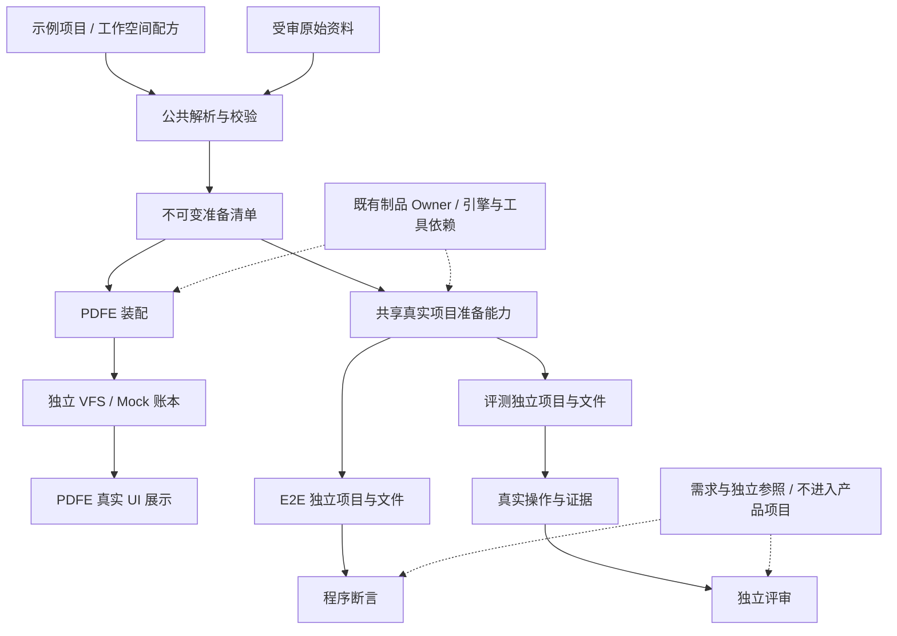
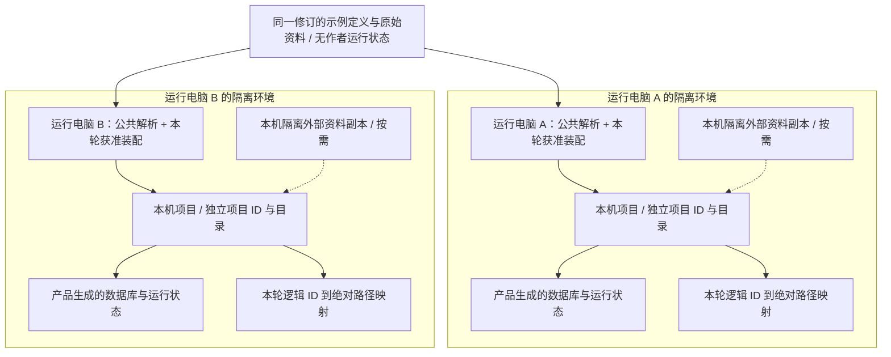

# 评测、自动化测试与 PDFE 的共享示例设计

## Scope / Non-goals

统一三类消费者所需的外部原始资料、合成示例项目与轻量工作空间配方，让使用者主要
选择示例和数据条件，不再各自找文件、校验摘要、拼目录和组合项目。共享的是不可变
内容、公共解析校验与准备清单，不是产品数据库、可写目录、预制成功结果或
一套通用业务模拟器。本文是数据设计及维护契约，不是数据加载器已经实现的声明。

范围以当前 Desktop、其真实 Serve 集成和开发评测 Skill 为首批消费者；将来其他 Owner
有真实复用需求时采用同一数据契约，不强制迁移全部局部单元夹具。
不新增评测平台、调度框架、生产数据模式或 Runtime 依赖，不改变产品路径和权限规则。

## 🎯 核心设计原则

本设计解决的是“一个示例项目如何被不同工具、不同运行电脑可靠使用”，不是将文件搬到
统一目录。目录与字段是下列原则的落地方式，不是设计目标：

1. **以可使用的项目为单位。** 调用者表达业务示例与必要条件，不重复找文件、拼目录、
   校验摘要或创建关联。文件齐全不代表项目可用，还须保持归属、引用和可达性。
2. **共享可重建输入，不共享运行状态。** 不同运行电脑使用同一内容定义，在各自隔离环境
   生成自己的项目身份、数据库和路径；不分发作者已运行的 workspace/Home 副本。
3. **统一准备能力，不统一产品实现。** 解析与校验只维护一份，装配留在所属 Owner；
   PDFE Mock、真实产品和独立判定不互相替代，不为复用重写业务状态机。
4. **默认简单，差异显式。** 一个基础项目直接可用，实际需要空、多项目或特殊资料
   时才增加条件或配方；不为目录对称、潜在消费者或格式齐全提前搭框架。
5. **准备条件，不制造结果。** 前置资料、项目和能力必须区别于本轮要验证的动作；
   数据来源与判据独立，不能用预置产物证明导入、保存、模型执行或恢复成功。
6. **内容稳定，位置可变。** 示例身份和相对关系不依赖用户名、checkout 路径或工作空间
   位置；绝对路径只属于本机装配映射。不同平台的能力限制明确披露，不静默降级。
7. **可追溯而不重复维护。** 来源、修订和运行映射可回查，摘要等机械信息由工具产生；
   复用不要求维护者在三个消费者中重复登记同一文件或逐轮编辑环境路径。

取舍优先级：安全与验收真实性先于复用，业务语义先于文件去重，调用简单先于配置
完备。若公共抽象增加调用者负担却未移除重复准备，应收缩抽象而不是增加配置层。

## Source of truth

| 职责 | 当前 Owner 与依据 |
| --- | --- |
| 项目、用户根与真实持久化 | [持久化边界](persistence.md)、Serve 的路径和业务 API；数据工具不得另算项目数据库路径 |
| PDFE 的场景政策、生成器、实例账本 | [PDFE 概要设计](../../apps/desktop/docs/architecture/PDFE.md)、[运行时](../../apps/desktop/docs/architecture/preview.md) |
| 自动化运行及断言 | [测试设计](../../apps/desktop/docs/architecture/testing-strategy.md)、[验收规范](../../apps/desktop/docs/quality/testing.md) |
| 评测要求、独立参照与采用状态 | [评测设计](../../apps/desktop/docs/architecture/evaluation.md)、[场景库](../../apps/desktop/eval-scenarios/README.md)；不由输入样本决定正确答案 |
| 执行、授权及判定 | [构建 工程规范](../../apps/desktop/docs/architecture/evaluation.md)、[执行 工程规范](../../apps/desktop/docs/architecture/evaluation.md)；本文不复制其流程 |

## Current / Required / Gap / Advisory

**🚧 状态说明**：`current` 表示当前机制，`required` 表示设计约束，`gap` 表示尚未
具备或验证，`advisory` 表示建议。下文架构图描述目标设计，不表示相应代码已经落地。

- **current**：最小项目位于 `apps/desktop/e2e/fixtures/data/minimal-project/`；Office
  专项库存位于 `apps/desktop/e2e/fixtures/office-corpus/`；评测页面另有原始资料。
  PDFE 通过 `documents.ts` 引用部分已有文件并校验摘要，`PreviewFiles` 提供内存副本。
  `homeSeed` 按政策生成项目与任务；E2E runtime 提供独立 Home/workspace/profile。
- **current**：声明式 `buildProject` 可以创建真实项目并写入资料，但尚未接入 spec
  消费者；非空 sessions/settings 会明确拒绝。不能据其接口声明会话、配置已可播种。
- **current**：顶层 `examples/` 已有基础项目和 empty/pair 配方，公共解析校验位于
  `scripts/shared/examples.cjs`。既有 editor 合成 Markdown/TypeScript 原字节已迁入
  该项目，活跃评测引用已更新，判据与历史需求版本不变。
- **current**：PDFE 已区分 example/reviewed/empty 文件种子，空创建不再加载样本；
  `scripts/shared/preparation.cjs` 提供无 UI/断言依赖的文本及声明的 PDF、PNG、XLSX
  原始资料准备，经公开项目与资料 API 写入或复制并摘要读回。评测示例集中存于
  `examples/projects/evaluation/`；数据准备不替代人工导入功能测试。
  新 `buildExample` 与 E2E 消费 spec、评测准备规程已接线。
- **required**：新增共享样本采用本页的身份、来源、隔离与最小装载契约；适配器保持在
  现有 Owner，不让生产代码依赖开发数据。未知、缺失或不支持明确失败，不补成功占位。
- **gap**：接线和确定性通过不等于真实 Serve/Electron E2E、评测宿主与跨运行电脑/
  平台均已验收；具体版本、已测范围和阻塞见实施记录 (non-public execution/provenance record omitted)。
  当前真实准备仅支持无损 UTF-8 文本，二进制、生成参数、远程获取及历史自动恢复
  均不具备；未知能力明确拒绝。专项 reviewed 库存仍按需全量校验，不伪称逐格式懒加载。
- **advisory**：先打通一个基础项目的三类消费，再按实际需求迁移；不追求统一全部夹具。

## Ownership / Dependency

### 🧩 架构图一：一份定义，三种消费，独立判据



图示重点：公共能力止于数据解析与准备边界，两种装配保留各自 Owner；E2E 与评测
使用不同可写副本。原始输入、必要运行依赖和独立判据是三个不同职责，不混为项目文件。
PDFE 的 Mock 展示不进入真实 E2E 或评测通过链路。

共享数据只描述内容、关系及必要生成参数；HTTP/SSE、renderer DTO 和数据库字段映射
由各消费 Owner 持有。不要抽出一套同时重写 Serve、PDFE 与测试业务规则的“万能 seed”。
真实产品 API 创建是准备方式之一，不等同于已测试 UI 创建；被测步骤必须留到执行期。

### 公共准备边界与调用方式

目标是“一份公共解析校验能力、两种装配方式”，不是三个消费者各写一套加载器：

| 层次 | 共同职责与边界 |
| --- | --- |
| 公共解析校验 | 解析项目/配方与默认值、选择可选数据条件、解析文件引用、校验版本/摘要/路径/关系，产出同一结构的不可变准备清单；不得创建产品、修改目录或自动联网 |
| PDFE 装配 | 按清单构造独立 VFS 和所支持的领域账本，继续使用既有场景政策和接口适配 |
| 真实项目准备 | E2E 与评测复用相同的隔离项目创建、文件物化与结果映射能力；使用现有产品契约，不复用测试断言、Playwright Page 或 Judge 逻辑 |
| 调用方 | 选择数据、核本轮授权与被测动作、提供已核隔离目标和依赖，消费准备结果；断言、Driver 操作和评审保持独立 |

公共开发数据准备能力归根开发工具 Owner，实施时先复用 `scripts/shared/` 适用机制；
领域装配仍归原 Owner，生产产品不得导入该能力。第一批 Node 消费共用实际解析实现；
未来 Python 需要时采用同一 schema 与一致性样例，不提前制造第二套规则或跨语言平台。

调用者通常只选一个项目 ID；目录和文件细节由公共能力解决。需要空、多项目或大数据
时才选择配方或显式条件。以下是共同选择与返回契约；已实现最小入口及类型见公共
模块，扩展字段仍需实现，不表示已注册新的 ops CLI：

- 数据选择：`projectId` 或 `workspaceId` 二选一，可附已有的可选条件；未知条件拒绝。
  两者省略时读取 `examples/manifest.json` 的唯一 `defaultProjectId`；该字段是默认身份
  的机器可读真源，README 只解释用途，不解析 Markdown、不取首个文件、不在消费者
  中重复硬编码。缺失、无效或悬空默认引用明确拒绝；显式 ID 仍按同一规则校验。
  默认只选数据，不自动授权创建或写入。
- 执行上下文：本轮模式（准备/只读检查）、已核隔离目标及允许的准备能力；由现有
  runner/Skill 提供，不要求普通用例重复填写，不得从用户目录猜测或静默扩权。
- 返回结果：数据身份、准备状态、按符号 ID 定位的项目/文件、依赖与未支持项；
  装配后附真实 ID/路径和准备收据。调用者按符号引用，不自行拼路径或硬编码随机 ID。

最小普通用例是“使用默认项目”，而不是必须填写 profile、项目数量和种子。运行记录
仍冻结实际解析出的修订与内容摘要；默认项目变化不重写历史运行或静默升级冻结输入。
共用真实准备能力不等于评测可照搬所有 E2E 播种手段：只执行本轮允许的准备动作，
接口或权限不足时明确阻塞，不绕到直接写库、内部派发或预制结果。

### 共同业务不变量

在各消费者均支持的能力范围内，同一项目定义必须保持：

- 原始资料的内容身份和项目内相对位置一致，文件引用能定位实际存在的目标。
- 任务、会话、资料、版本及产物归属明确；所有支持的引用指向本次装配映射，不落到
  其他项目、作者机器路径或旧运行 ID。不能以文件摘要相同替代业务关系正确。
- 同模板的两个实例是两个独立项目；允许内容相同，不允许共享可写状态或串用身份。
- 空、缺失、加载失败和不支持分别表达；缺少某项准备能力时拒绝依赖项，而非伪造
  空列表、删除关系或改用另一份数据。三类运行结果的证据等级仍然不同。

物理路径、运行 ID 和合法运行时间允许不同；比较语义身份及结果，不比较作者环境的
绝对字符串。共享清单描述目标条件，适配器装配并核实这些条件，不只宣告“文件已复制”。

### 📁 目标目录及渐进归属

共享示例采用仓库顶层 `examples/`，不放在 `tests/datasets/`，避免把产品示例局限为
测试专属资产。使用复数名称表示多个示例项目及其共享资料。以下为布局契约，当前
已建立基础项目和最小配方，`assets/` 仅在真实跨项目复用时建立，不预建空目录。

```text
examples/
├─ README.md                   使用入口、资产及消费者索引，链接本文
├─ manifest.json               schemaVersion 与唯一 defaultProjectId，不复制全部项目清单
├─ assets/<asset-id>/           实际跨项目复用的原始文件与 manifest.json
├─ projects/<project-id>/
│  ├─ project.json             文件清单、业务关系、必要的可选条件
│  └─ files/                   此项目专属的受审原始资料，可按需建立
└─ workspaces/<workspace-id>.json  仅实际需要的空、多项目或大数据配方

apps/desktop/preview/           场景政策、生成器、VFS/DTO 适配，引用共享定义
apps/desktop/e2e/fixtures/      真实项目准备与隔离生命周期适配
apps/desktop/eval-scenarios/    需求、判据、独立参照及所选数据引用
```

顶层 `examples/` 持有可复用示例输入及项目定义，不承担测试执行、评测判据或 PDFE
业务适配。各消费 Owner 维护自己的适配与验收，共享定义的变更核对全部实际消费者。
该目录不保存运行工作空间、截图、日志、凭据、真实用户状态或参考答案。

共享数据不得依赖 Desktop 代码，也不得默认被产品启动路径或安装包装载。
Node/Python 消费相同数据文件，不跨语言导入 UI 模块。未来若提供用户可导入的产品
示例，须另行明确分发清单、许可证与产品入口，不能因位于 `examples/` 自动打包。
仅局部使用的几何、损坏格式、协议等夹具仍留所属测试目录；已有受审 Office corpus
等可以暂按明确旧路径引用，不为目录整齐复制一套字节。

第一批只共享实际被多处消费的业务原始资料。格式压力库存与正常业务示例分开；
单个示例不必塞满全部格式，也不要求每个消费者加载全部资产。
单项目专属资料就近放在 `projects/<project-id>/files/`，由 `project.json` 记录相同的
来源和完整性元数据，不为每个小文件再建独立资产目录和 manifest。出现真实跨项目
复用时再提取到 `assets/`；同一字节不重复保存，调用者无需关心具体存放方式。

### 外部依赖分类

| 类型 | 组织及失败语义 |
| --- | --- |
| 小型合成/脱敏原始资料 | 可审查、来源和权利明确后入 Git；同一字节只维护一份，按 ID 引用 |
| 大型或需单独获取的 corpus | manifest 入库，字节放受控本地缓存；精确版本/摘要/大小，显式准备，不在普通测试中偷偷下载 |
| Office/WASM、字体、原生模块、工具链 | 继续由现有制品/工具链 Owner 准备和校验；数据只声明依赖身份，不复制到示例项目 |
| 网络站点、服务、模型、账户 | 运行前核端点能力、费用、权限与可用性；不保存真实密钥，不用项目 fixture 伪造服务已就绪 |
| 故障、超量及恶意格式样本 | 专项 opt-in，注明风险与资源预算；不让日常快评加载，不以此扩张生产能力 |

数据缺失、依赖资源缺失、服务不可达和产品功能失败分别归因。必需输入不可用时阻塞
依赖项，其他独立项按原规则继续；不把“未执行”写成通过，不在冻结后删除范围追绿。

## 数据契约

### 资产 manifest

manifest 使用 JSON，下面为完整目标字段语义；当前最小字段及校验唯一实现于公共
模块，远程 acquisition/requirements 等未支持字段明确拒绝。未来不在 Node/Python
各自维护不同枚举或隐式默认规则。

| 字段 | 约束 |
| --- | --- |
| `schemaVersion`、`id`、`revision` | 格式版本、稳定业务身份、内容修订分开；修改字节/重要元数据必须增修订，不覆盖历史运行引用 |
| `source` | `synthetic` / `reviewed-local` / `remote` 等显式来源类别；记录生成器或原来源、来源版本、权利说明及必要许可证 |
| `files` | 每项有稳定 ID、受控相对路径、媒体类型、实际字节数、SHA256；扩展名不能证明格式正确 |
| `requirements` | 仅声明必要阅读引擎/格式能力等；不写本机绝对路径、模型密钥或个人配置 |
| `acquisition` | 仅远程资产需要：固定版本来源、摘要和大小；不包含带 token 的 URL，不以可变 latest 定位 |

Git 文件和远程缓存都校验完整性；缺摘要、错大小、未知文件、重复 ID 或越界路径必须
明确失败。来源可下载与具备使用/再分发权是两个判断；摘要相同不替代权利审查。
不为当前缺来源的历史文件编造许可证；保持待核验状态，不进入新共享受审清单。
摘要、实际大小等机械字段由工具生成并校验，不要求维护者手工计算或同步多份清单。
ID、来源权利与重要内容修订仍需人工/AI 核实；生成元数据不能自动批准内容或改判据。

### 修订追溯与旧内容重建

修订号和摘要只能标识、校验内容，不能恢复已被替换的字节。设计不建设多版本资产
服务，也不让每个项目维护一套历史目录；旧输入按其实际来源恢复：

- Git 内定义和原始资料绑定仓库来源、精确提交、仓库相对路径、项目/配方修订及
  文件摘要；同次解析使用同一源码快照，不混用不同提交的定义和文件。
- 外部资料绑定不可变来源版本及摘要，可使用已核受控内容缓存恢复；可变 URL、
  相同文件名或本机曾经下载过都不证明旧字节仍可取得。
- 未提交的数据用于开发时，记录其身份与相对提交的变化；需声明可重建时，在获准
  隔离记录中保留选定定义和原始输入及摘要。只有提交号、diff 或摘要而无可取得原件，
  不能声明完整重建；不因此自动提交、发布或打包敏感运行状态。
- 冻结选择包含解析后的默认项目身份及来源，不只记“使用默认项目”。恢复历史运行
  必须使用原绑定，不重新解析当前默认值；内容修订与来源不匹配时明确拒绝。
- 旧提交或原始资料不可取得时报告“不可重建”，可继续审阅已有证据，但不能换用新
  修订、重生成近似输入或冒称完成同条件复测。恢复来源另按授权准备，不自动切换
  当前 checkout、覆盖工作区或访问未授权网络。

维护者更新字节时只修改当前定义并递增必要修订；历史可取得性由上述绑定和实际来源
证明，不要求复制全部旧文件。后续验收必须验证旧输入恢复与明确拒绝两条路径。

### 默认项目与按需条件

项目定义保持小而明确：`schemaVersion`、`id`、`revision`、项目名称/说明、文件引用、
必要业务实体及引用关系。文件引用为二选一：共享资产使用 `assetId`、`assetRevision`、
`fileId`；专属文件使用受控项目相对 `source` 及同样的来源/摘要元数据。两者均声明
稳定文件 ID 和项目内相对 `target`，不得混用；目标根由适配器提供。任务、会话、资料和产物使用符号 ID，在准备收据
映射真实运行 ID；不得把随机项目根、产品数据库主键或完整 API 响应写成共享事实源。

先提供一个连贯研究主题的基础项目，默认文件量足以完成最小读取和日常浏览，三类
消费者直接引用它。不强制每个项目建立 smoke/everyday/boundary 三套 profile。
只有真实消费者需要不同输入集合时，才在项目定义中增加轻量可选条件；profile 仅是
这种可选选择配置，不成为每次调用必填参数，也不复制字节或判据。

| 使用需求 | 默认/按需处理 |
| --- | --- |
| 基本读取与日常使用 | 直接使用基础项目，不选 profile，不加载全部 Office 库存 |
| 更小的 smoke 输入 | 只有基础项目确实过重时才增加文件子集条件，不能改变同一文件内容 |
| 单项目特殊文件/格式 | 明确选择必要条件或专项资产，不默认扩充所有基础项目 |
| 空、多项目、分页与大量数据 | 使用工作空间配方组合项目与生成参数，不嵌套多层 profile |

### 轻量工作空间配方

配方只描述“准备哪些项目及多少数据”，没有步骤、分支、断言或副作用脚本，不是新
业务状态机。普通单项目用法无需创建配方文件；只在需要复用组合时建立：

| 配方类型 | 最小表达与用途 |
| --- | --- |
| 空工作空间 | 显式 `projects: []`，不等于省略选择后使用默认项目；不读取基础项目文件 |
| 日常工作空间 | 引用一个基础项目；与直接选项目使用同一内容，不维护第二份文件清单 |
| 跨项目工作空间 | 引用两个或更多项目，每项有唯一符号 key；同一模板可引用多次，实例账本和文件副本必须独立 |
| 大量数据工作空间 | 引用项目模板及必要数量/长内容/seed 参数，由现有领域生成器承担；不复制大量物理文件，不把单项目全部资料挂到每个任务 |

配方字段限于身份/格式版本/修订、项目引用列表及可选生成参数；项目引用声明唯一
`key`、`projectId`、冻结的 `projectRevision` 及必要条件。项目内文件 key 的定位以
项目 key 为命名空间，重复 key、悬空引用和冲突目标在装配前拒绝。参数覆盖范围显式
列出，未知字段拒绝；不得任意覆盖文件字节、产品配置、账户或宿主权限。
正式分页容量继续由真实常量持有，配方可以声明边界意图，不再维护一份容量数值。

项目数量和任务数量只在生成能力支持的消费模式生效；公共清单明确所需能力，适配器
必须装配或报不支持。当前真实会话准备接口的缺口不能用 PDFE Mock 生成器填补；
同名配方不暗示三种模式已具备相同业务准备能力，也不得静默退回普通项目。

空列表是零实体的显式配置，不是搜索无匹配或未登录。大量项目/任务用现有领域生成器
按 seed、固定时间和政策生成；不复制大目录，不在每个任务中重复塞入全部文档。
生成器版本、seed、时间/时区和参数都进入运行收据；读操作不得刷新创建时间。
真实动作产生的随机 ID/时间属于运行映射，不要求修改产品随机数或系统时间来求确定。

会话历史、任务产物、文献和版本关系只有在真实准备接口存在且不替代被测动作时才
物化；不支持则报告能力缺口。历史会话只能标为合法前置，不能伪称本轮模型完成。
正常业务示例不是格式覆盖矩阵；有关联的资料、任务和结果必须能解释共同的业务背景。

### 数据准备与被测动作分离

每次选择数据时明确 `prepare` 与 `exercise` 边界，继续使用现有测试/评测运行记录，
不为此新增调度 DSL：

| 验证目标 | 允许预置 | 必须由本轮真实执行产生 |
| --- | --- | --- |
| 阅读/搜索 | 原始文件、合法项目登记及搜索前提 | 打开、查询、结果定位与可见反馈 |
| 创建项目/导入 | 空工作空间、项目外源文件 | 真实 UI 创建/导入及完成后的登记与资料 |
| 编辑/保存 | 可编辑原始文件的隔离副本 | 输入、保存、重开读回及实际修改 |
| 模型任务 | 任务输入和所需原始资料 | 真实回合、工具行为和结果；费用与授权另核 |
| 迁移/恢复 | 明确版本的历史输入及必要状态 | 实际迁移/恢复过程；不先替换成新格式 |

PDFE 可以模拟响应与故障，但这类成功只证明 Mock 消费，不作为真实服务或模型验收。
判据、golden、参考答案与 Judge 资料留在评测控制侧，不复制进项目、产品搜索目录或
Driver 输入；动态参照由独立的已核契约取得，不从待判画面反推预期值。

## 准备、隔离与失败边界

准备按“公共解析选择与引用 → 公共校验并返回清单 → 适配器核权限/能力 →
在新隔离根装配 → 返回收据”设计。可用性和权限核验不因数据校验成功而省略。
该顺序是数据契约，执行仍归现有 runner/Skill，不新增常驻服务或未经注册的命令。

- 原始资料和缓存不可变；每轮使用独立 VFS 或物理副本。禁止硬链接可编辑文件回
  样本库，禁止 PDFE、自动化和评测共享同一可写 workspace、Home 或 profile。
- 真工作空间沿产品当前 resolver、公开创建/导入契约物化；不手写数据库和凭据，
  不篡改配置优先级、替换真实用户状态或为测试添加生产特殊分支。
- PDFE 适配必须支持显式空集合及按需 seed；目录树、文件内容、保存与重开消费同一文件事实源。
  全局主题、语言及登录选择仍按 PDFE 自身契约保存，不混进共享原始资料。
- 缓存按内容身份分离；仅经授权显式获取，先临时文件后完整校验，再发布可复用项。
  失败和部分下载不得标 ready；拒绝路径穿越、越界链接和危险归档成员，资源上界由
  获取 Owner 明确。路径/大小写冲突和权限差异必须在目标平台验证。
- 准备收据至少记录项目/配方 ID、实际修订/摘要、选中的可选条件/生成参数、运行根及归属、符号→真实 ID
  映射、实际装配文件、未支持项和准备状态；包身份、基线版本和判定仍由原运行记录持有。
- 失败保留首错及已产生状态；只回收有确切归属且不再使用的临时副本，不清用户目录、
  未知锁和共享缓存。重置恢复本轮指定修订，不隐式升级资料或覆盖旧证据。

## 🔒 可移植性：数据库、路径与外部目录

### 架构图二：同一示例，不同运行电脑独立重建

“运行电脑”指实际执行 PDFE、自动化测试或评测的机器，包括工作电脑、测试机及
CI 执行机；操作者是否相同不是可移植性的判断条件。“工作电脑”只覆盖其中一种环境。



两边共享内容身份与业务关系，不共享可写目录、数据库、凭据或授权记录。外部资料
虚线表示仅在合法前置或真实被测关联流程完成后可用，不表示准备工具自动获得授权。
图中数据库属于真实产品装配；PDFE 对应独立内存账本，不需要复制或生成这些数据库。
可移植性是“换位置后按定义重建”，不是“把 A 的运行状态搬给 B”；未实测仍为 `gap`。

### 工作空间不是可直接分发的产品快照

工作空间是本机容纳项目的目录，单个项目有自己的身份与业务状态；Home/profile 又有
用户级配置和跨项目登记。三者不能混为一个“示例文件夹”。当前真实机制依据如下：

| 层次 | 当前事实与共享边界 |
| --- | --- |
| 项目登记 | 用户级 `content.sqlite3` 中的项目记录包含 `dir_root`；不能把原运行电脑的登记库交给另一运行电脑当基础输入 |
| 项目业务状态 | `.scholarseed/service/project.sqlite3` 是项目级业务库相对位置，按需创建；位置相对不等于所有内部状态天然可跨机器恢复 |
| 外部关联资料 | Content 挂载记录关联外部真实绝对路径及授权；复制登记不转移另一机器的目录和授权 |
| 会话状态 | 用户级会话目录包含 `runtime_workdir`、项目路径等运行绑定；复制历史记录不证明本机可继续原会话 |
| 环境与运行资源 | Python 环境、锁、缓存、凭据与宿主偏好不是示例原始资料，不能以“完整项目”名义一起共享 |

事实来源：[持久化 Owner](persistence.md)、[项目登记](../../apps/serve/service/content/persistence/catalog.py)、
[挂载解析](../../apps/serve/service/content/service/space.py)、[会话目录](../../apps/serve/service/chat/persistence/catalog.py)。
本设计不审定这些产品状态的完整迁移能力，不推定任意数据库快照能跨版本或平台恢复。

日常示例只交付定义和原始资料；准备时由产品契约创建本机登记和必要业务状态，数据库
由各业务 Owner 管理。不预置作者的用户库、项目私有状态目录或 sqlite WAL/SHM 等运行
文件，不做通用 SQL 搜索替换来“修路径”。需要已有业务关系但缺合法准备接口时，明确
报告缺口；不以手写业务库代替。PDFE 仍用独立内存账本，不为外观一致复制真实数据库。

历史数据库仅允许进入明确的迁移/恢复专项夹具：记录原版本、范围、来源和摘要，使用
独立副本，由相关 Owner 验证完整状态及所需文件；迁移效果必须由被测流程产生。
这不是通用示例的默认格式，也不授权读写其他环境或用户的真实库。

### 内容引用相对化，本机映射运行时生成

- 定义使用逻辑 ID 和受控相对路径。仓库样本按实际 checkout 定位，目标项目、缓存、
  外部资料根由本轮已核上下文提供；不依赖作者用户名、固定盘符、固定临时目录或 cwd。
- 实际运行可以且需要使用绝对路径，但这些路径只写入本机产品状态及运行收据。
  收据用于追溯，不作为另一运行电脑的输入配置；换电脑或目录后重新装配，不沿用旧映射。
- Markdown 链接、Bib 附件字段、代码和配置中的文件引用同样属于检查范围，不能只
  校验 JSON 路径。基础示例使用相对或符号引用；若某格式必须保存路径，由所属适配器
  在副本内按已声明规则绑定，不盲目替换二进制或任意文本，并记录实际物化摘要。
- 公网 URL 与本机文件位置区分；需要联网的依赖显式声明，不伪装成本地文件。
  绝对路径作为负向测试文本时必须标明角色，不将其解释为可访问的真实目标。
- 检查嵌套引用、绝对链接、符号链接、大小写冲突和越界目标；不支持的引用明确失败。
  平台路径转换沿既有 Owner，不为兼容数据放宽授权或修改生产解析规则。

### 外部目录使用逻辑绑定

基础项目默认自包含，不依赖作者的下载目录、个人文献库、网络盘或私人缓存。只有
关联导入/挂载等专项才声明外部依赖，例如一个逻辑资料集 ID，而不是本机源路径。

准备侧在已核隔离空间生成该资料集的独立物理副本，返回逻辑依赖到本机绝对位置的
映射。若关联本身是被测动作，只准备源目录，关联与授权留给真实 UI 流程；若关联
是合法前置，也须沿本轮允许的产品接口准备，不能复制作者的挂载表或授权记录。

依赖缺失、不可读、撤销和路径冲突只在显式场景中构造，不隐式回退到作者路径或
扫描个人目录。没有合法准备接口或授权时阻塞相关项，不能靠复制文件伪称挂载成功。
PDFE 可在支持范围内模拟这种关系，但必须保持既有虚拟边界，不读取本机任意目录。

## 决策与迁移

### 方案选择

| 方案 | 取舍 |
| --- | --- |
| 各消费者继续独立造样本 | 局部简单，但来源、格式和业务关系漂移；保留给真正局部的单元夹具，不用于重复业务资料 |
| 一个共享可写项目/数据库快照 | 启动方便，但相互污染、Schema 耦合、预制结果泄漏；不采用。迁移专项历史快照另按其独立契约管理 |
| 不可变原始资料＋默认项目/轻量配方＋公共解析校验＋两种装配 | 选用；共享准备清单与真实项目准备能力，不统一业务实现，保留少量边界转换与运行映射 |

若只有单一消费者，或跨语言适配成本超过真实复用收益，保留局部夹具，不先造框架。
引擎/工具制品继续独立；将其合并到 corpus 会混淆版本、许可和准备权限，不采用。

### 实施里程碑（设计分解）

1. 建立一个默认基础项目及公共解析校验/元数据生成能力，明确数据工具 Owner；按需
   加最小空/双项目配方，复用已有受审字节，不先建三套 profile 或同时大规模搬迁。
2. 修正 PDFE 空 VFS 与显式 seed；接入共享基础项目，验证零样本空态、实例隔离、
   文件修改/重开/重置及所需文件严格缺失失败。
3. 建立不含测试断言和 Page 依赖的真实项目准备能力，为一条真实 E2E 接入相同清单，
   验证不同绝对根下的独立物化、关系与实际读取；保留 UI 创建/导入等被测动作。
   明确 builder 尚未支持的实体，不以字段存在当已完成。
4. 评测通过同一真实项目准备能力接入一个核心流程，在 Skill 既有准备与冻结步骤消费数据身份；
   独立参照隔离，保留真实终态。之后才扩展其他页面与边界。
5. 核旧路径全部消费者后逐项去重，更新引用、类型/构建资源及制品排除规则；保留
   历史冻结引用可追溯，不用永久转发壳或两份可写副本维持兼容。

每一步独立验收，执行进度归实施计划；本节保留里程碑设计，不将接线存在或历史成绩
直接当作全部运行验收完成。

## Enforced by

当前文档由 `pnpm ops ci check docs workspace` 与 Desktop 文档检查验证结构和链接；
它们不验证数据内容、真实调用或产品兼容性。以下分层验收按实际证据逐项完成；公共
解析、准备协议、CI 注册与生产排除已有确定性回归，不代表真实运行和平台层均通过：

- 公共解析/引用/摘要校验：三类消费者对同一输入取得同一准备清单；默认项目无需
  profile，专属与共享文件均可解析，摘要/大小工具生成结果可复核。重复 ID、错修订、
  缺文件、错误摘要、越界路径、未知条件均明确拒绝；空配方不读取无关文件，离线不自动联网。
- 工作空间配方：零项目、默认单项目、两个独立项目和生成边界分别验证；符号 key
  定位明确，同模板多实例可独立修改；未支持生成能力明确拒绝，不静默改规模。
- 隔离与生命周期：并行实例互不污染、原样本摘要不变、失败不复用半成品、重置可重复、
  退出取消在途准备，平台路径语义分别验证。
- 三类消费：PDFE 真实 Electron 的目标结果；真实 Serve/Electron E2E 的文件和业务
  终态；评测真实宿主调用及独立 Judge。确定性校验、Mock 和真实产品结论分别报告。
- 生产隔离：沿当前 PDFE 输出检查及打包 Owner 扩展静态依赖/资源闭包检查，共享
  数据、答案和开发适配器不得进入正常发行。移动目录不能绕过原只针对 preview 的检查。

### ✅ 简化使用与可移植性验收要求

| 设计目标 | 必须观察到的结果 |
| --- | --- |
| 普通使用无需理解存储细节 | 用例只选示例并使用符号定位；无需自行解析文件、拼根目录、计算摘要或挑 profile |
| 默认选择只有一个真源 | 不传 ID 时采用 manifest 的 defaultProjectId，显式 ID 可覆盖选择；缺失、无效和悬空默认引用明确拒绝，不解析 README 或按目录顺序猜测 |
| 历史输入可核重建 | 当前文件更新后，从绑定提交及受控外部来源恢复旧修订并通过摘要校验；旧字节不可取得或修订不匹配时明确拒绝，不使用当前默认值或新资料替代 |
| 一处维护内容 | 给基础项目新增文件后三类消费者无需分别维护文件清单；格式确有新增适配需求时仍由对应 Owner 实现并说明 |
| 准备逻辑真正复用 | 评测与 E2E 使用同一真实准备能力；PDFE 与真实准备从同一公共清单装配，不各写重复解析规则 |
| 同一项目业务语义一致 | 对支持的能力核资料身份、任务归属、引用可达和空态；不只核文件存在或摘要 |
| 不同目录可重建 | 同修订示例在两个不同 checkout/隔离工作根准备成功，无需编辑定义或文件内部路径；定位和打开均指向本轮根，不访问旧根 |
| 中文、空格及平台路径 | 在包含中文和空格的目标根验证准备、打开与适用的保存/重开；macOS/Windows 路径、大小写及权限语义分别给证据，未验证不推定兼容 |
| 无作者环境依赖 | 在不含作者 Home、登记库、外部目录、预置缓存及凭据的干净上下文中，默认示例可准备并打开；必要引擎依赖显式准备，缺失不冒充数据成功 |
| 同模板多项目隔离 | 两个实例分别创建身份与映射，修改其中一份不改变另一份和原始资料，引用不跨项目串用 |
| 外部目录可重绑定 | 同一逻辑资料集在不同本机根下，经合法流程关联后可读；缺失/无授权明确失败，原始作者路径和授权不被使用 |
| 不共享数据库运行态 | 新环境的登记与必要数据库由正常产品流程形成，示例不携带作者库；迁移专项另核其历史快照，不将它当普通准备成功 |

两个本机目录的成功只证明位置无关，不等于跨运行电脑或跨平台实测。跨运行电脑
验收需在另一台独立机器按同一冻结输入准备，记录其依赖和实际结果；操作者可以相同。
同电脑的另一个 checkout 或隔离 profile 不能替代跨电脑证据；无法提供时单列未验证。
文档检查只证明本设计文字和链接有效，不证明表中任何运行结果已经达成。

## AI 维护入口与 Update triggers

Codex 等工具处理样本、示例项目或准备逻辑时，先从知识索引定位本文，按任务追加
消费者 Owner 与实际加载源码；不要扫描真实用户项目来“补齐”示例。

- 新增资料：先判断已有文件能否复用；专属文件就近保存，真实共享再提取资产。
  核来源/许可/隐私、身份和实际格式，机械元数据由工具生成，只加必要引用；禁止
  顺手下载或引入用户配置，不要求新文件配齐三套 profile。
- 修改资料：核 PDFE、E2E 和场景引用；增内容修订、同步必要独立参照及回归，不根据
  新输出反改判据追绿。缺消费者时不声称已接入。
- 新增场景：优先组合既有输入与生成参数；仅真实新增业务内容才加资产。功能分类
  属于导航，不成为复制数据的理由。普通场景直接用默认项目，空、多项目和大数据
  才选配方；不在 Skill 或每条用例中重新实现解析、校验与真实项目准备。
- 共享示例前：检查定义和文件内容中的本机路径、外部目录绑定与私有运行状态；
  以另一隔离根重建验证，再按范围补另一运行电脑实测，不把作者机器可用当作可移植。数据库、运行收据、
  缓存和环境目录不能因“项目完整性”混入日常示例。
- 迁移路径/加载方式：检查实际静态与动态消费者、资源拷贝及生产排除边界，先接线
  后去重；旧运行保持精确来源，不把本机缓存当远端可复现交付。
- 本页持有共同原则与数据契约；加载器接口、测试策略、评测判据及 PDFE 交互分别
  回写原 Owner，不在 Skill 或其他架构页复制一份数据规范。

## Stop condition

来源/使用权不明、敏感输入、目标根归属不明、产品准备接口不支持、模型或网络授权
不足时停止依赖操作，明确缺口并继续独立项。不能通过关闭校验、伪造输出、直接写
内部业务库或降低评测要求完成数据准备；文档通过不代表三类消费者已经迁移完成。
